# Base de datos por vista — schema actualizado para cumplir la aplicación

**Versión vigente — 29/10/2026.** Se incorporan los ajustes FC01–FC13 de la auditoría y las respuestas del usuario: compra sobre kilos reconocidos en planta, varios requerimientos por cliente/campaña y varias facturas por carga. No se modifica el prototipo, la web, el backend ni una base desplegada. [SQL completo de instalación nueva](03_schema_total.sql).

**Modelo:** 60 tablas (19 actuales ampliadas y 41 propuestas), 124 FK y seis vistas. Se conservan por nombre 173 columnas legacy incluidas; **35 definiciones de columnas actuales cambian** y se agregan 74 columnas a tablas actuales. No se afirma compatibilidad de tipos sin migración. Los detalles de formularios se conservan mediante JSONB en las tablas existentes, sin tablas nuevas por pantalla.

**D08 — Destino como texto (29/10/2026):** se retira el catálogo propuesto de destinos porque el prototipo no tiene CRUD propio. La entrega guarda `destino text NOT NULL`; la guía conserva su dirección/ubigeo/establecimiento de llegada como snapshots.

**Simplificación confirmada — 29/10/2026:** una sola participación en `campania_x_proveedores`; se retiran la cabecera duplicada, los dos puentes de variedades calculadas y `acuerdo_compra`. Se conserva `norma` con datos iniciales y `guia_x_norma` para selecciones reales. [Datos iniciales reejecutables](04_datos_iniciales.sql): dos perfiles, cinco normas, cinco frutas, 17 variedades y parámetros de 2025/2026 tomados del prototipo. El SQL total ya incluye esa carga. No se crean usuarios ni movimientos ficticios.

**D17 — Sesiones fuera del alcance:** se retira `sesion_usuario` (tokens, expiración y revocación). `usuario` y `rol` permanecen; la autenticación no deberá depender de una tabla de sesiones propia.

**Convenciones:** ACTUAL conserva el campo del backend; MODIFICAR cambia su definición en el objetivo; AGREGAR amplía una tabla actual; TABLA NUEVA pertenece a una entidad propuesta. PK/FK y relaciones corresponden al SQL objetivo. El diccionario de cada tabla aparece en su primera ficha y las siguientes lo reutilizan.

**Alcance:** no es una migración sobre datos existentes. Archivo sigue excluida y sus referencias son opcionales/sin FK. Los triggers nuevos validan recepción reconocida, persona de liquidación, facturación acumulada, sobrepagos y aplicaciones de adelantos; no sustituyen autenticación, permisos, validación completa del JSON, emisión documental ni el servicio de cierre de campaña.

**Verificación nueva:** 59 comprobaciones ejecutadas en PGlite con btree_gist sobre este SQL; resultado y hash en `.validation/resultado_revision.json`. No son una prueba de navegador o de producción. Las auditorías anteriores se conservan al final como historial y describen el SQL anterior.

**Lectura por vistas:** se conserva el recorrido previo de 62 fichas; sus tablas, diccionarios y diagramas se regeneran desde el modelo actualizado. Las notas de observación del recorrido anterior no equivalen a una nueva prueba de la UI.

## Columnas adicionales en tablas actuales

| Tabla actual | Atributos para agregar | Para qué se añaden |
|---|---|---|
| `campana` | `temporada`, `responsable_usuario_id`, `lineamientos_archivo_id`, `observaciones`, `cerrada_at`, `cerrada_por_usuario_id`, `motivo_cierre`, `calidad` | Consultar la finalidad de cada columna en su diccionario por vista. |
| `campania_x_proveedores` | `precio_compra_kg`, `moneda`, `disponibilidad_desde`, `disponibilidad_hasta`, `observaciones`, `entrevista_aplica` | Consultar la finalidad de cada columna en su diccionario por vista. |
| `certificado_campana` | `codigo`, `norma_id`, `organismo`, `fecha_emision`, `moneda`, `documento_archivo_id`, `vigencia_desde`, `observaciones`, `historial_cobertura`, `tipo_certificacion` | Consultar la finalidad de cada columna en su diccionario por vista. |
| `certificado_proveedor` | Ninguno en esta revisión | Se conserva el catálogo o asociación actual. |
| `chofer_transporte_externo` | `persona_id`, `activo`, `usuario_id`, `numero_licencia` | Consultar la finalidad de cada columna en su diccionario por vista. |
| `chofer_vehiculo_externo` | `coordinacion_entrega_id` | Consultar la finalidad de cada columna en su diccionario por vista. |
| `cliente_negocio` | `fecha_registro` | Consultar la finalidad de cada columna en su diccionario por vista. |
| `cliente_negocio_campana` | `ficha_tecnica_archivo_id`, `destino_solicitado`, `entrega_desde`, `entrega_hasta`, `observaciones` | Consultar la finalidad de cada columna en su diccionario por vista. |
| `detalle_trazabilidad` | `carga_id`, `guia_remision_id`, `sctr_archivo_id` | Consultar la finalidad de cada columna en su diccionario por vista. |
| `empresa_transporte_externo` | `tipo_transportista`, `tipo_documento`, `numero_documento`, `persona_id`, `registro_mtc`, `departamento`, `provincia`, `ciudad`, `activo` | Consultar la finalidad de cada columna en su diccionario por vista. |
| `entrevista_extencion` | `fruta_derivada_id`, `distanciamiento_descripcion`, `frecuencia_riego_descripcion`, `aplicaciones_al_ano`, `observaciones`, `archivo_id`, `registrado_por_usuario_id` | Consultar la finalidad de cada columna en su diccionario por vista. |
| `examen_proveedor` | `cxp_id`, `finca_id`, `codigo_muestra`, `fecha_envio`, `estado_examen`, `documento_archivo_id` | Consultar la finalidad de cada columna en su diccionario por vista. |
| `finca` | `codigo_lugar_produccion`, `codigo_catastral`, `ubigeo`, `direccion`, `codigo_establecimiento`, `fruta_derivada_id`, `edad_cultivo_anios` | Consultar la finalidad de cada columna en su diccionario por vista. |
| `fruta` | Ninguno en esta revisión | Se conserva el catálogo o asociación actual. |
| `fruta_derivada` | Ninguno en esta revisión | Se conserva el catálogo o asociación actual. |
| `proveedor` | `persona_id`, `activo`, `documento_archivo_id`, `fecha_registro` | Consultar la finalidad de cada columna en su diccionario por vista. |
| `proveedor_x_fruta` | Ninguno en esta revisión | Se conserva el catálogo o asociación actual. |
| `trazabilidad_transporte` | `coordinacion_entrega_id`, `carga_id` | Consultar la finalidad de cada columna en su diccionario por vista. |
| `vehiculo_externo` | `capacidad_kg` | Consultar la finalidad de cada columna en su diccionario por vista. |

**Mermaid:** `||` = exactamente uno; `o|` = cero o uno; `o{` = cero o muchos. Cada caja es una tabla del esquema general. Las líneas son FK del SQL revisado: actual indica relación ya programada y propuesta indica una relación del diseño revisado, sin afirmar aprobación definitiva ni despliegue. Las FK compuestas del mismo par se agrupan. Una tabla aislada se consulta o participa en una decisión de diseño, sin FK directa en ese recorte. No se dibujan relaciones de navegación como si fueran FK.

**Mapa de integración:** las tablas actuales se conservan junto al flujo adicional propuesto, incluyendo empresas transportistas, choferes, unidades y sus asignaciones.

```mermaid
erDiagram
    fruta ||..o{ campana : actual
    campana ||..o{ campania_x_proveedores : actual
    proveedor ||..o{ campania_x_proveedores : actual
    campana ||..o{ certificado_campana : actual
    proveedor ||..o{ certificado_proveedor : actual
    empresa_transporte_externo ||..o{ chofer_transporte_externo : actual
    vehiculo_externo ||..o{ chofer_vehiculo_externo : actual
    chofer_transporte_externo ||..o{ chofer_vehiculo_externo : actual
    trazabilidad_transporte ||..o{ chofer_vehiculo_externo : actual
    cliente_negocio ||..o{ cliente_negocio_campana : actual
    campana ||..o{ cliente_negocio_campana : actual
    trazabilidad_transporte ||..o{ detalle_trazabilidad : actual
    campania_x_proveedores ||..o{ entrevista_extencion : actual
    finca ||..o{ entrevista_extencion : actual
    proveedor ||..o{ examen_proveedor : actual
    proveedor ||..o{ finca : actual
    fruta ||..o{ fruta_derivada : actual
    proveedor ||..o{ proveedor_x_fruta : actual
    fruta ||..o{ proveedor_x_fruta : actual
    campania_x_proveedores ||..o{ trazabilidad_transporte : actual
    empresa_transporte_externo ||..o{ vehiculo_externo : actual
    liquidacion_proveedor ||..o{ pago_proveedor : propuesta
    liquidacion_transporte ||..o{ pago_transporte : propuesta
    factura_venta ||..o{ cobro_venta : propuesta
    persona ||..o| usuario : propuesta
    rol ||..o{ usuario : propuesta
    proveedor ||..o{ proveedor_x_persona : propuesta
    persona ||..o{ proveedor_x_persona : propuesta
    proveedor ||..o{ proveedor_x_fruta_derivada : propuesta
    fruta_derivada ||..o{ proveedor_x_fruta_derivada : propuesta
    certificado_campana ||..o{ certificado_campana_x_proveedor : propuesta
    campana ||..o{ certificado_campana_x_proveedor : propuesta
    campania_x_proveedores ||..o{ certificado_campana_x_proveedor : propuesta
    proveedor ||..o{ certificado_campana_x_proveedor : propuesta
    certificado_campana ||..o{ ampliacion_certificado_campana : propuesta
    usuario o|..o{ ampliacion_certificado_campana : propuesta
    certificado_campana ||..o{ pago_certificado_campana : propuesta
    usuario o|..o{ pago_certificado_campana : propuesta
    cliente_negocio_campana ||..o{ cliente_negocio_campana_x_fruta_derivada : propuesta
    fruta_derivada ||..o{ cliente_negocio_campana_x_fruta_derivada : propuesta
    cliente_negocio_campana ||..o{ contrato_venta : propuesta
    contrato_venta ||..o{ entrega_programada : propuesta
    entrega_programada ||..o{ entrega_x_fruta_derivada : propuesta
    fruta_derivada ||..o{ entrega_x_fruta_derivada : propuesta
    campana ||..o{ solicitud_transporte : propuesta
    solicitud_transporte ||..o{ invitacion_transporte : propuesta
    empresa_transporte_externo ||..o{ invitacion_transporte : propuesta
    invitacion_transporte ||..o{ cotizacion_transporte : propuesta
    campana ||..o{ acuerdo_transporte : propuesta
    empresa_transporte_externo ||..o{ acuerdo_transporte : propuesta
    cotizacion_transporte o|..o{ acuerdo_transporte : propuesta
    entrega_programada ||..o| coordinacion_entrega : propuesta
    acuerdo_transporte ||..o{ coordinacion_entrega : propuesta
    empresa_transporte_externo ||..o{ coordinacion_entrega : propuesta
    chofer_transporte_externo ||..o{ coordinacion_entrega : propuesta
    coordinacion_entrega ||..o{ origen_entrega : propuesta
    campania_x_proveedores ||..o{ origen_entrega : propuesta
    entrega_programada ||..o| cosecha : propuesta
    cosecha o|..o{ analisis_calidad : propuesta
    campania_x_proveedores ||..o{ analisis_calidad : propuesta
    campania_x_proveedores ||..o{ medicion_mtd : propuesta
    usuario o|..o{ medicion_mtd : propuesta
    coordinacion_entrega ||..o| carga : propuesta
    carga ||..o{ proveedor_carga : propuesta
    campania_x_proveedores ||..o{ proveedor_carga : propuesta
    fruta_derivada ||..o{ proveedor_carga : propuesta
    proveedor_carga ||..o{ origen_carga : propuesta
    campania_x_proveedores ||..o{ origen_carga : propuesta
    carga ||..o{ gasto_carga : propuesta
    carga ||..o{ guia_remision : propuesta
    finca ||..o{ guia_remision : propuesta
    guia_remision ||..o{ proveedor_guia : propuesta
    carga ||..o{ proveedor_guia : propuesta
    proveedor_carga ||..o{ proveedor_guia : propuesta
    guia_remision ||..o{ guia_x_norma : propuesta
    norma ||..o{ guia_x_norma : propuesta
    coordinacion_entrega ||..o{ historial_chofer : propuesta
    carga o|..o{ historial_chofer : propuesta
    chofer_transporte_externo ||..o{ historial_chofer : propuesta
    carga ||..o| recepcion_planta : propuesta
    chofer_transporte_externo ||..o{ recepcion_planta : propuesta
    carga ||..o{ liquidacion_proveedor : propuesta
    proveedor ||..o{ liquidacion_proveedor : propuesta
    usuario ||..o{ liquidacion_proveedor : propuesta
    carga ||..o| liquidacion_transporte : propuesta
    usuario ||..o{ liquidacion_transporte : propuesta
    carga ||..o{ gasto_transporte : propuesta
    acuerdo_transporte ||..o{ adelanto_transporte : propuesta
    adelanto_transporte ||..o{ aplicacion_adelanto : propuesta
    carga ||..o{ factura_venta : propuesta
    usuario o|..o{ pago_proveedor : propuesta
    usuario o|..o{ pago_transporte : propuesta
    usuario o|..o{ cobro_venta : propuesta
    vehiculo_externo ||..o{ coordinacion_entrega : propuesta
    liquidacion_transporte ||..o{ aplicacion_adelanto : propuesta
    usuario o|..o{ campana : propuesta
    norma o|..o{ certificado_campana : propuesta
    persona o|..o{ chofer_transporte_externo : propuesta
    persona o|..o{ proveedor : propuesta
    usuario o|..o{ chofer_transporte_externo : propuesta
    coordinacion_entrega o|..o{ chofer_vehiculo_externo : propuesta
    carga o|..o{ detalle_trazabilidad : propuesta
    guia_remision o|..o{ detalle_trazabilidad : propuesta
    persona o|..o{ empresa_transporte_externo : propuesta
    fruta_derivada o|..o{ entrevista_extencion : propuesta
    usuario o|..o{ entrevista_extencion : propuesta
    campania_x_proveedores o|..o{ examen_proveedor : propuesta
    finca o|..o{ examen_proveedor : propuesta
    fruta_derivada o|..o{ finca : propuesta
    coordinacion_entrega o|..o{ trazabilidad_transporte : propuesta
    carga o|..o{ trazabilidad_transporte : propuesta
    finca ||..o{ origen_entrega : propuesta
    finca ||..o{ origen_carga : propuesta
    finca ||..o{ analisis_calidad : propuesta
    finca ||..o{ medicion_mtd : propuesta
    persona ||..o{ liquidacion_proveedor : propuesta
    parametro_uit
```

**Gestión de empresas logísticas, choferes y unidades:** `empresa_transporte_externo` registra al proveedor logístico externo contratado por la agroexportadora; `chofer_transporte_externo` y `vehiculo_externo` registran sus choferes y unidades. `chofer_vehiculo_externo` asigna un chofer y una unidad a `trazabilidad_transporte`, con fechas de inicio y fin. Estas cuatro tablas ya existen y se conservan en el SQL. `acuerdo_transporte` es la tabla propuesta para vincular la empresa transportista con la campaña y sus condiciones comerciales. La empresa agroexportadora que opera el sistema no se representa con `empresa_transporte_externo`; este modelo todavía no define una entidad propia para gestionar varias agroexportadoras.

**Entidades amarillas de las referencias incorporadas al mapa:** `fruta`, `fruta_derivada`, `proveedor_x_fruta`, `certificado_proveedor`, `examen_proveedor` y `certificado_campana`. Los rótulos históricos `Certificados` y `certificados_campana` se representan con `certificado_campana` para el certificado de campaña; `certificado_x_productor` se corresponde con la cobertura propuesta `certificado_campana_x_proveedor`, vinculada a proveedor y campaña. Esta equivalencia expresa su función; no afirma que todos los atributos del dibujo sean idénticos. `certificado_proveedor` permanece separado para documentos propios del proveedor. No se añade otra tabla genérica Certificados sin definir un ciclo de vida distinto. `proveedor_x_fruta` se conserva: la nota de la imagen que plantea trasladarlo a finca dice CONFIRMAR y no constituye una decisión aprobada. Las hectáreas están en `finca` (`ha_total_finca`, `ha_cultivo`) en el diccionario específico.

**Trazabilidad de finca tras el cambio:** origen_entrega, origen_carga, analisis_calidad y medicion_mtd ahora identifican finca directamente; antes la obtenían de la participación. El servicio deberá comprobar que esa finca pertenece al proveedor de cxp_id. Los orígenes admiten varias fincas de un proveedor en la misma entrega o carga. El precio simple queda en campania_x_proveedores; no existe una cabecera adicional de acuerdo_compra.

**Decisión de negocio — 27/10/2026:** se elimina el vínculo directo finca–campania_x_proveedores del modelo objetivo. Se mantiene proveedor–finca y la entrevista relaciona campaña/proveedor con la finca visitada. El código actual todavía contiene el vínculo retirado; estos documentos y el SQL son la propuesta para revisión.

**Relaciones documentales pendientes:** archivo queda excluida del SQL y de todos los diagramas. Las referencias de documentos, comprobantes, guías y evidencias se definirán en otra etapa. Las columnas reservadas quedan opcionales, sin FK ni obligación de asignarles un identificador. Las URL actuales se conservan.

**Inventario de relaciones pendientes a archivo (sin implementar):**

| Tabla | Referencia reservada opcional, sin FK |
|---|---|
| `certificado_proveedor` | `documento_archivo_id` |
| `persona` | `documento_archivo_id` |
| `pago_certificado_campana` | `comprobante_id` |
| `contrato_venta` | `archivo_id` |
| `solicitud_transporte` | `archivo_id` |
| `cotizacion_transporte` | `archivo_id` |
| `acuerdo_transporte` | `archivo_id` |
| `cosecha` | `evidencia_id` |
| `analisis_calidad` | `archivo_id` |
| `medicion_mtd` | `archivo_id` |
| `carga` | `guia_salida_id` |
| `guia_remision` | `archivo_id` |
| `recepcion_planta` | `evidencia_descarte_id` |
| `recepcion_planta` | `reporte_recepcion_id` |
| `liquidacion_proveedor` | `archivo_id` |
| `liquidacion_transporte` | `archivo_id` |
| `adelanto_transporte` | `comprobante_id` |
| `factura_venta` | `archivo_id` |
| `pago_proveedor` | `comprobante_id` |
| `pago_transporte` | `comprobante_id` |
| `cobro_venta` | `comprobante_id` |
| `campana` | `lineamientos_archivo_id` |
| `certificado_campana` | `documento_archivo_id` |
| `proveedor` | `documento_archivo_id` |
| `cliente_negocio_campana` | `ficha_tecnica_archivo_id` |
| `detalle_trazabilidad` | `sctr_archivo_id` |
| `entrevista_extencion` | `archivo_id` |
| `examen_proveedor` | `documento_archivo_id` |

**Decisiones para afinar el modelo durante el desarrollo:**

| Referencia | Estado | Tema | Alcance |
|---|---|---|---|
| D01 | Confirmado e incorporado al SQL | Participación única | Decisión del 29/10/2026: se retira la cabecera participacion_proveedor_campana. campania_x_proveedores conserva cxp_id, proveedor/campaña, cantidad, tipo, evaluación, precio y disponibilidad. Cobertura de certificados y proveedor_carga referencian cxp_id; no se mantiene una segunda participación. |
| D02 | Aprobado por el usuario | Fincas entrevistadas | El listado de fincas de una participación se obtiene desde entrevista_extencion. No se vuelve a agregar finca_id a campania_x_proveedores; los orígenes de entrega/carga seleccionan las fincas físicas de recojo. |
| D03 | Aprobado por el usuario | Análisis antes de cosecha | analisis_calidad identifica cxp_id y finca_id; cosecha_id queda opcional. La campaña se obtiene por la participación, sin otra FK redundante a campaña. El servicio validará coincidencia de campaña y origen si se vincula posteriormente una cosecha. |
| D04 | Aprobado por el usuario | Una variedad por finca | Se conserva finca.fruta_derivada_id y se obtiene fruta por fruta_derivada.fruta_id. No se agrega una tabla de varios cultivos por finca. El vínculo permanece opcional para datos históricos; completar variedad antes de operar cuando la vista la requiere. |
| D05 | Confirmado por el usuario | Autoridad de transporte | coordinacion_entrega es la fuente del viaje. Se conservan las tablas actuales por compatibilidad; ambas asignaciones usan instantes y exclusión [inicio,fin), permitiendo viajes sucesivos en el día. |
| D06 | Incorporado al SQL | Vincular antes del acuerdo | acuerdo_transporte admite BORRADOR sin condiciones completas; CONFIRMADO exige monto, tipo y fechas. No hace falta inventar un segundo vínculo. |
| D07 | Incorporado al SQL | Incorporación de campaña a Calidad | campana.calidad conserva un objeto por canal con su habilitación/estado, antes de crear cargas o elegir entregas. |
| D08 | Confirmado e incorporado al SQL | Destino como texto | Decisión del 29/10/2026: no existe CRUD independiente de destinos en el prototipo. Se retira el catálogo propuesto; entrega_programada.destino guarda texto obligatorio. La guía conserva direccion_llegada_snapshot, ubigeo_llegada_snapshot y establecimiento_llegada_snapshot propios, sin FK de destino. |
| D09 | Por discutir | Cantidad de certificados | El editor dice uno por campaña; el backend y el resumen admiten varios. Se mantiene la capacidad actual hasta decidir si las normas requieren certificados distintos. |
| D10 | Incorporado al SQL | Condiciones de compra | El precio simple vive en campania_x_proveedores.precio_compra_kg y moneda PEN. Se retira acuerdo_compra: no existe un flujo independiente de acuerdos/versiones en el prototipo. La liquidación conserva kilos reconocidos y precio aplicados. |
| D11 | Incorporado al SQL | Persona de la liquidación | La liquidación referencia persona directamente y admite proveedor principal o persona vinculada activa. Conserva snapshot de identidad; no exige un vínculo ficticio del proveedor consigo mismo. La autenticación operativa está implementada en el backend con JWT; no requiere una tabla de sesión. |
| D12 | Incorporado al SQL | Examen por etapas | Pendiente y Enviado admiten resultado/documento ausentes. Con resultado requiere resultado explícito. Se mantienen tipos positivo/negativo del backend para el dato final. |
| D13 | Decisión previa conservada | Gestión documental diferida | archivo no está en el SQL ni en diagramas. Los campos de documentos, comprobantes y evidencias son opcionales y sin FK. El mockup puede exigir archivos, pero esa exigencia no está implementada en el esquema de esta etapa. |
| D14 | Confirmado por el usuario | Una carga por entrega | Se conserva un viaje/carga por entrega. Cosecha también es única por entrega. El SQL permite varias facturas de esa carga, con suma de kilos no superior a la recepción, según respuesta explícita del usuario. |
| D15 | Incorporado según respuesta del usuario | Varios requerimientos cliente/campaña | Se retira la unicidad cliente/campaña para permitir requerimientos independientes. Cada fila conserva sus contratos y entregas. El editor del prototipo aún debe alinearse con esta decisión. |
| D17 | Confirmado e incorporado al SQL | Sin sesiones persistidas | Se retira sesion_usuario y su FK a usuario por decisión expresa. Su función era guardar tokens, expiración y revocación, no solo historial. No se administran sesiones/dispositivos en este alcance; usuario y rol permanecen. La autenticación del backend debe resolverse sin depender de esta tabla. |
| D16 | Confirmado e incorporado al SQL | Catálogos iniciales y constantes | rol, norma, fruta, fruta_derivada y parametro_uit tienen datos iniciales SQL sin exigir CRUD. guia_x_norma guarda solo normas seleccionadas al guardar una guía, con FK y unicidad. Tipos de certificado, moneda, estados, etapas, métodos y conceptos se mantienen como opciones fijas, sin tablas adicionales. Los puentes de variedades derivadas de campaña/participación se retiran; las selecciones reales de proveedor, cliente y kilos de entrega permanecen. |

**Recorrido entre módulos:** Comercial programa la entrega; Campaña coordina transporte y fincas; Calidad registra análisis y carga; el Chofer reporta eventos y recepción; Logística consulta el seguimiento; Facturación registra venta y cobros; Liquidación registra compras, transporte y pagos. Volver a módulos cambia de navegación, sin crear otro registro de negocio.

**Mapa del flujo funcional:** estas flechas indican navegación o información compartida; no son claves foráneas.

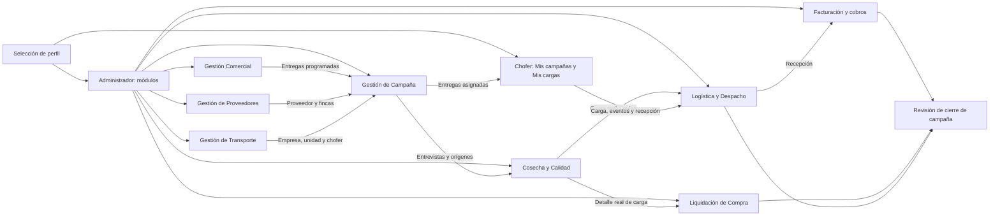

## Bienvenido (Acceso > Selección de perfil)

**Referencia de revisión:** V01 · Recorrido del 27/10/2026.

**Entrada, acciones y salida:** Seleccionar Administrador → Entrar como administrador → Módulos; seleccionar Chofer → elegir usuario → Mis campañas.

**Observado en la aplicación de referencia:** Selector de perfil y conductores de demo; se accedió como administrador, Miguel Torres y Elena Ruiz. Los registros se anuncian compartidos entre dispositivos.

**Criterio para revisar el modelo:** Una persona puede actuar como proveedor y como conductor sin duplicar su identidad. Un usuario tiene un rol en este alcance. La sesión persistente es una propuesta técnica: el retorno al login al recargar no se corrige únicamente creando tablas. El backend debe emitir/verificar una cookie o token con vencimiento, y el frontend restaurar sesión antes de cargar el perfil. Nunca guardar el token en claro ni usar los nombres del demo como autenticación real.

**Funcionalidad esperada de cada tabla en esta vista:**

| Tabla | Uso en esta vista | Funcionalidad esperada | Situación |
|---|---|---|---|
| [`usuario`](#tabla-usuario) | Consulta | Identificar al usuario en la futura autenticación; el selector actual permite entrar sin credenciales y no prueba que se persista una cuenta. | Tabla propuesta, sin implementar |
| [`rol`](#tabla-rol) | Consulta | Perfiles extensibles con Administrador y Chofer iniciales mediante SQL; no requiere CRUD de perfiles en el alcance actual. | Tabla propuesta, sin implementar |
| [`persona`](#tabla-persona) | Consulta | Identifica a una persona natural para cuentas o destinatarios de compras; su reutilización no crea otro proveedor ni autoriza por sí sola a cobrar. | Tabla propuesta, sin implementar |

**Esquema de relaciones utilizado por esta vista:**

**Tablas propuestas para revisar:** `usuario`, `rol`, `persona`.

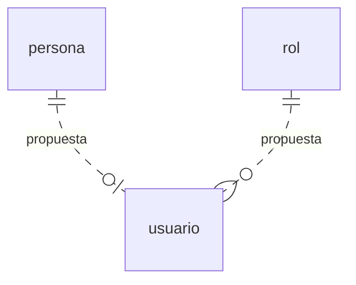

**D11 — Persona de la liquidación (Incorporado al SQL):** La liquidación referencia persona directamente y admite proveedor principal o persona vinculada activa. Conserva snapshot de identidad; no exige un vínculo ficticio del proveedor consigo mismo. La autenticación operativa está implementada en el backend con JWT; no requiere una tabla de sesión.

<a id="tabla-usuario"></a>

**Diccionario de `usuario` — tabla propuesta.**

**Clave primaria:** `usuario_id`. Cuenta asociada a una persona; no se crea una cuenta por cada participación comercial.

| Atributo | Estado | Tipo y obligatoriedad en el modelo revisado | Finalidad / relación |
|---|---|---|---|
| `usuario_id` | **TABLA NUEVA** | `integer GENERATED ALWAYS AS IDENTITY PRIMARY KEY` | Atributo propuesto para cubrir el flujo de la vista. |
| `persona_id` | **TABLA NUEVA** | `integer NOT NULL` | Atributo propuesto para cubrir el flujo de la vista. FK a `persona.persona_id`. |
| `rol_id` | **TABLA NUEVA** | `integer NOT NULL` | Atributo propuesto para cubrir el flujo de la vista. FK a `rol.rol_id`. |
| `usuario` | **TABLA NUEVA** | `varchar(80) NOT NULL` | Atributo propuesto para cubrir el flujo de la vista. |
| `password_hash` | **TABLA NUEVA** | `text NOT NULL` | Atributo propuesto para cubrir el flujo de la vista. |
| `activo` | **TABLA NUEVA** | `boolean NOT NULL DEFAULT true` | Atributo propuesto para cubrir el flujo de la vista. |
| `created_at` | **TABLA NUEVA** | `timestamptz NOT NULL DEFAULT now()` | Auditoría con la misma convención del backend. |
| `updated_at` | **TABLA NUEVA** | `timestamptz NOT NULL DEFAULT now()` | Auditoría con la misma convención del backend; el servicio/ORM actualiza esta fecha. |

**Restricciones propuestas para revisar:** `UNIQUE (persona_id)`; `UNIQUE (usuario)`.

<a id="tabla-rol"></a>

**Diccionario de `rol` — tabla propuesta.**

**Clave primaria:** `rol_id`. Perfiles extensibles con Administrador y Chofer iniciales mediante SQL; no requiere CRUD de perfiles en el alcance actual.

| Atributo | Estado | Tipo y obligatoriedad en el modelo revisado | Finalidad / relación |
|---|---|---|---|
| `rol_id` | **TABLA NUEVA** | `integer GENERATED ALWAYS AS IDENTITY PRIMARY KEY` | Atributo propuesto para cubrir el flujo de la vista. |
| `nombre` | **TABLA NUEVA** | `varchar(40) NOT NULL` | Atributo propuesto para cubrir el flujo de la vista. |
| `created_at` | **TABLA NUEVA** | `timestamptz NOT NULL DEFAULT now()` | Auditoría con la misma convención del backend. |
| `updated_at` | **TABLA NUEVA** | `timestamptz NOT NULL DEFAULT now()` | Auditoría con la misma convención del backend; el servicio/ORM actualiza esta fecha. |

**Restricciones propuestas para revisar:** `UNIQUE (nombre)`.

<a id="tabla-persona"></a>

**Diccionario de `persona` — tabla propuesta.**

**Clave primaria:** `persona_id`. Identidad única de productores, familiares y conductores.

| Atributo | Estado | Tipo y obligatoriedad en el modelo revisado | Finalidad / relación |
|---|---|---|---|
| `persona_id` | **TABLA NUEVA** | `integer GENERATED ALWAYS AS IDENTITY PRIMARY KEY` | Atributo propuesto para cubrir el flujo de la vista. |
| `tipo_documento` | **TABLA NUEVA** | `varchar(20) NOT NULL` | Atributo propuesto para cubrir el flujo de la vista. |
| `numero_documento` | **TABLA NUEVA** | `varchar(30) NOT NULL` | Atributo propuesto para cubrir el flujo de la vista. |
| `nombres` | **TABLA NUEVA** | `varchar(120) NOT NULL` | Atributo propuesto para cubrir el flujo de la vista. |
| `apellidos` | **TABLA NUEVA** | `varchar(120) NOT NULL` | Atributo propuesto para cubrir el flujo de la vista. |
| `telefono` | **TABLA NUEVA** | `varchar(30)` | Atributo propuesto para cubrir el flujo de la vista. |
| `correo` | **TABLA NUEVA** | `varchar(180)` | Atributo propuesto para cubrir el flujo de la vista. |
| `documento_archivo_id` | **TABLA NUEVA** | `integer` | PENDIENTE DE RELACIÓN: referencia documental reservada, opcional y sin FK. No usar identificadores de archivo hasta definir la integración. |
| `created_at` | **TABLA NUEVA** | `timestamptz NOT NULL DEFAULT now()` | Auditoría con la misma convención del backend. |
| `updated_at` | **TABLA NUEVA** | `timestamptz NOT NULL DEFAULT now()` | Auditoría con la misma convención del backend; el servicio/ORM actualiza esta fecha. |

**Restricciones propuestas para revisar:** `UNIQUE (tipo_documento, numero_documento)`.

## Módulos del sistema (Administrador > Inicio)

**Referencia de revisión:** V02 · Recorrido del 27/10/2026.

**Entrada, acciones y salida:** Cada una de las ocho tarjetas abre su módulo; Volver a módulos permite cambiar de flujo.

**Observado en la aplicación de referencia:** Ocho módulos y botón de cierre de sesión. La aplicación mantiene la URL raíz; los breadcrumbs de este documento son rutas lógicas.

**Criterio para revisar el modelo:** No representa una tabla de negocio. Es navegación y permisos sobre entidades compartidas. No se observó un módulo de sueldos. Los nombres de breadcrumb de este informe son rutas lógicas propuestas; la navegación inspeccionada mantiene la URL raíz, no URLs técnicas distintas.

Es navegación de módulos; no requiere una tabla de negocio propia.

## Gestión Comercial — Clientes (Administrador > Gestión Comercial > Clientes)

**Referencia de revisión:** V03 · Recorrido del 27/10/2026.

**Entrada, acciones y salida:** Gestión Comercial → Clientes → Ver cliente, Editar o Vincular a campaña; Contratos cambia al listado de participaciones.

**Observado en la aplicación de referencia:** Padrón con empresa, contacto, teléfono, correo, RUC y tipo Exportador/Industria; acciones Ver, Editar y Vincular.

**Criterio para revisar el modelo:** Se reutiliza cliente_negocio. El prototipo no tiene CRUD independiente de destinos; la entrega conserva destino como texto y la guía su dirección de llegada histórica (D08, 29/10/2026).

**Funcionalidad esperada de cada tabla en esta vista:**

| Tabla | Uso en esta vista | Funcionalidad esperada | Situación |
|---|---|---|---|
| [`cliente_negocio`](#tabla-cliente_negocio) | Escritura esperada | Mantiene cliente, tipo Exportador/Industria y contacto. Un cliente comercial no es automáticamente empresa transportista aunque compartan nombre. | Tabla actual incluida |

**Esquema de relaciones utilizado por esta vista:**

**Tablas actuales que se conservan:** `cliente_negocio`.

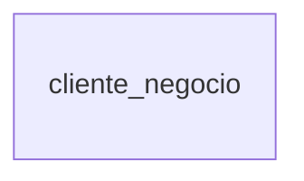

**D08 — Destino como texto (Confirmado e incorporado al SQL):** Decisión del 29/10/2026: no existe CRUD independiente de destinos en el prototipo. Se retira el catálogo propuesto; entrega_programada.destino guarda texto obligatorio. La guía conserva direccion_llegada_snapshot, ubigeo_llegada_snapshot y establecimiento_llegada_snapshot propios, sin FK de destino.

<a id="tabla-cliente_negocio"></a>

**Diccionario de `cliente_negocio` — tabla actual ampliada.**

**Clave primaria:** `cliente_negocio_id`. Padrón general del cliente y contacto.

**Fuente actual:** [ClienteNegocio](D:/upeu/proyecto-carrera/app/epe-backend/src/cliente-negocio/entities/cliente-negocio.ts).

| Atributo | Estado | Tipo y obligatoriedad en el modelo revisado | Finalidad / relación |
|---|---|---|---|
| `created_at` | **ACTUAL** | `timestamp with time zone NOT NULL DEFAULT now()` | Se conserva de la entidad/migración actual. |
| `updated_at` | **ACTUAL** | `timestamp with time zone NOT NULL DEFAULT now()` | Se conserva de la entidad/migración actual. |
| `cliente_negocio_id` | **ACTUAL** | `serial NOT NULL` | Se conserva de la entidad/migración actual. |
| `nombre_empresa` | **ACTUAL** | `varchar(255) NOT NULL` | Se conserva de la entidad/migración actual. |
| `nombre_contacto` | **ACTUAL** | `varchar(255) NOT NULL` | Se conserva de la entidad/migración actual. |
| `telefono` | **ACTUAL** | `varchar(20) NOT NULL` | Se conserva de la entidad/migración actual. |
| `ruc` | **ACTUAL** | `varchar(11) NOT NULL` | Se conserva de la entidad/migración actual. |
| `correo_corporativo` | **MODIFICAR** | `varchar(320)` | FC01: correo opcional según el validador del padrón; no usar cadenas vacías compartidas. |
| `ubicacion` | **ACTUAL** | `text NOT NULL` | Se conserva de la entidad/migración actual. |
| `tipo_cliente` | **ACTUAL** | `"cliente_negocio_tipo_cliente_enum" NOT NULL` | Se conserva de la entidad/migración actual. |
| `fecha_registro` | **AGREGAR** | `date` | Fecha comercial de registro, si se conoce; created_at se conserva. |

**Restricciones actuales conservadas:** `PRIMARY KEY (cliente_negocio_id)`; `UNIQUE (correo_corporativo)`; `UNIQUE (ruc)`.

## Detalle de cliente (Administrador > Gestión Comercial > Clientes > Detalle)

**Referencia de revisión:** V04 · Recorrido del 27/10/2026.

**Entrada, acciones y salida:** Clientes → Ver cliente SUTRIMEX → Participaciones por campaña → Abrir participación.

**Observado en la aplicación de referencia:** SUTRIMEX muestra sus datos generales y participaciones de Mango 2026 y Palta 2027, kilos y número de contratos.

**Criterio para revisar el modelo:** La ficha agrega información desde requerimientos y contratos. No crear tablas detalle_cliente ni copia de campañas. Cantidad registrada, kilos acordados y kilos entregados son métricas diferentes.

**Funcionalidad esperada de cada tabla en esta vista:**

| Tabla | Uso en esta vista | Funcionalidad esperada | Situación |
|---|---|---|---|
| [`cliente_negocio`](#tabla-cliente_negocio) | Consulta | Mantiene cliente, tipo Exportador/Industria y contacto. Un cliente comercial no es automáticamente empresa transportista aunque compartan nombre. | Tabla actual incluida |
| [`cliente_negocio_campana`](#tabla-cliente_negocio_campana) | Consulta | Representa el vínculo y requerimiento del cliente en la campaña, previo a sus contratos. El backend mantiene un vínculo único por cliente/campaña. | Tabla actual incluida |
| [`campana`](#tabla-campana) | Consulta | Identifica la campaña, sus fechas, fruta, responsable y estado; aporta el ámbito de todas las consultas de la vista. | Tabla actual incluida |
| [`contrato_venta`](#tabla-contrato_venta) | Consulta | Representa cada contrato del cliente/campaña con kilos, precio y moneda propios. Contratado no equivale a programado ni facturado. | Tabla propuesta, sin implementar |

**Esquema de relaciones utilizado por esta vista:**

**Tablas actuales que se conservan:** `cliente_negocio`, `cliente_negocio_campana`, `campana`.

**Tablas propuestas para revisar:** `contrato_venta`.

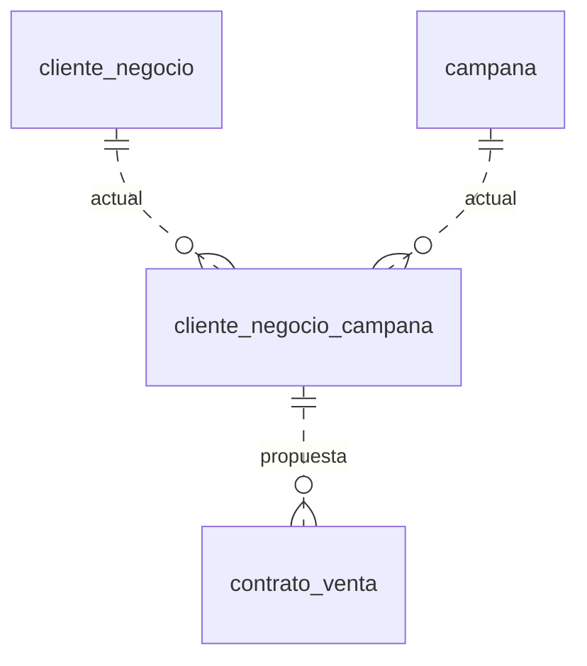

**`cliente_negocio`:** reutiliza su diccionario anterior; no crea una tabla duplicada.

<a id="tabla-cliente_negocio_campana"></a>

**Diccionario de `cliente_negocio_campana` — tabla actual ampliada.**

**Clave primaria:** `cliente_negocio_campana_id`. Participación cliente–campaña y necesidad original, previa a sus contratos.

**Fuente actual:** [ClienteNegocioCampana](D:/upeu/proyecto-carrera/app/epe-backend/src/cliente-negocio-campana/entities/cliente-negocio-campana.ts).

| Atributo | Estado | Tipo y obligatoriedad en el modelo revisado | Finalidad / relación |
|---|---|---|---|
| `created_at` | **ACTUAL** | `timestamp with time zone NOT NULL DEFAULT now()` | Se conserva de la entidad/migración actual. |
| `updated_at` | **ACTUAL** | `timestamp with time zone NOT NULL DEFAULT now()` | Se conserva de la entidad/migración actual. |
| `cliente_negocio_campana_id` | **ACTUAL** | `serial NOT NULL` | Se conserva de la entidad/migración actual. |
| `documento_url` | **MODIFICAR** | `text` | FC05: vinculación inicial sin contrato/adjunto todavía. |
| `fecha_registro` | **ACTUAL** | `date NOT NULL` | Se conserva de la entidad/migración actual. |
| `ficha_tecnica_url` | **MODIFICAR** | `text` | FC05: vinculación inicial sin contrato/adjunto todavía. |
| `cantidad_kg` | **ACTUAL** | `numeric(14,3) NOT NULL DEFAULT '0'::numeric` | Se conserva de la entidad/migración actual. |
| `kilos_acordados` | **ACTUAL** | `numeric(14,3) NOT NULL` | Se conserva de la entidad/migración actual. |
| `cliente_negocio_id` | **ACTUAL** | `integer NOT NULL` | Se conserva de la entidad/migración actual. FK a `cliente_negocio.cliente_negocio_id`. |
| `campania_id` | **ACTUAL** | `integer NOT NULL` | Se conserva de la entidad/migración actual. FK a `campana.campania_id`. |
| `ficha_tecnica_archivo_id` | **AGREGAR** | `integer` | PENDIENTE DE RELACIÓN: referencia documental reservada, opcional y sin FK. No usar identificadores de archivo hasta definir la integración. |
| `destino_solicitado` | **AGREGAR** | `varchar(255)` | Ciudad/planta/país solicitado en el requerimiento. |
| `entrega_desde` | **AGREGAR** | `date` | Inicio de la ventana solicitada. |
| `entrega_hasta` | **AGREGAR** | `date` | Fin de la ventana solicitada. |
| `observaciones` | **AGREGAR** | `text` | Requerimientos y notas comerciales. |

**Restricciones actuales conservadas:** `PRIMARY KEY (cliente_negocio_campana_id)`.

**Restricciones propuestas para revisar:** `CHECK (entrega_hasta >= entrega_desde)`.

<a id="tabla-campana"></a>

**Diccionario de `campana` — tabla actual ampliada.**

**Clave primaria:** `campania_id`. Campaña con sus fechas, responsable y cierre manual.

**Fuente actual:** [Campana](D:/upeu/proyecto-carrera/app/epe-backend/src/campana/entities/campana.ts).

| Atributo | Estado | Tipo y obligatoriedad en el modelo revisado | Finalidad / relación |
|---|---|---|---|
| `created_at` | **ACTUAL** | `timestamp with time zone NOT NULL DEFAULT now()` | Se conserva de la entidad/migración actual. |
| `updated_at` | **ACTUAL** | `timestamp with time zone NOT NULL DEFAULT now()` | Se conserva de la entidad/migración actual. |
| `campania_id` | **ACTUAL** | `serial NOT NULL` | Se conserva de la entidad/migración actual. |
| `nombre` | **ACTUAL** | `varchar NOT NULL` | Se conserva de la entidad/migración actual. |
| `fecha_inicio` | **ACTUAL** | `date NOT NULL` | Se conserva de la entidad/migración actual. |
| `fecha_fin` | **ACTUAL** | `date NOT NULL` | Se conserva de la entidad/migración actual. |
| `estado` | **ACTUAL** | `"campana_estado_enum" NOT NULL DEFAULT 'planificacion'::campana_estado_enum` | Se conserva de la entidad/migración actual. |
| `requerimiento_comercial` | **ACTUAL** | `numeric(12,3) NOT NULL` | Se conserva de la entidad/migración actual. |
| `fruta_id` | **ACTUAL** | `integer NOT NULL` | Se conserva de la entidad/migración actual. FK a `fruta.fruta_id`. |
| `temporada` | **AGREGAR** | `varchar(30)` | Periodo o temporada de la campaña. |
| `responsable_usuario_id` | **AGREGAR** | `integer` | Responsable de la campaña. FK a `usuario.usuario_id`. |
| `lineamientos_archivo_id` | **AGREGAR** | `integer` | PENDIENTE DE RELACIÓN: referencia documental reservada, opcional y sin FK. No usar identificadores de archivo hasta definir la integración. |
| `observaciones` | **AGREGAR** | `text` | Notas generales de campaña. |
| `cerrada_at` | **AGREGAR** | `timestamptz` | Fecha del cierre revisado. |
| `cerrada_por_usuario_id` | **AGREGAR** | `integer` | Usuario que confirmó el cierre. FK a `usuario.usuario_id`. |
| `motivo_cierre` | **AGREGAR** | `text` | Resumen o justificación del cierre. |
| `calidad` | **AGREGAR** | `jsonb NOT NULL DEFAULT '{}'::jsonb` | FC08: objeto por canal Industria/Exportación, con incorporación/estado y rechazos; no requiere entrega ficticia. |

**Restricciones actuales conservadas:** `PRIMARY KEY (campania_id)`.

**Índices actuales conservados:** `CREATE UNIQUE INDEX "UQ_campana_fruta_activa" ON agro.campana USING btree (fruta_id) WHERE (estado <> 'terminado'::campana_estado_enum)`.

**Restricciones propuestas para revisar:** `CHECK (fecha_fin >= fecha_inicio)`; `CHECK (jsonb_typeof(calidad) = 'object')`.

<a id="tabla-contrato_venta"></a>

**Diccionario de `contrato_venta` — tabla propuesta.**

**Clave primaria:** `contrato_venta_id`. Varios contratos por requerimiento, con precio y moneda propios.

| Atributo | Estado | Tipo y obligatoriedad en el modelo revisado | Finalidad / relación |
|---|---|---|---|
| `contrato_venta_id` | **TABLA NUEVA** | `integer GENERATED ALWAYS AS IDENTITY PRIMARY KEY` | Atributo propuesto para cubrir el flujo de la vista. |
| `cliente_negocio_campana_id` | **TABLA NUEVA** | `integer NOT NULL` | Atributo propuesto para cubrir el flujo de la vista. FK a `cliente_negocio_campana.cliente_negocio_campana_id`. |
| `numero` | **TABLA NUEVA** | `varchar(60) NOT NULL DEFAULT ('CTR-' || gen_random_uuid()::text)` | FC05: identificador interno autogenerado, sin pedir un campo nuevo en UI. |
| `canal` | **TABLA NUEVA** | `varchar(20) NOT NULL` | Atributo propuesto para cubrir el flujo de la vista. |
| `fecha` | **TABLA NUEVA** | `date NOT NULL` | Atributo propuesto para cubrir el flujo de la vista. |
| `kilos_acordados` | **TABLA NUEVA** | `numeric(14,3) NOT NULL` | Atributo propuesto para cubrir el flujo de la vista. |
| `precio_kg` | **TABLA NUEVA** | `numeric(14,4)` | FC05: contrato con precio pendiente; completar antes de preparar venta. |
| `moneda` | **TABLA NUEVA** | `varchar(3) NOT NULL` | Atributo propuesto para cubrir el flujo de la vista. |
| `estado` | **TABLA NUEVA** | `varchar(25) NOT NULL DEFAULT 'VIGENTE'` | Atributo propuesto para cubrir el flujo de la vista. |
| `condiciones_pago` | **TABLA NUEVA** | `text` | Atributo propuesto para cubrir el flujo de la vista. |
| `archivo_id` | **TABLA NUEVA** | `integer` | PENDIENTE DE RELACIÓN: referencia documental reservada, opcional y sin FK. No usar identificadores de archivo hasta definir la integración. |
| `created_at` | **TABLA NUEVA** | `timestamptz NOT NULL DEFAULT now()` | Auditoría con la misma convención del backend. |
| `updated_at` | **TABLA NUEVA** | `timestamptz NOT NULL DEFAULT now()` | Auditoría con la misma convención del backend; el servicio/ORM actualiza esta fecha. |
| `condiciones_entrega` | **TABLA NUEVA** | `text` | FC05: texto propio del contrato que el formulario vuelve a mostrar. |
| `observaciones` | **TABLA NUEVA** | `text` | FC05: texto propio del contrato que el formulario vuelve a mostrar. |

**Restricciones propuestas para revisar:** `UNIQUE (numero)`; `CHECK (kilos_acordados > 0)`; `CHECK (precio_kg > 0)`; `CHECK (canal IN ('EXPORTACION','INDUSTRIA'))`; `CHECK (moneda IN ('PEN','USD','EUR'))`.

## Contratos — Participaciones comerciales (Administrador > Gestión Comercial > Contratos)

**Referencia de revisión:** V05 · Recorrido del 27/10/2026.

**Entrada, acciones y salida:** Gestión Comercial → Contratos → Ver/Editar participación; Más opciones → Contratos o Entregas.

**Observado en la aplicación de referencia:** Listado cliente/campaña con cantidades, kilos acordados y contratos; existen varias filas de Batimix/Mango 2026 en los datos de demostración.

**Criterio para revisar el modelo:** Contrato con precio pendiente y condiciones de entrega/notas; cada requerimiento conserva sus contratos. Completar precio antes de facturar.

**Funcionalidad esperada de cada tabla en esta vista:**

| Tabla | Uso en esta vista | Funcionalidad esperada | Situación |
|---|---|---|---|
| [`cliente_negocio_campana`](#tabla-cliente_negocio_campana) | Escritura esperada | Representa el vínculo y requerimiento del cliente en la campaña, previo a sus contratos. El backend mantiene un vínculo único por cliente/campaña. | Tabla actual incluida |
| [`cliente_negocio_campana_x_fruta_derivada`](#tabla-cliente_negocio_campana_x_fruta_derivada) | Escritura esperada | Conserva la selección múltiple de variedades solicitadas en el requerimiento comercial. | Tabla propuesta, sin implementar |
| [`cliente_negocio`](#tabla-cliente_negocio) | Consulta | Mantiene cliente, tipo Exportador/Industria y contacto. Un cliente comercial no es automáticamente empresa transportista aunque compartan nombre. | Tabla actual incluida |
| [`campana`](#tabla-campana) | Consulta | Identifica la campaña, sus fechas, fruta, responsable y estado; aporta el ámbito de todas las consultas de la vista. | Tabla actual incluida |
| [`fruta_derivada`](#tabla-fruta_derivada) | Consulta | Identifica una variedad y su fruta. Permite mostrar el cultivo de la finca sin duplicar fruta_id en finca. | Tabla actual incluida |
| [`contrato_venta`](#tabla-contrato_venta) | Consulta | Representa cada contrato del cliente/campaña con kilos, precio y moneda propios. Contratado no equivale a programado ni facturado. | Tabla propuesta, sin implementar |

**Esquema de relaciones utilizado por esta vista:**

**Tablas actuales que se conservan:** `cliente_negocio_campana`, `cliente_negocio`, `campana`, `fruta_derivada`.

**Tablas propuestas para revisar:** `cliente_negocio_campana_x_fruta_derivada`, `contrato_venta`.

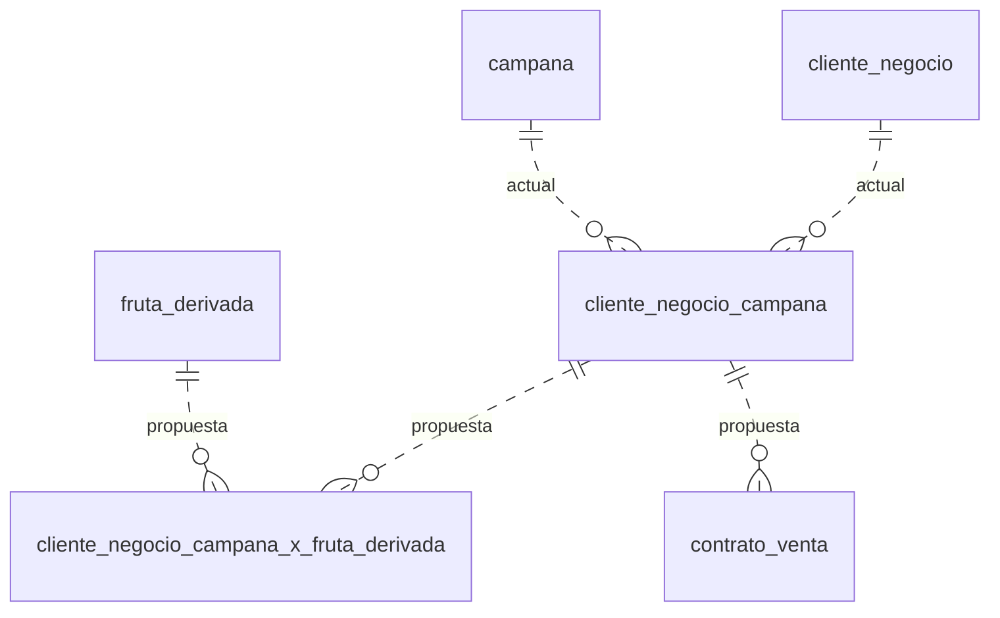

**D08 — Destino como texto (Confirmado e incorporado al SQL):** Decisión del 29/10/2026: no existe CRUD independiente de destinos en el prototipo. Se retira el catálogo propuesto; entrega_programada.destino guarda texto obligatorio. La guía conserva direccion_llegada_snapshot, ubigeo_llegada_snapshot y establecimiento_llegada_snapshot propios, sin FK de destino.

**D15 — Varios requerimientos cliente/campaña (Incorporado según respuesta del usuario):** Se retira la unicidad cliente/campaña para permitir requerimientos independientes. Cada fila conserva sus contratos y entregas. El editor del prototipo aún debe alinearse con esta decisión.

**`cliente_negocio_campana`:** reutiliza su diccionario anterior; no crea una tabla duplicada.

<a id="tabla-cliente_negocio_campana_x_fruta_derivada"></a>

**Diccionario de `cliente_negocio_campana_x_fruta_derivada` — tabla propuesta.**

**Clave primaria:** `cliente_negocio_campana_x_fruta_derivada_id`. Selección múltiple de variedades requeridas.

| Atributo | Estado | Tipo y obligatoriedad en el modelo revisado | Finalidad / relación |
|---|---|---|---|
| `cliente_negocio_campana_x_fruta_derivada_id` | **TABLA NUEVA** | `integer GENERATED ALWAYS AS IDENTITY PRIMARY KEY` | Atributo propuesto para cubrir el flujo de la vista. |
| `cliente_negocio_campana_id` | **TABLA NUEVA** | `integer NOT NULL` | Atributo propuesto para cubrir el flujo de la vista. FK a `cliente_negocio_campana.cliente_negocio_campana_id`. |
| `fruta_derivada_id` | **TABLA NUEVA** | `integer NOT NULL` | Atributo propuesto para cubrir el flujo de la vista. FK a `fruta_derivada.fruta_derivada_id`. |
| `created_at` | **TABLA NUEVA** | `timestamptz NOT NULL DEFAULT now()` | Auditoría con la misma convención del backend. |
| `updated_at` | **TABLA NUEVA** | `timestamptz NOT NULL DEFAULT now()` | Auditoría con la misma convención del backend; el servicio/ORM actualiza esta fecha. |

**Restricciones propuestas para revisar:** `UNIQUE (cliente_negocio_campana_id, fruta_derivada_id)`.

**`cliente_negocio`:** reutiliza su diccionario anterior; no crea una tabla duplicada.

**`campana`:** reutiliza su diccionario anterior; no crea una tabla duplicada.

<a id="tabla-fruta_derivada"></a>

**Diccionario de `fruta_derivada` — tabla actual ampliada.**

**Clave primaria:** `fruta_derivada_id`. Variedades pertenecientes a una fruta.

**Fuente actual:** [FrutaDerivada](D:/upeu/proyecto-carrera/app/epe-backend/src/fruta/entities/fruta-derivada.ts).

| Atributo | Estado | Tipo y obligatoriedad en el modelo revisado | Finalidad / relación |
|---|---|---|---|
| `created_at` | **ACTUAL** | `timestamp with time zone NOT NULL DEFAULT now()` | Se conserva de la entidad/migración actual. |
| `updated_at` | **ACTUAL** | `timestamp with time zone NOT NULL DEFAULT now()` | Se conserva de la entidad/migración actual. |
| `fruta_derivada_id` | **ACTUAL** | `serial NOT NULL` | Se conserva de la entidad/migración actual. |
| `name` | **ACTUAL** | `varchar(150) NOT NULL` | Se conserva de la entidad/migración actual. |
| `fruta_id` | **ACTUAL** | `integer NOT NULL` | Se conserva de la entidad/migración actual. FK a `fruta.fruta_id`. |

**Restricciones actuales conservadas:** `PRIMARY KEY (fruta_derivada_id)`.

**`contrato_venta`:** reutiliza su diccionario anterior; no crea una tabla duplicada.

## Consulta cliente–campaña (Administrador > Gestión Comercial > Contratos > Participación)

**Referencia de revisión:** V06 · Recorrido del 27/10/2026.

**Entrada, acciones y salida:** Ver participación o Abrir participación → consulta cliente–campaña → Volver al origen.

**Observado en la aplicación de referencia:** Consulta SUTRIMEX/Mango 2026 con ficha técnica, variedades, destino Rotterdam, ventana de entrega y resúmenes programados.

**Criterio para revisar el modelo:** Reutiliza la participación y agrega contratos y entregas por sus claves. La suma programada no debe confundirse con lo efectivamente cargado o recibido. La integración documental queda pendiente; las referencias reservadas son opcionales y no tienen FK.

**Funcionalidad esperada de cada tabla en esta vista:**

| Tabla | Uso en esta vista | Funcionalidad esperada | Situación |
|---|---|---|---|
| [`cliente_negocio_campana`](#tabla-cliente_negocio_campana) | Consulta | Representa el vínculo y requerimiento del cliente en la campaña, previo a sus contratos. El backend mantiene un vínculo único por cliente/campaña. | Tabla actual incluida |
| [`cliente_negocio`](#tabla-cliente_negocio) | Consulta | Mantiene cliente, tipo Exportador/Industria y contacto. Un cliente comercial no es automáticamente empresa transportista aunque compartan nombre. | Tabla actual incluida |
| [`campana`](#tabla-campana) | Consulta | Identifica la campaña, sus fechas, fruta, responsable y estado; aporta el ámbito de todas las consultas de la vista. | Tabla actual incluida |
| [`cliente_negocio_campana_x_fruta_derivada`](#tabla-cliente_negocio_campana_x_fruta_derivada) | Consulta | Conserva la selección múltiple de variedades solicitadas en el requerimiento comercial. | Tabla propuesta, sin implementar |
| [`fruta_derivada`](#tabla-fruta_derivada) | Consulta | Identifica una variedad y su fruta. Permite mostrar el cultivo de la finca sin duplicar fruta_id en finca. | Tabla actual incluida |
| [`contrato_venta`](#tabla-contrato_venta) | Consulta | Representa cada contrato del cliente/campaña con kilos, precio y moneda propios. Contratado no equivale a programado ni facturado. | Tabla propuesta, sin implementar |
| [`entrega_programada`](#tabla-entrega_programada) | Consulta | Guarda fecha, kilos y destino previstos de un contrato antes de completar transporte o registrar carga física. | Tabla propuesta, sin implementar |
| [`coordinacion_entrega`](#tabla-coordinacion_entrega) | Consulta | Selecciona transportista, unidad, chofer y fechas para una entrega programada. Puede existir antes de la carga real. | Tabla propuesta, sin implementar |

**Esquema de relaciones utilizado por esta vista:**

**Tablas actuales que se conservan:** `cliente_negocio_campana`, `cliente_negocio`, `campana`, `fruta_derivada`.

**Tablas propuestas para revisar:** `cliente_negocio_campana_x_fruta_derivada`, `contrato_venta`, `entrega_programada`, `coordinacion_entrega`.

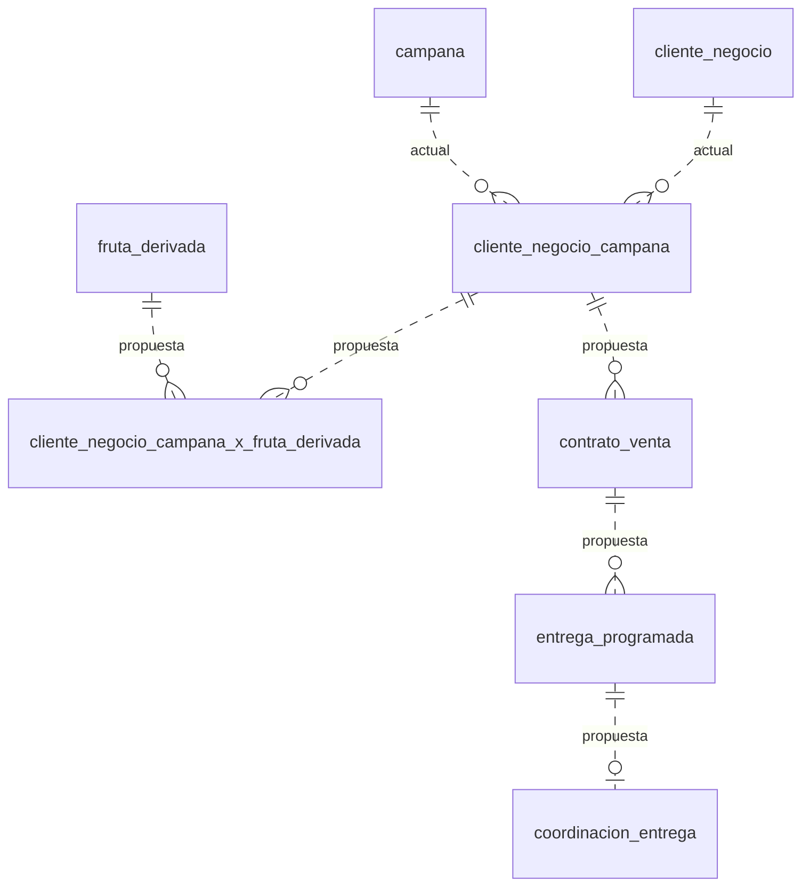

**D15 — Varios requerimientos cliente/campaña (Incorporado según respuesta del usuario):** Se retira la unicidad cliente/campaña para permitir requerimientos independientes. Cada fila conserva sus contratos y entregas. El editor del prototipo aún debe alinearse con esta decisión.

**`cliente_negocio_campana`:** reutiliza su diccionario anterior; no crea una tabla duplicada.

**`cliente_negocio`:** reutiliza su diccionario anterior; no crea una tabla duplicada.

**`campana`:** reutiliza su diccionario anterior; no crea una tabla duplicada.

**`cliente_negocio_campana_x_fruta_derivada`:** reutiliza su diccionario anterior; no crea una tabla duplicada.

**`fruta_derivada`:** reutiliza su diccionario anterior; no crea una tabla duplicada.

**`contrato_venta`:** reutiliza su diccionario anterior; no crea una tabla duplicada.

<a id="tabla-entrega_programada"></a>

**Diccionario de `entrega_programada` — tabla propuesta.**

**Clave primaria:** `entrega_programada_id`. Programación comercial; puede existir antes de asignar transporte.

| Atributo | Estado | Tipo y obligatoriedad en el modelo revisado | Finalidad / relación |
|---|---|---|---|
| `entrega_programada_id` | **TABLA NUEVA** | `integer GENERATED ALWAYS AS IDENTITY PRIMARY KEY` | Atributo propuesto para cubrir el flujo de la vista. |
| `contrato_venta_id` | **TABLA NUEVA** | `integer NOT NULL` | Atributo propuesto para cubrir el flujo de la vista. FK a `contrato_venta.contrato_venta_id`. |
| `destino` | **TABLA NUEVA** | `text NOT NULL` | D08: destino libre capturado por el formulario de entrega; no referencia un catálogo. |
| `fecha` | **TABLA NUEVA** | `date NOT NULL` | Atributo propuesto para cubrir el flujo de la vista. |
| `kilos_programados` | **TABLA NUEVA** | `numeric(14,3) NOT NULL` | Atributo propuesto para cubrir el flujo de la vista. |
| `observaciones` | **TABLA NUEVA** | `text` | Atributo propuesto para cubrir el flujo de la vista. |
| `created_at` | **TABLA NUEVA** | `timestamptz NOT NULL DEFAULT now()` | Auditoría con la misma convención del backend. |
| `updated_at` | **TABLA NUEVA** | `timestamptz NOT NULL DEFAULT now()` | Auditoría con la misma convención del backend; el servicio/ORM actualiza esta fecha. |

**Restricciones propuestas para revisar:** `CHECK (kilos_programados > 0)`; `CHECK (btrim(destino) <> '')`.

<a id="tabla-coordinacion_entrega"></a>

**Diccionario de `coordinacion_entrega` — tabla propuesta.**

**Clave primaria:** `coordinacion_entrega_id`. Asignación previa a la carga real; un registro por entrega.

| Atributo | Estado | Tipo y obligatoriedad en el modelo revisado | Finalidad / relación |
|---|---|---|---|
| `coordinacion_entrega_id` | **TABLA NUEVA** | `integer GENERATED ALWAYS AS IDENTITY PRIMARY KEY` | Atributo propuesto para cubrir el flujo de la vista. |
| `entrega_programada_id` | **TABLA NUEVA** | `integer NOT NULL` | Atributo propuesto para cubrir el flujo de la vista. FK a `entrega_programada.entrega_programada_id`. |
| `acuerdo_transporte_id` | **TABLA NUEVA** | `integer NOT NULL` | Atributo propuesto para cubrir el flujo de la vista. FK a `acuerdo_transporte.acuerdo_transporte_id`; FK a `acuerdo_transporte.acuerdo_transporte_id,id_empresa_transporte_externo`. |
| `id_empresa_transporte_externo` | **TABLA NUEVA** | `integer NOT NULL` | Atributo propuesto para cubrir el flujo de la vista. FK a `empresa_transporte_externo.id_empresa_transporte_externo`; FK a `acuerdo_transporte.acuerdo_transporte_id,id_empresa_transporte_externo`; FK a `vehiculo_externo.id_vehiculo_externo,id_empresa_transporte_externo`; FK a `chofer_transporte_externo.id_chofer_transporte_externo,id_empresa_transporte_externo`. |
| `id_vehiculo_externo` | **TABLA NUEVA** | `integer NOT NULL` | Atributo propuesto para cubrir el flujo de la vista. FK a `vehiculo_externo.id_vehiculo_externo,id_empresa_transporte_externo`. |
| `id_chofer_transporte_externo` | **TABLA NUEVA** | `integer NOT NULL` | Atributo propuesto para cubrir el flujo de la vista. FK a `chofer_transporte_externo.id_chofer_transporte_externo`; FK a `chofer_transporte_externo.id_chofer_transporte_externo,id_empresa_transporte_externo`. |
| `inicio_programado` | **TABLA NUEVA** | `timestamptz NOT NULL` | Atributo propuesto para cubrir el flujo de la vista. |
| `fin_programado` | **TABLA NUEVA** | `timestamptz NOT NULL` | Atributo propuesto para cubrir el flujo de la vista. |
| `origen_descripcion` | **TABLA NUEVA** | `text NOT NULL` | Atributo propuesto para cubrir el flujo de la vista. |
| `condiciones_carga` | **TABLA NUEVA** | `text` | Atributo propuesto para cubrir el flujo de la vista. |
| `observaciones` | **TABLA NUEVA** | `text` | Atributo propuesto para cubrir el flujo de la vista. |
| `created_at` | **TABLA NUEVA** | `timestamptz NOT NULL DEFAULT now()` | Auditoría con la misma convención del backend. |
| `updated_at` | **TABLA NUEVA** | `timestamptz NOT NULL DEFAULT now()` | Auditoría con la misma convención del backend; el servicio/ORM actualiza esta fecha. |
| `flete_asignado` | **TABLA NUEVA** | `numeric(14,2)` | FC07: flete de esta entrega, previo a liquidar; observación para exceso del acuerdo. |
| `observacion_flete` | **TABLA NUEVA** | `text` | FC07: flete de esta entrega, previo a liquidar; observación para exceso del acuerdo. |

**Restricciones propuestas para revisar:** `UNIQUE (entrega_programada_id)`; `UNIQUE (coordinacion_entrega_id, entrega_programada_id)`; `CHECK (fin_programado >= inicio_programado)`; `CHECK (flete_asignado > 0)`; `EXCLUDE USING gist (id_chofer_transporte_externo WITH =, tstzrange(inicio_programado, fin_programado, '[)') WITH &&)`.

## Contratos del cliente en campaña (Administrador > Gestión Comercial > Contratos > Participación > Contratos)

**Referencia de revisión:** V07 · Recorrido del 27/10/2026.

**Entrada, acciones y salida:** Contratos → Más opciones de SUTRIMEX → Contratos → Registrar/Editar contrato o Entregas.

**Observado en la aplicación de referencia:** Cuatro contratos de SUTRIMEX/Mango 2026; tres en USD y uno en PEN. Cada contrato accede a sus entregas.

**Criterio para revisar el modelo:** Contrato con precio pendiente y condiciones de entrega/notas; cada requerimiento conserva sus contratos. Completar precio antes de facturar.

**Funcionalidad esperada de cada tabla en esta vista:**

| Tabla | Uso en esta vista | Funcionalidad esperada | Situación |
|---|---|---|---|
| [`contrato_venta`](#tabla-contrato_venta) | Escritura esperada | Representa cada contrato del cliente/campaña con kilos, precio y moneda propios. Contratado no equivale a programado ni facturado. | Tabla propuesta, sin implementar |
| [`cliente_negocio_campana`](#tabla-cliente_negocio_campana) | Consulta | Representa el vínculo y requerimiento del cliente en la campaña, previo a sus contratos. El backend mantiene un vínculo único por cliente/campaña. | Tabla actual incluida |
| [`cliente_negocio`](#tabla-cliente_negocio) | Consulta | Mantiene cliente, tipo Exportador/Industria y contacto. Un cliente comercial no es automáticamente empresa transportista aunque compartan nombre. | Tabla actual incluida |
| [`campana`](#tabla-campana) | Consulta | Identifica la campaña, sus fechas, fruta, responsable y estado; aporta el ámbito de todas las consultas de la vista. | Tabla actual incluida |
| [`entrega_programada`](#tabla-entrega_programada) | Consulta | Guarda fecha, kilos y destino previstos de un contrato antes de completar transporte o registrar carga física. | Tabla propuesta, sin implementar |

**Esquema de relaciones utilizado por esta vista:**

**Tablas actuales que se conservan:** `cliente_negocio_campana`, `cliente_negocio`, `campana`.

**Tablas propuestas para revisar:** `contrato_venta`, `entrega_programada`.

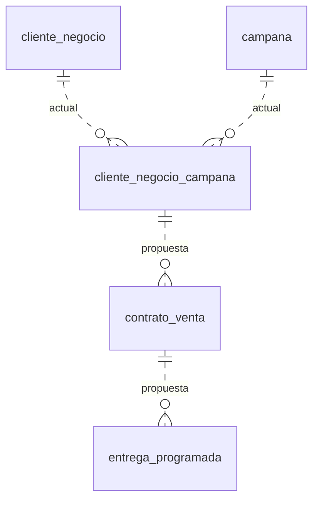

**D15 — Varios requerimientos cliente/campaña (Incorporado según respuesta del usuario):** Se retira la unicidad cliente/campaña para permitir requerimientos independientes. Cada fila conserva sus contratos y entregas. El editor del prototipo aún debe alinearse con esta decisión.

**`contrato_venta`:** reutiliza su diccionario anterior; no crea una tabla duplicada.

**`cliente_negocio_campana`:** reutiliza su diccionario anterior; no crea una tabla duplicada.

**`cliente_negocio`:** reutiliza su diccionario anterior; no crea una tabla duplicada.

**`campana`:** reutiliza su diccionario anterior; no crea una tabla duplicada.

**`entrega_programada`:** reutiliza su diccionario anterior; no crea una tabla duplicada.

## Entregas programadas (Administrador > Gestión Comercial > Contratos > Contrato > Entregas)

**Referencia de revisión:** V08 · Recorrido del 27/10/2026.

**Entrada, acciones y salida:** Contrato → Entregas → Registrar/Ver entrega; completar transporte corresponde a Campaña en proceso.

**Observado en la aplicación de referencia:** Contrato con dos entregas de 500 kg, destino y preparación; edición y eliminación deshabilitadas con carga registrada.

**Criterio para revisar el modelo:** Cada entrega conserva su destino como texto obligatorio, sin seleccionar un catálogo. El servicio valida kilos y distribución por variedad frente al contrato.

**Funcionalidad esperada de cada tabla en esta vista:**

| Tabla | Uso en esta vista | Funcionalidad esperada | Situación |
|---|---|---|---|
| [`entrega_programada`](#tabla-entrega_programada) | Escritura esperada | Guarda fecha, kilos y destino previstos de un contrato antes de completar transporte o registrar carga física. | Tabla propuesta, sin implementar |
| [`entrega_x_fruta_derivada`](#tabla-entrega_x_fruta_derivada) | Escritura esperada | Desglosa los kilos programados por variedad para el calendario semanal; no es una segunda entrega. | Tabla propuesta, sin implementar |
| [`contrato_venta`](#tabla-contrato_venta) | Consulta | Representa cada contrato del cliente/campaña con kilos, precio y moneda propios. Contratado no equivale a programado ni facturado. | Tabla propuesta, sin implementar |
| [`cliente_negocio_campana`](#tabla-cliente_negocio_campana) | Consulta | Representa el vínculo y requerimiento del cliente en la campaña, previo a sus contratos. El backend mantiene un vínculo único por cliente/campaña. | Tabla actual incluida |
| [`cliente_negocio`](#tabla-cliente_negocio) | Consulta | Mantiene cliente, tipo Exportador/Industria y contacto. Un cliente comercial no es automáticamente empresa transportista aunque compartan nombre. | Tabla actual incluida |
| [`fruta_derivada`](#tabla-fruta_derivada) | Consulta | Identifica una variedad y su fruta. Permite mostrar el cultivo de la finca sin duplicar fruta_id en finca. | Tabla actual incluida |
| [`coordinacion_entrega`](#tabla-coordinacion_entrega) | Consulta | Selecciona transportista, unidad, chofer y fechas para una entrega programada. Puede existir antes de la carga real. | Tabla propuesta, sin implementar |
| [`carga`](#tabla-carga) | Consulta | Representa la carga física de una coordinación, fecha y responsable. El peso real se obtiene de sus líneas de proveedores y se diferencia del programado. | Tabla propuesta, sin implementar |

**Esquema de relaciones utilizado por esta vista:**

**Tablas actuales que se conservan:** `cliente_negocio_campana`, `cliente_negocio`, `fruta_derivada`.

**Tablas propuestas para revisar:** `entrega_programada`, `entrega_x_fruta_derivada`, `contrato_venta`, `coordinacion_entrega`, `carga`.

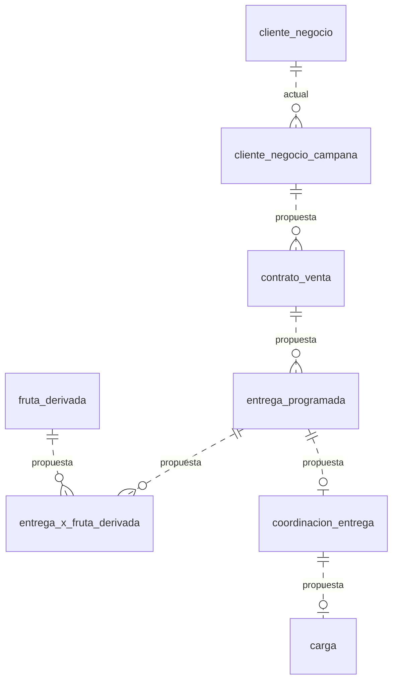

**D08 — Destino como texto (Confirmado e incorporado al SQL):** Decisión del 29/10/2026: no existe CRUD independiente de destinos en el prototipo. Se retira el catálogo propuesto; entrega_programada.destino guarda texto obligatorio. La guía conserva direccion_llegada_snapshot, ubigeo_llegada_snapshot y establecimiento_llegada_snapshot propios, sin FK de destino.

**D14 — Una carga por entrega (Confirmado por el usuario):** Se conserva un viaje/carga por entrega. Cosecha también es única por entrega. El SQL permite varias facturas de esa carga, con suma de kilos no superior a la recepción, según respuesta explícita del usuario.

**`entrega_programada`:** reutiliza su diccionario anterior; no crea una tabla duplicada.

<a id="tabla-entrega_x_fruta_derivada"></a>

**Diccionario de `entrega_x_fruta_derivada` — tabla propuesta.**

**Clave primaria:** `entrega_x_fruta_derivada_id`. Distribución programada por variedad para el programa semanal.

| Atributo | Estado | Tipo y obligatoriedad en el modelo revisado | Finalidad / relación |
|---|---|---|---|
| `entrega_x_fruta_derivada_id` | **TABLA NUEVA** | `integer GENERATED ALWAYS AS IDENTITY PRIMARY KEY` | Atributo propuesto para cubrir el flujo de la vista. |
| `entrega_programada_id` | **TABLA NUEVA** | `integer NOT NULL` | Atributo propuesto para cubrir el flujo de la vista. FK a `entrega_programada.entrega_programada_id`. |
| `fruta_derivada_id` | **TABLA NUEVA** | `integer NOT NULL` | Atributo propuesto para cubrir el flujo de la vista. FK a `fruta_derivada.fruta_derivada_id`. |
| `kilos_programados` | **TABLA NUEVA** | `numeric(14,3) NOT NULL` | Atributo propuesto para cubrir el flujo de la vista. |
| `created_at` | **TABLA NUEVA** | `timestamptz NOT NULL DEFAULT now()` | Auditoría con la misma convención del backend. |
| `updated_at` | **TABLA NUEVA** | `timestamptz NOT NULL DEFAULT now()` | Auditoría con la misma convención del backend; el servicio/ORM actualiza esta fecha. |

**Restricciones propuestas para revisar:** `UNIQUE (entrega_programada_id, fruta_derivada_id)`; `CHECK (kilos_programados > 0)`.

**`contrato_venta`:** reutiliza su diccionario anterior; no crea una tabla duplicada.

**`cliente_negocio_campana`:** reutiliza su diccionario anterior; no crea una tabla duplicada.

**`cliente_negocio`:** reutiliza su diccionario anterior; no crea una tabla duplicada.

**`fruta_derivada`:** reutiliza su diccionario anterior; no crea una tabla duplicada.

**`coordinacion_entrega`:** reutiliza su diccionario anterior; no crea una tabla duplicada.

<a id="tabla-carga"></a>

**Diccionario de `carga` — tabla propuesta.**

**Clave primaria:** `carga_id`. Carga física real de la coordinación; no crea otra asignación de camión o chofer.

| Atributo | Estado | Tipo y obligatoriedad en el modelo revisado | Finalidad / relación |
|---|---|---|---|
| `carga_id` | **TABLA NUEVA** | `integer GENERATED ALWAYS AS IDENTITY PRIMARY KEY` | Atributo propuesto para cubrir el flujo de la vista. |
| `coordinacion_entrega_id` | **TABLA NUEVA** | `integer NOT NULL` | Atributo propuesto para cubrir el flujo de la vista. FK a `coordinacion_entrega.coordinacion_entrega_id`. |
| `codigo` | **TABLA NUEVA** | `varchar(80) NOT NULL` | Atributo propuesto para cubrir el flujo de la vista. |
| `fecha_carga` | **TABLA NUEVA** | `date NOT NULL` | Atributo propuesto para cubrir el flujo de la vista. |
| `anotador_nombre` | **TABLA NUEVA** | `varchar(180) NOT NULL` | Atributo propuesto para cubrir el flujo de la vista. |
| `estado_calidad` | **TABLA NUEVA** | `varchar(30) NOT NULL DEFAULT 'PENDIENTE'` | Atributo propuesto para cubrir el flujo de la vista. |
| `viaticos_movilidad` | **TABLA NUEVA** | `numeric(14,2) NOT NULL DEFAULT 0` | Atributo propuesto para cubrir el flujo de la vista. |
| `viaticos_insumos` | **TABLA NUEVA** | `numeric(14,2) NOT NULL DEFAULT 0` | Atributo propuesto para cubrir el flujo de la vista. |
| `guia_salida_id` | **TABLA NUEVA** | `integer` | PENDIENTE DE RELACIÓN: referencia documental reservada, opcional y sin FK. No usar identificadores de archivo hasta definir la integración. |
| `guia_salida_registrada_at` | **TABLA NUEVA** | `timestamptz` | Atributo propuesto para cubrir el flujo de la vista. |
| `observaciones` | **TABLA NUEVA** | `text` | Atributo propuesto para cubrir el flujo de la vista. |
| `created_at` | **TABLA NUEVA** | `timestamptz NOT NULL DEFAULT now()` | Auditoría con la misma convención del backend. |
| `updated_at` | **TABLA NUEVA** | `timestamptz NOT NULL DEFAULT now()` | Auditoría con la misma convención del backend; el servicio/ORM actualiza esta fecha. |

**Restricciones propuestas para revisar:** `UNIQUE (coordinacion_entrega_id)`; `UNIQUE (codigo)`; `UNIQUE (carga_id, coordinacion_entrega_id)`; `CHECK (viaticos_movilidad >= 0)`; `CHECK (viaticos_insumos >= 0)`.

## Gestión de Campaña (Administrador > Gestión de Campaña > Listado)

**Referencia de revisión:** V09 · Recorrido del 27/10/2026.

**Entrada, acciones y salida:** Módulos → Gestión de Campaña → Planificado / En Proceso / Finalizado → Detalle o Más opciones.

**Observado en la aplicación de referencia:** Planificado, En Proceso y Finalizado; campaña pasa por fecha a En proceso según texto visible. La fecha final no ejecuta el cierre.

**Criterio para revisar el modelo:** La campaña conserva una fruta. Las variedades disponibles se consultan desde fruta_derivada sin puente propio; la UI multifruta aún debe alinearse con ese acuerdo. Catálogos iniciales por SQL.

**Funcionalidad esperada de cada tabla en esta vista:**

| Tabla | Uso en esta vista | Funcionalidad esperada | Situación |
|---|---|---|---|
| [`campana`](#tabla-campana) | Escritura esperada | Identifica la campaña, sus fechas, fruta, responsable y estado; aporta el ámbito de todas las consultas de la vista. | Tabla actual incluida |
| [`fruta`](#tabla-fruta) | Consulta | Proporciona el catálogo de cultivos y la fruta de la campaña. No representa kilos comprados ni cosechados. | Tabla actual incluida |
| [`fruta_derivada`](#tabla-fruta_derivada) | Consulta | Identifica una variedad y su fruta. Permite mostrar el cultivo de la finca sin duplicar fruta_id en finca. | Tabla actual incluida |
| [`usuario`](#tabla-usuario) | Consulta | Relaciona la cuenta autenticada con la identidad y, cuando corresponde, con el chofer. El selector del demo todavía no constituye autenticación. | Tabla propuesta, sin implementar |

**Esquema de relaciones utilizado por esta vista:**

**Tablas actuales que se conservan:** `campana`, `fruta`, `fruta_derivada`.

**Tablas propuestas para revisar:** `usuario`.

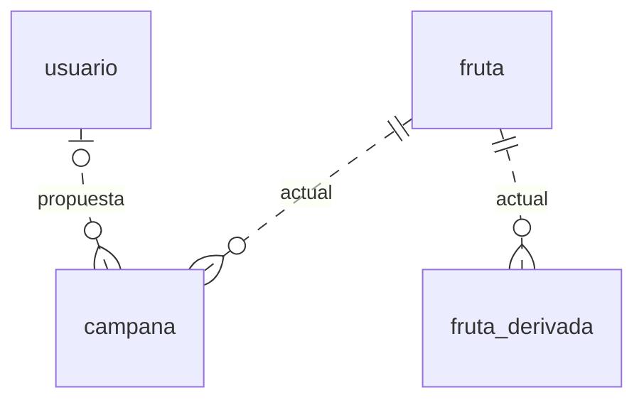

**`campana`:** reutiliza su diccionario anterior; no crea una tabla duplicada.

<a id="tabla-fruta"></a>

**Diccionario de `fruta` — tabla actual ampliada.**

**Clave primaria:** `fruta_id`. Catálogo de frutas.

**Fuente actual:** [Fruta](D:/upeu/proyecto-carrera/app/epe-backend/src/fruta/entities/fruta.ts).

| Atributo | Estado | Tipo y obligatoriedad en el modelo revisado | Finalidad / relación |
|---|---|---|---|
| `created_at` | **ACTUAL** | `timestamp with time zone NOT NULL DEFAULT now()` | Se conserva de la entidad/migración actual. |
| `updated_at` | **ACTUAL** | `timestamp with time zone NOT NULL DEFAULT now()` | Se conserva de la entidad/migración actual. |
| `fruta_id` | **ACTUAL** | `serial NOT NULL` | Se conserva de la entidad/migración actual. |
| `name` | **ACTUAL** | `varchar(150) NOT NULL` | Se conserva de la entidad/migración actual. |

**Restricciones actuales conservadas:** `PRIMARY KEY (fruta_id)`.

**`fruta_derivada`:** reutiliza su diccionario anterior; no crea una tabla duplicada.

**`usuario`:** reutiliza su diccionario anterior; no crea una tabla duplicada.

## Datos generales y resumen de campaña (Administrador > Gestión de Campaña > Campaña > Detalle)

**Referencia de revisión:** V10 · Recorrido del 27/10/2026.

**Entrada, acciones y salida:** En Proceso → Ver detalle de Mango 2026 → Datos generales; Revisar cierre abre su control separado.

**Observado en la aplicación de referencia:** Resumen de Mango 2026 con estimados, certificados y comprometidos; advertencias de recepciones incompletas; no equivalen a nuevas tablas.

**Criterio para revisar el modelo:** Son consultas sobre varias entidades. Distinguir sumas por requerimiento, contrato, proveedor y certificado; agregar cada conjunto por separado antes de combinarlos para evitar multiplicar kilos por un JOIN 1:N. La advertencia de cobertura duplicada no acredita producción nueva.

**Funcionalidad esperada de cada tabla en esta vista:**

| Tabla | Uso en esta vista | Funcionalidad esperada | Situación |
|---|---|---|---|
| [`campana`](#tabla-campana) | Consulta | Identifica la campaña, sus fechas, fruta, responsable y estado; aporta el ámbito de todas las consultas de la vista. | Tabla actual incluida |
| [`fruta`](#tabla-fruta) | Consulta | Proporciona el catálogo de cultivos y la fruta de la campaña. No representa kilos comprados ni cosechados. | Tabla actual incluida |
| [`fruta_derivada`](#tabla-fruta_derivada) | Consulta | Identifica una variedad y su fruta. Permite mostrar el cultivo de la finca sin duplicar fruta_id en finca. | Tabla actual incluida |
| [`usuario`](#tabla-usuario) | Consulta | Relaciona la cuenta autenticada con la identidad y, cuando corresponde, con el chofer. El selector del demo todavía no constituye autenticación. | Tabla propuesta, sin implementar |
| [`campania_x_proveedores`](#tabla-campania_x_proveedores) | Consulta | Consultar oferta y evaluación desde la única participación campania_x_proveedores, sin duplicar cantidades. | Tabla actual incluida |
| [`examen_proveedor`](#tabla-examen_proveedor) | Consulta | Registra muestras y exámenes de evaluación del proveedor, con contexto de campaña propuesto. No sustituye los análisis operativos de Calidad. | Tabla actual incluida |
| [`certificado_campana`](#tabla-certificado_campana) | Consulta | Guarda el certificado de campaña, vigencia y costo. No guarda como pago el recibo ni reemplaza el certificado propio del proveedor. | Tabla actual incluida |
| [`certificado_campana_x_proveedor`](#tabla-certificado_campana_x_proveedor) | Consulta | Distribuye la cobertura inicial del certificado entre productores de esa campaña. Su dependencia de la cabecera adicional de participación sigue por afinar. | Tabla propuesta, sin implementar |
| [`ampliacion_certificado_campana`](#tabla-ampliacion_certificado_campana) | Consulta | Registra cada aumento de kilos certificados como evento, sin sobrescribir el volumen inicial. | Tabla propuesta, sin implementar |
| [`cliente_negocio_campana`](#tabla-cliente_negocio_campana) | Consulta | Representa el vínculo y requerimiento del cliente en la campaña, previo a sus contratos. El backend mantiene un vínculo único por cliente/campaña. | Tabla actual incluida |
| [`contrato_venta`](#tabla-contrato_venta) | Consulta | Representa cada contrato del cliente/campaña con kilos, precio y moneda propios. Contratado no equivale a programado ni facturado. | Tabla propuesta, sin implementar |
| [`entrega_programada`](#tabla-entrega_programada) | Consulta | Guarda fecha, kilos y destino previstos de un contrato antes de completar transporte o registrar carga física. | Tabla propuesta, sin implementar |
| [`coordinacion_entrega`](#tabla-coordinacion_entrega) | Consulta | Selecciona transportista, unidad, chofer y fechas para una entrega programada. Puede existir antes de la carga real. | Tabla propuesta, sin implementar |
| [`cosecha`](#tabla-cosecha) | Consulta | Representa la operación agrícola, sus estimados, cantidades y estado propios. No debe crearse artificialmente solo para permitir un análisis previo. | Tabla propuesta, sin implementar |
| [`carga`](#tabla-carga) | Consulta | Representa la carga física de una coordinación, fecha y responsable. El peso real se obtiene de sus líneas de proveedores y se diferencia del programado. | Tabla propuesta, sin implementar |
| [`recepcion_planta`](#tabla-recepcion_planta) | Consulta | Mantiene una recepción por carga, peso de planta, descarte y cierres previstos. Recepción y descarte son pasos distintos sobre la misma fila. | Tabla propuesta, sin implementar |

**Esquema de relaciones utilizado por esta vista:**

**Tablas actuales que se conservan:** `campana`, `fruta`, `fruta_derivada`, `campania_x_proveedores`, `examen_proveedor`, `certificado_campana`, `cliente_negocio_campana`.

**Tablas propuestas para revisar:** `usuario`, `certificado_campana_x_proveedor`, `ampliacion_certificado_campana`, `contrato_venta`, `entrega_programada`, `coordinacion_entrega`, `cosecha`, `carga`, `recepcion_planta`.

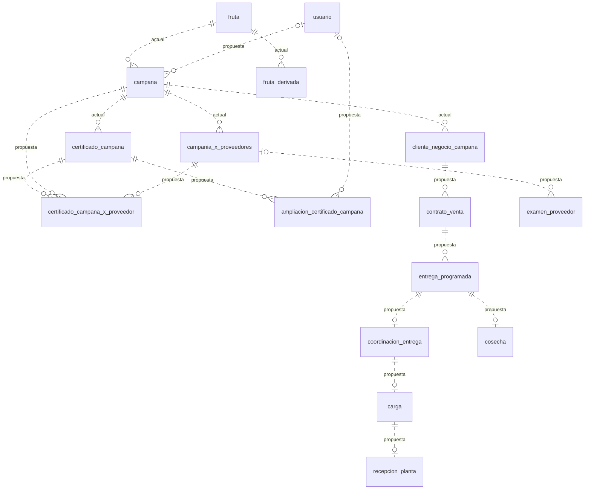

**D01 — Participación única (Confirmado e incorporado al SQL):** Decisión del 29/10/2026: se retira la cabecera participacion_proveedor_campana. campania_x_proveedores conserva cxp_id, proveedor/campaña, cantidad, tipo, evaluación, precio y disponibilidad. Cobertura de certificados y proveedor_carga referencian cxp_id; no se mantiene una segunda participación.

**D09 — Cantidad de certificados (Por discutir):** El editor dice uno por campaña; el backend y el resumen admiten varios. Se mantiene la capacidad actual hasta decidir si las normas requieren certificados distintos.

**`campana`:** reutiliza su diccionario anterior; no crea una tabla duplicada.

**`fruta`:** reutiliza su diccionario anterior; no crea una tabla duplicada.

**`fruta_derivada`:** reutiliza su diccionario anterior; no crea una tabla duplicada.

**`usuario`:** reutiliza su diccionario anterior; no crea una tabla duplicada.

<a id="tabla-campania_x_proveedores"></a>

**Diccionario de `campania_x_proveedores` — tabla actual ampliada.**

**Clave primaria:** `cxp_id`. Única participación proveedor/campaña, identificada por cxp_id; conserva oferta, tipo, evaluación, entrevista aplicable, precio simple PEN y disponibilidad.

**Fuente actual:** [CampaniaProveedor](D:/upeu/proyecto-carrera/app/epe-backend/src/campana-proveedor/entities/campania-proveedor.ts).

| Atributo | Estado | Tipo y obligatoriedad en el modelo revisado | Finalidad / relación |
|---|---|---|---|
| `created_at` | **ACTUAL** | `timestamp with time zone NOT NULL DEFAULT now()` | Se conserva de la entidad/migración actual. |
| `updated_at` | **ACTUAL** | `timestamp with time zone NOT NULL DEFAULT now()` | Se conserva de la entidad/migración actual. |
| `cxp_id` | **ACTUAL** | `serial NOT NULL` | Se conserva de la entidad/migración actual. |
| `cantidad_proveedor` | **ACTUAL** | `numeric(12,3) NOT NULL` | Se conserva de la entidad/migración actual. |
| `mtd_ceratitis` | **MODIFICAR** | `numeric(12,3)` | FC02: legacy opcional; MTD operativo se registra por finca en medicion_mtd. |
| `fruta_convencional_estimado` | **ACTUAL** | `integer` | Se conserva de la entidad/migración actual. |
| `tipo_proveedor` | **ACTUAL** | `"campania_x_proveedores_tipo_proveedor_enum" NOT NULL` | Se conserva de la entidad/migración actual. |
| `estado` | **ACTUAL** | `"campania_x_proveedores_estado_enum" NOT NULL DEFAULT 'sin validar'::campania_x_proveedores_estado_enum` | Se conserva de la entidad/migración actual. |
| `campania_id` | **ACTUAL** | `integer NOT NULL` | Se conserva de la entidad/migración actual. FK a `campana.campania_id`. |
| `proveedor_id` | **ACTUAL** | `integer NOT NULL` | Se conserva de la entidad/migración actual. FK a `proveedor.proveedor_id`. |
| `precio_compra_kg` | **AGREGAR** | `numeric(14,4)` | FC02: datos del editor de participación; el precio no requiere un tarifario adicional. |
| `moneda` | **AGREGAR** | `varchar(3) NOT NULL DEFAULT 'PEN'` | FC02: datos del editor de participación; el precio no requiere un tarifario adicional. |
| `disponibilidad_desde` | **AGREGAR** | `date` | FC02: datos del editor de participación; el precio no requiere un tarifario adicional. |
| `disponibilidad_hasta` | **AGREGAR** | `date` | FC02: datos del editor de participación; el precio no requiere un tarifario adicional. |
| `observaciones` | **AGREGAR** | `text` | FC02: datos del editor de participación; el precio no requiere un tarifario adicional. |
| `entrevista_aplica` | **AGREGAR** | `boolean NOT NULL DEFAULT true` | Consolidación: conserva el indicador de entrevista de la cabecera retirada; el servicio lo confirma según el proveedor. |

**Restricciones actuales conservadas:** `CHECK (((tipo_proveedor = 'productor'::campania_x_proveedores_tipo_proveedor_enum) OR (fruta_convencional_estimado IS NULL)))`; `PRIMARY KEY (cxp_id)`.

**Restricciones propuestas para revisar:** `UNIQUE (campania_id, proveedor_id)`; `CHECK (moneda = 'PEN' AND (precio_compra_kg IS NULL OR precio_compra_kg > 0))`; `CHECK (disponibilidad_hasta >= disponibilidad_desde)`; `UNIQUE (cxp_id, campania_id, proveedor_id)`.

<a id="tabla-examen_proveedor"></a>

**Diccionario de `examen_proveedor` — tabla actual ampliada.**

**Clave primaria:** `examen_proveedor_id`. Exámenes sanitarios de la participación, con muestra y fechas de laboratorio.

**Fuente actual:** [ExamenProveedor](D:/upeu/proyecto-carrera/app/epe-backend/src/proveedor/entities/examen-proveedor.ts).

| Atributo | Estado | Tipo y obligatoriedad en el modelo revisado | Finalidad / relación |
|---|---|---|---|
| `created_at` | **ACTUAL** | `timestamp with time zone NOT NULL DEFAULT now()` | Se conserva de la entidad/migración actual. |
| `updated_at` | **ACTUAL** | `timestamp with time zone NOT NULL DEFAULT now()` | Se conserva de la entidad/migración actual. |
| `examen_proveedor_id` | **ACTUAL** | `serial NOT NULL` | Se conserva de la entidad/migración actual. |
| `fecha` | **ACTUAL** | `date NOT NULL` | Se conserva de la entidad/migración actual. |
| `tipo_examen` | **ACTUAL** | `varchar(150) NOT NULL` | Se conserva de la entidad/migración actual. |
| `resultado` | **MODIFICAR** | `"examen_proveedor_resultado_enum"` | FC03: dato pendiente hasta completar la etapa correspondiente. |
| `origen` | **MODIFICAR** | `varchar(255)` | FC03: dato pendiente hasta completar la etapa correspondiente. |
| `observacion` | **MODIFICAR** | `text` | FC03: dato pendiente hasta completar la etapa correspondiente. |
| `documento_url` | **MODIFICAR** | `text` | FC03: dato pendiente hasta completar la etapa correspondiente. |
| `proveedor_id` | **ACTUAL** | `integer NOT NULL` | Se conserva de la entidad/migración actual. FK a `proveedor.proveedor_id`. |
| `cxp_id` | **AGREGAR** | `integer` | Contexto de campaña/proveedor cuando se conoce. FK a `campania_x_proveedores.cxp_id`. |
| `finca_id` | **AGREGAR** | `integer` | Finca de la muestra cuando se conoce. FK a `finca.finca_id`. |
| `codigo_muestra` | **AGREGAR** | `varchar(80)` | Identificador de muestra. |
| `fecha_envio` | **AGREGAR** | `date` | Fecha de envío al laboratorio. |
| `estado_examen` | **AGREGAR** | `varchar(30) NOT NULL DEFAULT 'Pendiente'` | FC03: etapa explícita del trámite de laboratorio. |
| `documento_archivo_id` | **AGREGAR** | `integer` | PENDIENTE DE RELACIÓN: referencia documental reservada, opcional y sin FK. No usar identificadores de archivo hasta definir la integración. |

**Restricciones actuales conservadas:** `PRIMARY KEY (examen_proveedor_id)`.

**Restricciones propuestas para revisar:** `CHECK (estado_examen IN ('Pendiente','Enviado','Con resultado'))`; `CHECK (estado_examen <> 'Con resultado' OR resultado IS NOT NULL)`.

<a id="tabla-certificado_campana"></a>

**Diccionario de `certificado_campana` — tabla actual ampliada.**

**Clave primaria:** `certificado_id`. Certificado de campaña y su costo; el backend admite varios, aunque el editor del mockup anuncia uno. Unicidad pendiente de decisión.

**Fuente actual:** [CertificadoCampana](D:/upeu/proyecto-carrera/app/epe-backend/src/certificado-campana/entities/certificado-campana.ts).

| Atributo | Estado | Tipo y obligatoriedad en el modelo revisado | Finalidad / relación |
|---|---|---|---|
| `created_at` | **ACTUAL** | `timestamp with time zone NOT NULL DEFAULT now()` | Se conserva de la entidad/migración actual. |
| `updated_at` | **ACTUAL** | `timestamp with time zone NOT NULL DEFAULT now()` | Se conserva de la entidad/migración actual. |
| `certificado_id` | **ACTUAL** | `serial NOT NULL` | Se conserva de la entidad/migración actual. |
| `nombre` | **ACTUAL** | `varchar(255) NOT NULL` | Se conserva de la entidad/migración actual. |
| `document_url` | **MODIFICAR** | `text` | FC04: permitir ficha inicial sin evidencia o fechas todavía completas. |
| `costo` | **ACTUAL** | `numeric(12,2) NOT NULL` | Se conserva de la entidad/migración actual. |
| `recibo_url` | **MODIFICAR** | `text` | FC04: permitir ficha inicial sin evidencia o fechas todavía completas. |
| `fecha_vencimiento` | **MODIFICAR** | `date` | FC04: permitir ficha inicial sin evidencia o fechas todavía completas. |
| `estado` | **MODIFICAR** | `"certificado_campana_estado_enum"` | FC04: permitir ficha inicial sin evidencia o fechas todavía completas. |
| `campania_id` | **ACTUAL** | `integer NOT NULL` | Se conserva de la entidad/migración actual. FK a `campana.campania_id`. |
| `codigo` | **AGREGAR** | `varchar(80)` | Identificador externo del certificado. |
| `norma_id` | **AGREGAR** | `integer` | Norma del certificado. FK a `norma.norma_id`. |
| `organismo` | **AGREGAR** | `varchar(255)` | Organismo certificador. |
| `fecha_emision` | **AGREGAR** | `date` | Fecha de emisión del certificado. |
| `moneda` | **AGREGAR** | `varchar(3)` | Moneda del costo y de sus pagos; no se deduce automáticamente. |
| `documento_archivo_id` | **AGREGAR** | `integer` | PENDIENTE DE RELACIÓN: referencia documental reservada, opcional y sin FK. No usar identificadores de archivo hasta definir la integración. |
| `vigencia_desde` | **AGREGAR** | `date` | FC04: inicio de vigencia independiente de la emisión. |
| `observaciones` | **AGREGAR** | `text` | FC04: notas del editor de certificación. |
| `historial_cobertura` | **AGREGAR** | `jsonb NOT NULL DEFAULT '[]'::jsonb` | FC04: filas {fecha,kilos,producerIds}; conserva cada selección anterior. |
| `tipo_certificacion` | **AGREGAR** | `varchar(80)` | Opción fija del formulario, distinta de nombre y de norma_id; nullable para fichas aún incompletas. No se crea tabla de tipos. |

**Restricciones actuales conservadas:** `PRIMARY KEY (certificado_id)`.

**Restricciones propuestas para revisar:** `CHECK (moneda IS NULL OR moneda IN ('PEN','USD','EUR'))`; `CHECK (jsonb_typeof(historial_cobertura) = 'array')`; `CHECK (fecha_vencimiento >= vigencia_desde)`; `CHECK (tipo_certificacion IN ('Global GAP','Orgánico USDA','Orgánico UE','Fairtrade','Rainforest Alliance'))`; `UNIQUE (certificado_id, campania_id)`.

<a id="tabla-certificado_campana_x_proveedor"></a>

**Diccionario de `certificado_campana_x_proveedor` — tabla propuesta.**

**Clave primaria:** `certificado_campana_x_proveedor_id`. Productores cubiertos y kilos iniciales capturados al certificar.

| Atributo | Estado | Tipo y obligatoriedad en el modelo revisado | Finalidad / relación |
|---|---|---|---|
| `certificado_campana_x_proveedor_id` | **TABLA NUEVA** | `integer GENERATED ALWAYS AS IDENTITY PRIMARY KEY` | Atributo propuesto para cubrir el flujo de la vista. |
| `certificado_id` | **TABLA NUEVA** | `integer NOT NULL` | Atributo propuesto para cubrir el flujo de la vista. FK a `certificado_campana.certificado_id`; FK a `certificado_campana.certificado_id,campania_id`. |
| `campania_id` | **TABLA NUEVA** | `integer NOT NULL` | Atributo propuesto para cubrir el flujo de la vista. FK a `campana.campania_id`; FK a `certificado_campana.certificado_id,campania_id`; FK a `campania_x_proveedores.cxp_id,campania_id,proveedor_id`. |
| `cxp_id` | **TABLA NUEVA** | `integer NOT NULL` | Participación única en campania_x_proveedores; no existe cabecera duplicada. FK a `campania_x_proveedores.cxp_id`; FK a `campania_x_proveedores.cxp_id,campania_id,proveedor_id`. |
| `proveedor_id` | **TABLA NUEVA** | `integer NOT NULL` | Atributo propuesto para cubrir el flujo de la vista. FK a `proveedor.proveedor_id`; FK a `campania_x_proveedores.cxp_id,campania_id,proveedor_id`. |
| `kilos_autorizados` | **TABLA NUEVA** | `numeric(14,3) NOT NULL` | Atributo propuesto para cubrir el flujo de la vista. |
| `created_at` | **TABLA NUEVA** | `timestamptz NOT NULL DEFAULT now()` | Auditoría con la misma convención del backend. |
| `updated_at` | **TABLA NUEVA** | `timestamptz NOT NULL DEFAULT now()` | Auditoría con la misma convención del backend; el servicio/ORM actualiza esta fecha. |

**Restricciones propuestas para revisar:** `UNIQUE (certificado_id, cxp_id)`; `CHECK (kilos_autorizados > 0)`.

<a id="tabla-ampliacion_certificado_campana"></a>

**Diccionario de `ampliacion_certificado_campana` — tabla propuesta.**

**Clave primaria:** `ampliacion_certificado_campana_id`. Incrementos de cobertura, sin sobrescribir los kilos iniciales.

| Atributo | Estado | Tipo y obligatoriedad en el modelo revisado | Finalidad / relación |
|---|---|---|---|
| `ampliacion_certificado_campana_id` | **TABLA NUEVA** | `integer GENERATED ALWAYS AS IDENTITY PRIMARY KEY` | Atributo propuesto para cubrir el flujo de la vista. |
| `certificado_id` | **TABLA NUEVA** | `integer NOT NULL` | Atributo propuesto para cubrir el flujo de la vista. FK a `certificado_campana.certificado_id`. |
| `fecha` | **TABLA NUEVA** | `date NOT NULL` | Atributo propuesto para cubrir el flujo de la vista. |
| `kilos_adicionales` | **TABLA NUEVA** | `numeric(14,3) NOT NULL` | Atributo propuesto para cubrir el flujo de la vista. |
| `referencia` | **TABLA NUEVA** | `varchar(180) NOT NULL` | Atributo propuesto para cubrir el flujo de la vista. |
| `registrado_por_usuario_id` | **TABLA NUEVA** | `integer` | Atributo propuesto para cubrir el flujo de la vista. FK a `usuario.usuario_id`. |
| `created_at` | **TABLA NUEVA** | `timestamptz NOT NULL DEFAULT now()` | Auditoría con la misma convención del backend. |
| `updated_at` | **TABLA NUEVA** | `timestamptz NOT NULL DEFAULT now()` | Auditoría con la misma convención del backend; el servicio/ORM actualiza esta fecha. |

**Restricciones propuestas para revisar:** `CHECK (kilos_adicionales > 0)`.

**`cliente_negocio_campana`:** reutiliza su diccionario anterior; no crea una tabla duplicada.

**`contrato_venta`:** reutiliza su diccionario anterior; no crea una tabla duplicada.

**`entrega_programada`:** reutiliza su diccionario anterior; no crea una tabla duplicada.

**`coordinacion_entrega`:** reutiliza su diccionario anterior; no crea una tabla duplicada.

<a id="tabla-cosecha"></a>

**Diccionario de `cosecha` — tabla propuesta.**

**Clave primaria:** `cosecha_id`. Operación de cosecha de una entrega; estado separado del despacho.

| Atributo | Estado | Tipo y obligatoriedad en el modelo revisado | Finalidad / relación |
|---|---|---|---|
| `cosecha_id` | **TABLA NUEVA** | `integer GENERATED ALWAYS AS IDENTITY PRIMARY KEY` | Atributo propuesto para cubrir el flujo de la vista. |
| `entrega_programada_id` | **TABLA NUEVA** | `integer NOT NULL` | Atributo propuesto para cubrir el flujo de la vista. FK a `entrega_programada.entrega_programada_id`. |
| `codigo_lote` | **TABLA NUEVA** | `varchar(60) NOT NULL` | Atributo propuesto para cubrir el flujo de la vista. |
| `fecha_prevista` | **TABLA NUEVA** | `date NOT NULL` | Atributo propuesto para cubrir el flujo de la vista. |
| `kilos_estimados` | **TABLA NUEVA** | `numeric(14,3) NOT NULL` | Atributo propuesto para cubrir el flujo de la vista. |
| `kilos_cosechados` | **TABLA NUEVA** | `numeric(14,3)` | Atributo propuesto para cubrir el flujo de la vista. |
| `kilos_aceptados` | **TABLA NUEVA** | `numeric(14,3)` | Atributo propuesto para cubrir el flujo de la vista. |
| `estado` | **TABLA NUEVA** | `varchar(30) NOT NULL DEFAULT 'PENDIENTE'` | Atributo propuesto para cubrir el flujo de la vista. |
| `cierre_cosecha_at` | **TABLA NUEVA** | `timestamptz` | Atributo propuesto para cubrir el flujo de la vista. |
| `evidencia_id` | **TABLA NUEVA** | `integer` | PENDIENTE DE RELACIÓN: referencia documental reservada, opcional y sin FK. No usar identificadores de archivo hasta definir la integración. |
| `created_at` | **TABLA NUEVA** | `timestamptz NOT NULL DEFAULT now()` | Auditoría con la misma convención del backend. |
| `updated_at` | **TABLA NUEVA** | `timestamptz NOT NULL DEFAULT now()` | Auditoría con la misma convención del backend; el servicio/ORM actualiza esta fecha. |
| `organizacion` | **TABLA NUEVA** | `jsonb NOT NULL DEFAULT '{}'::jsonb` | FC08: conserva el objeto/lista homólogo de QualityOperation (organizacion); avances identifican proveedor/finca, fecha, kilos, jabas y responsable. |
| `avances` | **TABLA NUEVA** | `jsonb NOT NULL DEFAULT '[]'::jsonb` | FC08: conserva el objeto/lista homólogo de QualityOperation (avances); avances identifican proveedor/finca, fecha, kilos, jabas y responsable. |
| `cierre` | **TABLA NUEVA** | `jsonb NOT NULL DEFAULT '{}'::jsonb` | FC08: conserva el objeto/lista homólogo de QualityOperation (cierre); avances identifican proveedor/finca, fecha, kilos, jabas y responsable. |
| `industria` | **TABLA NUEVA** | `jsonb NOT NULL DEFAULT '{}'::jsonb` | FC08: conserva el objeto/lista homólogo de QualityOperation (industria); avances identifican proveedor/finca, fecha, kilos, jabas y responsable. |
| `observaciones` | **TABLA NUEVA** | `text` | Notas de la operación de calidad/cosecha. |

**Restricciones propuestas para revisar:** `UNIQUE (codigo_lote)`; `CHECK (kilos_estimados >= 0)`; `CHECK (kilos_cosechados >= 0)`; `CHECK (kilos_aceptados >= 0)`; `CHECK (jsonb_typeof(organizacion) = 'object')`; `CHECK (jsonb_typeof(avances) = 'array')`; `CHECK (jsonb_typeof(cierre) = 'object')`; `CHECK (jsonb_typeof(industria) = 'object')`; `UNIQUE (entrega_programada_id)`.

**`carga`:** reutiliza su diccionario anterior; no crea una tabla duplicada.

<a id="tabla-recepcion_planta"></a>

**Diccionario de `recepcion_planta` — tabla propuesta.**

**Clave primaria:** `recepcion_planta_id`. Recepción única con checklist, peso, descarte y cierre físico/administrativo.

| Atributo | Estado | Tipo y obligatoriedad en el modelo revisado | Finalidad / relación |
|---|---|---|---|
| `recepcion_planta_id` | **TABLA NUEVA** | `integer GENERATED ALWAYS AS IDENTITY PRIMARY KEY` | Atributo propuesto para cubrir el flujo de la vista. |
| `carga_id` | **TABLA NUEVA** | `integer NOT NULL` | Atributo propuesto para cubrir el flujo de la vista. FK a `carga.carga_id`. |
| `id_chofer_transporte_externo` | **TABLA NUEVA** | `integer NOT NULL` | Atributo propuesto para cubrir el flujo de la vista. FK a `chofer_transporte_externo.id_chofer_transporte_externo`. |
| `fecha_recepcion` | **TABLA NUEVA** | `timestamptz` | Atributo propuesto para cubrir el flujo de la vista. |
| `peso_planta_kg` | **TABLA NUEVA** | `numeric(14,3)` | Atributo propuesto para cubrir el flujo de la vista. |
| `hubo_descarte` | **TABLA NUEVA** | `boolean` | Atributo propuesto para cubrir el flujo de la vista. |
| `descarte_kg` | **TABLA NUEVA** | `numeric(14,3)` | Atributo propuesto para cubrir el flujo de la vista. |
| `evidencia_descarte_id` | **TABLA NUEVA** | `integer` | PENDIENTE DE RELACIÓN: referencia documental reservada, opcional y sin FK. No usar identificadores de archivo hasta definir la integración. |
| `reporte_recepcion_id` | **TABLA NUEVA** | `integer` | PENDIENTE DE RELACIÓN: referencia documental reservada, opcional y sin FK. No usar identificadores de archivo hasta definir la integración. |
| `resultado` | **TABLA NUEVA** | `varchar(80)` | Atributo propuesto para cubrir el flujo de la vista. |
| `recepcion_confirmada_at` | **TABLA NUEVA** | `timestamptz` | Atributo propuesto para cubrir el flujo de la vista. |
| `descarte_confirmado_at` | **TABLA NUEVA** | `timestamptz` | Atributo propuesto para cubrir el flujo de la vista. |
| `jabas_devueltas` | **TABLA NUEVA** | `integer` | Atributo propuesto para cubrir el flujo de la vista. |
| `jabas_devolucion_at` | **TABLA NUEVA** | `timestamptz` | Atributo propuesto para cubrir el flujo de la vista. |
| `descarga_at` | **TABLA NUEVA** | `timestamptz` | Atributo propuesto para cubrir el flujo de la vista. |
| `cierre_fisico_at` | **TABLA NUEVA** | `timestamptz` | Atributo propuesto para cubrir el flujo de la vista. |
| `cierre_administrativo_at` | **TABLA NUEVA** | `timestamptz` | Atributo propuesto para cubrir el flujo de la vista. |
| `observaciones` | **TABLA NUEVA** | `text` | Atributo propuesto para cubrir el flujo de la vista. |
| `created_at` | **TABLA NUEVA** | `timestamptz NOT NULL DEFAULT now()` | Auditoría con la misma convención del backend. |
| `updated_at` | **TABLA NUEVA** | `timestamptz NOT NULL DEFAULT now()` | Auditoría con la misma convención del backend; el servicio/ORM actualiza esta fecha. |
| `compras` | **TABLA NUEVA** | `jsonb NOT NULL DEFAULT '[]'::jsonb` | FC10: datos de LogisticsDelivery; compras guarda providerId, recognizedQuantity, revisión y soporte; checklist conserva no aplica y confirmaciones. |
| `logistica` | **TABLA NUEVA** | `jsonb NOT NULL DEFAULT '{}'::jsonb` | FC10: datos de LogisticsDelivery; compras guarda providerId, recognizedQuantity, revisión y soporte; checklist conserva no aplica y confirmaciones. |
| `checklist` | **TABLA NUEVA** | `jsonb NOT NULL DEFAULT '{}'::jsonb` | FC10: datos de LogisticsDelivery; compras guarda providerId, recognizedQuantity, revisión y soporte; checklist conserva no aplica y confirmaciones. |
| `documentos` | **TABLA NUEVA** | `jsonb NOT NULL DEFAULT '{}'::jsonb` | FC10: datos de LogisticsDelivery; compras guarda providerId, recognizedQuantity, revisión y soporte; checklist conserva no aplica y confirmaciones. |
| `descarga_inicio_at` | **TABLA NUEVA** | `timestamptz` | FC10: dato de descarga/devolución que no puede reconstruirse desde un único total o fecha. |
| `descarga_fin_at` | **TABLA NUEVA** | `timestamptz` | FC10: dato de descarga/devolución que no puede reconstruirse desde un único total o fecha. |
| `jabas_iniciales` | **TABLA NUEVA** | `integer` | FC10: dato de descarga/devolución que no puede reconstruirse desde un único total o fecha. |
| `jabas_no_aplica` | **TABLA NUEVA** | `boolean` | FC10: dato de descarga/devolución que no puede reconstruirse desde un único total o fecha. |

**Restricciones propuestas para revisar:** `UNIQUE (carga_id)`; `CHECK (peso_planta_kg > 0)`; `CHECK (descarte_kg >= 0)`; `CHECK (jabas_devueltas >= 0)`; `CHECK (hubo_descarte IS DISTINCT FROM false OR descarte_kg = 0)`; `CHECK (hubo_descarte IS DISTINCT FROM true OR descarte_kg > 0)`; `CHECK (jsonb_typeof(compras) = 'array')`; `CHECK (jsonb_typeof(logistica) = 'object')`; `CHECK (jsonb_typeof(checklist) = 'object')`; `CHECK (jsonb_typeof(documentos) = 'object')`; `CHECK (descarga_fin_at >= descarga_inicio_at)`; `CHECK (jabas_iniciales >= 0 AND (jabas_iniciales IS NULL OR jabas_devueltas <= jabas_iniciales))`; `CHECK (descarte_kg <= peso_planta_kg)`.

## Proveedores de campaña (Administrador > Gestión de Campaña > Planificado > Campaña > Proveedores)

**Referencia de revisión:** V11 · Recorrido del 27/10/2026.

**Entrada, acciones y salida:** Planificado → Más opciones de Palta 2027 → Proveedores → Ver participación; Más opciones del proveedor → Entrevista / Exámenes.

**Observado en la aplicación de referencia:** Roberto Palacios aparece como productor de Palta 2027. El detalle muestra dos fincas; se confirma con el usuario que serán las fincas entrevistadas.

**Criterio para revisar el modelo:** El precio simple vive en campania_x_proveedores.precio_compra_kg y moneda PEN. Se retira acuerdo_compra: no existe un flujo independiente de acuerdos/versiones en el prototipo. La liquidación conserva kilos reconocidos y precio aplicados. Decisión del 29/10/2026: se retira la cabecera participacion_proveedor_campana. campania_x_proveedores conserva cxp_id, proveedor/campaña, cantidad, tipo, evaluación, precio y disponibilidad. Cobertura de certificados y proveedor_carga referencian cxp_id; no se mantiene una segunda participación.

**Funcionalidad esperada de cada tabla en esta vista:**

| Tabla | Uso en esta vista | Funcionalidad esperada | Situación |
|---|---|---|---|
| [`campania_x_proveedores`](#tabla-campania_x_proveedores) | Escritura esperada | Crear o actualizar la participación del proveedor, su tipo, cantidad y evaluación en la campaña; es el identificador usado para agrupar sus entrevistas. | Tabla actual incluida |
| [`proveedor`](#tabla-proveedor) | Consulta | Mantiene el padrón comercial y datos generales de la persona o entidad proveedora, compartidos entre campañas. | Tabla actual incluida |
| [`campana`](#tabla-campana) | Consulta | Identifica la campaña, sus fechas, fruta, responsable y estado; aporta el ámbito de todas las consultas de la vista. | Tabla actual incluida |
| [`proveedor_x_fruta`](#tabla-proveedor_x_fruta) | Consulta | Asocia las frutas del padrón al proveedor; se conserva mientras no se apruebe derivarlas exclusivamente de sus fincas. | Tabla actual incluida |
| [`proveedor_x_fruta_derivada`](#tabla-proveedor_x_fruta_derivada) | Consulta | Propuesta para las variedades del padrón del proveedor. No identifica la finca física de recojo. | Tabla propuesta, sin implementar |
| [`fruta`](#tabla-fruta) | Consulta | Proporciona el catálogo de cultivos y la fruta de la campaña. No representa kilos comprados ni cosechados. | Tabla actual incluida |
| [`fruta_derivada`](#tabla-fruta_derivada) | Consulta | Identifica una variedad y su fruta. Permite mostrar el cultivo de la finca sin duplicar fruta_id en finca. | Tabla actual incluida |
| [`entrevista_extencion`](#tabla-entrevista_extencion) | Consulta | Consultar las entrevistas de la participación y obtener sus fincas distintas para el detalle «Fincas vinculadas a la campaña», según decisión confirmada. | Tabla actual incluida |
| [`finca`](#tabla-finca) | Consulta | Leer las fincas alcanzadas a través de entrevistas; no es una asociación directa de finca con la participación. | Tabla actual incluida |
| [`examen_proveedor`](#tabla-examen_proveedor) | Consulta | Registra muestras y exámenes de evaluación del proveedor, con contexto de campaña propuesto. No sustituye los análisis operativos de Calidad. | Tabla actual incluida |

**Esquema de relaciones utilizado por esta vista:**

**Tablas actuales que se conservan:** `campania_x_proveedores`, `proveedor`, `campana`, `proveedor_x_fruta`, `fruta`, `fruta_derivada`, `entrevista_extencion`, `finca`, `examen_proveedor`.

**Tablas propuestas para revisar:** `proveedor_x_fruta_derivada`.

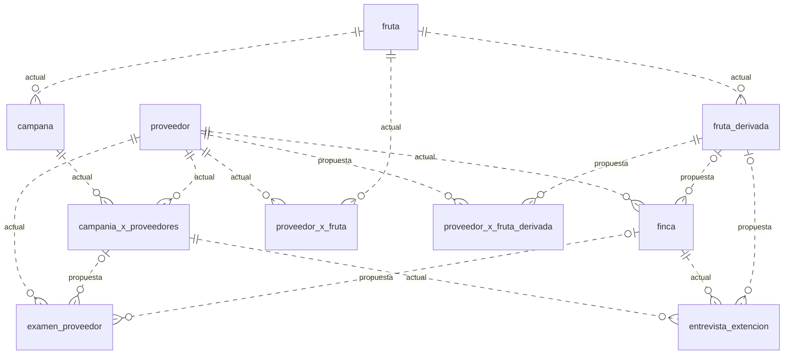

**D01 — Participación única (Confirmado e incorporado al SQL):** Decisión del 29/10/2026: se retira la cabecera participacion_proveedor_campana. campania_x_proveedores conserva cxp_id, proveedor/campaña, cantidad, tipo, evaluación, precio y disponibilidad. Cobertura de certificados y proveedor_carga referencian cxp_id; no se mantiene una segunda participación.

**D02 — Fincas entrevistadas (Aprobado por el usuario):** El listado de fincas de una participación se obtiene desde entrevista_extencion. No se vuelve a agregar finca_id a campania_x_proveedores; los orígenes de entrega/carga seleccionan las fincas físicas de recojo.

**`campania_x_proveedores`:** reutiliza su diccionario anterior; no crea una tabla duplicada.

<a id="tabla-proveedor"></a>

**Diccionario de `proveedor` — tabla actual ampliada.**

**Clave primaria:** `proveedor_id`. Identidad comercial del proveedor principal.

**Fuente actual:** [Proveedor](D:/upeu/proyecto-carrera/app/epe-backend/src/proveedor/entities/proveedor.ts).

| Atributo | Estado | Tipo y obligatoriedad en el modelo revisado | Finalidad / relación |
|---|---|---|---|
| `created_at` | **ACTUAL** | `timestamp with time zone NOT NULL DEFAULT now()` | Se conserva de la entidad/migración actual. |
| `updated_at` | **ACTUAL** | `timestamp with time zone NOT NULL DEFAULT now()` | Se conserva de la entidad/migración actual. |
| `proveedor_id` | **ACTUAL** | `serial NOT NULL` | Se conserva de la entidad/migración actual. |
| `nombres` | **ACTUAL** | `varchar(150) NOT NULL` | Se conserva de la entidad/migración actual. |
| `apellido` | **ACTUAL** | `varchar(150) NOT NULL` | Se conserva de la entidad/migración actual. |
| `tipo_documento` | **ACTUAL** | `"proveedor_tipo_documento_enum" NOT NULL` | Se conserva de la entidad/migración actual. |
| `nmr_documento` | **MODIFICAR** | `varchar(30) NOT NULL` | FC01: conservar texto/ceros/letras o admitir dato pendiente del formulario. |
| `identidad_doc_url` | **MODIFICAR** | `text` | FC01: conservar texto/ceros/letras o admitir dato pendiente del formulario. |
| `zona` | **ACTUAL** | `text NOT NULL` | Se conserva de la entidad/migración actual. |
| `telefono` | **MODIFICAR** | `varchar(30) NOT NULL` | FC01: conservar texto/ceros/letras o admitir dato pendiente del formulario. |
| `email` | **MODIFICAR** | `varchar(320)` | FC01: conservar texto/ceros/letras o admitir dato pendiente del formulario. |
| `codigo_lugar_produccion` | **MODIFICAR** | `varchar(60)` | FC01: conservar texto/ceros/letras o admitir dato pendiente del formulario. |
| `nombre_agronomico` | **ACTUAL** | `varchar(255)` | Se conserva de la entidad/migración actual. |
| `densidad_plantacion` | **ACTUAL** | `numeric(12,3)` | Se conserva de la entidad/migración actual. |
| `distanciamiento` | **ACTUAL** | `numeric(12,3)` | Se conserva de la entidad/migración actual. |
| `frecuencia_riego` | **ACTUAL** | `integer` | Se conserva de la entidad/migración actual. |
| `nombre_aplicacion` | **ACTUAL** | `varchar(255)` | Se conserva de la entidad/migración actual. |
| `aplicaciones_al_ano` | **ACTUAL** | `integer` | Se conserva de la entidad/migración actual. |
| `estado_examen_sanidad_agraria` | **ACTUAL** | `varchar(100)` | Se conserva de la entidad/migración actual. |
| `persona_id` | **AGREGAR** | `integer` | Vincular identidad compartida sin eliminar los nombres/documentos actuales. FK a `persona.persona_id`. |
| `activo` | **AGREGAR** | `boolean NOT NULL DEFAULT true` | Permitir desactivación sin borrar historial. |
| `documento_archivo_id` | **AGREGAR** | `integer` | PENDIENTE DE RELACIÓN: referencia documental reservada, opcional y sin FK. No usar identificadores de archivo hasta definir la integración. |
| `fecha_registro` | **AGREGAR** | `date` | Fecha de registro que muestra el padrón del prototipo. |

**Restricciones actuales conservadas:** `PRIMARY KEY (proveedor_id)`.

**`campana`:** reutiliza su diccionario anterior; no crea una tabla duplicada.

<a id="tabla-proveedor_x_fruta"></a>

**Diccionario de `proveedor_x_fruta` — tabla actual ampliada.**

**Clave primaria:** `pxf_id`. Frutas asociadas al padrón general.

**Fuente actual:** [ProveedorFruta](D:/upeu/proyecto-carrera/app/epe-backend/src/proveedor-fruta/entities/proveedor-fruta.ts).

| Atributo | Estado | Tipo y obligatoriedad en el modelo revisado | Finalidad / relación |
|---|---|---|---|
| `created_at` | **ACTUAL** | `timestamp with time zone NOT NULL DEFAULT now()` | Se conserva de la entidad/migración actual. |
| `updated_at` | **ACTUAL** | `timestamp with time zone NOT NULL DEFAULT now()` | Se conserva de la entidad/migración actual. |
| `pxf_id` | **ACTUAL** | `serial NOT NULL` | Se conserva de la entidad/migración actual. |
| `proveedor_id` | **ACTUAL** | `integer NOT NULL` | Se conserva de la entidad/migración actual. FK a `proveedor.proveedor_id`. |
| `fruta_id` | **ACTUAL** | `integer NOT NULL` | Se conserva de la entidad/migración actual. FK a `fruta.fruta_id`. |

**Restricciones actuales conservadas:** `PRIMARY KEY (pxf_id)`.

**Índices actuales conservados:** `CREATE UNIQUE INDEX "UQ_proveedor_fruta" ON agro.proveedor_x_fruta USING btree (proveedor_id, fruta_id)`.

<a id="tabla-proveedor_x_fruta_derivada"></a>

**Diccionario de `proveedor_x_fruta_derivada` — tabla propuesta.**

**Clave primaria:** `proveedor_x_fruta_derivada_id`. Variedades asociadas al padrón general.

| Atributo | Estado | Tipo y obligatoriedad en el modelo revisado | Finalidad / relación |
|---|---|---|---|
| `proveedor_x_fruta_derivada_id` | **TABLA NUEVA** | `integer GENERATED ALWAYS AS IDENTITY PRIMARY KEY` | Atributo propuesto para cubrir el flujo de la vista. |
| `proveedor_id` | **TABLA NUEVA** | `integer NOT NULL` | Atributo propuesto para cubrir el flujo de la vista. FK a `proveedor.proveedor_id`. |
| `fruta_derivada_id` | **TABLA NUEVA** | `integer NOT NULL` | Atributo propuesto para cubrir el flujo de la vista. FK a `fruta_derivada.fruta_derivada_id`. |
| `created_at` | **TABLA NUEVA** | `timestamptz NOT NULL DEFAULT now()` | Auditoría con la misma convención del backend. |
| `updated_at` | **TABLA NUEVA** | `timestamptz NOT NULL DEFAULT now()` | Auditoría con la misma convención del backend; el servicio/ORM actualiza esta fecha. |

**Restricciones propuestas para revisar:** `UNIQUE (proveedor_id, fruta_derivada_id)`.

**`fruta`:** reutiliza su diccionario anterior; no crea una tabla duplicada.

**`fruta_derivada`:** reutiliza su diccionario anterior; no crea una tabla duplicada.

<a id="tabla-entrevista_extencion"></a>

**Diccionario de `entrevista_extencion` — tabla actual ampliada.**

**Clave primaria:** `entrevista_id`. Registro agronómico de cada finca entrevistada en una campaña.

**Fuente actual:** [EntrevistaExtencion](D:/upeu/proyecto-carrera/app/epe-backend/src/entrevista-extencion/entities/entrevista-extencion.ts).

| Atributo | Estado | Tipo y obligatoriedad en el modelo revisado | Finalidad / relación |
|---|---|---|---|
| `created_at` | **ACTUAL** | `timestamp with time zone NOT NULL DEFAULT now()` | Se conserva de la entidad/migración actual. |
| `updated_at` | **ACTUAL** | `timestamp with time zone NOT NULL DEFAULT now()` | Se conserva de la entidad/migración actual. |
| `entrevista_id` | **ACTUAL** | `serial NOT NULL` | Se conserva de la entidad/migración actual. |
| `densidad` | **MODIFICAR** | `numeric(12,3)` | FC02: el escalar legacy no impide guardar la descripción agronómica del formulario. |
| `distanciamiento` | **MODIFICAR** | `numeric(12,3)` | FC02: el escalar legacy no impide guardar la descripción agronómica del formulario. |
| `frecuencia` | **MODIFICAR** | `numeric(12,3)` | FC02: el escalar legacy no impide guardar la descripción agronómica del formulario. |
| `nombre_aplicacion` | **MODIFICAR** | `varchar(255)` | FC02: el escalar legacy no impide guardar la descripción agronómica del formulario. |
| `anio_aplicacion` | **MODIFICAR** | `integer` | FC02: el escalar legacy no impide guardar la descripción agronómica del formulario. |
| `codigo` | **ACTUAL** | `varchar(255) NOT NULL` | Se conserva de la entidad/migración actual. |
| `cam_x_prov_id` | **ACTUAL** | `integer NOT NULL` | Se conserva de la entidad/migración actual. FK a `campania_x_proveedores.cxp_id`. |
| `finca_id` | **ACTUAL** | `integer NOT NULL` | Se conserva de la entidad/migración actual. FK a `finca.finca_id`. |
| `fruta_derivada_id` | **AGREGAR** | `integer` | Variedad entrevistada, si se registra. FK a `fruta_derivada.fruta_derivada_id`. |
| `distanciamiento_descripcion` | **AGREGAR** | `varchar(60)` | Expresión como 5 x 4; no sustituye automáticamente el escalar actual. |
| `frecuencia_riego_descripcion` | **AGREGAR** | `varchar(120)` | Expresión como cada cuatro días; frecuencia actual sigue numérica. |
| `aplicaciones_al_ano` | **AGREGAR** | `integer` | Cantidad de aplicaciones en un año; distinta de anio_aplicacion. |
| `observaciones` | **AGREGAR** | `text` | Notas de la entrevista. |
| `archivo_id` | **AGREGAR** | `integer` | PENDIENTE DE RELACIÓN: referencia documental reservada, opcional y sin FK. No usar identificadores de archivo hasta definir la integración. |
| `registrado_por_usuario_id` | **AGREGAR** | `integer` | Responsable de la entrevista. FK a `usuario.usuario_id`. |

**Restricciones actuales conservadas:** `CHECK (((codigo)::text ~ '^FVV-[A-Z0-9-]+-[0-9]+$'::text))`; `CHECK (((densidad >= (0)::numeric) AND (distanciamiento >= (0)::numeric) AND (frecuencia >= (0)::numeric) AND ((anio_aplicacion >= 1900) AND (anio_aplicacion <= 9999))))`; `PRIMARY KEY (entrevista_id)`.

**Índices actuales conservados:** `CREATE INDEX "IDX_entrevista_extencion_cxp" ON agro.entrevista_extencion USING btree (cam_x_prov_id)`; `CREATE INDEX "IDX_entrevista_extencion_finca" ON agro.entrevista_extencion USING btree (finca_id)`; `CREATE UNIQUE INDEX "UQ_entrevista_extencion_codigo" ON agro.entrevista_extencion USING btree (codigo)`.

**Restricciones propuestas para revisar:** `CHECK (aplicaciones_al_ano >= 0)`.

<a id="tabla-finca"></a>

**Diccionario de `finca` — tabla actual ampliada.**

**Clave primaria:** `finca_id`. Datos físicos de cada finca, independientes de la campaña.

**Fuente actual:** [Finca](D:/upeu/proyecto-carrera/app/epe-backend/src/finca/entities/finca.ts).

| Atributo | Estado | Tipo y obligatoriedad en el modelo revisado | Finalidad / relación |
|---|---|---|---|
| `created_at` | **ACTUAL** | `timestamp with time zone NOT NULL DEFAULT now()` | Se conserva de la entidad/migración actual. |
| `updated_at` | **ACTUAL** | `timestamp with time zone NOT NULL DEFAULT now()` | Se conserva de la entidad/migración actual. |
| `finca_id` | **ACTUAL** | `serial NOT NULL` | Se conserva de la entidad/migración actual. |
| `nombre_finca` | **ACTUAL** | `varchar(255) NOT NULL` | Se conserva de la entidad/migración actual. |
| `departamento` | **ACTUAL** | `varchar(100) NOT NULL` | Se conserva de la entidad/migración actual. |
| `provincia` | **ACTUAL** | `varchar(100) NOT NULL` | Se conserva de la entidad/migración actual. |
| `distrito` | **ACTUAL** | `varchar(100) NOT NULL` | Se conserva de la entidad/migración actual. |
| `latitud` | **ACTUAL** | `numeric(10,7) NOT NULL` | Se conserva de la entidad/migración actual. |
| `longitud` | **ACTUAL** | `numeric(10,7) NOT NULL` | Se conserva de la entidad/migración actual. |
| `ha_total_finca` | **MODIFICAR** | `numeric(12,3) NOT NULL` | FC01: admite hectáreas fraccionarias sin redondear a enteros. |
| `ha_cultivo` | **MODIFICAR** | `numeric(12,3) NOT NULL` | FC01: admite hectáreas fraccionarias sin redondear a enteros. |
| `proveedor_id` | **ACTUAL** | `integer NOT NULL` | Se conserva de la entidad/migración actual. FK a `proveedor.proveedor_id`. |
| `codigo_lugar_produccion` | **AGREGAR** | `varchar(60)` | Código SENASA del lugar físico de producción. |
| `codigo_catastral` | **AGREGAR** | `varchar(60)` | Código catastral de la finca. |
| `ubigeo` | **AGREGAR** | `varchar(6)` | Ubigeo de la finca. |
| `direccion` | **AGREGAR** | `text` | Dirección física para recojo/guías. |
| `codigo_establecimiento` | **AGREGAR** | `varchar(4)` | Código de establecimiento si aplica. |
| `fruta_derivada_id` | **AGREGAR** | `integer` | Variedad asociada a la finca. FK a `fruta_derivada.fruta_derivada_id`. |
| `edad_cultivo_anios` | **AGREGAR** | `numeric(6,2)` | Edad del cultivo expresada en años. |

**Restricciones actuales conservadas:** `CHECK (((ha_total_finca >= 0) AND (ha_cultivo >= 0) AND (ha_cultivo <= ha_total_finca)))`; `PRIMARY KEY (finca_id)`.

**Índices actuales conservados:** `CREATE INDEX "IDX_finca_proveedor" ON agro.finca USING btree (proveedor_id)`.

**Restricciones propuestas para revisar:** `CHECK (ubigeo IS NULL OR ubigeo ~ '^[0-9]{6}$')`; `CHECK (edad_cultivo_anios >= 0)`.

**`examen_proveedor`:** reutiliza su diccionario anterior; no crea una tabla duplicada.

## Entrevista (Administrador > Gestión de Campaña > Planificado > Proveedores > Participación > Entrevista)

**Referencia de revisión:** V12 · Recorrido del 27/10/2026.

**Entrada, acciones y salida:** Proveedores de campaña → Más opciones de Roberto Palacios → Entrevista → Fincas entrevistadas → Ver finca o Registrar entrevista.

**Observado en la aplicación de referencia:** Dos fincas entrevistadas, fecha/hora, códigos FYV de la UI y detalle agronómico. El backend conserva codigo FVV; revisar el prefijo antes de cambiar datos.

**Criterio para revisar el modelo:** Entrevista por participación y finca del mismo proveedor; admite descripciones de distanciamiento/riego sin exigir escalares legacy inventados.

**Funcionalidad esperada de cada tabla en esta vista:**

| Tabla | Uso en esta vista | Funcionalidad esperada | Situación |
|---|---|---|---|
| [`entrevista_extencion`](#tabla-entrevista_extencion) | Escritura esperada | Guardar una visita por finca y participación, fecha/hora y datos agronómicos; el código identifica la entrevista, no una nueva finca. | Tabla actual incluida |
| [`finca`](#tabla-finca) | Escritura esperada | Reutilizar una finca existente del proveedor o registrar una nueva desde la entrevista, separando datos físicos del registro agronómico de campaña. | Tabla actual incluida |
| [`campania_x_proveedores`](#tabla-campania_x_proveedores) | Consulta | Única participación proveedor/campaña, identificada por cxp_id; conserva oferta, tipo, evaluación, entrevista aplicable, precio simple PEN y disponibilidad. | Tabla actual incluida |
| [`proveedor`](#tabla-proveedor) | Consulta | Mantiene el padrón comercial y datos generales de la persona o entidad proveedora, compartidos entre campañas. | Tabla actual incluida |
| [`campana`](#tabla-campana) | Consulta | Identifica la campaña, sus fechas, fruta, responsable y estado; aporta el ámbito de todas las consultas de la vista. | Tabla actual incluida |
| [`fruta_derivada`](#tabla-fruta_derivada) | Consulta | Identifica una variedad y su fruta. Permite mostrar el cultivo de la finca sin duplicar fruta_id en finca. | Tabla actual incluida |
| [`fruta`](#tabla-fruta) | Consulta | Proporciona el catálogo de cultivos y la fruta de la campaña. No representa kilos comprados ni cosechados. | Tabla actual incluida |

**Esquema de relaciones utilizado por esta vista:**

**Tablas actuales que se conservan:** `entrevista_extencion`, `finca`, `campania_x_proveedores`, `proveedor`, `campana`, `fruta_derivada`, `fruta`.

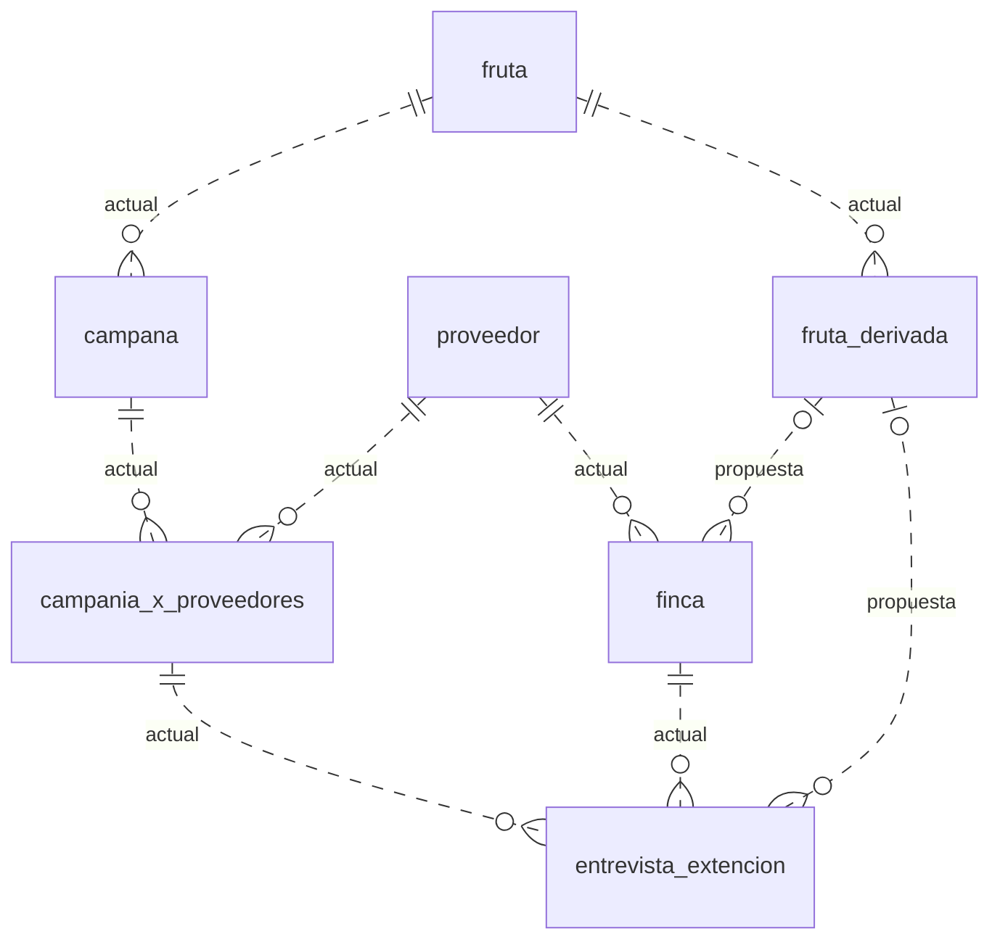

**D02 — Fincas entrevistadas (Aprobado por el usuario):** El listado de fincas de una participación se obtiene desde entrevista_extencion. No se vuelve a agregar finca_id a campania_x_proveedores; los orígenes de entrega/carga seleccionan las fincas físicas de recojo.

**D04 — Una variedad por finca (Aprobado por el usuario):** Se conserva finca.fruta_derivada_id y se obtiene fruta por fruta_derivada.fruta_id. No se agrega una tabla de varios cultivos por finca. El vínculo permanece opcional para datos históricos; completar variedad antes de operar cuando la vista la requiere.

**D10 — Condiciones de compra (Incorporado al SQL):** El precio simple vive en campania_x_proveedores.precio_compra_kg y moneda PEN. Se retira acuerdo_compra: no existe un flujo independiente de acuerdos/versiones en el prototipo. La liquidación conserva kilos reconocidos y precio aplicados.

**`entrevista_extencion`:** reutiliza su diccionario anterior; no crea una tabla duplicada.

**`finca`:** reutiliza su diccionario anterior; no crea una tabla duplicada.

**`campania_x_proveedores`:** reutiliza su diccionario anterior; no crea una tabla duplicada.

**`proveedor`:** reutiliza su diccionario anterior; no crea una tabla duplicada.

**`campana`:** reutiliza su diccionario anterior; no crea una tabla duplicada.

**`fruta_derivada`:** reutiliza su diccionario anterior; no crea una tabla duplicada.

**`fruta`:** reutiliza su diccionario anterior; no crea una tabla duplicada.

## Exámenes (Administrador > Gestión de Campaña > Planificado > Proveedores > Participación > Exámenes)

**Referencia de revisión:** V13 · Recorrido del 27/10/2026.

**Entrada, acciones y salida:** Proveedores de campaña → Más opciones del proveedor → Exámenes → Registrar examen.

**Observado en la aplicación de referencia:** Examen por fruta, análisis, muestra, origen, toma/envío, estado, resultado y documento. El registro visible tiene resultado negativo.

**Criterio para revisar el modelo:** Pendiente y Enviado admiten resultado/documento ausentes. Con resultado requiere resultado explícito. Se mantienen tipos positivo/negativo del backend para el dato final.

**Funcionalidad esperada de cada tabla en esta vista:**

| Tabla | Uso en esta vista | Funcionalidad esperada | Situación |
|---|---|---|---|
| [`examen_proveedor`](#tabla-examen_proveedor) | Escritura esperada | Registra muestras y exámenes de evaluación del proveedor, con contexto de campaña propuesto. No sustituye los análisis operativos de Calidad. | Tabla actual incluida |
| [`campania_x_proveedores`](#tabla-campania_x_proveedores) | Consulta | Aportar el contexto de campaña/proveedor del examen; validar que el proveedor del examen coincide con el de la participación. | Tabla actual incluida |
| [`proveedor`](#tabla-proveedor) | Consulta | Mantiene el padrón comercial y datos generales de la persona o entidad proveedora, compartidos entre campañas. | Tabla actual incluida |
| [`finca`](#tabla-finca) | Consulta | Conserva ubicación, coordenadas, hectáreas y una variedad por finca en este alcance. Su fruta se obtiene por fruta_derivada; no tiene FK directa a participación. | Tabla actual incluida |
| [`campana`](#tabla-campana) | Consulta | Identifica la campaña, sus fechas, fruta, responsable y estado; aporta el ámbito de todas las consultas de la vista. | Tabla actual incluida |
| [`fruta`](#tabla-fruta) | Consulta | Proporciona el catálogo de cultivos y la fruta de la campaña. No representa kilos comprados ni cosechados. | Tabla actual incluida |

**Esquema de relaciones utilizado por esta vista:**

**Tablas actuales que se conservan:** `examen_proveedor`, `campania_x_proveedores`, `proveedor`, `finca`, `campana`, `fruta`.

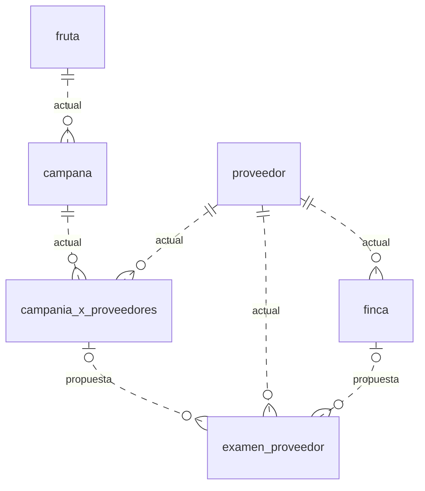

**D12 — Examen por etapas (Incorporado al SQL):** Pendiente y Enviado admiten resultado/documento ausentes. Con resultado requiere resultado explícito. Se mantienen tipos positivo/negativo del backend para el dato final.

**D13 — Gestión documental diferida (Decisión previa conservada):** archivo no está en el SQL ni en diagramas. Los campos de documentos, comprobantes y evidencias son opcionales y sin FK. El mockup puede exigir archivos, pero esa exigencia no está implementada en el esquema de esta etapa.

**`examen_proveedor`:** reutiliza su diccionario anterior; no crea una tabla duplicada.

**`campania_x_proveedores`:** reutiliza su diccionario anterior; no crea una tabla duplicada.

**`proveedor`:** reutiliza su diccionario anterior; no crea una tabla duplicada.

**`finca`:** reutiliza su diccionario anterior; no crea una tabla duplicada.

**`campana`:** reutiliza su diccionario anterior; no crea una tabla duplicada.

**`fruta`:** reutiliza su diccionario anterior; no crea una tabla duplicada.

## Certificaciones (Administrador > Gestión de Campaña > Planificado > Campaña > Certificaciones)

**Referencia de revisión:** V14 · Recorrido del 27/10/2026.

**Entrada, acciones y salida:** Planificado → Más opciones de campaña → Certificaciones → Editar certificado / Ampliación / Registrar pago.

**Observado en la aplicación de referencia:** El editor dice un certificado por campaña y muestra productor cubierto, kilos iniciales, ampliaciones y pago. El resumen reconoce cobertura múltiple; no se cambia la unicidad sin decidirlo.

**Criterio para revisar el modelo:** La referencia inspeccionada muestra un certificado por campaña, pero el backend admite varios. Esta revisión conserva esa capacidad: cada certificado puede incorporar norma, organismo, moneda y cobertura. Revisar la diferencia con las vistas antes de imponer una nueva unicidad.

**Funcionalidad esperada de cada tabla en esta vista:**

| Tabla | Uso en esta vista | Funcionalidad esperada | Situación |
|---|---|---|---|
| [`certificado_campana`](#tabla-certificado_campana) | Escritura esperada | Guarda el certificado de campaña, vigencia y costo. No guarda como pago el recibo ni reemplaza el certificado propio del proveedor. | Tabla actual incluida |
| [`certificado_campana_x_proveedor`](#tabla-certificado_campana_x_proveedor) | Escritura esperada | Guardar productores cubiertos y kilos iniciales por certificado. La selección debe corresponder a la campaña; su FK a la cabecera adicional sigue por afinar. | Tabla propuesta, sin implementar |
| [`campana`](#tabla-campana) | Consulta | Identifica la campaña, sus fechas, fruta, responsable y estado; aporta el ámbito de todas las consultas de la vista. | Tabla actual incluida |
| [`campania_x_proveedores`](#tabla-campania_x_proveedores) | Consulta | Única participación proveedor/campaña, identificada por cxp_id; conserva oferta, tipo, evaluación, entrevista aplicable, precio simple PEN y disponibilidad. | Tabla actual incluida |
| [`proveedor`](#tabla-proveedor) | Consulta | Mantiene el padrón comercial y datos generales de la persona o entidad proveedora, compartidos entre campañas. | Tabla actual incluida |
| [`norma`](#tabla-norma) | Consulta | Catálogo con datos iniciales SQL de códigos de guía; sin CRUD requerido. Se relaciona con guías mediante guia_x_norma y opcionalmente con certificados, sin confundir el tipo de certificado. | Tabla propuesta, sin implementar |
| [`ampliacion_certificado_campana`](#tabla-ampliacion_certificado_campana) | Consulta | Registra cada aumento de kilos certificados como evento, sin sobrescribir el volumen inicial. | Tabla propuesta, sin implementar |
| [`pago_certificado_campana`](#tabla-pago_certificado_campana) | Consulta | Registra desembolsos parciales del certificado en su moneda. El saldo se calcula con los pagos y no por una etiqueta de estado. | Tabla propuesta, sin implementar |

**Esquema de relaciones utilizado por esta vista:**

**Tablas actuales que se conservan:** `certificado_campana`, `campana`, `campania_x_proveedores`, `proveedor`.

**Tablas propuestas para revisar:** `certificado_campana_x_proveedor`, `norma`, `ampliacion_certificado_campana`, `pago_certificado_campana`.

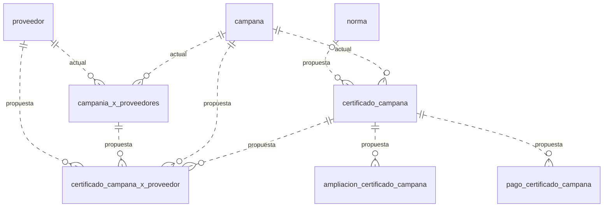

**D01 — Participación única (Confirmado e incorporado al SQL):** Decisión del 29/10/2026: se retira la cabecera participacion_proveedor_campana. campania_x_proveedores conserva cxp_id, proveedor/campaña, cantidad, tipo, evaluación, precio y disponibilidad. Cobertura de certificados y proveedor_carga referencian cxp_id; no se mantiene una segunda participación.

**D09 — Cantidad de certificados (Por discutir):** El editor dice uno por campaña; el backend y el resumen admiten varios. Se mantiene la capacidad actual hasta decidir si las normas requieren certificados distintos.

**D13 — Gestión documental diferida (Decisión previa conservada):** archivo no está en el SQL ni en diagramas. Los campos de documentos, comprobantes y evidencias son opcionales y sin FK. El mockup puede exigir archivos, pero esa exigencia no está implementada en el esquema de esta etapa.

**`certificado_campana`:** reutiliza su diccionario anterior; no crea una tabla duplicada.

**`certificado_campana_x_proveedor`:** reutiliza su diccionario anterior; no crea una tabla duplicada.

**`campana`:** reutiliza su diccionario anterior; no crea una tabla duplicada.

**`campania_x_proveedores`:** reutiliza su diccionario anterior; no crea una tabla duplicada.

**`proveedor`:** reutiliza su diccionario anterior; no crea una tabla duplicada.

<a id="tabla-norma"></a>

**Diccionario de `norma` — tabla propuesta.**

**Clave primaria:** `norma_id`. Catálogo con datos iniciales SQL de códigos de guía; sin CRUD requerido. Se relaciona con guías mediante guia_x_norma y opcionalmente con certificados, sin confundir el tipo de certificado.

| Atributo | Estado | Tipo y obligatoriedad en el modelo revisado | Finalidad / relación |
|---|---|---|---|
| `norma_id` | **TABLA NUEVA** | `integer GENERATED ALWAYS AS IDENTITY PRIMARY KEY` | Atributo propuesto para cubrir el flujo de la vista. |
| `codigo` | **TABLA NUEVA** | `varchar(40) NOT NULL` | Atributo propuesto para cubrir el flujo de la vista. |
| `nombre` | **TABLA NUEVA** | `varchar(180) NOT NULL` | Atributo propuesto para cubrir el flujo de la vista. |
| `created_at` | **TABLA NUEVA** | `timestamptz NOT NULL DEFAULT now()` | Auditoría con la misma convención del backend. |
| `updated_at` | **TABLA NUEVA** | `timestamptz NOT NULL DEFAULT now()` | Auditoría con la misma convención del backend; el servicio/ORM actualiza esta fecha. |

**Restricciones propuestas para revisar:** `UNIQUE (codigo)`.

**`ampliacion_certificado_campana`:** reutiliza su diccionario anterior; no crea una tabla duplicada.

<a id="tabla-pago_certificado_campana"></a>

**Diccionario de `pago_certificado_campana` — tabla propuesta.**

**Clave primaria:** `pago_certificado_campana_id`. Desembolsos de la certificación en su misma moneda.

| Atributo | Estado | Tipo y obligatoriedad en el modelo revisado | Finalidad / relación |
|---|---|---|---|
| `pago_certificado_campana_id` | **TABLA NUEVA** | `integer GENERATED ALWAYS AS IDENTITY PRIMARY KEY` | Atributo propuesto para cubrir el flujo de la vista. |
| `certificado_id` | **TABLA NUEVA** | `integer NOT NULL` | Atributo propuesto para cubrir el flujo de la vista. FK a `certificado_campana.certificado_id`. |
| `fecha` | **TABLA NUEVA** | `date NOT NULL` | Atributo propuesto para cubrir el flujo de la vista. |
| `monto` | **TABLA NUEVA** | `numeric(14,2) NOT NULL` | Atributo propuesto para cubrir el flujo de la vista. |
| `referencia` | **TABLA NUEVA** | `varchar(100) NOT NULL` | Atributo propuesto para cubrir el flujo de la vista. |
| `comprobante_id` | **TABLA NUEVA** | `integer` | PENDIENTE DE RELACIÓN: referencia documental reservada, opcional y sin FK. No usar identificadores de archivo hasta definir la integración. |
| `registrado_por_usuario_id` | **TABLA NUEVA** | `integer` | Atributo propuesto para cubrir el flujo de la vista. FK a `usuario.usuario_id`. |
| `created_at` | **TABLA NUEVA** | `timestamptz NOT NULL DEFAULT now()` | Auditoría con la misma convención del backend. |
| `updated_at` | **TABLA NUEVA** | `timestamptz NOT NULL DEFAULT now()` | Auditoría con la misma convención del backend; el servicio/ORM actualiza esta fecha. |

**Restricciones propuestas para revisar:** `UNIQUE (certificado_id, referencia)`; `CHECK (monto > 0)`.

## Ampliación de certificación (Administrador > Gestión de Campaña > Certificaciones > Ampliación)

**Referencia de revisión:** V15 · Recorrido del 27/10/2026.

**Entrada, acciones y salida:** Certificaciones → + Ampliación → modal; Cancelar vuelve sin registrar evento.

**Observado en la aplicación de referencia:** Modal de kilos adicionales, fecha y referencia/evidencia textual. No se guardó ampliación.

**Criterio para revisar el modelo:** Cada ampliación es un evento con kilos positivos; no sustituye ni modifica los kilos iniciales. En el formulario observado la evidencia es texto de referencia, no un archivo obligatorio. Se preserva el evento sin edición destructiva.

**Funcionalidad esperada de cada tabla en esta vista:**

| Tabla | Uso en esta vista | Funcionalidad esperada | Situación |
|---|---|---|---|
| [`ampliacion_certificado_campana`](#tabla-ampliacion_certificado_campana) | Escritura esperada | Registra cada aumento de kilos certificados como evento, sin sobrescribir el volumen inicial. | Tabla propuesta, sin implementar |
| [`certificado_campana`](#tabla-certificado_campana) | Consulta | Guarda el certificado de campaña, vigencia y costo. No guarda como pago el recibo ni reemplaza el certificado propio del proveedor. | Tabla actual incluida |

**Esquema de relaciones utilizado por esta vista:**

**Tablas actuales que se conservan:** `certificado_campana`.

**Tablas propuestas para revisar:** `ampliacion_certificado_campana`.

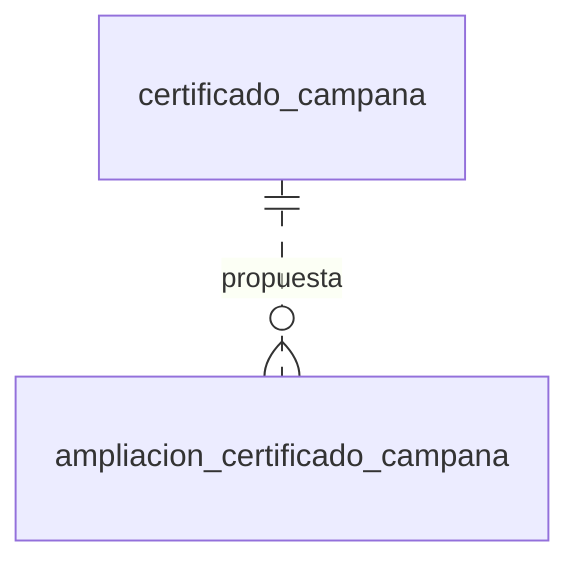

**D09 — Cantidad de certificados (Por discutir):** El editor dice uno por campaña; el backend y el resumen admiten varios. Se mantiene la capacidad actual hasta decidir si las normas requieren certificados distintos.

**`ampliacion_certificado_campana`:** reutiliza su diccionario anterior; no crea una tabla duplicada.

**`certificado_campana`:** reutiliza su diccionario anterior; no crea una tabla duplicada.

## Pago de certificación (Administrador > Gestión de Campaña > Certificaciones > Pagos)

**Referencia de revisión:** V16 · Recorrido del 27/10/2026.

**Entrada, acciones y salida:** Certificaciones → Registrar pago → modal; Cancelar vuelve sin registrar desembolso.

**Observado en la aplicación de referencia:** Modal con costo, pagado, monto, fecha, referencia y evidencia de pago. No se registró desembolso.

**Criterio para revisar el modelo:** Se proponen pagos parciales en la moneda del certificado. Comprobar el saldo antes de registrar un pago y conservar sus evidencias son reglas del servicio a implementar. El costo y recibo actuales se conservan sin convertir automáticamente un recibo en un pago.

**Funcionalidad esperada de cada tabla en esta vista:**

| Tabla | Uso en esta vista | Funcionalidad esperada | Situación |
|---|---|---|---|
| [`pago_certificado_campana`](#tabla-pago_certificado_campana) | Escritura esperada | Registra desembolsos parciales del certificado en su moneda. El saldo se calcula con los pagos y no por una etiqueta de estado. | Tabla propuesta, sin implementar |
| [`certificado_campana`](#tabla-certificado_campana) | Consulta | Guarda el certificado de campaña, vigencia y costo. No guarda como pago el recibo ni reemplaza el certificado propio del proveedor. | Tabla actual incluida |

**Esquema de relaciones utilizado por esta vista:**

**Tablas actuales que se conservan:** `certificado_campana`.

**Tablas propuestas para revisar:** `pago_certificado_campana`.

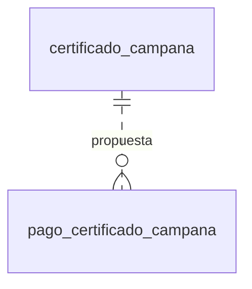

**D13 — Gestión documental diferida (Decisión previa conservada):** archivo no está en el SQL ni en diagramas. Los campos de documentos, comprobantes y evidencias son opcionales y sin FK. El mockup puede exigir archivos, pero esa exigencia no está implementada en el esquema de esta etapa.

**`pago_certificado_campana`:** reutiliza su diccionario anterior; no crea una tabla duplicada.

**`certificado_campana`:** reutiliza su diccionario anterior; no crea una tabla duplicada.

## Transportistas por campaña (Administrador > Gestión de Campaña > En Proceso > Campaña > Transportistas)

**Referencia de revisión:** V17 · Recorrido del 27/10/2026.

**Entrada, acciones y salida:** En Proceso → Más opciones de Mango 2026 → Transportistas → Vincular; Más opciones de empresa → Acuerdo de pago.

**Observado en la aplicación de referencia:** Tres transportistas vinculados; el acuerdo se abre aparte y queda solo lectura cuando ya tiene liquidación.

**Criterio para revisar el modelo:** acuerdo_transporte es una entidad nueva vinculada a la empresa y campaña actuales. Sus adelantos se registran aparte; no se infiere un pago por elegir una modalidad. Si se requiere guardar la vinculación sin acuerdo completo, revisar ese estado antes de implementar.

**Funcionalidad esperada de cada tabla en esta vista:**

| Tabla | Uso en esta vista | Funcionalidad esperada | Situación |
|---|---|---|---|
| [`acuerdo_transporte`](#tabla-acuerdo_transporte) | Escritura esperada | La intención de esta vista es vincular al transportista y registrar sus condiciones aparte. La fila actual propuesta necesita un estado borrador o un rediseño para representar el intervalo sin acuerdo. | Tabla propuesta, sin implementar |
| [`empresa_transporte_externo`](#tabla-empresa_transporte_externo) | Consulta | Es el proveedor logístico contratado, empresa o independiente previsto. No representa a la agroexportadora que opera el sistema. | Tabla actual incluida |
| [`campana`](#tabla-campana) | Consulta | Identifica la campaña, sus fechas, fruta, responsable y estado; aporta el ámbito de todas las consultas de la vista. | Tabla actual incluida |
| [`adelanto_transporte`](#tabla-adelanto_transporte) | Por discutir | Registra el dinero efectivamente entregado por adelantado; el monto prometido en el acuerdo no acredita desembolso. | Tabla propuesta, sin implementar; permanencia o diseño por discutir |

**Esquema de relaciones utilizado por esta vista:**

**Tablas actuales que se conservan:** `empresa_transporte_externo`, `campana`.

**Tablas propuestas para revisar:** `acuerdo_transporte`, `adelanto_transporte`.

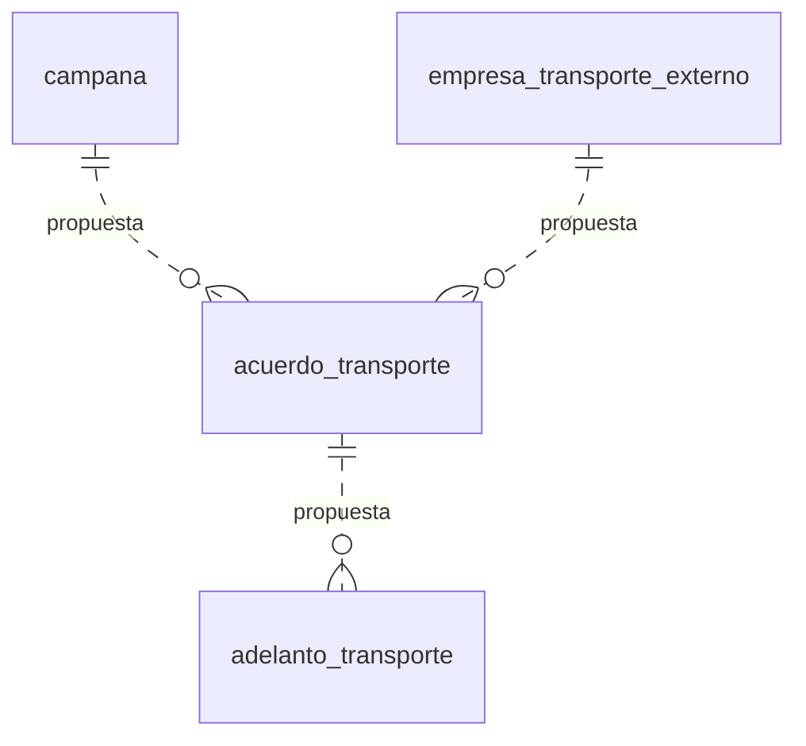

**D06 — Vincular antes del acuerdo (Incorporado al SQL):** acuerdo_transporte admite BORRADOR sin condiciones completas; CONFIRMADO exige monto, tipo y fechas. No hace falta inventar un segundo vínculo.

<a id="tabla-acuerdo_transporte"></a>

**Diccionario de `acuerdo_transporte` — tabla propuesta.**

**Clave primaria:** `acuerdo_transporte_id`. Vínculo empresa/campaña en BORRADOR; al CONFIRMAR conserva monto, moneda PEN, tipo, adelanto previsto y fechas.

| Atributo | Estado | Tipo y obligatoriedad en el modelo revisado | Finalidad / relación |
|---|---|---|---|
| `acuerdo_transporte_id` | **TABLA NUEVA** | `integer GENERATED ALWAYS AS IDENTITY PRIMARY KEY` | Atributo propuesto para cubrir el flujo de la vista. |
| `campania_id` | **TABLA NUEVA** | `integer NOT NULL` | Atributo propuesto para cubrir el flujo de la vista. FK a `campana.campania_id`. |
| `id_empresa_transporte_externo` | **TABLA NUEVA** | `integer NOT NULL` | Atributo propuesto para cubrir el flujo de la vista. FK a `empresa_transporte_externo.id_empresa_transporte_externo`. |
| `cotizacion_transporte_id` | **TABLA NUEVA** | `integer` | Atributo propuesto para cubrir el flujo de la vista. FK a `cotizacion_transporte.cotizacion_transporte_id`. |
| `tipo_pago` | **TABLA NUEVA** | `varchar(20)` | FC06: el vínculo existe como borrador antes de completar las condiciones. |
| `monto_acordado` | **TABLA NUEVA** | `numeric(14,2)` | FC06: el vínculo existe como borrador antes de completar las condiciones. |
| `fecha_acuerdo` | **TABLA NUEVA** | `date` | FC06: el vínculo existe como borrador antes de completar las condiciones. |
| `fecha_pago_final` | **TABLA NUEVA** | `date` | Atributo propuesto para cubrir el flujo de la vista. |
| `archivo_id` | **TABLA NUEVA** | `integer` | PENDIENTE DE RELACIÓN: referencia documental reservada, opcional y sin FK. No usar identificadores de archivo hasta definir la integración. |
| `created_at` | **TABLA NUEVA** | `timestamptz NOT NULL DEFAULT now()` | Auditoría con la misma convención del backend. |
| `updated_at` | **TABLA NUEVA** | `timestamptz NOT NULL DEFAULT now()` | Auditoría con la misma convención del backend; el servicio/ORM actualiza esta fecha. |
| `estado` | **TABLA NUEVA** | `varchar(20) NOT NULL DEFAULT 'BORRADOR'` | FC06: BORRADOR vincula empresa/campaña; CONFIRMADO exige condiciones completas. |
| `moneda` | **TABLA NUEVA** | `varchar(3) NOT NULL DEFAULT 'PEN'` | Compra/transporte en soles según respuesta del usuario. |
| `adelanto_acordado` | **TABLA NUEVA** | `numeric(14,2) NOT NULL DEFAULT 0` | Distingue adelanto previsto de los desembolsos reales. |
| `referencia_cotizacion` | **TABLA NUEVA** | `text` | Texto de cotización del vínculo aun sin una cotización estructurada. |

**Restricciones propuestas para revisar:** `UNIQUE (campania_id, id_empresa_transporte_externo)`; `UNIQUE (acuerdo_transporte_id, id_empresa_transporte_externo)`; `CHECK (monto_acordado > 0)`; `CHECK (tipo_pago IN ('INMEDIATO','CON_ADELANTO','AL_FINAL'))`; `CHECK (estado IN ('BORRADOR','CONFIRMADO') AND moneda = 'PEN')`; `CHECK (estado <> 'CONFIRMADO' OR (tipo_pago IS NOT NULL AND monto_acordado IS NOT NULL AND fecha_acuerdo IS NOT NULL AND fecha_pago_final IS NOT NULL))`; `CHECK (adelanto_acordado >= 0 AND (monto_acordado IS NULL OR adelanto_acordado <= monto_acordado))`.

<a id="tabla-empresa_transporte_externo"></a>

**Diccionario de `empresa_transporte_externo` — tabla actual ampliada.**

**Clave primaria:** `id_empresa_transporte_externo`. Padrón de empresas con RUC e independientes identificados por documento; admite correo y dimensiones pendientes en sus subrecursos.

**Fuente actual:** [EmpresaTransporteExterno](D:/upeu/proyecto-carrera/app/epe-backend/src/transporte/entities/empresa-transporte-externo.ts).

| Atributo | Estado | Tipo y obligatoriedad en el modelo revisado | Finalidad / relación |
|---|---|---|---|
| `created_at` | **ACTUAL** | `timestamp with time zone NOT NULL DEFAULT now()` | Se conserva de la entidad/migración actual. |
| `updated_at` | **ACTUAL** | `timestamp with time zone NOT NULL DEFAULT now()` | Se conserva de la entidad/migración actual. |
| `id_empresa_transporte_externo` | **ACTUAL** | `serial NOT NULL` | Se conserva de la entidad/migración actual. |
| `nombre_completo` | **ACTUAL** | `varchar(255) NOT NULL` | Se conserva de la entidad/migración actual. |
| `ruc` | **MODIFICAR** | `varchar(11)` | FC01: independiente identificado por documento; empresa conserva RUC obligatorio por CHECK. |
| `correo` | **MODIFICAR** | `varchar(320)` | FC01: correo opcional según el validador del padrón; no usar cadenas vacías compartidas. |
| `numero` | **ACTUAL** | `varchar(20) NOT NULL` | Se conserva de la entidad/migración actual. |
| `tipo_transportista` | **AGREGAR** | `varchar(20) NOT NULL DEFAULT 'EMPRESA'` | Diferenciar empresa e independiente; el RUC obligatorio actual todavía debe revisarse para independientes. |
| `tipo_documento` | **AGREGAR** | `varchar(20)` | Tipo de identificación cuando se amplíe el flujo a independientes. |
| `numero_documento` | **AGREGAR** | `varchar(30)` | Documento general; conservar el RUC actual hasta decidir su transición. |
| `persona_id` | **AGREGAR** | `integer` | Identidad del transportista independiente. FK a `persona.persona_id`. |
| `registro_mtc` | **AGREGAR** | `varchar(80)` | Registro MTC cuando corresponda. |
| `departamento` | **AGREGAR** | `varchar(100)` | Ubicación del transportista. |
| `provincia` | **AGREGAR** | `varchar(100)` | Ubicación del transportista. |
| `ciudad` | **AGREGAR** | `varchar(100)` | Ubicación del transportista. |
| `activo` | **AGREGAR** | `boolean NOT NULL DEFAULT true` | Desactivar sin borrar historial. |

**Restricciones actuales conservadas:** `PRIMARY KEY (id_empresa_transporte_externo)`; `UNIQUE (correo)`; `UNIQUE (ruc)`.

**Restricciones propuestas para revisar:** `CHECK (tipo_transportista IN ('EMPRESA','INDEPENDIENTE'))`; `CHECK ((tipo_transportista = 'EMPRESA' AND ruc IS NOT NULL AND ruc ~ '^[0-9]{11}$') OR (tipo_transportista = 'INDEPENDIENTE' AND tipo_documento IS NOT NULL AND numero_documento IS NOT NULL AND length(trim(numero_documento)) > 0))`.

**`campana`:** reutiliza su diccionario anterior; no crea una tabla duplicada.

<a id="tabla-adelanto_transporte"></a>

**Diccionario de `adelanto_transporte` — tabla propuesta.**

**Clave primaria:** `adelanto_transporte_id`. Dinero entregado a la empresa antes de aplicarse a una carga.

| Atributo | Estado | Tipo y obligatoriedad en el modelo revisado | Finalidad / relación |
|---|---|---|---|
| `adelanto_transporte_id` | **TABLA NUEVA** | `integer GENERATED ALWAYS AS IDENTITY PRIMARY KEY` | Atributo propuesto para cubrir el flujo de la vista. |
| `acuerdo_transporte_id` | **TABLA NUEVA** | `integer NOT NULL` | Atributo propuesto para cubrir el flujo de la vista. FK a `acuerdo_transporte.acuerdo_transporte_id`. |
| `fecha` | **TABLA NUEVA** | `date NOT NULL` | Atributo propuesto para cubrir el flujo de la vista. |
| `monto` | **TABLA NUEVA** | `numeric(14,2) NOT NULL` | Atributo propuesto para cubrir el flujo de la vista. |
| `referencia` | **TABLA NUEVA** | `varchar(100) NOT NULL` | Atributo propuesto para cubrir el flujo de la vista. |
| `comprobante_id` | **TABLA NUEVA** | `integer` | PENDIENTE DE RELACIÓN: referencia documental reservada, opcional y sin FK. No usar identificadores de archivo hasta definir la integración. |
| `created_at` | **TABLA NUEVA** | `timestamptz NOT NULL DEFAULT now()` | Auditoría con la misma convención del backend. |
| `updated_at` | **TABLA NUEVA** | `timestamptz NOT NULL DEFAULT now()` | Auditoría con la misma convención del backend; el servicio/ORM actualiza esta fecha. |

**Restricciones propuestas para revisar:** `UNIQUE (acuerdo_transporte_id, referencia)`; `CHECK (monto > 0)`.

## Entregas de la campaña (Administrador > Gestión de Campaña > En Proceso > Campaña > Entregas)

**Referencia de revisión:** V18 · Recorrido del 27/10/2026.

**Entrada, acciones y salida:** En Proceso → Más opciones → Entregas → Completar entrega, Editar coordinación o Ver entrega según preparación.

**Observado en la aplicación de referencia:** Entregas Por completar, Lista para carga o Con carga registrada; el texto diferencia programación comercial y coordinación.

**Criterio para revisar el modelo:** Una entrega programada puede existir sin coordinación, y una coordinación sin carga real. Estas tres etapas no deben forzar kilos ficticios ni una cosecha para permitir la asignación del chofer.

**Funcionalidad esperada de cada tabla en esta vista:**

| Tabla | Uso en esta vista | Funcionalidad esperada | Situación |
|---|---|---|---|
| [`campana`](#tabla-campana) | Consulta | Identifica la campaña, sus fechas, fruta, responsable y estado; aporta el ámbito de todas las consultas de la vista. | Tabla actual incluida |
| [`entrega_programada`](#tabla-entrega_programada) | Consulta | Guarda fecha, kilos y destino previstos de un contrato antes de completar transporte o registrar carga física. | Tabla propuesta, sin implementar |
| [`contrato_venta`](#tabla-contrato_venta) | Consulta | Representa cada contrato del cliente/campaña con kilos, precio y moneda propios. Contratado no equivale a programado ni facturado. | Tabla propuesta, sin implementar |
| [`cliente_negocio_campana`](#tabla-cliente_negocio_campana) | Consulta | Representa el vínculo y requerimiento del cliente en la campaña, previo a sus contratos. El backend mantiene un vínculo único por cliente/campaña. | Tabla actual incluida |
| [`cliente_negocio`](#tabla-cliente_negocio) | Consulta | Mantiene cliente, tipo Exportador/Industria y contacto. Un cliente comercial no es automáticamente empresa transportista aunque compartan nombre. | Tabla actual incluida |
| [`coordinacion_entrega`](#tabla-coordinacion_entrega) | Consulta | Selecciona transportista, unidad, chofer y fechas para una entrega programada. Puede existir antes de la carga real. | Tabla propuesta, sin implementar |
| [`carga`](#tabla-carga) | Consulta | Representa la carga física de una coordinación, fecha y responsable. El peso real se obtiene de sus líneas de proveedores y se diferencia del programado. | Tabla propuesta, sin implementar |

**Esquema de relaciones utilizado por esta vista:**

**Tablas actuales que se conservan:** `campana`, `cliente_negocio_campana`, `cliente_negocio`.

**Tablas propuestas para revisar:** `entrega_programada`, `contrato_venta`, `coordinacion_entrega`, `carga`.

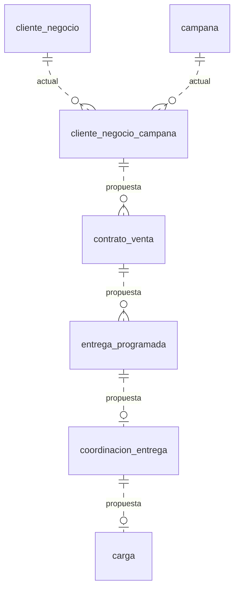

**`campana`:** reutiliza su diccionario anterior; no crea una tabla duplicada.

**`entrega_programada`:** reutiliza su diccionario anterior; no crea una tabla duplicada.

**`contrato_venta`:** reutiliza su diccionario anterior; no crea una tabla duplicada.

**`cliente_negocio_campana`:** reutiliza su diccionario anterior; no crea una tabla duplicada.

**`cliente_negocio`:** reutiliza su diccionario anterior; no crea una tabla duplicada.

**`coordinacion_entrega`:** reutiliza su diccionario anterior; no crea una tabla duplicada.

**`carga`:** reutiliza su diccionario anterior; no crea una tabla duplicada.

## Completar coordinación de entrega (Administrador > Gestión de Campaña > En Proceso > Entregas > Coordinación)

**Referencia de revisión:** V19 · Recorrido del 27/10/2026.

**Entrada, acciones y salida:** Entregas → Completar entrega → Completar coordinación → elegir transportista, chofer, unidad y orígenes.

**Observado en la aplicación de referencia:** Formulario con transportista vinculado, varios proveedores/fincas, camión, chofer, fechas, origen, condiciones y observaciones.

**Criterio para revisar el modelo:** El camión y el chofer deben pertenecer al transportista del acuerdo y este a la campaña. Los orígenes son fincas de participaciones de esa campaña. Exportación admite origen orgánico según el prototipo. Una fila por finca evita guardar una cadena de nombres como relación. La descripción de origen sí puede mantenerse como texto informativo.

**Funcionalidad esperada de cada tabla en esta vista:**

| Tabla | Uso en esta vista | Funcionalidad esperada | Situación |
|---|---|---|---|
| [`coordinacion_entrega`](#tabla-coordinacion_entrega) | Escritura esperada | Selecciona transportista, unidad, chofer y fechas para una entrega programada. Puede existir antes de la carga real. | Tabla propuesta, sin implementar |
| [`origen_entrega`](#tabla-origen_entrega) | Escritura esperada | Guardar una fila por finca seleccionada de cada proveedor participante; comprobar pertenencia de finca al proveedor y, cuando se exija, entrevista en esa campaña. | Tabla propuesta, sin implementar |
| [`entrega_programada`](#tabla-entrega_programada) | Consulta | Guarda fecha, kilos y destino previstos de un contrato antes de completar transporte o registrar carga física. | Tabla propuesta, sin implementar |
| [`contrato_venta`](#tabla-contrato_venta) | Consulta | Representa cada contrato del cliente/campaña con kilos, precio y moneda propios. Contratado no equivale a programado ni facturado. | Tabla propuesta, sin implementar |
| [`cliente_negocio_campana`](#tabla-cliente_negocio_campana) | Consulta | Representa el vínculo y requerimiento del cliente en la campaña, previo a sus contratos. El backend mantiene un vínculo único por cliente/campaña. | Tabla actual incluida |
| [`cliente_negocio`](#tabla-cliente_negocio) | Consulta | Mantiene cliente, tipo Exportador/Industria y contacto. Un cliente comercial no es automáticamente empresa transportista aunque compartan nombre. | Tabla actual incluida |
| [`campana`](#tabla-campana) | Consulta | Identifica la campaña, sus fechas, fruta, responsable y estado; aporta el ámbito de todas las consultas de la vista. | Tabla actual incluida |
| [`acuerdo_transporte`](#tabla-acuerdo_transporte) | Consulta | Representa vinculación de transportista/campaña y condiciones comerciales. Debe definirse si puede existir como borrador antes de registrar el acuerdo. | Tabla propuesta, sin implementar |
| [`empresa_transporte_externo`](#tabla-empresa_transporte_externo) | Consulta | Es el proveedor logístico contratado, empresa o independiente previsto. No representa a la agroexportadora que opera el sistema. | Tabla actual incluida |
| [`vehiculo_externo`](#tabla-vehiculo_externo) | Consulta | Identifica la unidad y su empresa, placa, dimensiones y pesos. Los datos se consultan al asignar y se capturan históricamente en documentos. | Tabla actual incluida |
| [`chofer_transporte_externo`](#tabla-chofer_transporte_externo) | Consulta | Mantiene conductor, contacto y empresa. El vínculo opcional a usuario permitirá filtrar las asignaciones de quien inicia sesión. | Tabla actual incluida |
| [`campania_x_proveedores`](#tabla-campania_x_proveedores) | Consulta | Única participación proveedor/campaña, identificada por cxp_id; conserva oferta, tipo, evaluación, entrevista aplicable, precio simple PEN y disponibilidad. | Tabla actual incluida |
| [`proveedor`](#tabla-proveedor) | Consulta | Mantiene el padrón comercial y datos generales de la persona o entidad proveedora, compartidos entre campañas. | Tabla actual incluida |
| [`entrevista_extencion`](#tabla-entrevista_extencion) | Consulta | Añade los datos agronómicos de la visita a una finca del proveedor en esa campaña. Las fincas entrevistadas se obtienen de estas filas, sin otra vinculación directa finca–participación. | Tabla actual incluida |
| [`finca`](#tabla-finca) | Consulta | Conserva ubicación, coordenadas, hectáreas y una variedad por finca en este alcance. Su fruta se obtiene por fruta_derivada; no tiene FK directa a participación. | Tabla actual incluida |
| [`fruta_derivada`](#tabla-fruta_derivada) | Consulta | Identifica una variedad y su fruta. Permite mostrar el cultivo de la finca sin duplicar fruta_id en finca. | Tabla actual incluida |

**Esquema de relaciones utilizado por esta vista:**

**Tablas actuales que se conservan:** `cliente_negocio_campana`, `cliente_negocio`, `campana`, `empresa_transporte_externo`, `vehiculo_externo`, `chofer_transporte_externo`, `campania_x_proveedores`, `proveedor`, `entrevista_extencion`, `finca`, `fruta_derivada`.

**Tablas propuestas para revisar:** `coordinacion_entrega`, `origen_entrega`, `entrega_programada`, `contrato_venta`, `acuerdo_transporte`.

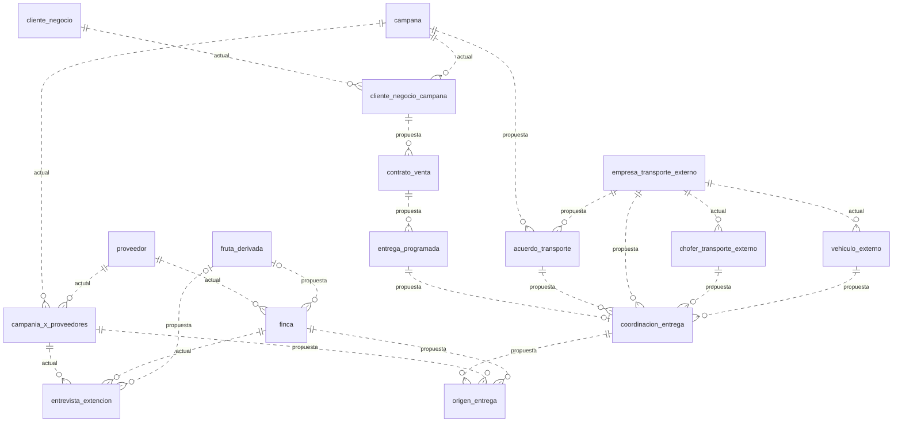

**D02 — Fincas entrevistadas (Aprobado por el usuario):** El listado de fincas de una participación se obtiene desde entrevista_extencion. No se vuelve a agregar finca_id a campania_x_proveedores; los orígenes de entrega/carga seleccionan las fincas físicas de recojo.

**D05 — Autoridad de transporte (Confirmado por el usuario):** coordinacion_entrega es la fuente del viaje. Se conservan las tablas actuales por compatibilidad; ambas asignaciones usan instantes y exclusión [inicio,fin), permitiendo viajes sucesivos en el día.

**D06 — Vincular antes del acuerdo (Incorporado al SQL):** acuerdo_transporte admite BORRADOR sin condiciones completas; CONFIRMADO exige monto, tipo y fechas. No hace falta inventar un segundo vínculo.

**`coordinacion_entrega`:** reutiliza su diccionario anterior; no crea una tabla duplicada.

<a id="tabla-origen_entrega"></a>

**Diccionario de `origen_entrega` — tabla propuesta.**

**Clave primaria:** `origen_entrega_id`. Selección de varias fincas de varios proveedores antes de cargar.

| Atributo | Estado | Tipo y obligatoriedad en el modelo revisado | Finalidad / relación |
|---|---|---|---|
| `origen_entrega_id` | **TABLA NUEVA** | `integer GENERATED ALWAYS AS IDENTITY PRIMARY KEY` | Atributo propuesto para cubrir el flujo de la vista. |
| `coordinacion_entrega_id` | **TABLA NUEVA** | `integer NOT NULL` | Atributo propuesto para cubrir el flujo de la vista. FK a `coordinacion_entrega.coordinacion_entrega_id`. |
| `cxp_id` | **TABLA NUEVA** | `integer NOT NULL` | Atributo propuesto para cubrir el flujo de la vista. FK a `campania_x_proveedores.cxp_id`. |
| `created_at` | **TABLA NUEVA** | `timestamptz NOT NULL DEFAULT now()` | Auditoría con la misma convención del backend. |
| `updated_at` | **TABLA NUEVA** | `timestamptz NOT NULL DEFAULT now()` | Auditoría con la misma convención del backend; el servicio/ORM actualiza esta fecha. |
| `finca_id` | **TABLA NUEVA** | `integer NOT NULL` | Finca del origen o medición; ya no se obtiene de campania_x_proveedores. El servicio debe validar que pertenece al proveedor de cxp_id. FK a `finca.finca_id`. |

**Restricciones propuestas para revisar:** `UNIQUE (coordinacion_entrega_id, cxp_id, finca_id)`.

**`entrega_programada`:** reutiliza su diccionario anterior; no crea una tabla duplicada.

**`contrato_venta`:** reutiliza su diccionario anterior; no crea una tabla duplicada.

**`cliente_negocio_campana`:** reutiliza su diccionario anterior; no crea una tabla duplicada.

**`cliente_negocio`:** reutiliza su diccionario anterior; no crea una tabla duplicada.

**`campana`:** reutiliza su diccionario anterior; no crea una tabla duplicada.

**`acuerdo_transporte`:** reutiliza su diccionario anterior; no crea una tabla duplicada.

**`empresa_transporte_externo`:** reutiliza su diccionario anterior; no crea una tabla duplicada.

<a id="tabla-vehiculo_externo"></a>

**Diccionario de `vehiculo_externo` — tabla actual ampliada.**

**Clave primaria:** `id_vehiculo_externo`. Unidad de transporte con capacidad y pesos explícitos.

**Fuente actual:** [VehiculoExterno](D:/upeu/proyecto-carrera/app/epe-backend/src/transporte/entities/vehiculo-externo.ts).

| Atributo | Estado | Tipo y obligatoriedad en el modelo revisado | Finalidad / relación |
|---|---|---|---|
| `created_at` | **ACTUAL** | `timestamp with time zone NOT NULL DEFAULT now()` | Se conserva de la entidad/migración actual. |
| `updated_at` | **ACTUAL** | `timestamp with time zone NOT NULL DEFAULT now()` | Se conserva de la entidad/migración actual. |
| `id_vehiculo_externo` | **ACTUAL** | `serial NOT NULL` | Se conserva de la entidad/migración actual. |
| `placa` | **ACTUAL** | `varchar(15) NOT NULL` | Se conserva de la entidad/migración actual. |
| `volumen` | **MODIFICAR** | `numeric(12,3)` | FC01: dimensión/peso pendiente no obliga a inventar un valor positivo. |
| `ancho` | **MODIFICAR** | `numeric(10,3)` | FC01: dimensión/peso pendiente no obliga a inventar un valor positivo. |
| `altura` | **MODIFICAR** | `numeric(10,3)` | FC01: dimensión/peso pendiente no obliga a inventar un valor positivo. |
| `profundidad` | **MODIFICAR** | `numeric(10,3)` | FC01: dimensión/peso pendiente no obliga a inventar un valor positivo. |
| `peso_neto` | **MODIFICAR** | `numeric(14,3)` | FC01: dimensión/peso pendiente no obliga a inventar un valor positivo. |
| `peso_bruto` | **MODIFICAR** | `numeric(14,3)` | FC01: dimensión/peso pendiente no obliga a inventar un valor positivo. |
| `id_empresa_transporte_externo` | **ACTUAL** | `integer NOT NULL` | Se conserva de la entidad/migración actual. FK a `empresa_transporte_externo.id_empresa_transporte_externo`. |
| `capacidad_kg` | **AGREGAR** | `numeric(14,3)` | Capacidad útil en kg, independiente de peso_neto y peso_bruto. |

**Restricciones actuales conservadas:** `CHECK (((volumen > (0)::numeric) AND (ancho > (0)::numeric) AND (altura > (0)::numeric) AND (profundidad > (0)::numeric)))`; `CHECK (((peso_neto >= (0)::numeric) AND (peso_bruto >= peso_neto)))`; `PRIMARY KEY (id_vehiculo_externo)`; `UNIQUE (placa)`.

**Índices actuales conservados:** `CREATE INDEX "IDX_vehiculo_empresa_transporte" ON agro.vehiculo_externo USING btree (id_empresa_transporte_externo)`.

**Restricciones propuestas para revisar:** `CHECK (capacidad_kg > 0)`; `UNIQUE (id_vehiculo_externo, id_empresa_transporte_externo)`.

<a id="tabla-chofer_transporte_externo"></a>

**Diccionario de `chofer_transporte_externo` — tabla actual ampliada.**

**Clave primaria:** `id_chofer_transporte_externo`. Identidad del conductor y vínculo opcional a cuenta de acceso.

**Fuente actual:** [ChoferTransporteExterno](D:/upeu/proyecto-carrera/app/epe-backend/src/transporte/entities/chofer-transporte-externo.ts).

| Atributo | Estado | Tipo y obligatoriedad en el modelo revisado | Finalidad / relación |
|---|---|---|---|
| `created_at` | **ACTUAL** | `timestamp with time zone NOT NULL DEFAULT now()` | Se conserva de la entidad/migración actual. |
| `updated_at` | **ACTUAL** | `timestamp with time zone NOT NULL DEFAULT now()` | Se conserva de la entidad/migración actual. |
| `id_chofer_transporte_externo` | **ACTUAL** | `serial NOT NULL` | Se conserva de la entidad/migración actual. |
| `nombre` | **ACTUAL** | `varchar(255) NOT NULL` | Se conserva de la entidad/migración actual. |
| `telefono` | **ACTUAL** | `varchar(20) NOT NULL` | Se conserva de la entidad/migración actual. |
| `correo` | **MODIFICAR** | `varchar(320)` | FC01: correo opcional según el validador del padrón; no usar cadenas vacías compartidas. |
| `id_empresa_transporte_externo` | **ACTUAL** | `integer NOT NULL` | Se conserva de la entidad/migración actual. FK a `empresa_transporte_externo.id_empresa_transporte_externo`. |
| `persona_id` | **AGREGAR** | `integer` | Vincular identidad compartida sin eliminar los nombres/documentos actuales. FK a `persona.persona_id`. |
| `activo` | **AGREGAR** | `boolean NOT NULL DEFAULT true` | Permitir desactivación sin borrar historial. |
| `usuario_id` | **AGREGAR** | `integer` | Cuenta que ingresará con el rol de chofer. FK a `usuario.usuario_id`. |
| `numero_licencia` | **AGREGAR** | `varchar(40)` | Licencia real del conductor; completar antes de emitir documentos. |

**Restricciones actuales conservadas:** `PRIMARY KEY (id_chofer_transporte_externo)`.

**Índices actuales conservados:** `CREATE INDEX "IDX_chofer_empresa_transporte" ON agro.chofer_transporte_externo USING btree (id_empresa_transporte_externo)`.

**Restricciones propuestas para revisar:** `UNIQUE (id_chofer_transporte_externo, id_empresa_transporte_externo)`.

**`campania_x_proveedores`:** reutiliza su diccionario anterior; no crea una tabla duplicada.

**`proveedor`:** reutiliza su diccionario anterior; no crea una tabla duplicada.

**`entrevista_extencion`:** reutiliza su diccionario anterior; no crea una tabla duplicada.

**`finca`:** reutiliza su diccionario anterior; no crea una tabla duplicada.

**`fruta_derivada`:** reutiliza su diccionario anterior; no crea una tabla duplicada.

## Programa semanal de entregas (Administrador > Gestión de Campaña > Campaña > Programa semanal de entregas)

**Referencia de revisión:** V20 · Recorrido del 27/10/2026.

**Entrada, acciones y salida:** Campaña → Más opciones → Programa semanal de entregas → semana/variedad → cantidad diaria abre su composición.

**Observado en la aplicación de referencia:** Programa por semana ISO, cliente, contrato, placa y variedad; las cantidades diarias se consultan y pueden existir con placa Por asignar.

**Criterio para revisar el modelo:** La consulta v_programa_semanal agrupa programación por variedad, año y semana ISO. La placa puede seguir sin asignar. No se crea otra tabla calendario ni se confunden cantidades programadas con cantidades cargadas.

**Funcionalidad esperada de cada tabla en esta vista:**

| Tabla | Uso en esta vista | Funcionalidad esperada | Situación |
|---|---|---|---|
| [`campana`](#tabla-campana) | Consulta | Identifica la campaña, sus fechas, fruta, responsable y estado; aporta el ámbito de todas las consultas de la vista. | Tabla actual incluida |
| [`cliente_negocio`](#tabla-cliente_negocio) | Consulta | Mantiene cliente, tipo Exportador/Industria y contacto. Un cliente comercial no es automáticamente empresa transportista aunque compartan nombre. | Tabla actual incluida |
| [`cliente_negocio_campana`](#tabla-cliente_negocio_campana) | Consulta | Representa el vínculo y requerimiento del cliente en la campaña, previo a sus contratos. El backend mantiene un vínculo único por cliente/campaña. | Tabla actual incluida |
| [`contrato_venta`](#tabla-contrato_venta) | Consulta | Representa cada contrato del cliente/campaña con kilos, precio y moneda propios. Contratado no equivale a programado ni facturado. | Tabla propuesta, sin implementar |
| [`entrega_programada`](#tabla-entrega_programada) | Consulta | Guarda fecha, kilos y destino previstos de un contrato antes de completar transporte o registrar carga física. | Tabla propuesta, sin implementar |
| [`entrega_x_fruta_derivada`](#tabla-entrega_x_fruta_derivada) | Consulta | Consultar cantidades programadas por variedad para cada día de la semana; las sumas del calendario se calculan sin otra tabla semanal. | Tabla propuesta, sin implementar |
| [`fruta_derivada`](#tabla-fruta_derivada) | Consulta | Identifica una variedad y su fruta. Permite mostrar el cultivo de la finca sin duplicar fruta_id en finca. | Tabla actual incluida |
| [`coordinacion_entrega`](#tabla-coordinacion_entrega) | Consulta | Selecciona transportista, unidad, chofer y fechas para una entrega programada. Puede existir antes de la carga real. | Tabla propuesta, sin implementar |
| [`vehiculo_externo`](#tabla-vehiculo_externo) | Consulta | Identifica la unidad y su empresa, placa, dimensiones y pesos. Los datos se consultan al asignar y se capturan históricamente en documentos. | Tabla actual incluida |

**Esquema de relaciones utilizado por esta vista:**

**Tablas actuales que se conservan:** `campana`, `cliente_negocio`, `cliente_negocio_campana`, `fruta_derivada`, `vehiculo_externo`.

**Tablas propuestas para revisar:** `contrato_venta`, `entrega_programada`, `entrega_x_fruta_derivada`, `coordinacion_entrega`.

```mermaid
erDiagram
    cliente_negocio ||..o{ cliente_negocio_campana : actual
    campana ||..o{ cliente_negocio_campana : actual
    cliente_negocio_campana ||..o{ contrato_venta : propuesta
    contrato_venta ||..o{ entrega_programada : propuesta
    entrega_programada ||..o{ entrega_x_fruta_derivada : propuesta
    fruta_derivada ||..o{ entrega_x_fruta_derivada : propuesta
    entrega_programada ||..o| coordinacion_entrega : propuesta
    vehiculo_externo ||..o{ coordinacion_entrega : propuesta
```

**`campana`:** reutiliza su diccionario anterior; no crea una tabla duplicada.

**`cliente_negocio`:** reutiliza su diccionario anterior; no crea una tabla duplicada.

**`cliente_negocio_campana`:** reutiliza su diccionario anterior; no crea una tabla duplicada.

**`contrato_venta`:** reutiliza su diccionario anterior; no crea una tabla duplicada.

**`entrega_programada`:** reutiliza su diccionario anterior; no crea una tabla duplicada.

**`entrega_x_fruta_derivada`:** reutiliza su diccionario anterior; no crea una tabla duplicada.

**`fruta_derivada`:** reutiliza su diccionario anterior; no crea una tabla duplicada.

**`coordinacion_entrega`:** reutiliza su diccionario anterior; no crea una tabla duplicada.

**`vehiculo_externo`:** reutiliza su diccionario anterior; no crea una tabla duplicada.

## Gestión de proveedores (Administrador > Gestión de Proveedores > Listado)

**Referencia de revisión:** V21 · Recorrido del 27/10/2026.

**Entrada, acciones y salida:** Módulos → Gestión de Proveedores → Ver/Editar proveedor; Más opciones → Fincas o Certificados.

**Observado en la aplicación de referencia:** Padrón general con frutas y variedades, sanidad y accesos separados a Fincas y Certificados.

**Criterio para revisar el modelo:** Separar persona, proveedor y participación. Las personas vinculadas se reutilizan para liquidaciones y control anual; no crean un proveedor nuevo ni transfieren compras antiguas. Las asociaciones generales de fruta y variedad no implican automáticamente que se ofrece esa fruta en todas las campañas.

**Funcionalidad esperada de cada tabla en esta vista:**

| Tabla | Uso en esta vista | Funcionalidad esperada | Situación |
|---|---|---|---|
| [`proveedor`](#tabla-proveedor) | Escritura esperada | Mantiene el padrón comercial y datos generales de la persona o entidad proveedora, compartidos entre campañas. | Tabla actual incluida |
| [`proveedor_x_fruta`](#tabla-proveedor_x_fruta) | Escritura esperada | Asocia las frutas del padrón al proveedor; se conserva mientras no se apruebe derivarlas exclusivamente de sus fincas. | Tabla actual incluida |
| [`proveedor_x_fruta_derivada`](#tabla-proveedor_x_fruta_derivada) | Escritura esperada | Propuesta para las variedades del padrón del proveedor. No identifica la finca física de recojo. | Tabla propuesta, sin implementar |
| [`fruta`](#tabla-fruta) | Consulta | Proporciona el catálogo de cultivos y la fruta de la campaña. No representa kilos comprados ni cosechados. | Tabla actual incluida |
| [`fruta_derivada`](#tabla-fruta_derivada) | Consulta | Identifica una variedad y su fruta. Permite mostrar el cultivo de la finca sin duplicar fruta_id en finca. | Tabla actual incluida |
| [`persona`](#tabla-persona) | Por discutir | Identifica a una persona natural para cuentas o destinatarios de compras; su reutilización no crea otro proveedor ni autoriza por sí sola a cobrar. | Tabla propuesta, sin implementar; permanencia o diseño por discutir |
| [`proveedor_x_persona`](#tabla-proveedor_x_persona) | Por discutir | Vincula al proveedor con personas principal/vinculadas que pueden figurar como destinatarias; no reparte ni transfiere compras históricas. | Tabla propuesta, sin implementar; permanencia o diseño por discutir |

**Esquema de relaciones utilizado por esta vista:**

**Tablas actuales que se conservan:** `proveedor`, `proveedor_x_fruta`, `fruta`, `fruta_derivada`.

**Tablas propuestas para revisar:** `proveedor_x_fruta_derivada`, `persona`, `proveedor_x_persona`.

```mermaid
erDiagram
    fruta ||..o{ fruta_derivada : actual
    proveedor ||..o{ proveedor_x_fruta : actual
    fruta ||..o{ proveedor_x_fruta : actual
    proveedor ||..o{ proveedor_x_persona : propuesta
    persona ||..o{ proveedor_x_persona : propuesta
    proveedor ||..o{ proveedor_x_fruta_derivada : propuesta
    fruta_derivada ||..o{ proveedor_x_fruta_derivada : propuesta
    persona o|..o{ proveedor : propuesta
```

**D11 — Persona de la liquidación (Incorporado al SQL):** La liquidación referencia persona directamente y admite proveedor principal o persona vinculada activa. Conserva snapshot de identidad; no exige un vínculo ficticio del proveedor consigo mismo. La autenticación operativa está implementada en el backend con JWT; no requiere una tabla de sesión.

**`proveedor`:** reutiliza su diccionario anterior; no crea una tabla duplicada.

**`proveedor_x_fruta`:** reutiliza su diccionario anterior; no crea una tabla duplicada.

**`proveedor_x_fruta_derivada`:** reutiliza su diccionario anterior; no crea una tabla duplicada.

**`fruta`:** reutiliza su diccionario anterior; no crea una tabla duplicada.

**`fruta_derivada`:** reutiliza su diccionario anterior; no crea una tabla duplicada.

**`persona`:** reutiliza su diccionario anterior; no crea una tabla duplicada.

<a id="tabla-proveedor_x_persona"></a>

**Diccionario de `proveedor_x_persona` — tabla propuesta.**

**Clave primaria:** `proveedor_x_persona_id`. Personas vinculadas; la relación no transfiere compras históricas.

| Atributo | Estado | Tipo y obligatoriedad en el modelo revisado | Finalidad / relación |
|---|---|---|---|
| `proveedor_x_persona_id` | **TABLA NUEVA** | `integer GENERATED ALWAYS AS IDENTITY PRIMARY KEY` | Atributo propuesto para cubrir el flujo de la vista. |
| `proveedor_id` | **TABLA NUEVA** | `integer NOT NULL` | Atributo propuesto para cubrir el flujo de la vista. FK a `proveedor.proveedor_id`. |
| `persona_id` | **TABLA NUEVA** | `integer NOT NULL` | Atributo propuesto para cubrir el flujo de la vista. FK a `persona.persona_id`. |
| `vinculo` | **TABLA NUEVA** | `varchar(60) NOT NULL` | Atributo propuesto para cubrir el flujo de la vista. |
| `activo` | **TABLA NUEVA** | `boolean NOT NULL DEFAULT true` | Atributo propuesto para cubrir el flujo de la vista. |
| `created_at` | **TABLA NUEVA** | `timestamptz NOT NULL DEFAULT now()` | Auditoría con la misma convención del backend. |
| `updated_at` | **TABLA NUEVA** | `timestamptz NOT NULL DEFAULT now()` | Auditoría con la misma convención del backend; el servicio/ORM actualiza esta fecha. |

**Restricciones propuestas para revisar:** `UNIQUE (proveedor_id, persona_id)`.

## Detalle de proveedor (Administrador > Gestión de Proveedores > Proveedor > Detalle)

**Referencia de revisión:** V22 · Recorrido del 27/10/2026.

**Entrada, acciones y salida:** Gestión de Proveedores → Ver proveedor → Datos generales, frutas y variedades → Volver a proveedores.

**Observado en la aplicación de referencia:** Ficha de Roberto Palacios con identidad, contacto, ubicación y frutas/variedades. No se observó editor de personas vinculadas en esta ficha.

**Criterio para revisar el modelo:** Se conservan los datos personales y la URL de identidad actuales; la referencia documental propuesta queda opcional y pendiente de relación. Los datos de sanidad del padrón son un resumen general, no sustituyen el historial de exámenes por campaña.

**Funcionalidad esperada de cada tabla en esta vista:**

| Tabla | Uso en esta vista | Funcionalidad esperada | Situación |
|---|---|---|---|
| [`proveedor`](#tabla-proveedor) | Consulta | Mantiene el padrón comercial y datos generales de la persona o entidad proveedora, compartidos entre campañas. | Tabla actual incluida |
| [`proveedor_x_fruta`](#tabla-proveedor_x_fruta) | Consulta | Asocia las frutas del padrón al proveedor; se conserva mientras no se apruebe derivarlas exclusivamente de sus fincas. | Tabla actual incluida |
| [`proveedor_x_fruta_derivada`](#tabla-proveedor_x_fruta_derivada) | Consulta | Propuesta para las variedades del padrón del proveedor. No identifica la finca física de recojo. | Tabla propuesta, sin implementar |
| [`fruta`](#tabla-fruta) | Consulta | Proporciona el catálogo de cultivos y la fruta de la campaña. No representa kilos comprados ni cosechados. | Tabla actual incluida |
| [`fruta_derivada`](#tabla-fruta_derivada) | Consulta | Identifica una variedad y su fruta. Permite mostrar el cultivo de la finca sin duplicar fruta_id en finca. | Tabla actual incluida |
| [`persona`](#tabla-persona) | Por discutir | Identifica a una persona natural para cuentas o destinatarios de compras; su reutilización no crea otro proveedor ni autoriza por sí sola a cobrar. | Tabla propuesta, sin implementar; permanencia o diseño por discutir |

**Esquema de relaciones utilizado por esta vista:**

**Tablas actuales que se conservan:** `proveedor`, `proveedor_x_fruta`, `fruta`, `fruta_derivada`.

**Tablas propuestas para revisar:** `proveedor_x_fruta_derivada`, `persona`.

```mermaid
erDiagram
    fruta ||..o{ fruta_derivada : actual
    proveedor ||..o{ proveedor_x_fruta : actual
    fruta ||..o{ proveedor_x_fruta : actual
    proveedor ||..o{ proveedor_x_fruta_derivada : propuesta
    fruta_derivada ||..o{ proveedor_x_fruta_derivada : propuesta
    persona o|..o{ proveedor : propuesta
```

**D11 — Persona de la liquidación (Incorporado al SQL):** La liquidación referencia persona directamente y admite proveedor principal o persona vinculada activa. Conserva snapshot de identidad; no exige un vínculo ficticio del proveedor consigo mismo. La autenticación operativa está implementada en el backend con JWT; no requiere una tabla de sesión.

**`proveedor`:** reutiliza su diccionario anterior; no crea una tabla duplicada.

**`proveedor_x_fruta`:** reutiliza su diccionario anterior; no crea una tabla duplicada.

**`proveedor_x_fruta_derivada`:** reutiliza su diccionario anterior; no crea una tabla duplicada.

**`fruta`:** reutiliza su diccionario anterior; no crea una tabla duplicada.

**`fruta_derivada`:** reutiliza su diccionario anterior; no crea una tabla duplicada.

**`persona`:** reutiliza su diccionario anterior; no crea una tabla duplicada.

## Fincas (Administrador > Gestión de Proveedores > Proveedor > Fincas)

**Referencia de revisión:** V23 · Recorrido del 27/10/2026.

**Entrada, acciones y salida:** Proveedor → Más opciones → Fincas → Registrar / Ver / Editar finca.

**Observado en la aplicación de referencia:** Dos fincas con SENASA, ubicación, cultivo/variedad y hectáreas; datos agronómicos gestionados por campaña.

**Criterio para revisar el modelo:** Una finca pertenece al proveedor y tendrá una variedad en este alcance; la fruta se obtiene de esa variedad. La asociación propuesta se mantiene opcional para registros históricos incompletos y debe completarse antes de la operación que la requiera. Las hectáreas son datos de finca; la entrevista añade datos de campaña sin duplicar la finca.

**Funcionalidad esperada de cada tabla en esta vista:**

| Tabla | Uso en esta vista | Funcionalidad esperada | Situación |
|---|---|---|---|
| [`finca`](#tabla-finca) | Escritura esperada | Conserva ubicación, coordenadas, hectáreas y una variedad por finca en este alcance. Su fruta se obtiene por fruta_derivada; no tiene FK directa a participación. | Tabla actual incluida |
| [`proveedor`](#tabla-proveedor) | Consulta | Mantiene el padrón comercial y datos generales de la persona o entidad proveedora, compartidos entre campañas. | Tabla actual incluida |
| [`fruta`](#tabla-fruta) | Consulta | Proporciona el catálogo de cultivos y la fruta de la campaña. No representa kilos comprados ni cosechados. | Tabla actual incluida |
| [`fruta_derivada`](#tabla-fruta_derivada) | Consulta | Identifica una variedad y su fruta. Permite mostrar el cultivo de la finca sin duplicar fruta_id en finca. | Tabla actual incluida |

**Esquema de relaciones utilizado por esta vista:**

**Tablas actuales que se conservan:** `finca`, `proveedor`, `fruta`, `fruta_derivada`.

```mermaid
erDiagram
    proveedor ||..o{ finca : actual
    fruta ||..o{ fruta_derivada : actual
    fruta_derivada o|..o{ finca : propuesta
```

**D04 — Una variedad por finca (Aprobado por el usuario):** Se conserva finca.fruta_derivada_id y se obtiene fruta por fruta_derivada.fruta_id. No se agrega una tabla de varios cultivos por finca. El vínculo permanece opcional para datos históricos; completar variedad antes de operar cuando la vista la requiere.

**`finca`:** reutiliza su diccionario anterior; no crea una tabla duplicada.

**`proveedor`:** reutiliza su diccionario anterior; no crea una tabla duplicada.

**`fruta`:** reutiliza su diccionario anterior; no crea una tabla duplicada.

**`fruta_derivada`:** reutiliza su diccionario anterior; no crea una tabla duplicada.

## Certificados del proveedor (Administrador > Gestión de Proveedores > Proveedor > Certificados)

**Referencia de revisión:** V24 · Recorrido del 27/10/2026.

**Entrada, acciones y salida:** Proveedor → Más opciones → Certificados → Registrar / Ver / Editar certificado propio.

**Observado en la aplicación de referencia:** Certificados propios con nombre, revisión SENASA y documento, separados explícitamente del certificado de campaña.

**Criterio para revisar el modelo:** No exigir campaña, costo, moneda o norma a un certificado propio que solo registra nombre, revisión y archivo. Separarlo evita columnas obligatorias artificiales del certificado de campaña.

**Funcionalidad esperada de cada tabla en esta vista:**

| Tabla | Uso en esta vista | Funcionalidad esperada | Situación |
|---|---|---|---|
| [`certificado_proveedor`](#tabla-certificado_proveedor) | Escritura esperada | Conserva certificados propios del proveedor y revisión SENASA, separados de la cobertura de campaña; su relación documental está pendiente. | Tabla actual incluida |
| [`proveedor`](#tabla-proveedor) | Consulta | Mantiene el padrón comercial y datos generales de la persona o entidad proveedora, compartidos entre campañas. | Tabla actual incluida |

**Esquema de relaciones utilizado por esta vista:**

**Tablas actuales que se conservan:** `certificado_proveedor`, `proveedor`.

```mermaid
erDiagram
    proveedor ||..o{ certificado_proveedor : actual
```

**D13 — Gestión documental diferida (Decisión previa conservada):** archivo no está en el SQL ni en diagramas. Los campos de documentos, comprobantes y evidencias son opcionales y sin FK. El mockup puede exigir archivos, pero esa exigencia no está implementada en el esquema de esta etapa.

<a id="tabla-certificado_proveedor"></a>

**Diccionario de `certificado_proveedor` — tabla actual ampliada.**

**Clave primaria:** `certificado_proveedor_id`. Certificados generales del proveedor; distintos del certificado de campaña.

**Fuente actual:** [CertificadoProveedor](D:/upeu/proyecto-carrera/app/epe-backend/src/certificado-proveedor/entities/certificado-proveedor.ts).

| Atributo | Estado | Tipo y obligatoriedad en el modelo revisado | Finalidad / relación |
|---|---|---|---|
| `created_at` | **ACTUAL** | `timestamp with time zone NOT NULL DEFAULT now()` | Se conserva de la entidad/migración actual. |
| `updated_at` | **ACTUAL** | `timestamp with time zone NOT NULL DEFAULT now()` | Se conserva de la entidad/migración actual. |
| `certificado_proveedor_id` | **ACTUAL** | `serial NOT NULL` | Se conserva de la entidad/migración actual. |
| `fecha_revision_senasa` | **ACTUAL** | `date NOT NULL` | Se conserva de la entidad/migración actual. |
| `nombre` | **ACTUAL** | `varchar(255) NOT NULL` | Se conserva de la entidad/migración actual. |
| `proveedor_id` | **ACTUAL** | `integer NOT NULL` | Se conserva de la entidad/migración actual. FK a `proveedor.proveedor_id`. |
| `documento_archivo_id` | **ACTUAL** | `integer` | PENDIENTE DE RELACIÓN: referencia documental reservada, opcional y sin FK. No usar identificadores de archivo hasta definir la integración. |

**Restricciones actuales conservadas:** `PRIMARY KEY (certificado_proveedor_id)`.

**Índices actuales conservados:** `CREATE INDEX "IDX_certificado_proveedor_documento_archivo" ON agro.certificado_proveedor USING btree (documento_archivo_id)`.

**`proveedor`:** reutiliza su diccionario anterior; no crea una tabla duplicada.

## Gestión de transporte (Administrador > Gestión de Transporte > Transportistas)

**Referencia de revisión:** V25 · Recorrido del 27/10/2026.

**Entrada, acciones y salida:** Módulos → Gestión de Transporte → Ver empresa; selección de empresas → Solicitar cotización.

**Observado en la aplicación de referencia:** Padrón de empresas e independientes; selección múltiple para cotizar. Las tablas actuales de trazabilidad no tienen un editor independiente en esta pantalla.

**Criterio para revisar el modelo:** Se conservan empresa_transporte_externo, vehiculo_externo y chofer_transporte_externo. El mockup incluye independientes; el RUC obligatorio del backend todavía necesita adaptación para ese caso. Las tres tablas actuales de trazabilidad se presentan solo como compatibilidad, sin forzar su edición desde este padrón. La coincidencia del nombre del cliente y del transportista no fusiona ambas entidades.

**Funcionalidad esperada de cada tabla en esta vista:**

| Tabla | Uso en esta vista | Funcionalidad esperada | Situación |
|---|---|---|---|
| [`empresa_transporte_externo`](#tabla-empresa_transporte_externo) | Escritura esperada | Es el proveedor logístico contratado, empresa o independiente previsto. No representa a la agroexportadora que opera el sistema. | Tabla actual incluida |
| [`vehiculo_externo`](#tabla-vehiculo_externo) | Consulta | Identifica la unidad y su empresa, placa, dimensiones y pesos. Los datos se consultan al asignar y se capturan históricamente en documentos. | Tabla actual incluida |
| [`chofer_transporte_externo`](#tabla-chofer_transporte_externo) | Consulta | Mantiene conductor, contacto y empresa. El vínculo opcional a usuario permitirá filtrar las asignaciones de quien inicia sesión. | Tabla actual incluida |
| [`persona`](#tabla-persona) | Por discutir | Identifica a una persona natural para cuentas o destinatarios de compras; su reutilización no crea otro proveedor ni autoriza por sí sola a cobrar. | Tabla propuesta, sin implementar; permanencia o diseño por discutir |
| [`trazabilidad_transporte`](#tabla-trazabilidad_transporte) | Compatibilidad actual | Solo compatibilidad: conservar los registros actuales por proveedor/campaña. No se edita un viaje paralelo desde el listado de transportistas. | Tabla actual incluida |
| [`chofer_vehiculo_externo`](#tabla-chofer_vehiculo_externo) | Compatibilidad actual | Solo compatibilidad: conservar asignaciones y restricciones existentes. Su papel frente a coordinacion_entrega debe decidirse antes de generar nuevas asignaciones. | Tabla actual incluida |
| [`detalle_trazabilidad`](#tabla-detalle_trazabilidad) | Compatibilidad actual | Solo compatibilidad: conservar guía URL, SCTR y costos históricos; no copiar esos importes como gastos nuevos por mostrar esta vista. | Tabla actual incluida |

**Esquema de relaciones utilizado por esta vista:**

**Tablas actuales que se conservan:** `empresa_transporte_externo`, `vehiculo_externo`, `chofer_transporte_externo`, `trazabilidad_transporte`, `chofer_vehiculo_externo`, `detalle_trazabilidad`.

**Tablas propuestas para revisar:** `persona`.

```mermaid
erDiagram
    empresa_transporte_externo ||..o{ chofer_transporte_externo : actual
    vehiculo_externo ||..o{ chofer_vehiculo_externo : actual
    chofer_transporte_externo ||..o{ chofer_vehiculo_externo : actual
    trazabilidad_transporte ||..o{ chofer_vehiculo_externo : actual
    trazabilidad_transporte ||..o{ detalle_trazabilidad : actual
    empresa_transporte_externo ||..o{ vehiculo_externo : actual
    persona o|..o{ chofer_transporte_externo : propuesta
    persona o|..o{ empresa_transporte_externo : propuesta
```

**D05 — Autoridad de transporte (Confirmado por el usuario):** coordinacion_entrega es la fuente del viaje. Se conservan las tablas actuales por compatibilidad; ambas asignaciones usan instantes y exclusión [inicio,fin), permitiendo viajes sucesivos en el día.

**Gestión de empresas logísticas, choferes y unidades:** `empresa_transporte_externo` registra al proveedor logístico externo contratado por la agroexportadora; `chofer_transporte_externo` y `vehiculo_externo` registran sus choferes y unidades. `chofer_vehiculo_externo` asigna un chofer y una unidad a `trazabilidad_transporte`, con fechas de inicio y fin. Estas cuatro tablas ya existen y se conservan en el SQL. `acuerdo_transporte` es la tabla propuesta para vincular la empresa transportista con la campaña y sus condiciones comerciales. La empresa agroexportadora que opera el sistema no se representa con `empresa_transporte_externo`; este modelo todavía no define una entidad propia para gestionar varias agroexportadoras.

**Reglas para revisar antes de implementar:** la asignación conserva las fechas y la restricción actual que impide solapamientos del mismo chofer. Las FK por separado no garantizan que el chofer y la unidad pertenezcan a la misma empresa, ni impiden por sí solas que una unidad tenga asignaciones simultáneas. Validar esas reglas en el servicio y definir si se permiten unidades o conductores de otra empresa. El vínculo opcional a coordinacion_entrega integra el flujo propuesto sin sustituir la trazabilidad actual.

**`empresa_transporte_externo`:** reutiliza su diccionario anterior; no crea una tabla duplicada.

**`vehiculo_externo`:** reutiliza su diccionario anterior; no crea una tabla duplicada.

**`chofer_transporte_externo`:** reutiliza su diccionario anterior; no crea una tabla duplicada.

**`persona`:** reutiliza su diccionario anterior; no crea una tabla duplicada.

<a id="tabla-trazabilidad_transporte"></a>

**Diccionario de `trazabilidad_transporte` — tabla actual ampliada.**

**Clave primaria:** `id_trazabilidad_transporte`. Tabla actual de transporte que se conserva con su historial.

**Fuente actual:** [TrazabilidadTransporte](D:/upeu/proyecto-carrera/app/epe-backend/src/transporte/entities/trazabilidad-transporte.ts).

| Atributo | Estado | Tipo y obligatoriedad en el modelo revisado | Finalidad / relación |
|---|---|---|---|
| `created_at` | **ACTUAL** | `timestamp with time zone NOT NULL DEFAULT now()` | Se conserva de la entidad/migración actual. |
| `updated_at` | **ACTUAL** | `timestamp with time zone NOT NULL DEFAULT now()` | Se conserva de la entidad/migración actual. |
| `id_trazabilidad_transporte` | **ACTUAL** | `serial NOT NULL` | Se conserva de la entidad/migración actual. |
| `contrato_url` | **ACTUAL** | `text NOT NULL` | Se conserva de la entidad/migración actual. |
| `kg_comprados` | **ACTUAL** | `numeric(14,3) NOT NULL` | Se conserva de la entidad/migración actual. |
| `kg_planta` | **ACTUAL** | `numeric(14,3) NOT NULL` | Se conserva de la entidad/migración actual. |
| `estado` | **ACTUAL** | `"trazabilidad_transporte_estado_enum" NOT NULL` | Se conserva de la entidad/migración actual. |
| `cxp_id` | **ACTUAL** | `integer NOT NULL` | Se conserva de la entidad/migración actual. FK a `campania_x_proveedores.cxp_id`. |
| `coordinacion_entrega_id` | **AGREGAR** | `integer` | Coordinación futura relacionada; revisar equivalencia sin agrupar por coincidencias de fechas. FK a `coordinacion_entrega.coordinacion_entrega_id`. |
| `carga_id` | **AGREGAR** | `integer` | Carga multiproveedor futura relacionada; no convierte esta fila en una carga automáticamente. FK a `carga.carga_id`. |

**Restricciones actuales conservadas:** `CHECK (((kg_comprados >= (0)::numeric) AND (kg_planta >= (0)::numeric)))`; `PRIMARY KEY (id_trazabilidad_transporte)`.

**Índices actuales conservados:** `CREATE INDEX "IDX_trazabilidad_cxp" ON agro.trazabilidad_transporte USING btree (cxp_id)`.

<a id="tabla-chofer_vehiculo_externo"></a>

**Diccionario de `chofer_vehiculo_externo` — tabla actual ampliada.**

**Clave primaria:** `id_chofer_vehiculo_externo`. Tabla actual de transporte que se conserva con su historial.

**Fuente actual:** [ChoferVehiculoExterno](D:/upeu/proyecto-carrera/app/epe-backend/src/transporte/entities/chofer-vehiculo-externo.ts).

| Atributo | Estado | Tipo y obligatoriedad en el modelo revisado | Finalidad / relación |
|---|---|---|---|
| `created_at` | **ACTUAL** | `timestamp with time zone NOT NULL DEFAULT now()` | Se conserva de la entidad/migración actual. |
| `updated_at` | **ACTUAL** | `timestamp with time zone NOT NULL DEFAULT now()` | Se conserva de la entidad/migración actual. |
| `id_chofer_vehiculo_externo` | **ACTUAL** | `serial NOT NULL` | Se conserva de la entidad/migración actual. |
| `fecha_asignacion_inicio` | **MODIFICAR** | `timestamptz NOT NULL` | Viajes sucesivos del chofer en un mismo día; intervalo de instantes [inicio,fin). |
| `fecha_asignacion_final` | **MODIFICAR** | `timestamptz NOT NULL` | Viajes sucesivos del chofer en un mismo día; intervalo de instantes [inicio,fin). |
| `id_vehiculo_externo` | **ACTUAL** | `integer NOT NULL` | Se conserva de la entidad/migración actual. FK a `vehiculo_externo.id_vehiculo_externo`. |
| `id_chofer_transporte_externo` | **ACTUAL** | `integer NOT NULL` | Se conserva de la entidad/migración actual. FK a `chofer_transporte_externo.id_chofer_transporte_externo`. |
| `id_trazabilidad_transporte` | **ACTUAL** | `integer NOT NULL` | Se conserva de la entidad/migración actual. FK a `trazabilidad_transporte.id_trazabilidad_transporte`. |
| `coordinacion_entrega_id` | **AGREGAR** | `integer` | Identificar la entrega coordinada cuando se confirme la equivalencia. FK a `coordinacion_entrega.coordinacion_entrega_id`. |

**Restricciones actuales conservadas:** `PRIMARY KEY (id_chofer_vehiculo_externo)`.

**Índices actuales conservados:** `CREATE INDEX "IDX_asignacion_chofer" ON agro.chofer_vehiculo_externo USING btree (id_chofer_transporte_externo)`; `CREATE INDEX "IDX_asignacion_trazabilidad" ON agro.chofer_vehiculo_externo USING btree (id_trazabilidad_transporte)`; `CREATE INDEX "IDX_asignacion_vehiculo" ON agro.chofer_vehiculo_externo USING btree (id_vehiculo_externo)`.

**Restricciones propuestas para revisar:** `CHECK (fecha_asignacion_final > fecha_asignacion_inicio)`; `EXCLUDE USING gist (id_chofer_transporte_externo WITH =, tstzrange(fecha_asignacion_inicio, fecha_asignacion_final, '[)') WITH &&)`.

<a id="tabla-detalle_trazabilidad"></a>

**Diccionario de `detalle_trazabilidad` — tabla actual ampliada.**

**Clave primaria:** `id_detalle_trazabilidad`. Tabla actual de transporte que se conserva con su historial.

**Fuente actual:** [DetalleTrazabilidad](D:/upeu/proyecto-carrera/app/epe-backend/src/transporte/entities/detalle-trazabilidad.ts).

| Atributo | Estado | Tipo y obligatoriedad en el modelo revisado | Finalidad / relación |
|---|---|---|---|
| `created_at` | **ACTUAL** | `timestamp with time zone NOT NULL DEFAULT now()` | Se conserva de la entidad/migración actual. |
| `updated_at` | **ACTUAL** | `timestamp with time zone NOT NULL DEFAULT now()` | Se conserva de la entidad/migración actual. |
| `id_detalle_trazabilidad` | **ACTUAL** | `serial NOT NULL` | Se conserva de la entidad/migración actual. |
| `guia_url` | **ACTUAL** | `text NOT NULL` | Se conserva de la entidad/migración actual. |
| `flete` | **ACTUAL** | `numeric(12,2) NOT NULL` | Se conserva de la entidad/migración actual. |
| `sctr` | **ACTUAL** | `varchar(255) NOT NULL` | Se conserva de la entidad/migración actual. |
| `estibas` | **ACTUAL** | `numeric(12,2) NOT NULL` | Se conserva de la entidad/migración actual. |
| `pasajes` | **ACTUAL** | `numeric(12,2) NOT NULL` | Se conserva de la entidad/migración actual. |
| `comida` | **ACTUAL** | `numeric(12,2) NOT NULL` | Se conserva de la entidad/migración actual. |
| `id_trazabilidad_transporte` | **ACTUAL** | `integer NOT NULL` | Se conserva de la entidad/migración actual. FK a `trazabilidad_transporte.id_trazabilidad_transporte`. |
| `carga_id` | **AGREGAR** | `integer` | Carga nueva a la que corresponden los costos, solo después de revisar el viaje. FK a `carga.carga_id`. |
| `guia_remision_id` | **AGREGAR** | `integer` | Guía estructurada, sin borrar guia_url. FK a `guia_remision.guia_remision_id`. |
| `sctr_archivo_id` | **AGREGAR** | `integer` | PENDIENTE DE RELACIÓN: referencia documental reservada, opcional y sin FK. No usar identificadores de archivo hasta definir la integración. |

**Restricciones actuales conservadas:** `CHECK (((flete >= (0)::numeric) AND (estibas >= (0)::numeric) AND (pasajes >= (0)::numeric) AND (comida >= (0)::numeric)))`; `PRIMARY KEY (id_detalle_trazabilidad)`.

**Índices actuales conservados:** `CREATE INDEX "IDX_detalle_trazabilidad" ON agro.detalle_trazabilidad USING btree (id_trazabilidad_transporte)`.

## Ficha del transportista (Administrador > Gestión de Transporte > Transportista > Detalle)

**Referencia de revisión:** V26 · Recorrido del 27/10/2026.

**Entrada, acciones y salida:** Ver empresa SUTRIMEX → Ver vehículos / Ver choferes / Nuevo vehículo / Nuevo chofer / Editar transportista.

**Observado en la aplicación de referencia:** Ficha SUTRIMEX con ubicación, MTC y accesos a sus dos vehículos y dos choferes.

**Criterio para revisar el modelo:** La ficha agrega información de los hijos. No mantener contadores editables de vehículos o choferes. Los códigos de empresa se referencian desde el acuerdo y no se repiten como textos en cada carga.

**Funcionalidad esperada de cada tabla en esta vista:**

| Tabla | Uso en esta vista | Funcionalidad esperada | Situación |
|---|---|---|---|
| [`empresa_transporte_externo`](#tabla-empresa_transporte_externo) | Escritura esperada | Es el proveedor logístico contratado, empresa o independiente previsto. No representa a la agroexportadora que opera el sistema. | Tabla actual incluida |
| [`vehiculo_externo`](#tabla-vehiculo_externo) | Consulta | Identifica la unidad y su empresa, placa, dimensiones y pesos. Los datos se consultan al asignar y se capturan históricamente en documentos. | Tabla actual incluida |
| [`chofer_transporte_externo`](#tabla-chofer_transporte_externo) | Consulta | Mantiene conductor, contacto y empresa. El vínculo opcional a usuario permitirá filtrar las asignaciones de quien inicia sesión. | Tabla actual incluida |

**Esquema de relaciones utilizado por esta vista:**

**Tablas actuales que se conservan:** `empresa_transporte_externo`, `vehiculo_externo`, `chofer_transporte_externo`.

```mermaid
erDiagram
    empresa_transporte_externo ||..o{ chofer_transporte_externo : actual
    empresa_transporte_externo ||..o{ vehiculo_externo : actual
```

**D05 — Autoridad de transporte (Confirmado por el usuario):** coordinacion_entrega es la fuente del viaje. Se conservan las tablas actuales por compatibilidad; ambas asignaciones usan instantes y exclusión [inicio,fin), permitiendo viajes sucesivos en el día.

**`empresa_transporte_externo`:** reutiliza su diccionario anterior; no crea una tabla duplicada.

**`vehiculo_externo`:** reutiliza su diccionario anterior; no crea una tabla duplicada.

**`chofer_transporte_externo`:** reutiliza su diccionario anterior; no crea una tabla duplicada.

## Vehículos (Administrador > Gestión de Transporte > Transportista > Vehículos)

**Referencia de revisión:** V27 · Recorrido del 27/10/2026.

**Entrada, acciones y salida:** Ficha del transportista → Ver vehículos → listado filtrado por empresa → Ver/Editar unidad.

**Observado en la aplicación de referencia:** Listado de unidades filtrado por empresa, placa, volumen y pesos; Ver/Editar. No se interpreta peso neto como capacidad útil.

**Criterio para revisar el modelo:** Se conservan volumen, ancho, altura, profundidad, peso_neto y peso_bruto. capacidad_kg es un atributo adicional independiente; no se convierte peso_neto a capacidad. Confirmar unidades con las vistas antes de importar datos.

**Funcionalidad esperada de cada tabla en esta vista:**

| Tabla | Uso en esta vista | Funcionalidad esperada | Situación |
|---|---|---|---|
| [`vehiculo_externo`](#tabla-vehiculo_externo) | Escritura esperada | Identifica la unidad y su empresa, placa, dimensiones y pesos. Los datos se consultan al asignar y se capturan históricamente en documentos. | Tabla actual incluida |
| [`empresa_transporte_externo`](#tabla-empresa_transporte_externo) | Consulta | Es el proveedor logístico contratado, empresa o independiente previsto. No representa a la agroexportadora que opera el sistema. | Tabla actual incluida |

**Esquema de relaciones utilizado por esta vista:**

**Tablas actuales que se conservan:** `vehiculo_externo`, `empresa_transporte_externo`.

```mermaid
erDiagram
    empresa_transporte_externo ||..o{ vehiculo_externo : actual
```

**D05 — Autoridad de transporte (Confirmado por el usuario):** coordinacion_entrega es la fuente del viaje. Se conservan las tablas actuales por compatibilidad; ambas asignaciones usan instantes y exclusión [inicio,fin), permitiendo viajes sucesivos en el día.

**`vehiculo_externo`:** reutiliza su diccionario anterior; no crea una tabla duplicada.

**`empresa_transporte_externo`:** reutiliza su diccionario anterior; no crea una tabla duplicada.

## Choferes (Administrador > Gestión de Transporte > Transportista > Choferes)

**Referencia de revisión:** V28 · Recorrido del 27/10/2026.

**Entrada, acciones y salida:** Ficha del transportista → Ver choferes → listado filtrado por empresa → Ver/Editar conductor.

**Observado en la aplicación de referencia:** Listado de Miguel Torres y Rosa Aguilar para SUTRIMEX, con teléfono y correo. Usuario y chofer son conceptos distintos.

**Criterio para revisar el modelo:** Se conserva el nombre y contacto del conductor. persona_id, usuario_id y numero_licencia son adicionales opcionales. No se inventan documentos ni se obliga a rehacer los registros actuales para instalar el modelo de revisión.

**Funcionalidad esperada de cada tabla en esta vista:**

| Tabla | Uso en esta vista | Funcionalidad esperada | Situación |
|---|---|---|---|
| [`chofer_transporte_externo`](#tabla-chofer_transporte_externo) | Escritura esperada | Mantiene conductor, contacto y empresa. El vínculo opcional a usuario permitirá filtrar las asignaciones de quien inicia sesión. | Tabla actual incluida |
| [`empresa_transporte_externo`](#tabla-empresa_transporte_externo) | Consulta | Es el proveedor logístico contratado, empresa o independiente previsto. No representa a la agroexportadora que opera el sistema. | Tabla actual incluida |
| [`persona`](#tabla-persona) | Por discutir | Identifica a una persona natural para cuentas o destinatarios de compras; su reutilización no crea otro proveedor ni autoriza por sí sola a cobrar. | Tabla propuesta, sin implementar; permanencia o diseño por discutir |
| [`usuario`](#tabla-usuario) | Por discutir | Relaciona la cuenta autenticada con la identidad y, cuando corresponde, con el chofer. El selector del demo todavía no constituye autenticación. | Tabla propuesta, sin implementar; permanencia o diseño por discutir |

**Esquema de relaciones utilizado por esta vista:**

**Tablas actuales que se conservan:** `chofer_transporte_externo`, `empresa_transporte_externo`.

**Tablas propuestas para revisar:** `persona`, `usuario`.

```mermaid
erDiagram
    empresa_transporte_externo ||..o{ chofer_transporte_externo : actual
    persona ||..o| usuario : propuesta
    persona o|..o{ chofer_transporte_externo : propuesta
    usuario o|..o{ chofer_transporte_externo : propuesta
    persona o|..o{ empresa_transporte_externo : propuesta
```

**D05 — Autoridad de transporte (Confirmado por el usuario):** coordinacion_entrega es la fuente del viaje. Se conservan las tablas actuales por compatibilidad; ambas asignaciones usan instantes y exclusión [inicio,fin), permitiendo viajes sucesivos en el día.

**D11 — Persona de la liquidación (Incorporado al SQL):** La liquidación referencia persona directamente y admite proveedor principal o persona vinculada activa. Conserva snapshot de identidad; no exige un vínculo ficticio del proveedor consigo mismo. La autenticación operativa está implementada en el backend con JWT; no requiere una tabla de sesión.

**`chofer_transporte_externo`:** reutiliza su diccionario anterior; no crea una tabla duplicada.

**`empresa_transporte_externo`:** reutiliza su diccionario anterior; no crea una tabla duplicada.

**`persona`:** reutiliza su diccionario anterior; no crea una tabla duplicada.

**`usuario`:** reutiliza su diccionario anterior; no crea una tabla duplicada.

## Requerimientos y cotizaciones (Administrador > Gestión de Transporte > Requerimientos y cotizaciones)

**Referencia de revisión:** V29 · Recorrido del 27/10/2026.

**Entrada, acciones y salida:** Gestión de Transporte → Requerimientos y cotizaciones → Nueva solicitud. El listado estaba vacío.

**Observado en la aplicación de referencia:** La lista de solicitudes estaba vacía; se inspeccionó el acceso a nueva solicitud. No hay respuesta de cotización observable sin crear datos.

**Criterio para revisar el modelo:** Solicitud 1:N invitados; cada invitación puede recibir N versiones de cotización. La tabla cotizacion_transporte y sus atributos de respuesta son propuestos porque no había respuestas para inspeccionar. No afirmar que existe envío real: la interfaz lo declara simulado.

**Funcionalidad esperada de cada tabla en esta vista:**

| Tabla | Uso en esta vista | Funcionalidad esperada | Situación |
|---|---|---|---|
| [`solicitud_transporte`](#tabla-solicitud_transporte) | Escritura esperada | Guarda el requerimiento común de servicio, campaña, ruta, ventana y condiciones antes de recibir respuestas. | Tabla propuesta, sin implementar |
| [`invitacion_transporte`](#tabla-invitacion_transporte) | Escritura esperada | Identifica cada transportista destinatario de una solicitud, preservando el contacto usado. No supone que se haya enviado un correo real. | Tabla propuesta, sin implementar |
| [`cotizacion_transporte`](#tabla-cotizacion_transporte) | Escritura esperada | Propuesta para cada respuesta económica de un invitado; la lista actual está vacía y el formulario de respuesta no pudo contrastarse. | Tabla propuesta, sin implementar |
| [`campana`](#tabla-campana) | Consulta | Identifica la campaña, sus fechas, fruta, responsable y estado; aporta el ámbito de todas las consultas de la vista. | Tabla actual incluida |
| [`empresa_transporte_externo`](#tabla-empresa_transporte_externo) | Consulta | Es el proveedor logístico contratado, empresa o independiente previsto. No representa a la agroexportadora que opera el sistema. | Tabla actual incluida |

**Esquema de relaciones utilizado por esta vista:**

**Tablas actuales que se conservan:** `campana`, `empresa_transporte_externo`.

**Tablas propuestas para revisar:** `solicitud_transporte`, `invitacion_transporte`, `cotizacion_transporte`.

```mermaid
erDiagram
    campana ||..o{ solicitud_transporte : propuesta
    solicitud_transporte ||..o{ invitacion_transporte : propuesta
    empresa_transporte_externo ||..o{ invitacion_transporte : propuesta
    invitacion_transporte ||..o{ cotizacion_transporte : propuesta
```

**D13 — Gestión documental diferida (Decisión previa conservada):** archivo no está en el SQL ni en diagramas. Los campos de documentos, comprobantes y evidencias son opcionales y sin FK. El mockup puede exigir archivos, pero esa exigencia no está implementada en el esquema de esta etapa.

<a id="tabla-solicitud_transporte"></a>

**Diccionario de `solicitud_transporte` — tabla propuesta.**

**Clave primaria:** `solicitud_transporte_id`. Solicitud persistida; enviar correos está simulado en el prototipo.

| Atributo | Estado | Tipo y obligatoriedad en el modelo revisado | Finalidad / relación |
|---|---|---|---|
| `solicitud_transporte_id` | **TABLA NUEVA** | `integer GENERATED ALWAYS AS IDENTITY PRIMARY KEY` | Atributo propuesto para cubrir el flujo de la vista. |
| `campania_id` | **TABLA NUEVA** | `integer NOT NULL` | Atributo propuesto para cubrir el flujo de la vista. FK a `campana.campania_id`. |
| `referencia` | **TABLA NUEVA** | `varchar(100) NOT NULL` | Atributo propuesto para cubrir el flujo de la vista. |
| `fecha` | **TABLA NUEVA** | `timestamptz NOT NULL DEFAULT now()` | Atributo propuesto para cubrir el flujo de la vista. |
| `origen` | **TABLA NUEVA** | `text NOT NULL` | Atributo propuesto para cubrir el flujo de la vista. |
| `destino` | **TABLA NUEVA** | `text NOT NULL` | Atributo propuesto para cubrir el flujo de la vista. |
| `ventana_servicio` | **TABLA NUEVA** | `varchar(180)` | Atributo propuesto para cubrir el flujo de la vista. |
| `cantidad_estimada` | **TABLA NUEVA** | `varchar(100)` | Atributo propuesto para cubrir el flujo de la vista. |
| `caracteristicas_vehiculo` | **TABLA NUEVA** | `text` | Atributo propuesto para cubrir el flujo de la vista. |
| `condiciones` | **TABLA NUEVA** | `text` | Atributo propuesto para cubrir el flujo de la vista. |
| `limite_respuesta` | **TABLA NUEVA** | `timestamptz` | Atributo propuesto para cubrir el flujo de la vista. |
| `mensaje` | **TABLA NUEVA** | `text` | Atributo propuesto para cubrir el flujo de la vista. |
| `archivo_id` | **TABLA NUEVA** | `integer` | PENDIENTE DE RELACIÓN: referencia documental reservada, opcional y sin FK. No usar identificadores de archivo hasta definir la integración. |
| `estado` | **TABLA NUEVA** | `varchar(25) NOT NULL DEFAULT 'BORRADOR'` | Atributo propuesto para cubrir el flujo de la vista. |
| `created_at` | **TABLA NUEVA** | `timestamptz NOT NULL DEFAULT now()` | Auditoría con la misma convención del backend. |
| `updated_at` | **TABLA NUEVA** | `timestamptz NOT NULL DEFAULT now()` | Auditoría con la misma convención del backend; el servicio/ORM actualiza esta fecha. |

**Restricciones propuestas para revisar:** `UNIQUE (referencia)`.

<a id="tabla-invitacion_transporte"></a>

**Diccionario de `invitacion_transporte` — tabla propuesta.**

**Clave primaria:** `invitacion_transporte_id`. Destinatarios por solicitud, con contacto capturado al invitar.

| Atributo | Estado | Tipo y obligatoriedad en el modelo revisado | Finalidad / relación |
|---|---|---|---|
| `invitacion_transporte_id` | **TABLA NUEVA** | `integer GENERATED ALWAYS AS IDENTITY PRIMARY KEY` | Atributo propuesto para cubrir el flujo de la vista. |
| `solicitud_transporte_id` | **TABLA NUEVA** | `integer NOT NULL` | Atributo propuesto para cubrir el flujo de la vista. FK a `solicitud_transporte.solicitud_transporte_id`. |
| `id_empresa_transporte_externo` | **TABLA NUEVA** | `integer NOT NULL` | Atributo propuesto para cubrir el flujo de la vista. FK a `empresa_transporte_externo.id_empresa_transporte_externo`. |
| `correo_snapshot` | **TABLA NUEVA** | `varchar(180)` | Atributo propuesto para cubrir el flujo de la vista. |
| `estado` | **TABLA NUEVA** | `varchar(25) NOT NULL DEFAULT 'INVITADA'` | Atributo propuesto para cubrir el flujo de la vista. |
| `created_at` | **TABLA NUEVA** | `timestamptz NOT NULL DEFAULT now()` | Auditoría con la misma convención del backend. |
| `updated_at` | **TABLA NUEVA** | `timestamptz NOT NULL DEFAULT now()` | Auditoría con la misma convención del backend; el servicio/ORM actualiza esta fecha. |

**Restricciones propuestas para revisar:** `UNIQUE (solicitud_transporte_id, id_empresa_transporte_externo)`.

<a id="tabla-cotizacion_transporte"></a>

**Diccionario de `cotizacion_transporte` — tabla propuesta.**

**Clave primaria:** `cotizacion_transporte_id`. Propuesta de respuesta; atributos no observables por lista vacía se proponen.

| Atributo | Estado | Tipo y obligatoriedad en el modelo revisado | Finalidad / relación |
|---|---|---|---|
| `cotizacion_transporte_id` | **TABLA NUEVA** | `integer GENERATED ALWAYS AS IDENTITY PRIMARY KEY` | Atributo propuesto para cubrir el flujo de la vista. |
| `invitacion_transporte_id` | **TABLA NUEVA** | `integer NOT NULL` | Atributo propuesto para cubrir el flujo de la vista. FK a `invitacion_transporte.invitacion_transporte_id`. |
| `fecha` | **TABLA NUEVA** | `date NOT NULL` | Atributo propuesto para cubrir el flujo de la vista. |
| `monto` | **TABLA NUEVA** | `numeric(14,2) NOT NULL` | Atributo propuesto para cubrir el flujo de la vista. |
| `moneda` | **TABLA NUEVA** | `varchar(3) NOT NULL` | Atributo propuesto para cubrir el flujo de la vista. |
| `condiciones` | **TABLA NUEVA** | `text` | Atributo propuesto para cubrir el flujo de la vista. |
| `archivo_id` | **TABLA NUEVA** | `integer` | PENDIENTE DE RELACIÓN: referencia documental reservada, opcional y sin FK. No usar identificadores de archivo hasta definir la integración. |
| `estado` | **TABLA NUEVA** | `varchar(25) NOT NULL DEFAULT 'RECIBIDA'` | Atributo propuesto para cubrir el flujo de la vista. |
| `created_at` | **TABLA NUEVA** | `timestamptz NOT NULL DEFAULT now()` | Auditoría con la misma convención del backend. |
| `updated_at` | **TABLA NUEVA** | `timestamptz NOT NULL DEFAULT now()` | Auditoría con la misma convención del backend; el servicio/ORM actualiza esta fecha. |
| `disponibilidad` | **TABLA NUEVA** | `text` | Texto del editor de respuesta de transporte; sin inventar disponibilidad al registrar la cotización. |

**Restricciones propuestas para revisar:** `CHECK (monto > 0)`; `CHECK (moneda IN ('PEN','USD','EUR'))`.

**`campana`:** reutiliza su diccionario anterior; no crea una tabla duplicada.

**`empresa_transporte_externo`:** reutiliza su diccionario anterior; no crea una tabla duplicada.

## Solicitar cotización (Administrador > Gestión de Transporte > Requerimientos y cotizaciones > Solicitud)

**Referencia de revisión:** V30 · Recorrido del 27/10/2026.

**Entrada, acciones y salida:** Padrón → seleccionar transportistas → Solicitar cotización → formulario → Revisar solicitud. No se ejecutó envío.

**Observado en la aplicación de referencia:** Formulario de solicitud a empresas seleccionadas con campaña, ruta, ventana, estimado, vehículo, condiciones y fecha límite. El correo se anuncia simulado.

**Criterio para revisar el modelo:** La referencia es única y los invitados son una tabla puente; no serializar la lista de empresas en una columna. La cantidad estimada observada es un campo textual que puede expresar kg o volumen; se conserva como tal hasta acordar un formato estructurado. No se envió la solicitud.

**Funcionalidad esperada de cada tabla en esta vista:**

| Tabla | Uso en esta vista | Funcionalidad esperada | Situación |
|---|---|---|---|
| [`solicitud_transporte`](#tabla-solicitud_transporte) | Escritura esperada | Guarda el requerimiento común de servicio, campaña, ruta, ventana y condiciones antes de recibir respuestas. | Tabla propuesta, sin implementar |
| [`invitacion_transporte`](#tabla-invitacion_transporte) | Escritura esperada | Identifica cada transportista destinatario de una solicitud, preservando el contacto usado. No supone que se haya enviado un correo real. | Tabla propuesta, sin implementar |
| [`cotizacion_transporte`](#tabla-cotizacion_transporte) | Escritura esperada | Propuesta para cada respuesta económica de un invitado; la lista actual está vacía y el formulario de respuesta no pudo contrastarse. | Tabla propuesta, sin implementar |
| [`campana`](#tabla-campana) | Consulta | Identifica la campaña, sus fechas, fruta, responsable y estado; aporta el ámbito de todas las consultas de la vista. | Tabla actual incluida |
| [`empresa_transporte_externo`](#tabla-empresa_transporte_externo) | Consulta | Es el proveedor logístico contratado, empresa o independiente previsto. No representa a la agroexportadora que opera el sistema. | Tabla actual incluida |

**Esquema de relaciones utilizado por esta vista:**

**Tablas actuales que se conservan:** `campana`, `empresa_transporte_externo`.

**Tablas propuestas para revisar:** `solicitud_transporte`, `invitacion_transporte`, `cotizacion_transporte`.

```mermaid
erDiagram
    campana ||..o{ solicitud_transporte : propuesta
    solicitud_transporte ||..o{ invitacion_transporte : propuesta
    empresa_transporte_externo ||..o{ invitacion_transporte : propuesta
    invitacion_transporte ||..o{ cotizacion_transporte : propuesta
```

**D13 — Gestión documental diferida (Decisión previa conservada):** archivo no está en el SQL ni en diagramas. Los campos de documentos, comprobantes y evidencias son opcionales y sin FK. El mockup puede exigir archivos, pero esa exigencia no está implementada en el esquema de esta etapa.

**`solicitud_transporte`:** reutiliza su diccionario anterior; no crea una tabla duplicada.

**`invitacion_transporte`:** reutiliza su diccionario anterior; no crea una tabla duplicada.

**`cotizacion_transporte`:** reutiliza su diccionario anterior; no crea una tabla duplicada.

**`campana`:** reutiliza su diccionario anterior; no crea una tabla duplicada.

**`empresa_transporte_externo`:** reutiliza su diccionario anterior; no crea una tabla duplicada.

## Cosecha y control de calidad (Administrador > Cosecha y Control de Calidad > Campañas)

**Referencia de revisión:** V31 · Recorrido del 27/10/2026.

**Entrada, acciones y salida:** Módulos → Cosecha y Control de Calidad → Exportador/Industria → Ver campaña o menú de opciones.

**Observado en la aplicación de referencia:** Campañas de Calidad por canal Exportador/Industria y botón Agregar campaña. La persistencia de esa incorporación requiere decisión propia.

**Criterio para revisar el modelo:** campana.calidad conserva un objeto por canal con su habilitación/estado, antes de crear cargas o elegir entregas.

**Funcionalidad esperada de cada tabla en esta vista:**

| Tabla | Uso en esta vista | Funcionalidad esperada | Situación |
|---|---|---|---|
| [`campana`](#tabla-campana) | Consulta | Leer campañas para incorporarlas o consultarlas en Calidad. No se crea otra campaña; la persistencia de «Agregar campaña» y su canal sigue en discusión. | Tabla actual incluida |
| [`cliente_negocio`](#tabla-cliente_negocio) | Consulta | Mantiene cliente, tipo Exportador/Industria y contacto. Un cliente comercial no es automáticamente empresa transportista aunque compartan nombre. | Tabla actual incluida |
| [`cliente_negocio_campana`](#tabla-cliente_negocio_campana) | Consulta | Representa el vínculo y requerimiento del cliente en la campaña, previo a sus contratos. El backend mantiene un vínculo único por cliente/campaña. | Tabla actual incluida |
| [`contrato_venta`](#tabla-contrato_venta) | Consulta | Representa cada contrato del cliente/campaña con kilos, precio y moneda propios. Contratado no equivale a programado ni facturado. | Tabla propuesta, sin implementar |
| [`entrega_programada`](#tabla-entrega_programada) | Consulta | Guarda fecha, kilos y destino previstos de un contrato antes de completar transporte o registrar carga física. | Tabla propuesta, sin implementar |
| [`cosecha`](#tabla-cosecha) | Consulta | Representa la operación agrícola, sus estimados, cantidades y estado propios. No debe crearse artificialmente solo para permitir un análisis previo. | Tabla propuesta, sin implementar |
| [`carga`](#tabla-carga) | Consulta | Representa la carga física de una coordinación, fecha y responsable. El peso real se obtiene de sus líneas de proveedores y se diferencia del programado. | Tabla propuesta, sin implementar |

**Esquema de relaciones utilizado por esta vista:**

**Tablas actuales que se conservan:** `campana`, `cliente_negocio`, `cliente_negocio_campana`.

**Tablas propuestas para revisar:** `contrato_venta`, `entrega_programada`, `cosecha`, `carga`.

```mermaid
erDiagram
    cliente_negocio ||..o{ cliente_negocio_campana : actual
    campana ||..o{ cliente_negocio_campana : actual
    cliente_negocio_campana ||..o{ contrato_venta : propuesta
    contrato_venta ||..o{ entrega_programada : propuesta
    entrega_programada ||..o| cosecha : propuesta
    carga
```

**D07 — Incorporación de campaña a Calidad (Incorporado al SQL):** campana.calidad conserva un objeto por canal con su habilitación/estado, antes de crear cargas o elegir entregas.

**`campana`:** reutiliza su diccionario anterior; no crea una tabla duplicada.

**`cliente_negocio`:** reutiliza su diccionario anterior; no crea una tabla duplicada.

**`cliente_negocio_campana`:** reutiliza su diccionario anterior; no crea una tabla duplicada.

**`contrato_venta`:** reutiliza su diccionario anterior; no crea una tabla duplicada.

**`entrega_programada`:** reutiliza su diccionario anterior; no crea una tabla duplicada.

**`cosecha`:** reutiliza su diccionario anterior; no crea una tabla duplicada.

**`carga`:** reutiliza su diccionario anterior; no crea una tabla duplicada.

## Resumen de cosecha y calidad (Administrador > Cosecha y Control de Calidad > Campaña > Resumen)

**Referencia de revisión:** V32 · Recorrido del 27/10/2026.

**Entrada, acciones y salida:** Calidad → Ver campaña Mango 2026 → resumen de estado y fechas → Volver a campañas.

**Observado en la aplicación de referencia:** La ficha consultada muestra estado, inicio y fin; indica consultar los estados de calidad desde las opciones de campaña.

**Criterio para revisar el modelo:** El estado de campaña, el de cosecha, el de calidad y el del chofer tienen responsabilidades distintas. No usar una única columna estado para cuatro procesos.

**Funcionalidad esperada de cada tabla en esta vista:**

| Tabla | Uso en esta vista | Funcionalidad esperada | Situación |
|---|---|---|---|
| [`campana`](#tabla-campana) | Consulta | Identifica la campaña, sus fechas, fruta, responsable y estado; aporta el ámbito de todas las consultas de la vista. | Tabla actual incluida |
| [`fruta`](#tabla-fruta) | Consulta | Proporciona el catálogo de cultivos y la fruta de la campaña. No representa kilos comprados ni cosechados. | Tabla actual incluida |
| [`cosecha`](#tabla-cosecha) | Consulta | Consulta prevista desde las opciones de campaña. La ficha resumen visitada solo muestra estado y fechas; no exige una tabla de resumen ni crea operaciones. | Tabla propuesta, sin implementar |
| [`carga`](#tabla-carga) | Consulta | Representa la carga física de una coordinación, fecha y responsable. El peso real se obtiene de sus líneas de proveedores y se diferencia del programado. | Tabla propuesta, sin implementar |

**Esquema de relaciones utilizado por esta vista:**

**Tablas actuales que se conservan:** `campana`, `fruta`.

**Tablas propuestas para revisar:** `cosecha`, `carga`.

```mermaid
erDiagram
    fruta ||..o{ campana : actual
    cosecha
    carga
```

**`campana`:** reutiliza su diccionario anterior; no crea una tabla duplicada.

**`fruta`:** reutiliza su diccionario anterior; no crea una tabla duplicada.

**`cosecha`:** reutiliza su diccionario anterior; no crea una tabla duplicada.

**`carga`:** reutiliza su diccionario anterior; no crea una tabla duplicada.

## Análisis y revisión (Administrador > Cosecha y Control de Calidad > Exportador > Campaña > Análisis y revisión)

**Referencia de revisión:** V33 · Recorrido del 27/10/2026.

**Entrada, acciones y salida:** Calidad → Opciones de campaña → Análisis y revisión → Registrar análisis o Completar/editar.

**Observado en la aplicación de referencia:** Análisis por proveedor/finca y fecha, con resultado pendiente permitido; MTD y captura son obligatorios en el mockup. Se aprobó permitir análisis anterior a cosecha.

**Criterio para revisar el modelo:** El usuario aprobó registrar análisis por participación y finca antes de cosecha; cosecha_id queda opcional. La campaña se obtiene desde cxp_id. El MTD conserva historial y límite aplicado por finca/campaña. Si después se vincula una operación, el servicio comprobará que corresponde a la misma campaña y finca. La evidencia exigida por el mockup queda pendiente de integración documental.

**Funcionalidad esperada de cada tabla en esta vista:**

| Tabla | Uso en esta vista | Funcionalidad esperada | Situación |
|---|---|---|---|
| [`analisis_calidad`](#tabla-analisis_calidad) | Escritura esperada | Crear el análisis previo por participación y finca, permitiendo resultado pendiente. Vincular cosecha solo cuando exista y pertenezca al mismo contexto. | Tabla propuesta, sin implementar |
| [`medicion_mtd`](#tabla-medicion_mtd) | Escritura esperada | Registrar el valor de la finca y conservar historial. La captura que exige el mockup queda pendiente de integración documental en este esquema. | Tabla propuesta, sin implementar |
| [`campana`](#tabla-campana) | Consulta | Identifica la campaña, sus fechas, fruta, responsable y estado; aporta el ámbito de todas las consultas de la vista. | Tabla actual incluida |
| [`campania_x_proveedores`](#tabla-campania_x_proveedores) | Consulta | Única participación proveedor/campaña, identificada por cxp_id; conserva oferta, tipo, evaluación, entrevista aplicable, precio simple PEN y disponibilidad. | Tabla actual incluida |
| [`proveedor`](#tabla-proveedor) | Consulta | Mantiene el padrón comercial y datos generales de la persona o entidad proveedora, compartidos entre campañas. | Tabla actual incluida |
| [`entrevista_extencion`](#tabla-entrevista_extencion) | Consulta | Añade los datos agronómicos de la visita a una finca del proveedor en esa campaña. Las fincas entrevistadas se obtienen de estas filas, sin otra vinculación directa finca–participación. | Tabla actual incluida |
| [`finca`](#tabla-finca) | Consulta | Conserva ubicación, coordenadas, hectáreas y una variedad por finca en este alcance. Su fruta se obtiene por fruta_derivada; no tiene FK directa a participación. | Tabla actual incluida |
| [`fruta_derivada`](#tabla-fruta_derivada) | Consulta | Identifica una variedad y su fruta. Permite mostrar el cultivo de la finca sin duplicar fruta_id en finca. | Tabla actual incluida |
| [`cosecha`](#tabla-cosecha) | Consulta | Consultar o vincular opcionalmente una operación posterior; ya no es requisito para registrar el muestreo inicial. | Tabla propuesta, sin implementar |

**Esquema de relaciones utilizado por esta vista:**

**Tablas actuales que se conservan:** `campana`, `campania_x_proveedores`, `proveedor`, `entrevista_extencion`, `finca`, `fruta_derivada`.

**Tablas propuestas para revisar:** `analisis_calidad`, `medicion_mtd`, `cosecha`.

```mermaid
erDiagram
    campana ||..o{ campania_x_proveedores : actual
    proveedor ||..o{ campania_x_proveedores : actual
    campania_x_proveedores ||..o{ entrevista_extencion : actual
    finca ||..o{ entrevista_extencion : actual
    proveedor ||..o{ finca : actual
    cosecha o|..o{ analisis_calidad : propuesta
    campania_x_proveedores ||..o{ analisis_calidad : propuesta
    campania_x_proveedores ||..o{ medicion_mtd : propuesta
    fruta_derivada o|..o{ entrevista_extencion : propuesta
    fruta_derivada o|..o{ finca : propuesta
    finca ||..o{ analisis_calidad : propuesta
    finca ||..o{ medicion_mtd : propuesta
```

**D03 — Análisis antes de cosecha (Aprobado por el usuario):** analisis_calidad identifica cxp_id y finca_id; cosecha_id queda opcional. La campaña se obtiene por la participación, sin otra FK redundante a campaña. El servicio validará coincidencia de campaña y origen si se vincula posteriormente una cosecha.

**D04 — Una variedad por finca (Aprobado por el usuario):** Se conserva finca.fruta_derivada_id y se obtiene fruta por fruta_derivada.fruta_id. No se agrega una tabla de varios cultivos por finca. El vínculo permanece opcional para datos históricos; completar variedad antes de operar cuando la vista la requiere.

**D13 — Gestión documental diferida (Decisión previa conservada):** archivo no está en el SQL ni en diagramas. Los campos de documentos, comprobantes y evidencias son opcionales y sin FK. El mockup puede exigir archivos, pero esa exigencia no está implementada en el esquema de esta etapa.

<a id="tabla-analisis_calidad"></a>

**Diccionario de `analisis_calidad` — tabla propuesta.**

**Clave primaria:** `analisis_calidad_id`. Muestreo previo por participación de campaña/proveedor y finca. Puede vincularse a cosecha después; no equivale al examen de admisión.

| Atributo | Estado | Tipo y obligatoriedad en el modelo revisado | Finalidad / relación |
|---|---|---|---|
| `analisis_calidad_id` | **TABLA NUEVA** | `integer GENERATED ALWAYS AS IDENTITY PRIMARY KEY` | Atributo propuesto para cubrir el flujo de la vista. |
| `cosecha_id` | **TABLA NUEVA** | `integer` | Vínculo opcional posterior a una operación; el análisis puede registrarse antes de la cosecha. La campaña se obtiene de cxp_id. FK a `cosecha.cosecha_id`. |
| `cxp_id` | **TABLA NUEVA** | `integer NOT NULL` | Atributo propuesto para cubrir el flujo de la vista. FK a `campania_x_proveedores.cxp_id`. |
| `tipo` | **TABLA NUEVA** | `varchar(100) NOT NULL` | Atributo propuesto para cubrir el flujo de la vista. |
| `fecha_muestreo` | **TABLA NUEVA** | `date NOT NULL` | Atributo propuesto para cubrir el flujo de la vista. |
| `estado` | **TABLA NUEVA** | `varchar(30) NOT NULL DEFAULT 'PENDIENTE'` | Atributo propuesto para cubrir el flujo de la vista. |
| `resultado_texto` | **TABLA NUEVA** | `varchar(180)` | Atributo propuesto para cubrir el flujo de la vista. |
| `resultado_numerico` | **TABLA NUEVA** | `numeric(14,4)` | Atributo propuesto para cubrir el flujo de la vista. |
| `unidad` | **TABLA NUEVA** | `varchar(30)` | Atributo propuesto para cubrir el flujo de la vista. |
| `archivo_id` | **TABLA NUEVA** | `integer` | PENDIENTE DE RELACIÓN: referencia documental reservada, opcional y sin FK. No usar identificadores de archivo hasta definir la integración. |
| `observaciones` | **TABLA NUEVA** | `text` | Atributo propuesto para cubrir el flujo de la vista. |
| `created_at` | **TABLA NUEVA** | `timestamptz NOT NULL DEFAULT now()` | Auditoría con la misma convención del backend. |
| `updated_at` | **TABLA NUEVA** | `timestamptz NOT NULL DEFAULT now()` | Auditoría con la misma convención del backend; el servicio/ORM actualiza esta fecha. |
| `finca_id` | **TABLA NUEVA** | `integer NOT NULL` | Finca del origen o medición; ya no se obtiene de campania_x_proveedores. El servicio debe validar que pertenece al proveedor de cxp_id. FK a `finca.finca_id`. |

<a id="tabla-medicion_mtd"></a>

**Diccionario de `medicion_mtd` — tabla propuesta.**

**Clave primaria:** `medicion_mtd_id`. Historial de MTD por finca y campaña, con captura de respaldo.

| Atributo | Estado | Tipo y obligatoriedad en el modelo revisado | Finalidad / relación |
|---|---|---|---|
| `medicion_mtd_id` | **TABLA NUEVA** | `integer GENERATED ALWAYS AS IDENTITY PRIMARY KEY` | Atributo propuesto para cubrir el flujo de la vista. |
| `cxp_id` | **TABLA NUEVA** | `integer NOT NULL` | Atributo propuesto para cubrir el flujo de la vista. FK a `campania_x_proveedores.cxp_id`. |
| `medido_at` | **TABLA NUEVA** | `timestamptz NOT NULL` | Atributo propuesto para cubrir el flujo de la vista. |
| `valor` | **TABLA NUEVA** | `numeric(12,4) NOT NULL` | Atributo propuesto para cubrir el flujo de la vista. |
| `limite_aplicado` | **TABLA NUEVA** | `numeric(12,4) NOT NULL` | Atributo propuesto para cubrir el flujo de la vista. |
| `archivo_id` | **TABLA NUEVA** | `integer` | PENDIENTE DE RELACIÓN: referencia documental reservada, opcional y sin FK. No usar identificadores de archivo hasta definir la integración. |
| `registrado_por_usuario_id` | **TABLA NUEVA** | `integer` | Atributo propuesto para cubrir el flujo de la vista. FK a `usuario.usuario_id`. |
| `created_at` | **TABLA NUEVA** | `timestamptz NOT NULL DEFAULT now()` | Auditoría con la misma convención del backend. |
| `updated_at` | **TABLA NUEVA** | `timestamptz NOT NULL DEFAULT now()` | Auditoría con la misma convención del backend; el servicio/ORM actualiza esta fecha. |
| `trampa_referencia` | **TABLA NUEVA** | `varchar(120)` | Referencia textual de trampa observada en el modelo de Calidad; no se inventa un catálogo de trampas. |
| `finca_id` | **TABLA NUEVA** | `integer NOT NULL` | Finca del origen o medición; ya no se obtiene de campania_x_proveedores. El servicio debe validar que pertenece al proveedor de cxp_id. FK a `finca.finca_id`. |

**Restricciones propuestas para revisar:** `CHECK (valor >= 0)`; `CHECK (limite_aplicado >= 0)`.

**`campana`:** reutiliza su diccionario anterior; no crea una tabla duplicada.

**`campania_x_proveedores`:** reutiliza su diccionario anterior; no crea una tabla duplicada.

**`proveedor`:** reutiliza su diccionario anterior; no crea una tabla duplicada.

**`entrevista_extencion`:** reutiliza su diccionario anterior; no crea una tabla duplicada.

**`finca`:** reutiliza su diccionario anterior; no crea una tabla duplicada.

**`fruta_derivada`:** reutiliza su diccionario anterior; no crea una tabla duplicada.

**`cosecha`:** reutiliza su diccionario anterior; no crea una tabla duplicada.

## Cargas por entrega (Administrador > Cosecha y Control de Calidad > Campaña > Cargas por entrega)

**Referencia de revisión:** V34 · Recorrido del 27/10/2026.

**Entrada, acciones y salida:** Calidad → Opciones → Carga / Cargas por entrega → Registrar carga, Ver carga o Editar datos.

**Observado en la aplicación de referencia:** Listado de carga por entrega con transportista, placa/chofer, kilos e indicador de calidad. La UI declara una carga por entrega pero repite en1 en datos demo.

**Criterio para revisar el modelo:** Organización, avances por finca/proveedor, cierre e inspección Industria se conservan en JSONB de cosecha. El servicio valida el contenido y las sumas; no se crea una tabla por pantalla.

**Funcionalidad esperada de cada tabla en esta vista:**

| Tabla | Uso en esta vista | Funcionalidad esperada | Situación |
|---|---|---|---|
| [`carga`](#tabla-carga) | Escritura esperada | Registrar o editar datos propios de la carga real, respetando una por coordinación en el SQL propuesto. No copiar el viaje desde la campaña como si fuera otra asignación. | Tabla propuesta, sin implementar |
| [`proveedor_carga`](#tabla-proveedor_carga) | Escritura esperada | Desglosa kilos reales, variedad, bultos y precio aplicado por proveedor. No distribuye automáticamente kilos entre las fincas de ese proveedor. | Tabla propuesta, sin implementar |
| [`origen_carga`](#tabla-origen_carga) | Escritura esperada | Conserva las fincas que aportaron a una línea de proveedor de la carga; los kilos por finca pueden quedar sin medir. | Tabla propuesta, sin implementar |
| [`gasto_carga`](#tabla-gasto_carga) | Escritura esperada | Desglosa costos como cuadrilla o anotadores de esa carga. No equivale al flete ni a los desembolsos de transporte. | Tabla propuesta, sin implementar |
| [`campana`](#tabla-campana) | Consulta | Identifica la campaña, sus fechas, fruta, responsable y estado; aporta el ámbito de todas las consultas de la vista. | Tabla actual incluida |
| [`coordinacion_entrega`](#tabla-coordinacion_entrega) | Consulta | Selecciona transportista, unidad, chofer y fechas para una entrega programada. Puede existir antes de la carga real. | Tabla propuesta, sin implementar |
| [`entrega_programada`](#tabla-entrega_programada) | Consulta | Guarda fecha, kilos y destino previstos de un contrato antes de completar transporte o registrar carga física. | Tabla propuesta, sin implementar |
| [`contrato_venta`](#tabla-contrato_venta) | Consulta | Representa cada contrato del cliente/campaña con kilos, precio y moneda propios. Contratado no equivale a programado ni facturado. | Tabla propuesta, sin implementar |
| [`cliente_negocio_campana`](#tabla-cliente_negocio_campana) | Consulta | Representa el vínculo y requerimiento del cliente en la campaña, previo a sus contratos. El backend mantiene un vínculo único por cliente/campaña. | Tabla actual incluida |
| [`cliente_negocio`](#tabla-cliente_negocio) | Consulta | Mantiene cliente, tipo Exportador/Industria y contacto. Un cliente comercial no es automáticamente empresa transportista aunque compartan nombre. | Tabla actual incluida |
| [`empresa_transporte_externo`](#tabla-empresa_transporte_externo) | Consulta | Es el proveedor logístico contratado, empresa o independiente previsto. No representa a la agroexportadora que opera el sistema. | Tabla actual incluida |
| [`vehiculo_externo`](#tabla-vehiculo_externo) | Consulta | Identifica la unidad y su empresa, placa, dimensiones y pesos. Los datos se consultan al asignar y se capturan históricamente en documentos. | Tabla actual incluida |
| [`chofer_transporte_externo`](#tabla-chofer_transporte_externo) | Consulta | Mantiene conductor, contacto y empresa. El vínculo opcional a usuario permitirá filtrar las asignaciones de quien inicia sesión. | Tabla actual incluida |
| [`proveedor`](#tabla-proveedor) | Consulta | Mantiene el padrón comercial y datos generales de la persona o entidad proveedora, compartidos entre campañas. | Tabla actual incluida |
| [`finca`](#tabla-finca) | Consulta | Conserva ubicación, coordenadas, hectáreas y una variedad por finca en este alcance. Su fruta se obtiene por fruta_derivada; no tiene FK directa a participación. | Tabla actual incluida |
| [`fruta_derivada`](#tabla-fruta_derivada) | Consulta | Identifica una variedad y su fruta. Permite mostrar el cultivo de la finca sin duplicar fruta_id en finca. | Tabla actual incluida |
| [`cosecha`](#tabla-cosecha) | Consulta | Representa la operación agrícola, sus estimados, cantidades y estado propios. No debe crearse artificialmente solo para permitir un análisis previo. | Tabla propuesta, sin implementar |
| [`analisis_calidad`](#tabla-analisis_calidad) | Consulta | Registra muestreo por campaña/proveedor/finca antes de la cosecha; cosecha_id es opcional por decisión aprobada. Conserva resultado y unidad cuando lleguen. | Tabla propuesta, sin implementar |

**Esquema de relaciones utilizado por esta vista:**

**Tablas actuales que se conservan:** `campana`, `cliente_negocio_campana`, `cliente_negocio`, `empresa_transporte_externo`, `vehiculo_externo`, `chofer_transporte_externo`, `proveedor`, `finca`, `fruta_derivada`.

**Tablas propuestas para revisar:** `carga`, `proveedor_carga`, `origen_carga`, `gasto_carga`, `coordinacion_entrega`, `entrega_programada`, `contrato_venta`, `cosecha`, `analisis_calidad`.

```mermaid
erDiagram
    empresa_transporte_externo ||..o{ chofer_transporte_externo : actual
    cliente_negocio ||..o{ cliente_negocio_campana : actual
    campana ||..o{ cliente_negocio_campana : actual
    proveedor ||..o{ finca : actual
    empresa_transporte_externo ||..o{ vehiculo_externo : actual
    cliente_negocio_campana ||..o{ contrato_venta : propuesta
    contrato_venta ||..o{ entrega_programada : propuesta
    entrega_programada ||..o| coordinacion_entrega : propuesta
    empresa_transporte_externo ||..o{ coordinacion_entrega : propuesta
    chofer_transporte_externo ||..o{ coordinacion_entrega : propuesta
    entrega_programada ||..o| cosecha : propuesta
    cosecha o|..o{ analisis_calidad : propuesta
    coordinacion_entrega ||..o| carga : propuesta
    carga ||..o{ proveedor_carga : propuesta
    fruta_derivada ||..o{ proveedor_carga : propuesta
    proveedor_carga ||..o{ origen_carga : propuesta
    carga ||..o{ gasto_carga : propuesta
    vehiculo_externo ||..o{ coordinacion_entrega : propuesta
    fruta_derivada o|..o{ finca : propuesta
    finca ||..o{ origen_carga : propuesta
    finca ||..o{ analisis_calidad : propuesta
```

**D14 — Una carga por entrega (Confirmado por el usuario):** Se conserva un viaje/carga por entrega. Cosecha también es única por entrega. El SQL permite varias facturas de esa carga, con suma de kilos no superior a la recepción, según respuesta explícita del usuario.

**D05 — Autoridad de transporte (Confirmado por el usuario):** coordinacion_entrega es la fuente del viaje. Se conservan las tablas actuales por compatibilidad; ambas asignaciones usan instantes y exclusión [inicio,fin), permitiendo viajes sucesivos en el día.

**`carga`:** reutiliza su diccionario anterior; no crea una tabla duplicada.

<a id="tabla-proveedor_carga"></a>

**Diccionario de `proveedor_carga` — tabla propuesta.**

**Clave primaria:** `proveedor_carga_id`. Kilos reales por proveedor y variedad; la UI no reparte automáticamente por finca.

| Atributo | Estado | Tipo y obligatoriedad en el modelo revisado | Finalidad / relación |
|---|---|---|---|
| `proveedor_carga_id` | **TABLA NUEVA** | `integer GENERATED ALWAYS AS IDENTITY PRIMARY KEY` | Atributo propuesto para cubrir el flujo de la vista. |
| `carga_id` | **TABLA NUEVA** | `integer NOT NULL` | Atributo propuesto para cubrir el flujo de la vista. FK a `carga.carga_id`. |
| `cxp_id` | **TABLA NUEVA** | `integer NOT NULL` | Participación única en campania_x_proveedores; no existe cabecera duplicada. FK a `campania_x_proveedores.cxp_id`. |
| `fruta_derivada_id` | **TABLA NUEVA** | `integer NOT NULL` | Atributo propuesto para cubrir el flujo de la vista. FK a `fruta_derivada.fruta_derivada_id`. |
| `kilos_cargados` | **TABLA NUEVA** | `numeric(14,3) NOT NULL` | Atributo propuesto para cubrir el flujo de la vista. |
| `precio_compra_kg_aplicado` | **TABLA NUEVA** | `numeric(14,4)` | Atributo propuesto para cubrir el flujo de la vista. |
| `jabas_cargadas` | **TABLA NUEVA** | `integer NOT NULL DEFAULT 0` | Atributo propuesto para cubrir el flujo de la vista. |
| `jabas_vacias` | **TABLA NUEVA** | `integer NOT NULL DEFAULT 0` | Atributo propuesto para cubrir el flujo de la vista. |
| `bines_cargados` | **TABLA NUEVA** | `integer NOT NULL DEFAULT 0` | Atributo propuesto para cubrir el flujo de la vista. |
| `bines_vacios` | **TABLA NUEVA** | `integer NOT NULL DEFAULT 0` | Atributo propuesto para cubrir el flujo de la vista. |
| `mallas_cargadas` | **TABLA NUEVA** | `integer NOT NULL DEFAULT 0` | Atributo propuesto para cubrir el flujo de la vista. |
| `mallas_vacias` | **TABLA NUEVA** | `integer NOT NULL DEFAULT 0` | Atributo propuesto para cubrir el flujo de la vista. |
| `created_at` | **TABLA NUEVA** | `timestamptz NOT NULL DEFAULT now()` | Auditoría con la misma convención del backend. |
| `updated_at` | **TABLA NUEVA** | `timestamptz NOT NULL DEFAULT now()` | Auditoría con la misma convención del backend; el servicio/ORM actualiza esta fecha. |

**Restricciones propuestas para revisar:** `UNIQUE (carga_id, cxp_id, fruta_derivada_id)`; `UNIQUE (proveedor_carga_id, carga_id)`; `CHECK (kilos_cargados > 0)`; `CHECK (precio_compra_kg_aplicado > 0)`; `CHECK (jabas_cargadas >= 0)`; `CHECK (jabas_vacias >= 0)`; `CHECK (bines_cargados >= 0)`; `CHECK (bines_vacios >= 0)`; `CHECK (mallas_cargadas >= 0)`; `CHECK (mallas_vacias >= 0)`.

<a id="tabla-origen_carga"></a>

**Diccionario de `origen_carga` — tabla propuesta.**

**Clave primaria:** `origen_carga_id`. Trazabilidad a fincas seleccionadas; asignación de kg opcional hasta medirla.

| Atributo | Estado | Tipo y obligatoriedad en el modelo revisado | Finalidad / relación |
|---|---|---|---|
| `origen_carga_id` | **TABLA NUEVA** | `integer GENERATED ALWAYS AS IDENTITY PRIMARY KEY` | Atributo propuesto para cubrir el flujo de la vista. |
| `proveedor_carga_id` | **TABLA NUEVA** | `integer NOT NULL` | Atributo propuesto para cubrir el flujo de la vista. FK a `proveedor_carga.proveedor_carga_id`. |
| `cxp_id` | **TABLA NUEVA** | `integer NOT NULL` | Atributo propuesto para cubrir el flujo de la vista. FK a `campania_x_proveedores.cxp_id`. |
| `kilos_origen` | **TABLA NUEVA** | `numeric(14,3)` | Atributo propuesto para cubrir el flujo de la vista. |
| `created_at` | **TABLA NUEVA** | `timestamptz NOT NULL DEFAULT now()` | Auditoría con la misma convención del backend. |
| `updated_at` | **TABLA NUEVA** | `timestamptz NOT NULL DEFAULT now()` | Auditoría con la misma convención del backend; el servicio/ORM actualiza esta fecha. |
| `finca_id` | **TABLA NUEVA** | `integer NOT NULL` | Finca del origen o medición; ya no se obtiene de campania_x_proveedores. El servicio debe validar que pertenece al proveedor de cxp_id. FK a `finca.finca_id`. |

**Restricciones propuestas para revisar:** `UNIQUE (proveedor_carga_id, cxp_id, finca_id)`; `CHECK (kilos_origen > 0)`.

<a id="tabla-gasto_carga"></a>

**Diccionario de `gasto_carga` — tabla propuesta.**

**Clave primaria:** `gasto_carga_id`. Cuadrilla, anotadores y otros costos de carga; no son automáticamente gasto de transporte.

| Atributo | Estado | Tipo y obligatoriedad en el modelo revisado | Finalidad / relación |
|---|---|---|---|
| `gasto_carga_id` | **TABLA NUEVA** | `integer GENERATED ALWAYS AS IDENTITY PRIMARY KEY` | Atributo propuesto para cubrir el flujo de la vista. |
| `carga_id` | **TABLA NUEVA** | `integer NOT NULL` | Atributo propuesto para cubrir el flujo de la vista. FK a `carga.carga_id`. |
| `concepto` | **TABLA NUEVA** | `varchar(150) NOT NULL` | Atributo propuesto para cubrir el flujo de la vista. |
| `monto` | **TABLA NUEVA** | `numeric(14,2) NOT NULL` | Atributo propuesto para cubrir el flujo de la vista. |
| `created_at` | **TABLA NUEVA** | `timestamptz NOT NULL DEFAULT now()` | Auditoría con la misma convención del backend. |
| `updated_at` | **TABLA NUEVA** | `timestamptz NOT NULL DEFAULT now()` | Auditoría con la misma convención del backend; el servicio/ORM actualiza esta fecha. |

**Restricciones propuestas para revisar:** `UNIQUE (carga_id, concepto)`; `CHECK (monto >= 0)`.

**`campana`:** reutiliza su diccionario anterior; no crea una tabla duplicada.

**`coordinacion_entrega`:** reutiliza su diccionario anterior; no crea una tabla duplicada.

**`entrega_programada`:** reutiliza su diccionario anterior; no crea una tabla duplicada.

**`contrato_venta`:** reutiliza su diccionario anterior; no crea una tabla duplicada.

**`cliente_negocio_campana`:** reutiliza su diccionario anterior; no crea una tabla duplicada.

**`cliente_negocio`:** reutiliza su diccionario anterior; no crea una tabla duplicada.

**`empresa_transporte_externo`:** reutiliza su diccionario anterior; no crea una tabla duplicada.

**`vehiculo_externo`:** reutiliza su diccionario anterior; no crea una tabla duplicada.

**`chofer_transporte_externo`:** reutiliza su diccionario anterior; no crea una tabla duplicada.

**`proveedor`:** reutiliza su diccionario anterior; no crea una tabla duplicada.

**`finca`:** reutiliza su diccionario anterior; no crea una tabla duplicada.

**`fruta_derivada`:** reutiliza su diccionario anterior; no crea una tabla duplicada.

**`cosecha`:** reutiliza su diccionario anterior; no crea una tabla duplicada.

**`analisis_calidad`:** reutiliza su diccionario anterior; no crea una tabla duplicada.

## Detalle de operación y carga (Administrador > Cosecha y Control de Calidad > Cargas por entrega > Detalle)

**Referencia de revisión:** V35 · Recorrido del 27/10/2026.

**Entrada, acciones y salida:** Cargas por entrega → Ver carga 2 → operación EXP-MAN-002 → entrega, controles, MTD y documentos.

**Observado en la aplicación de referencia:** Detalle EXP-MAN-002 con datos programados, finca/orígenes y controles. Hay diferencias entre kilos de lista y detalle: no se resuelven inventando pesos.

**Criterio para revisar el modelo:** Organización, avances por finca/proveedor, cierre e inspección Industria se conservan en JSONB de cosecha. El servicio valida el contenido y las sumas; no se crea una tabla por pantalla.

**Funcionalidad esperada de cada tabla en esta vista:**

| Tabla | Uso en esta vista | Funcionalidad esperada | Situación |
|---|---|---|---|
| [`cosecha`](#tabla-cosecha) | Consulta | Representa la operación agrícola, sus estimados, cantidades y estado propios. No debe crearse artificialmente solo para permitir un análisis previo. | Tabla propuesta, sin implementar |
| [`carga`](#tabla-carga) | Consulta | Representa la carga física de una coordinación, fecha y responsable. El peso real se obtiene de sus líneas de proveedores y se diferencia del programado. | Tabla propuesta, sin implementar |
| [`coordinacion_entrega`](#tabla-coordinacion_entrega) | Consulta | Selecciona transportista, unidad, chofer y fechas para una entrega programada. Puede existir antes de la carga real. | Tabla propuesta, sin implementar |
| [`origen_entrega`](#tabla-origen_entrega) | Consulta | Selecciona cada finca de los proveedores de la entrega. finca_id identifica el punto físico; cxp_id acredita la participación en campaña. | Tabla propuesta, sin implementar |
| [`campania_x_proveedores`](#tabla-campania_x_proveedores) | Consulta | Única participación proveedor/campaña, identificada por cxp_id; conserva oferta, tipo, evaluación, entrevista aplicable, precio simple PEN y disponibilidad. | Tabla actual incluida |
| [`proveedor`](#tabla-proveedor) | Consulta | Mantiene el padrón comercial y datos generales de la persona o entidad proveedora, compartidos entre campañas. | Tabla actual incluida |
| [`finca`](#tabla-finca) | Consulta | Conserva ubicación, coordenadas, hectáreas y una variedad por finca en este alcance. Su fruta se obtiene por fruta_derivada; no tiene FK directa a participación. | Tabla actual incluida |
| [`fruta_derivada`](#tabla-fruta_derivada) | Consulta | Identifica una variedad y su fruta. Permite mostrar el cultivo de la finca sin duplicar fruta_id en finca. | Tabla actual incluida |
| [`entrega_programada`](#tabla-entrega_programada) | Consulta | Guarda fecha, kilos y destino previstos de un contrato antes de completar transporte o registrar carga física. | Tabla propuesta, sin implementar |
| [`contrato_venta`](#tabla-contrato_venta) | Consulta | Representa cada contrato del cliente/campaña con kilos, precio y moneda propios. Contratado no equivale a programado ni facturado. | Tabla propuesta, sin implementar |
| [`cliente_negocio_campana`](#tabla-cliente_negocio_campana) | Consulta | Representa el vínculo y requerimiento del cliente en la campaña, previo a sus contratos. El backend mantiene un vínculo único por cliente/campaña. | Tabla actual incluida |
| [`empresa_transporte_externo`](#tabla-empresa_transporte_externo) | Consulta | Es el proveedor logístico contratado, empresa o independiente previsto. No representa a la agroexportadora que opera el sistema. | Tabla actual incluida |
| [`vehiculo_externo`](#tabla-vehiculo_externo) | Consulta | Identifica la unidad y su empresa, placa, dimensiones y pesos. Los datos se consultan al asignar y se capturan históricamente en documentos. | Tabla actual incluida |
| [`chofer_transporte_externo`](#tabla-chofer_transporte_externo) | Consulta | Mantiene conductor, contacto y empresa. El vínculo opcional a usuario permitirá filtrar las asignaciones de quien inicia sesión. | Tabla actual incluida |
| [`analisis_calidad`](#tabla-analisis_calidad) | Consulta | Registra muestreo por campaña/proveedor/finca antes de la cosecha; cosecha_id es opcional por decisión aprobada. Conserva resultado y unidad cuando lleguen. | Tabla propuesta, sin implementar |
| [`medicion_mtd`](#tabla-medicion_mtd) | Consulta | Consultar historial por finca y campaña de la operación; el demo muestra también fincas externas al detalle, por lo que el filtro deberá revisarse. | Tabla propuesta, sin implementar |
| [`proveedor_carga`](#tabla-proveedor_carga) | Consulta | Desglosa kilos reales, variedad, bultos y precio aplicado por proveedor. No distribuye automáticamente kilos entre las fincas de ese proveedor. | Tabla propuesta, sin implementar |
| [`origen_carga`](#tabla-origen_carga) | Consulta | Conserva las fincas que aportaron a una línea de proveedor de la carga; los kilos por finca pueden quedar sin medir. | Tabla propuesta, sin implementar |

**Esquema de relaciones utilizado por esta vista:**

**Tablas actuales que se conservan:** `campania_x_proveedores`, `proveedor`, `finca`, `fruta_derivada`, `cliente_negocio_campana`, `empresa_transporte_externo`, `vehiculo_externo`, `chofer_transporte_externo`.

**Tablas propuestas para revisar:** `cosecha`, `carga`, `coordinacion_entrega`, `origen_entrega`, `entrega_programada`, `contrato_venta`, `analisis_calidad`, `medicion_mtd`, `proveedor_carga`, `origen_carga`.

```mermaid
erDiagram
    proveedor ||..o{ campania_x_proveedores : actual
    empresa_transporte_externo ||..o{ chofer_transporte_externo : actual
    proveedor ||..o{ finca : actual
    empresa_transporte_externo ||..o{ vehiculo_externo : actual
    cliente_negocio_campana ||..o{ contrato_venta : propuesta
    contrato_venta ||..o{ entrega_programada : propuesta
    entrega_programada ||..o| coordinacion_entrega : propuesta
    empresa_transporte_externo ||..o{ coordinacion_entrega : propuesta
    chofer_transporte_externo ||..o{ coordinacion_entrega : propuesta
    coordinacion_entrega ||..o{ origen_entrega : propuesta
    campania_x_proveedores ||..o{ origen_entrega : propuesta
    entrega_programada ||..o| cosecha : propuesta
    cosecha o|..o{ analisis_calidad : propuesta
    campania_x_proveedores ||..o{ analisis_calidad : propuesta
    campania_x_proveedores ||..o{ medicion_mtd : propuesta
    coordinacion_entrega ||..o| carga : propuesta
    carga ||..o{ proveedor_carga : propuesta
    campania_x_proveedores ||..o{ proveedor_carga : propuesta
    fruta_derivada ||..o{ proveedor_carga : propuesta
    proveedor_carga ||..o{ origen_carga : propuesta
    campania_x_proveedores ||..o{ origen_carga : propuesta
    vehiculo_externo ||..o{ coordinacion_entrega : propuesta
    fruta_derivada o|..o{ finca : propuesta
    finca ||..o{ origen_entrega : propuesta
    finca ||..o{ origen_carga : propuesta
    finca ||..o{ analisis_calidad : propuesta
    finca ||..o{ medicion_mtd : propuesta
```

**D03 — Análisis antes de cosecha (Aprobado por el usuario):** analisis_calidad identifica cxp_id y finca_id; cosecha_id queda opcional. La campaña se obtiene por la participación, sin otra FK redundante a campaña. El servicio validará coincidencia de campaña y origen si se vincula posteriormente una cosecha.

**D14 — Una carga por entrega (Confirmado por el usuario):** Se conserva un viaje/carga por entrega. Cosecha también es única por entrega. El SQL permite varias facturas de esa carga, con suma de kilos no superior a la recepción, según respuesta explícita del usuario.

**`cosecha`:** reutiliza su diccionario anterior; no crea una tabla duplicada.

**`carga`:** reutiliza su diccionario anterior; no crea una tabla duplicada.

**`coordinacion_entrega`:** reutiliza su diccionario anterior; no crea una tabla duplicada.

**`origen_entrega`:** reutiliza su diccionario anterior; no crea una tabla duplicada.

**`campania_x_proveedores`:** reutiliza su diccionario anterior; no crea una tabla duplicada.

**`proveedor`:** reutiliza su diccionario anterior; no crea una tabla duplicada.

**`finca`:** reutiliza su diccionario anterior; no crea una tabla duplicada.

**`fruta_derivada`:** reutiliza su diccionario anterior; no crea una tabla duplicada.

**`entrega_programada`:** reutiliza su diccionario anterior; no crea una tabla duplicada.

**`contrato_venta`:** reutiliza su diccionario anterior; no crea una tabla duplicada.

**`cliente_negocio_campana`:** reutiliza su diccionario anterior; no crea una tabla duplicada.

**`empresa_transporte_externo`:** reutiliza su diccionario anterior; no crea una tabla duplicada.

**`vehiculo_externo`:** reutiliza su diccionario anterior; no crea una tabla duplicada.

**`chofer_transporte_externo`:** reutiliza su diccionario anterior; no crea una tabla duplicada.

**`analisis_calidad`:** reutiliza su diccionario anterior; no crea una tabla duplicada.

**`medicion_mtd`:** reutiliza su diccionario anterior; no crea una tabla duplicada.

**`proveedor_carga`:** reutiliza su diccionario anterior; no crea una tabla duplicada.

**`origen_carga`:** reutiliza su diccionario anterior; no crea una tabla duplicada.

## Guías de remisión (Administrador > Cosecha y Control de Calidad > Campaña > Guías de remisión)

**Referencia de revisión:** V36 · Recorrido del 27/10/2026.

**Entrada, acciones y salida:** Calidad → Opciones → Guías de remisión → fila de carga → Preparar guía o Ver detalle.

**Observado en la aplicación de referencia:** Guías por carga, estado y kilos; la preparación abre el conjunto de guías de esa carga.

**Criterio para revisar el modelo:** La guía conserva contenido completo en JSONB y cada proveedor_guia conserva sus fincas seleccionadas. Se mantiene guía/carga, kilos y normas. El destino es la dirección de llegada textual de la propia guía, junto a sus snapshots de ubigeo/establecimiento, sin catálogo. El servicio preserva el contenido al emitir. Norma usa seed; cada selección del editor se resuelve por codigo y se guarda en guia_x_norma, sin insertar todas las normas. Se conserva standardText histórico en contenido.

**Funcionalidad esperada de cada tabla en esta vista:**

| Tabla | Uso en esta vista | Funcionalidad esperada | Situación |
|---|---|---|---|
| [`carga`](#tabla-carga) | Consulta | Representa la carga física de una coordinación, fecha y responsable. El peso real se obtiene de sus líneas de proveedores y se diferencia del programado. | Tabla propuesta, sin implementar |
| [`proveedor_carga`](#tabla-proveedor_carga) | Consulta | Desglosa kilos reales, variedad, bultos y precio aplicado por proveedor. No distribuye automáticamente kilos entre las fincas de ese proveedor. | Tabla propuesta, sin implementar |
| [`coordinacion_entrega`](#tabla-coordinacion_entrega) | Consulta | Selecciona transportista, unidad, chofer y fechas para una entrega programada. Puede existir antes de la carga real. | Tabla propuesta, sin implementar |
| [`entrega_programada`](#tabla-entrega_programada) | Consulta | Guarda fecha, kilos y destino previstos de un contrato antes de completar transporte o registrar carga física. | Tabla propuesta, sin implementar |
| [`contrato_venta`](#tabla-contrato_venta) | Consulta | Representa cada contrato del cliente/campaña con kilos, precio y moneda propios. Contratado no equivale a programado ni facturado. | Tabla propuesta, sin implementar |
| [`cliente_negocio_campana`](#tabla-cliente_negocio_campana) | Consulta | Representa el vínculo y requerimiento del cliente en la campaña, previo a sus contratos. El backend mantiene un vínculo único por cliente/campaña. | Tabla actual incluida |
| [`cliente_negocio`](#tabla-cliente_negocio) | Consulta | Mantiene cliente, tipo Exportador/Industria y contacto. Un cliente comercial no es automáticamente empresa transportista aunque compartan nombre. | Tabla actual incluida |
| [`empresa_transporte_externo`](#tabla-empresa_transporte_externo) | Consulta | Es el proveedor logístico contratado, empresa o independiente previsto. No representa a la agroexportadora que opera el sistema. | Tabla actual incluida |
| [`vehiculo_externo`](#tabla-vehiculo_externo) | Consulta | Identifica la unidad y su empresa, placa, dimensiones y pesos. Los datos se consultan al asignar y se capturan históricamente en documentos. | Tabla actual incluida |
| [`chofer_transporte_externo`](#tabla-chofer_transporte_externo) | Consulta | Mantiene conductor, contacto y empresa. El vínculo opcional a usuario permitirá filtrar las asignaciones de quien inicia sesión. | Tabla actual incluida |
| [`guia_remision`](#tabla-guia_remision) | Consulta | Representa el documento estructurado del traslado, con datos históricos de partida, llegada, transportista y conductor. Permanece aunque archivo se difiera. | Tabla propuesta, sin implementar |
| [`proveedor_guia`](#tabla-proveedor_guia) | Consulta | Asigna kilos de las líneas de proveedor de la carga a cada guía; permite varias guías sin duplicar kilos. | Tabla propuesta, sin implementar |
| [`guia_x_norma`](#tabla-guia_x_norma) | Consulta | Normas elegidas en el editor de cada guía; se insertan/eliminan sus filas al guardar un borrador, resolviendo norma_id por codigo. No se precargan relaciones para todas las guías. UNIQUE evita duplicar selecciones. | Tabla propuesta, sin implementar |
| [`norma`](#tabla-norma) | Consulta | Catálogo con datos iniciales SQL de códigos de guía; sin CRUD requerido. Se relaciona con guías mediante guia_x_norma y opcionalmente con certificados, sin confundir el tipo de certificado. | Tabla propuesta, sin implementar |

**Esquema de relaciones utilizado por esta vista:**

**Tablas actuales que se conservan:** `cliente_negocio_campana`, `cliente_negocio`, `empresa_transporte_externo`, `vehiculo_externo`, `chofer_transporte_externo`.

**Tablas propuestas para revisar:** `carga`, `proveedor_carga`, `coordinacion_entrega`, `entrega_programada`, `contrato_venta`, `guia_remision`, `proveedor_guia`, `guia_x_norma`, `norma`.

```mermaid
erDiagram
    empresa_transporte_externo ||..o{ chofer_transporte_externo : actual
    cliente_negocio ||..o{ cliente_negocio_campana : actual
    empresa_transporte_externo ||..o{ vehiculo_externo : actual
    cliente_negocio_campana ||..o{ contrato_venta : propuesta
    contrato_venta ||..o{ entrega_programada : propuesta
    entrega_programada ||..o| coordinacion_entrega : propuesta
    empresa_transporte_externo ||..o{ coordinacion_entrega : propuesta
    chofer_transporte_externo ||..o{ coordinacion_entrega : propuesta
    coordinacion_entrega ||..o| carga : propuesta
    carga ||..o{ proveedor_carga : propuesta
    carga ||..o{ guia_remision : propuesta
    guia_remision ||..o{ proveedor_guia : propuesta
    carga ||..o{ proveedor_guia : propuesta
    proveedor_carga ||..o{ proveedor_guia : propuesta
    guia_remision ||..o{ guia_x_norma : propuesta
    norma ||..o{ guia_x_norma : propuesta
    vehiculo_externo ||..o{ coordinacion_entrega : propuesta
```

**D14 — Una carga por entrega (Confirmado por el usuario):** Se conserva un viaje/carga por entrega. Cosecha también es única por entrega. El SQL permite varias facturas de esa carga, con suma de kilos no superior a la recepción, según respuesta explícita del usuario.

**D13 — Gestión documental diferida (Decisión previa conservada):** archivo no está en el SQL ni en diagramas. Los campos de documentos, comprobantes y evidencias son opcionales y sin FK. El mockup puede exigir archivos, pero esa exigencia no está implementada en el esquema de esta etapa.

**`carga`:** reutiliza su diccionario anterior; no crea una tabla duplicada.

**`proveedor_carga`:** reutiliza su diccionario anterior; no crea una tabla duplicada.

**`coordinacion_entrega`:** reutiliza su diccionario anterior; no crea una tabla duplicada.

**`entrega_programada`:** reutiliza su diccionario anterior; no crea una tabla duplicada.

**`contrato_venta`:** reutiliza su diccionario anterior; no crea una tabla duplicada.

**`cliente_negocio_campana`:** reutiliza su diccionario anterior; no crea una tabla duplicada.

**`cliente_negocio`:** reutiliza su diccionario anterior; no crea una tabla duplicada.

**`empresa_transporte_externo`:** reutiliza su diccionario anterior; no crea una tabla duplicada.

**`vehiculo_externo`:** reutiliza su diccionario anterior; no crea una tabla duplicada.

**`chofer_transporte_externo`:** reutiliza su diccionario anterior; no crea una tabla duplicada.

<a id="tabla-guia_remision"></a>

**Diccionario de `guia_remision` — tabla propuesta.**

**Clave primaria:** `guia_remision_id`. Documento de traslado y captura histórica de origen, destino y transportista.

| Atributo | Estado | Tipo y obligatoriedad en el modelo revisado | Finalidad / relación |
|---|---|---|---|
| `guia_remision_id` | **TABLA NUEVA** | `integer GENERATED ALWAYS AS IDENTITY PRIMARY KEY` | Atributo propuesto para cubrir el flujo de la vista. |
| `carga_id` | **TABLA NUEVA** | `integer NOT NULL` | Atributo propuesto para cubrir el flujo de la vista. FK a `carga.carga_id`. |
| `numero` | **TABLA NUEVA** | `varchar(30) NOT NULL` | Atributo propuesto para cubrir el flujo de la vista. |
| `fecha_inicio_traslado` | **TABLA NUEVA** | `date NOT NULL` | Atributo propuesto para cubrir el flujo de la vista. |
| `fecha_entrega_transportista` | **TABLA NUEVA** | `date` | Atributo propuesto para cubrir el flujo de la vista. |
| `peso_bruto_kg` | **TABLA NUEVA** | `numeric(14,3) NOT NULL` | Atributo propuesto para cubrir el flujo de la vista. |
| `unidad_peso` | **TABLA NUEVA** | `varchar(3) NOT NULL DEFAULT 'KGM'` | Atributo propuesto para cubrir el flujo de la vista. |
| `numero_bultos` | **TABLA NUEVA** | `integer NOT NULL` | Atributo propuesto para cubrir el flujo de la vista. |
| `finca_partida_id` | **TABLA NUEVA** | `integer NOT NULL` | Atributo propuesto para cubrir el flujo de la vista. FK a `finca.finca_id`. |
| `ubigeo_partida_snapshot` | **TABLA NUEVA** | `varchar(6) NOT NULL` | Atributo propuesto para cubrir el flujo de la vista. |
| `direccion_partida_snapshot` | **TABLA NUEVA** | `text NOT NULL` | Atributo propuesto para cubrir el flujo de la vista. |
| `establecimiento_partida_snapshot` | **TABLA NUEVA** | `varchar(4) NOT NULL` | Atributo propuesto para cubrir el flujo de la vista. |
| `ubigeo_llegada_snapshot` | **TABLA NUEVA** | `varchar(6) NOT NULL` | Atributo propuesto para cubrir el flujo de la vista. |
| `direccion_llegada_snapshot` | **TABLA NUEVA** | `text NOT NULL` | D08: dirección de destino textual capturada en la guía; conserva el punto de llegada histórico sin catálogo. |
| `establecimiento_llegada_snapshot` | **TABLA NUEVA** | `varchar(4) NOT NULL` | Atributo propuesto para cubrir el flujo de la vista. |
| `transportista_documento_snapshot` | **TABLA NUEVA** | `varchar(30) NOT NULL` | Atributo propuesto para cubrir el flujo de la vista. |
| `mtc_snapshot` | **TABLA NUEVA** | `varchar(80)` | Atributo propuesto para cubrir el flujo de la vista. |
| `placa_snapshot` | **TABLA NUEVA** | `varchar(15) NOT NULL` | Atributo propuesto para cubrir el flujo de la vista. |
| `conductor_documento_snapshot` | **TABLA NUEVA** | `varchar(30) NOT NULL` | Atributo propuesto para cubrir el flujo de la vista. |
| `conductor_nombre_snapshot` | **TABLA NUEVA** | `varchar(180) NOT NULL` | Atributo propuesto para cubrir el flujo de la vista. |
| `conductor_licencia_snapshot` | **TABLA NUEVA** | `varchar(40) NOT NULL` | Atributo propuesto para cubrir el flujo de la vista. |
| `archivo_id` | **TABLA NUEVA** | `integer` | PENDIENTE DE RELACIÓN: referencia documental reservada, opcional y sin FK. No usar identificadores de archivo hasta definir la integración. |
| `observaciones` | **TABLA NUEVA** | `text` | Atributo propuesto para cubrir el flujo de la vista. |
| `created_at` | **TABLA NUEVA** | `timestamptz NOT NULL DEFAULT now()` | Auditoría con la misma convención del backend. |
| `updated_at` | **TABLA NUEVA** | `timestamptz NOT NULL DEFAULT now()` | Auditoría con la misma convención del backend; el servicio/ORM actualiza esta fecha. |
| `contenido` | **TABLA NUEVA** | `jsonb NOT NULL DEFAULT '{}'::jsonb` | FC09: snapshot completo de RemissionGuideDetails y campos impresos; conserva datos históricos. |
| `emitida_at` | **TABLA NUEVA** | `timestamptz` | Distingue borrador de guía emitida; el contenido emitido se conserva. |

**Restricciones propuestas para revisar:** `UNIQUE (numero)`; `UNIQUE (guia_remision_id, carga_id)`; `CHECK (peso_bruto_kg > 0)`; `CHECK (numero_bultos > 0)`; `CHECK (unidad_peso = 'KGM')`; `CHECK (jsonb_typeof(contenido) = 'object')`.

<a id="tabla-proveedor_guia"></a>

**Diccionario de `proveedor_guia` — tabla propuesta.**

**Clave primaria:** `proveedor_guia_id`. Distribución de kilos de una carga entre sus guías, sin duplicarlos.

| Atributo | Estado | Tipo y obligatoriedad en el modelo revisado | Finalidad / relación |
|---|---|---|---|
| `proveedor_guia_id` | **TABLA NUEVA** | `integer GENERATED ALWAYS AS IDENTITY PRIMARY KEY` | Atributo propuesto para cubrir el flujo de la vista. |
| `guia_remision_id` | **TABLA NUEVA** | `integer NOT NULL` | Atributo propuesto para cubrir el flujo de la vista. FK a `guia_remision.guia_remision_id`; FK a `guia_remision.guia_remision_id,carga_id`. |
| `carga_id` | **TABLA NUEVA** | `integer NOT NULL` | Atributo propuesto para cubrir el flujo de la vista. FK a `carga.carga_id`; FK a `guia_remision.guia_remision_id,carga_id`; FK a `proveedor_carga.proveedor_carga_id,carga_id`. |
| `proveedor_carga_id` | **TABLA NUEVA** | `integer NOT NULL` | Atributo propuesto para cubrir el flujo de la vista. FK a `proveedor_carga.proveedor_carga_id`; FK a `proveedor_carga.proveedor_carga_id,carga_id`. |
| `kilos_asignados` | **TABLA NUEVA** | `numeric(14,3) NOT NULL` | Atributo propuesto para cubrir el flujo de la vista. |
| `created_at` | **TABLA NUEVA** | `timestamptz NOT NULL DEFAULT now()` | Auditoría con la misma convención del backend. |
| `updated_at` | **TABLA NUEVA** | `timestamptz NOT NULL DEFAULT now()` | Auditoría con la misma convención del backend; el servicio/ORM actualiza esta fecha. |
| `fincas_ids` | **TABLA NUEVA** | `jsonb NOT NULL DEFAULT '[]'::jsonb` | FC09: IDs de las fincas de este proveedor seleccionadas para esta guía. |

**Restricciones propuestas para revisar:** `UNIQUE (guia_remision_id, proveedor_carga_id)`; `CHECK (kilos_asignados > 0)`; `CHECK (jsonb_typeof(fincas_ids) = 'array')`.

<a id="tabla-guia_x_norma"></a>

**Diccionario de `guia_x_norma` — tabla propuesta.**

**Clave primaria:** `guia_x_norma_id`. Normas elegidas en el editor de cada guía; se insertan/eliminan sus filas al guardar un borrador, resolviendo norma_id por codigo. No se precargan relaciones para todas las guías. UNIQUE evita duplicar selecciones.

| Atributo | Estado | Tipo y obligatoriedad en el modelo revisado | Finalidad / relación |
|---|---|---|---|
| `guia_x_norma_id` | **TABLA NUEVA** | `integer GENERATED ALWAYS AS IDENTITY PRIMARY KEY` | Atributo propuesto para cubrir el flujo de la vista. |
| `guia_remision_id` | **TABLA NUEVA** | `integer NOT NULL` | Atributo propuesto para cubrir el flujo de la vista. FK a `guia_remision.guia_remision_id`. |
| `norma_id` | **TABLA NUEVA** | `integer NOT NULL` | Atributo propuesto para cubrir el flujo de la vista. FK a `norma.norma_id`. |
| `created_at` | **TABLA NUEVA** | `timestamptz NOT NULL DEFAULT now()` | Auditoría con la misma convención del backend. |
| `updated_at` | **TABLA NUEVA** | `timestamptz NOT NULL DEFAULT now()` | Auditoría con la misma convención del backend; el servicio/ORM actualiza esta fecha. |

**Restricciones propuestas para revisar:** `UNIQUE (guia_remision_id, norma_id)`.

**`norma`:** reutiliza su diccionario anterior; no crea una tabla duplicada.

## Preparar guía de remisión (Administrador > Cosecha y Control de Calidad > Guías de remisión > Carga > Preparar guía)

**Referencia de revisión:** V37 · Recorrido del 27/10/2026.

**Entrada, acciones y salida:** Preparar guía → Guías de la carga → Completar datos → formulario de traslado, proveedores, conductor, partida, llegada y normas.

**Observado en la aplicación de referencia:** Formulario con kilos, KGM, bultos y secciones de transportista, conductor, partida, llegada y normas. Al abrir preparación apareció fila Por preparar y sincronización; no se guardó ni emitió una guía.

**Criterio para revisar el modelo:** La guía conserva contenido completo en JSONB y cada proveedor_guia conserva sus fincas seleccionadas. Se mantiene guía/carga, kilos y normas. El destino es la dirección de llegada textual de la propia guía, junto a sus snapshots de ubigeo/establecimiento, sin catálogo. El servicio preserva el contenido al emitir. Norma usa seed; cada selección del editor se resuelve por codigo y se guarda en guia_x_norma, sin insertar todas las normas. Se conserva standardText histórico en contenido.

**Funcionalidad esperada de cada tabla en esta vista:**

| Tabla | Uso en esta vista | Funcionalidad esperada | Situación |
|---|---|---|---|
| [`guia_remision`](#tabla-guia_remision) | Escritura esperada | Guardar el borrador estructurado y los datos históricos de traslado; definir una partida física y no convertir una cadena de fincas en dirección válida. | Tabla propuesta, sin implementar |
| [`proveedor_guia`](#tabla-proveedor_guia) | Escritura esperada | Seleccionar proveedores de la misma carga y distribuir kilos pendientes entre guías; requiere validación transaccional de acumulados. | Tabla propuesta, sin implementar |
| [`guia_x_norma`](#tabla-guia_x_norma) | Escritura esperada | Normas elegidas en el editor de cada guía; se insertan/eliminan sus filas al guardar un borrador, resolviendo norma_id por codigo. No se precargan relaciones para todas las guías. UNIQUE evita duplicar selecciones. | Tabla propuesta, sin implementar |
| [`carga`](#tabla-carga) | Consulta | Representa la carga física de una coordinación, fecha y responsable. El peso real se obtiene de sus líneas de proveedores y se diferencia del programado. | Tabla propuesta, sin implementar |
| [`proveedor_carga`](#tabla-proveedor_carga) | Consulta | Desglosa kilos reales, variedad, bultos y precio aplicado por proveedor. No distribuye automáticamente kilos entre las fincas de ese proveedor. | Tabla propuesta, sin implementar |
| [`origen_carga`](#tabla-origen_carga) | Consulta | Conserva las fincas que aportaron a una línea de proveedor de la carga; los kilos por finca pueden quedar sin medir. | Tabla propuesta, sin implementar |
| [`origen_entrega`](#tabla-origen_entrega) | Consulta | Selecciona cada finca de los proveedores de la entrega. finca_id identifica el punto físico; cxp_id acredita la participación en campaña. | Tabla propuesta, sin implementar |
| [`finca`](#tabla-finca) | Consulta | Conserva ubicación, coordenadas, hectáreas y una variedad por finca en este alcance. Su fruta se obtiene por fruta_derivada; no tiene FK directa a participación. | Tabla actual incluida |
| [`proveedor`](#tabla-proveedor) | Consulta | Mantiene el padrón comercial y datos generales de la persona o entidad proveedora, compartidos entre campañas. | Tabla actual incluida |
| [`fruta_derivada`](#tabla-fruta_derivada) | Consulta | Identifica una variedad y su fruta. Permite mostrar el cultivo de la finca sin duplicar fruta_id en finca. | Tabla actual incluida |
| [`coordinacion_entrega`](#tabla-coordinacion_entrega) | Consulta | Selecciona transportista, unidad, chofer y fechas para una entrega programada. Puede existir antes de la carga real. | Tabla propuesta, sin implementar |
| [`empresa_transporte_externo`](#tabla-empresa_transporte_externo) | Consulta | Es el proveedor logístico contratado, empresa o independiente previsto. No representa a la agroexportadora que opera el sistema. | Tabla actual incluida |
| [`vehiculo_externo`](#tabla-vehiculo_externo) | Consulta | Identifica la unidad y su empresa, placa, dimensiones y pesos. Los datos se consultan al asignar y se capturan históricamente en documentos. | Tabla actual incluida |
| [`chofer_transporte_externo`](#tabla-chofer_transporte_externo) | Consulta | Mantiene conductor, contacto y empresa. El vínculo opcional a usuario permitirá filtrar las asignaciones de quien inicia sesión. | Tabla actual incluida |
| [`entrega_programada`](#tabla-entrega_programada) | Consulta | Guarda fecha, kilos y destino previstos de un contrato antes de completar transporte o registrar carga física. | Tabla propuesta, sin implementar |
| [`contrato_venta`](#tabla-contrato_venta) | Consulta | Representa cada contrato del cliente/campaña con kilos, precio y moneda propios. Contratado no equivale a programado ni facturado. | Tabla propuesta, sin implementar |
| [`cliente_negocio_campana`](#tabla-cliente_negocio_campana) | Consulta | Representa el vínculo y requerimiento del cliente en la campaña, previo a sus contratos. El backend mantiene un vínculo único por cliente/campaña. | Tabla actual incluida |
| [`cliente_negocio`](#tabla-cliente_negocio) | Consulta | Mantiene cliente, tipo Exportador/Industria y contacto. Un cliente comercial no es automáticamente empresa transportista aunque compartan nombre. | Tabla actual incluida |
| [`norma`](#tabla-norma) | Consulta | Catálogo con datos iniciales SQL de códigos de guía; sin CRUD requerido. Se relaciona con guías mediante guia_x_norma y opcionalmente con certificados, sin confundir el tipo de certificado. | Tabla propuesta, sin implementar |

**Esquema de relaciones utilizado por esta vista:**

**Tablas actuales que se conservan:** `finca`, `proveedor`, `fruta_derivada`, `empresa_transporte_externo`, `vehiculo_externo`, `chofer_transporte_externo`, `cliente_negocio_campana`, `cliente_negocio`.

**Tablas propuestas para revisar:** `guia_remision`, `proveedor_guia`, `guia_x_norma`, `carga`, `proveedor_carga`, `origen_carga`, `origen_entrega`, `coordinacion_entrega`, `entrega_programada`, `contrato_venta`, `norma`.

```mermaid
erDiagram
    empresa_transporte_externo ||..o{ chofer_transporte_externo : actual
    cliente_negocio ||..o{ cliente_negocio_campana : actual
    proveedor ||..o{ finca : actual
    empresa_transporte_externo ||..o{ vehiculo_externo : actual
    cliente_negocio_campana ||..o{ contrato_venta : propuesta
    contrato_venta ||..o{ entrega_programada : propuesta
    entrega_programada ||..o| coordinacion_entrega : propuesta
    empresa_transporte_externo ||..o{ coordinacion_entrega : propuesta
    chofer_transporte_externo ||..o{ coordinacion_entrega : propuesta
    coordinacion_entrega ||..o{ origen_entrega : propuesta
    coordinacion_entrega ||..o| carga : propuesta
    carga ||..o{ proveedor_carga : propuesta
    fruta_derivada ||..o{ proveedor_carga : propuesta
    proveedor_carga ||..o{ origen_carga : propuesta
    carga ||..o{ guia_remision : propuesta
    finca ||..o{ guia_remision : propuesta
    guia_remision ||..o{ proveedor_guia : propuesta
    carga ||..o{ proveedor_guia : propuesta
    proveedor_carga ||..o{ proveedor_guia : propuesta
    guia_remision ||..o{ guia_x_norma : propuesta
    norma ||..o{ guia_x_norma : propuesta
    vehiculo_externo ||..o{ coordinacion_entrega : propuesta
    fruta_derivada o|..o{ finca : propuesta
    finca ||..o{ origen_entrega : propuesta
    finca ||..o{ origen_carga : propuesta
```

**D13 — Gestión documental diferida (Decisión previa conservada):** archivo no está en el SQL ni en diagramas. Los campos de documentos, comprobantes y evidencias son opcionales y sin FK. El mockup puede exigir archivos, pero esa exigencia no está implementada en el esquema de esta etapa.

**D14 — Una carga por entrega (Confirmado por el usuario):** Se conserva un viaje/carga por entrega. Cosecha también es única por entrega. El SQL permite varias facturas de esa carga, con suma de kilos no superior a la recepción, según respuesta explícita del usuario.

**`guia_remision`:** reutiliza su diccionario anterior; no crea una tabla duplicada.

**`proveedor_guia`:** reutiliza su diccionario anterior; no crea una tabla duplicada.

**`guia_x_norma`:** reutiliza su diccionario anterior; no crea una tabla duplicada.

**`carga`:** reutiliza su diccionario anterior; no crea una tabla duplicada.

**`proveedor_carga`:** reutiliza su diccionario anterior; no crea una tabla duplicada.

**`origen_carga`:** reutiliza su diccionario anterior; no crea una tabla duplicada.

**`origen_entrega`:** reutiliza su diccionario anterior; no crea una tabla duplicada.

**`finca`:** reutiliza su diccionario anterior; no crea una tabla duplicada.

**`proveedor`:** reutiliza su diccionario anterior; no crea una tabla duplicada.

**`fruta_derivada`:** reutiliza su diccionario anterior; no crea una tabla duplicada.

**`coordinacion_entrega`:** reutiliza su diccionario anterior; no crea una tabla duplicada.

**`empresa_transporte_externo`:** reutiliza su diccionario anterior; no crea una tabla duplicada.

**`vehiculo_externo`:** reutiliza su diccionario anterior; no crea una tabla duplicada.

**`chofer_transporte_externo`:** reutiliza su diccionario anterior; no crea una tabla duplicada.

**`entrega_programada`:** reutiliza su diccionario anterior; no crea una tabla duplicada.

**`contrato_venta`:** reutiliza su diccionario anterior; no crea una tabla duplicada.

**`cliente_negocio_campana`:** reutiliza su diccionario anterior; no crea una tabla duplicada.

**`cliente_negocio`:** reutiliza su diccionario anterior; no crea una tabla duplicada.

**`norma`:** reutiliza su diccionario anterior; no crea una tabla duplicada.

## Logística y despacho (Administrador > Logística y Despacho > Campañas)

**Referencia de revisión:** V38 · Recorrido del 27/10/2026.

**Entrada, acciones y salida:** Módulos → Logística y Despacho → Ingresar a cargas de una campaña.

**Observado en la aplicación de referencia:** Tablero por campaña y estados En carga, Salida de finca, En camino, Llegada y Cierre-Completado.

**Criterio para revisar el modelo:** El tablero se deriva de los eventos del chofer y las cargas existentes. No persistir otra copia de los contadores. Una asignación puede ser visible antes de tener carga real, por eso historial_chofer se vincula a coordinación y admite carga aún nula.

**Funcionalidad esperada de cada tabla en esta vista:**

| Tabla | Uso en esta vista | Funcionalidad esperada | Situación |
|---|---|---|---|
| [`campana`](#tabla-campana) | Consulta | Identifica la campaña, sus fechas, fruta, responsable y estado; aporta el ámbito de todas las consultas de la vista. | Tabla actual incluida |
| [`cliente_negocio_campana`](#tabla-cliente_negocio_campana) | Consulta | Representa el vínculo y requerimiento del cliente en la campaña, previo a sus contratos. El backend mantiene un vínculo único por cliente/campaña. | Tabla actual incluida |
| [`contrato_venta`](#tabla-contrato_venta) | Consulta | Representa cada contrato del cliente/campaña con kilos, precio y moneda propios. Contratado no equivale a programado ni facturado. | Tabla propuesta, sin implementar |
| [`entrega_programada`](#tabla-entrega_programada) | Consulta | Guarda fecha, kilos y destino previstos de un contrato antes de completar transporte o registrar carga física. | Tabla propuesta, sin implementar |
| [`coordinacion_entrega`](#tabla-coordinacion_entrega) | Consulta | Selecciona transportista, unidad, chofer y fechas para una entrega programada. Puede existir antes de la carga real. | Tabla propuesta, sin implementar |
| [`carga`](#tabla-carga) | Consulta | Representa la carga física de una coordinación, fecha y responsable. El peso real se obtiene de sus líneas de proveedores y se diferencia del programado. | Tabla propuesta, sin implementar |
| [`historial_chofer`](#tabla-historial_chofer) | Consulta | Registra cada evento En carga, Salida, En camino, Llegada o Cierre con fecha y responsable. El estado resumido se consulta desde el último evento. | Tabla propuesta, sin implementar |

**Esquema de relaciones utilizado por esta vista:**

**Tablas actuales que se conservan:** `campana`, `cliente_negocio_campana`.

**Tablas propuestas para revisar:** `contrato_venta`, `entrega_programada`, `coordinacion_entrega`, `carga`, `historial_chofer`.

```mermaid
erDiagram
    campana ||..o{ cliente_negocio_campana : actual
    cliente_negocio_campana ||..o{ contrato_venta : propuesta
    contrato_venta ||..o{ entrega_programada : propuesta
    entrega_programada ||..o| coordinacion_entrega : propuesta
    coordinacion_entrega ||..o| carga : propuesta
    coordinacion_entrega ||..o{ historial_chofer : propuesta
    carga o|..o{ historial_chofer : propuesta
```

**D05 — Autoridad de transporte (Confirmado por el usuario):** coordinacion_entrega es la fuente del viaje. Se conservan las tablas actuales por compatibilidad; ambas asignaciones usan instantes y exclusión [inicio,fin), permitiendo viajes sucesivos en el día.

**`campana`:** reutiliza su diccionario anterior; no crea una tabla duplicada.

**`cliente_negocio_campana`:** reutiliza su diccionario anterior; no crea una tabla duplicada.

**`contrato_venta`:** reutiliza su diccionario anterior; no crea una tabla duplicada.

**`entrega_programada`:** reutiliza su diccionario anterior; no crea una tabla duplicada.

**`coordinacion_entrega`:** reutiliza su diccionario anterior; no crea una tabla duplicada.

**`carga`:** reutiliza su diccionario anterior; no crea una tabla duplicada.

<a id="tabla-historial_chofer"></a>

**Diccionario de `historial_chofer` — tabla propuesta.**

**Clave primaria:** `historial_chofer_id`. Eventos ordenados del despacho; el estado vigente se deriva del último evento.

| Atributo | Estado | Tipo y obligatoriedad en el modelo revisado | Finalidad / relación |
|---|---|---|---|
| `historial_chofer_id` | **TABLA NUEVA** | `integer GENERATED ALWAYS AS IDENTITY PRIMARY KEY` | Atributo propuesto para cubrir el flujo de la vista. |
| `coordinacion_entrega_id` | **TABLA NUEVA** | `integer NOT NULL` | Atributo propuesto para cubrir el flujo de la vista. FK a `coordinacion_entrega.coordinacion_entrega_id`; FK a `carga.carga_id,coordinacion_entrega_id`. |
| `carga_id` | **TABLA NUEVA** | `integer` | Atributo propuesto para cubrir el flujo de la vista. FK a `carga.carga_id`; FK a `carga.carga_id,coordinacion_entrega_id`. |
| `id_chofer_transporte_externo` | **TABLA NUEVA** | `integer NOT NULL` | Atributo propuesto para cubrir el flujo de la vista. FK a `chofer_transporte_externo.id_chofer_transporte_externo`. |
| `estado` | **TABLA NUEVA** | `varchar(25) NOT NULL` | Atributo propuesto para cubrir el flujo de la vista. |
| `fecha_hora` | **TABLA NUEVA** | `timestamptz NOT NULL DEFAULT now()` | Atributo propuesto para cubrir el flujo de la vista. |
| `observacion` | **TABLA NUEVA** | `text` | Atributo propuesto para cubrir el flujo de la vista. |
| `created_at` | **TABLA NUEVA** | `timestamptz NOT NULL DEFAULT now()` | Auditoría con la misma convención del backend. |
| `updated_at` | **TABLA NUEVA** | `timestamptz NOT NULL DEFAULT now()` | Auditoría con la misma convención del backend; el servicio/ORM actualiza esta fecha. |

**Restricciones propuestas para revisar:** `UNIQUE (coordinacion_entrega_id, estado)`; `CHECK (estado IN ('EN_CARGA','SALIDA','EN_CAMINO','LLEGADA','CIERRE'))`.

## Cargas de campaña (Administrador > Logística y Despacho > Campaña > Cargas)

**Referencia de revisión:** V39 · Recorrido del 27/10/2026.

**Entrada, acciones y salida:** Campaña de Logística → filtrar estado → Ver entrega por código.

**Observado en la aplicación de referencia:** Listado con código de despacho, cliente/destino, unidad/chofer, kilos, estado y último reporte.

**Criterio para revisar el modelo:** El último reporte puede consultarse desde v_estado_despacho. trazabilidad_transporte y sus estados actuales se conservan mientras se define el paso al historial de eventos propuesto. No cambiar los registros antiguos para hacerlos coincidir con un tablero de demostración.

**Funcionalidad esperada de cada tabla en esta vista:**

| Tabla | Uso en esta vista | Funcionalidad esperada | Situación |
|---|---|---|---|
| [`campana`](#tabla-campana) | Consulta | Identifica la campaña, sus fechas, fruta, responsable y estado; aporta el ámbito de todas las consultas de la vista. | Tabla actual incluida |
| [`carga`](#tabla-carga) | Consulta | Representa la carga física de una coordinación, fecha y responsable. El peso real se obtiene de sus líneas de proveedores y se diferencia del programado. | Tabla propuesta, sin implementar |
| [`coordinacion_entrega`](#tabla-coordinacion_entrega) | Consulta | Selecciona transportista, unidad, chofer y fechas para una entrega programada. Puede existir antes de la carga real. | Tabla propuesta, sin implementar |
| [`historial_chofer`](#tabla-historial_chofer) | Consulta | Registra cada evento En carga, Salida, En camino, Llegada o Cierre con fecha y responsable. El estado resumido se consulta desde el último evento. | Tabla propuesta, sin implementar |
| [`entrega_programada`](#tabla-entrega_programada) | Consulta | Guarda fecha, kilos y destino previstos de un contrato antes de completar transporte o registrar carga física. | Tabla propuesta, sin implementar |
| [`contrato_venta`](#tabla-contrato_venta) | Consulta | Representa cada contrato del cliente/campaña con kilos, precio y moneda propios. Contratado no equivale a programado ni facturado. | Tabla propuesta, sin implementar |
| [`cliente_negocio_campana`](#tabla-cliente_negocio_campana) | Consulta | Representa el vínculo y requerimiento del cliente en la campaña, previo a sus contratos. El backend mantiene un vínculo único por cliente/campaña. | Tabla actual incluida |
| [`cliente_negocio`](#tabla-cliente_negocio) | Consulta | Mantiene cliente, tipo Exportador/Industria y contacto. Un cliente comercial no es automáticamente empresa transportista aunque compartan nombre. | Tabla actual incluida |
| [`vehiculo_externo`](#tabla-vehiculo_externo) | Consulta | Identifica la unidad y su empresa, placa, dimensiones y pesos. Los datos se consultan al asignar y se capturan históricamente en documentos. | Tabla actual incluida |
| [`chofer_transporte_externo`](#tabla-chofer_transporte_externo) | Consulta | Mantiene conductor, contacto y empresa. El vínculo opcional a usuario permitirá filtrar las asignaciones de quien inicia sesión. | Tabla actual incluida |

**Esquema de relaciones utilizado por esta vista:**

**Tablas actuales que se conservan:** `campana`, `cliente_negocio_campana`, `cliente_negocio`, `vehiculo_externo`, `chofer_transporte_externo`.

**Tablas propuestas para revisar:** `carga`, `coordinacion_entrega`, `historial_chofer`, `entrega_programada`, `contrato_venta`.

```mermaid
erDiagram
    cliente_negocio ||..o{ cliente_negocio_campana : actual
    campana ||..o{ cliente_negocio_campana : actual
    cliente_negocio_campana ||..o{ contrato_venta : propuesta
    contrato_venta ||..o{ entrega_programada : propuesta
    entrega_programada ||..o| coordinacion_entrega : propuesta
    chofer_transporte_externo ||..o{ coordinacion_entrega : propuesta
    coordinacion_entrega ||..o| carga : propuesta
    coordinacion_entrega ||..o{ historial_chofer : propuesta
    carga o|..o{ historial_chofer : propuesta
    chofer_transporte_externo ||..o{ historial_chofer : propuesta
    vehiculo_externo ||..o{ coordinacion_entrega : propuesta
```

**D05 — Autoridad de transporte (Confirmado por el usuario):** coordinacion_entrega es la fuente del viaje. Se conservan las tablas actuales por compatibilidad; ambas asignaciones usan instantes y exclusión [inicio,fin), permitiendo viajes sucesivos en el día.

**`campana`:** reutiliza su diccionario anterior; no crea una tabla duplicada.

**`carga`:** reutiliza su diccionario anterior; no crea una tabla duplicada.

**`coordinacion_entrega`:** reutiliza su diccionario anterior; no crea una tabla duplicada.

**`historial_chofer`:** reutiliza su diccionario anterior; no crea una tabla duplicada.

**`entrega_programada`:** reutiliza su diccionario anterior; no crea una tabla duplicada.

**`contrato_venta`:** reutiliza su diccionario anterior; no crea una tabla duplicada.

**`cliente_negocio_campana`:** reutiliza su diccionario anterior; no crea una tabla duplicada.

**`cliente_negocio`:** reutiliza su diccionario anterior; no crea una tabla duplicada.

**`vehiculo_externo`:** reutiliza su diccionario anterior; no crea una tabla duplicada.

**`chofer_transporte_externo`:** reutiliza su diccionario anterior; no crea una tabla duplicada.

## Consulta de entrega (Administrador > Logística y Despacho > Campaña > Cargas > Entrega)

**Referencia de revisión:** V40 · Recorrido del 27/10/2026.

**Entrada, acciones y salida:** Cargas de Logística → Ver entrega DEMO-FACTURAR-001 → historial, viaje, carga, checklist y recepción en consulta.

**Observado en la aplicación de referencia:** Consulta de DEMO-FACTURAR-001: 580 kg de origen y 570 kg en planta; el historial y resumen no siempre coinciden en los datos demo.

**Criterio para revisar el modelo:** Se documentan peso de origen, peso recibido, descarte y respaldo por carga. La diferencia entre balanzas no se clasifica automáticamente como descarte. Comprobar recepción completa antes de facturar es parte del servicio posterior; no se inventan reportes a partir de facturas.

**Funcionalidad esperada de cada tabla en esta vista:**

| Tabla | Uso en esta vista | Funcionalidad esperada | Situación |
|---|---|---|---|
| [`campana`](#tabla-campana) | Consulta | Identifica la campaña, sus fechas, fruta, responsable y estado; aporta el ámbito de todas las consultas de la vista. | Tabla actual incluida |
| [`coordinacion_entrega`](#tabla-coordinacion_entrega) | Consulta | Selecciona transportista, unidad, chofer y fechas para una entrega programada. Puede existir antes de la carga real. | Tabla propuesta, sin implementar |
| [`origen_entrega`](#tabla-origen_entrega) | Consulta | Selecciona cada finca de los proveedores de la entrega. finca_id identifica el punto físico; cxp_id acredita la participación en campaña. | Tabla propuesta, sin implementar |
| [`finca`](#tabla-finca) | Consulta | Conserva ubicación, coordenadas, hectáreas y una variedad por finca en este alcance. Su fruta se obtiene por fruta_derivada; no tiene FK directa a participación. | Tabla actual incluida |
| [`entrega_programada`](#tabla-entrega_programada) | Consulta | Guarda fecha, kilos y destino previstos de un contrato antes de completar transporte o registrar carga física. | Tabla propuesta, sin implementar |
| [`contrato_venta`](#tabla-contrato_venta) | Consulta | Representa cada contrato del cliente/campaña con kilos, precio y moneda propios. Contratado no equivale a programado ni facturado. | Tabla propuesta, sin implementar |
| [`cliente_negocio_campana`](#tabla-cliente_negocio_campana) | Consulta | Representa el vínculo y requerimiento del cliente en la campaña, previo a sus contratos. El backend mantiene un vínculo único por cliente/campaña. | Tabla actual incluida |
| [`cliente_negocio`](#tabla-cliente_negocio) | Consulta | Mantiene cliente, tipo Exportador/Industria y contacto. Un cliente comercial no es automáticamente empresa transportista aunque compartan nombre. | Tabla actual incluida |
| [`empresa_transporte_externo`](#tabla-empresa_transporte_externo) | Consulta | Es el proveedor logístico contratado, empresa o independiente previsto. No representa a la agroexportadora que opera el sistema. | Tabla actual incluida |
| [`vehiculo_externo`](#tabla-vehiculo_externo) | Consulta | Identifica la unidad y su empresa, placa, dimensiones y pesos. Los datos se consultan al asignar y se capturan históricamente en documentos. | Tabla actual incluida |
| [`chofer_transporte_externo`](#tabla-chofer_transporte_externo) | Consulta | Mantiene conductor, contacto y empresa. El vínculo opcional a usuario permitirá filtrar las asignaciones de quien inicia sesión. | Tabla actual incluida |
| [`carga`](#tabla-carga) | Consulta | Representa la carga física de una coordinación, fecha y responsable. El peso real se obtiene de sus líneas de proveedores y se diferencia del programado. | Tabla propuesta, sin implementar |
| [`proveedor_carga`](#tabla-proveedor_carga) | Consulta | Desglosa kilos reales, variedad, bultos y precio aplicado por proveedor. No distribuye automáticamente kilos entre las fincas de ese proveedor. | Tabla propuesta, sin implementar |
| [`proveedor`](#tabla-proveedor) | Consulta | Mantiene el padrón comercial y datos generales de la persona o entidad proveedora, compartidos entre campañas. | Tabla actual incluida |
| [`fruta_derivada`](#tabla-fruta_derivada) | Consulta | Identifica una variedad y su fruta. Permite mostrar el cultivo de la finca sin duplicar fruta_id en finca. | Tabla actual incluida |
| [`gasto_carga`](#tabla-gasto_carga) | Consulta | Desglosa costos como cuadrilla o anotadores de esa carga. No equivale al flete ni a los desembolsos de transporte. | Tabla propuesta, sin implementar |
| [`historial_chofer`](#tabla-historial_chofer) | Consulta | Registra cada evento En carga, Salida, En camino, Llegada o Cierre con fecha y responsable. El estado resumido se consulta desde el último evento. | Tabla propuesta, sin implementar |
| [`recepcion_planta`](#tabla-recepcion_planta) | Consulta | Consultar peso recibido y descarte de la misma carga, sin inferirlos de una factura. No se observó un editor administrativo en la pantalla visitada. | Tabla propuesta, sin implementar |
| [`guia_remision`](#tabla-guia_remision) | Consulta | Representa el documento estructurado del traslado, con datos históricos de partida, llegada, transportista y conductor. Permanece aunque archivo se difiera. | Tabla propuesta, sin implementar |

**Esquema de relaciones utilizado por esta vista:**

**Tablas actuales que se conservan:** `campana`, `finca`, `cliente_negocio_campana`, `cliente_negocio`, `empresa_transporte_externo`, `vehiculo_externo`, `chofer_transporte_externo`, `proveedor`, `fruta_derivada`.

**Tablas propuestas para revisar:** `coordinacion_entrega`, `origen_entrega`, `entrega_programada`, `contrato_venta`, `carga`, `proveedor_carga`, `gasto_carga`, `historial_chofer`, `recepcion_planta`, `guia_remision`.

```mermaid
erDiagram
    empresa_transporte_externo ||..o{ chofer_transporte_externo : actual
    cliente_negocio ||..o{ cliente_negocio_campana : actual
    campana ||..o{ cliente_negocio_campana : actual
    proveedor ||..o{ finca : actual
    empresa_transporte_externo ||..o{ vehiculo_externo : actual
    cliente_negocio_campana ||..o{ contrato_venta : propuesta
    contrato_venta ||..o{ entrega_programada : propuesta
    entrega_programada ||..o| coordinacion_entrega : propuesta
    empresa_transporte_externo ||..o{ coordinacion_entrega : propuesta
    chofer_transporte_externo ||..o{ coordinacion_entrega : propuesta
    coordinacion_entrega ||..o{ origen_entrega : propuesta
    coordinacion_entrega ||..o| carga : propuesta
    carga ||..o{ proveedor_carga : propuesta
    fruta_derivada ||..o{ proveedor_carga : propuesta
    carga ||..o{ gasto_carga : propuesta
    carga ||..o{ guia_remision : propuesta
    finca ||..o{ guia_remision : propuesta
    coordinacion_entrega ||..o{ historial_chofer : propuesta
    carga o|..o{ historial_chofer : propuesta
    chofer_transporte_externo ||..o{ historial_chofer : propuesta
    carga ||..o| recepcion_planta : propuesta
    chofer_transporte_externo ||..o{ recepcion_planta : propuesta
    vehiculo_externo ||..o{ coordinacion_entrega : propuesta
    fruta_derivada o|..o{ finca : propuesta
    finca ||..o{ origen_entrega : propuesta
```

**D05 — Autoridad de transporte (Confirmado por el usuario):** coordinacion_entrega es la fuente del viaje. Se conservan las tablas actuales por compatibilidad; ambas asignaciones usan instantes y exclusión [inicio,fin), permitiendo viajes sucesivos en el día.

**D13 — Gestión documental diferida (Decisión previa conservada):** archivo no está en el SQL ni en diagramas. Los campos de documentos, comprobantes y evidencias son opcionales y sin FK. El mockup puede exigir archivos, pero esa exigencia no está implementada en el esquema de esta etapa.

**`campana`:** reutiliza su diccionario anterior; no crea una tabla duplicada.

**`coordinacion_entrega`:** reutiliza su diccionario anterior; no crea una tabla duplicada.

**`origen_entrega`:** reutiliza su diccionario anterior; no crea una tabla duplicada.

**`finca`:** reutiliza su diccionario anterior; no crea una tabla duplicada.

**`entrega_programada`:** reutiliza su diccionario anterior; no crea una tabla duplicada.

**`contrato_venta`:** reutiliza su diccionario anterior; no crea una tabla duplicada.

**`cliente_negocio_campana`:** reutiliza su diccionario anterior; no crea una tabla duplicada.

**`cliente_negocio`:** reutiliza su diccionario anterior; no crea una tabla duplicada.

**`empresa_transporte_externo`:** reutiliza su diccionario anterior; no crea una tabla duplicada.

**`vehiculo_externo`:** reutiliza su diccionario anterior; no crea una tabla duplicada.

**`chofer_transporte_externo`:** reutiliza su diccionario anterior; no crea una tabla duplicada.

**`carga`:** reutiliza su diccionario anterior; no crea una tabla duplicada.

**`proveedor_carga`:** reutiliza su diccionario anterior; no crea una tabla duplicada.

**`proveedor`:** reutiliza su diccionario anterior; no crea una tabla duplicada.

**`fruta_derivada`:** reutiliza su diccionario anterior; no crea una tabla duplicada.

**`gasto_carga`:** reutiliza su diccionario anterior; no crea una tabla duplicada.

**`historial_chofer`:** reutiliza su diccionario anterior; no crea una tabla duplicada.

**`recepcion_planta`:** reutiliza su diccionario anterior; no crea una tabla duplicada.

**`guia_remision`:** reutiliza su diccionario anterior; no crea una tabla duplicada.

## Facturación y cobros — Campañas (Administrador > Facturación y cobros > Campañas)

**Referencia de revisión:** V41 · Recorrido del 27/10/2026.

**Entrada, acciones y salida:** Módulos → Facturación y cobros → campaña → Ver clientes.

**Observado en la aplicación de referencia:** Campañas con cargas, incluidas finalizadas; navegación a clientes de cada campaña.

**Criterio para revisar el modelo:** Es una consulta, sin nueva tabla financiera por campaña. Acceso a campaña cerrada debe ser de consulta.

**Funcionalidad esperada de cada tabla en esta vista:**

| Tabla | Uso en esta vista | Funcionalidad esperada | Situación |
|---|---|---|---|
| [`campana`](#tabla-campana) | Consulta | Identifica la campaña, sus fechas, fruta, responsable y estado; aporta el ámbito de todas las consultas de la vista. | Tabla actual incluida |
| [`carga`](#tabla-carga) | Consulta | Representa la carga física de una coordinación, fecha y responsable. El peso real se obtiene de sus líneas de proveedores y se diferencia del programado. | Tabla propuesta, sin implementar |
| [`coordinacion_entrega`](#tabla-coordinacion_entrega) | Consulta | Selecciona transportista, unidad, chofer y fechas para una entrega programada. Puede existir antes de la carga real. | Tabla propuesta, sin implementar |
| [`entrega_programada`](#tabla-entrega_programada) | Consulta | Guarda fecha, kilos y destino previstos de un contrato antes de completar transporte o registrar carga física. | Tabla propuesta, sin implementar |
| [`contrato_venta`](#tabla-contrato_venta) | Consulta | Representa cada contrato del cliente/campaña con kilos, precio y moneda propios. Contratado no equivale a programado ni facturado. | Tabla propuesta, sin implementar |
| [`cliente_negocio_campana`](#tabla-cliente_negocio_campana) | Consulta | Representa el vínculo y requerimiento del cliente en la campaña, previo a sus contratos. El backend mantiene un vínculo único por cliente/campaña. | Tabla actual incluida |

**Esquema de relaciones utilizado por esta vista:**

**Tablas actuales que se conservan:** `campana`, `cliente_negocio_campana`.

**Tablas propuestas para revisar:** `carga`, `coordinacion_entrega`, `entrega_programada`, `contrato_venta`.

```mermaid
erDiagram
    campana ||..o{ cliente_negocio_campana : actual
    cliente_negocio_campana ||..o{ contrato_venta : propuesta
    contrato_venta ||..o{ entrega_programada : propuesta
    entrega_programada ||..o| coordinacion_entrega : propuesta
    coordinacion_entrega ||..o| carga : propuesta
```

**`campana`:** reutiliza su diccionario anterior; no crea una tabla duplicada.

**`carga`:** reutiliza su diccionario anterior; no crea una tabla duplicada.

**`coordinacion_entrega`:** reutiliza su diccionario anterior; no crea una tabla duplicada.

**`entrega_programada`:** reutiliza su diccionario anterior; no crea una tabla duplicada.

**`contrato_venta`:** reutiliza su diccionario anterior; no crea una tabla duplicada.

**`cliente_negocio_campana`:** reutiliza su diccionario anterior; no crea una tabla duplicada.

## Clientes de campaña (Administrador > Facturación y cobros > Campaña > Clientes)

**Referencia de revisión:** V42 · Recorrido del 27/10/2026.

**Entrada, acciones y salida:** Campaña → clientes con cargas → Facturar → cargas registradas del cliente.

**Observado en la aplicación de referencia:** Resumen facturado/cobrado/saldo y tabla de kilos e importes contratados, que no deben mezclarse con facturación.

**Criterio para revisar el modelo:** Separar contratado, preparado y facturado. Sumar por moneda del documento; la UI muestra totales USD, pero hay contratos PEN en la misma campaña. Un resumen único mezclado sería incorrecto.

**Funcionalidad esperada de cada tabla en esta vista:**

| Tabla | Uso en esta vista | Funcionalidad esperada | Situación |
|---|---|---|---|
| [`campana`](#tabla-campana) | Consulta | Identifica la campaña, sus fechas, fruta, responsable y estado; aporta el ámbito de todas las consultas de la vista. | Tabla actual incluida |
| [`cliente_negocio`](#tabla-cliente_negocio) | Consulta | Mantiene cliente, tipo Exportador/Industria y contacto. Un cliente comercial no es automáticamente empresa transportista aunque compartan nombre. | Tabla actual incluida |
| [`cliente_negocio_campana`](#tabla-cliente_negocio_campana) | Consulta | Representa el vínculo y requerimiento del cliente en la campaña, previo a sus contratos. El backend mantiene un vínculo único por cliente/campaña. | Tabla actual incluida |
| [`contrato_venta`](#tabla-contrato_venta) | Consulta | Representa cada contrato del cliente/campaña con kilos, precio y moneda propios. Contratado no equivale a programado ni facturado. | Tabla propuesta, sin implementar |
| [`entrega_programada`](#tabla-entrega_programada) | Consulta | Guarda fecha, kilos y destino previstos de un contrato antes de completar transporte o registrar carga física. | Tabla propuesta, sin implementar |
| [`coordinacion_entrega`](#tabla-coordinacion_entrega) | Consulta | Selecciona transportista, unidad, chofer y fechas para una entrega programada. Puede existir antes de la carga real. | Tabla propuesta, sin implementar |
| [`carga`](#tabla-carga) | Consulta | Representa la carga física de una coordinación, fecha y responsable. El peso real se obtiene de sus líneas de proveedores y se diferencia del programado. | Tabla propuesta, sin implementar |
| [`factura_venta`](#tabla-factura_venta) | Consulta | Guarda la preparación y registro de la factura externa por carga, con kilos facturados, precio y moneda. No implica emisión fiscal desde la app. | Tabla propuesta, sin implementar |
| [`cobro_venta`](#tabla-cobro_venta) | Consulta | Registra uno o varios ingresos contra una factura, en la moneda de esta. Los cobros no alteran el peso recibido. | Tabla propuesta, sin implementar |

**Esquema de relaciones utilizado por esta vista:**

**Tablas actuales que se conservan:** `campana`, `cliente_negocio`, `cliente_negocio_campana`.

**Tablas propuestas para revisar:** `contrato_venta`, `entrega_programada`, `coordinacion_entrega`, `carga`, `factura_venta`, `cobro_venta`.

```mermaid
erDiagram
    cliente_negocio ||..o{ cliente_negocio_campana : actual
    campana ||..o{ cliente_negocio_campana : actual
    factura_venta ||..o{ cobro_venta : propuesta
    cliente_negocio_campana ||..o{ contrato_venta : propuesta
    contrato_venta ||..o{ entrega_programada : propuesta
    entrega_programada ||..o| coordinacion_entrega : propuesta
    coordinacion_entrega ||..o| carga : propuesta
    carga ||..o{ factura_venta : propuesta
```

**`campana`:** reutiliza su diccionario anterior; no crea una tabla duplicada.

**`cliente_negocio`:** reutiliza su diccionario anterior; no crea una tabla duplicada.

**`cliente_negocio_campana`:** reutiliza su diccionario anterior; no crea una tabla duplicada.

**`contrato_venta`:** reutiliza su diccionario anterior; no crea una tabla duplicada.

**`entrega_programada`:** reutiliza su diccionario anterior; no crea una tabla duplicada.

**`coordinacion_entrega`:** reutiliza su diccionario anterior; no crea una tabla duplicada.

**`carga`:** reutiliza su diccionario anterior; no crea una tabla duplicada.

<a id="tabla-factura_venta"></a>

**Diccionario de `factura_venta` — tabla propuesta.**

**Clave primaria:** `factura_venta_id`. Preparación y factura externa en una fila; preserva peso, precio y moneda facturados.

| Atributo | Estado | Tipo y obligatoriedad en el modelo revisado | Finalidad / relación |
|---|---|---|---|
| `factura_venta_id` | **TABLA NUEVA** | `integer GENERATED ALWAYS AS IDENTITY PRIMARY KEY` | Atributo propuesto para cubrir el flujo de la vista. |
| `carga_id` | **TABLA NUEVA** | `integer NOT NULL` | Atributo propuesto para cubrir el flujo de la vista. FK a `carga.carga_id`. |
| `referencia_preparacion` | **TABLA NUEVA** | `varchar(40) NOT NULL` | Atributo propuesto para cubrir el flujo de la vista. |
| `fecha_preparacion` | **TABLA NUEVA** | `date NOT NULL` | Atributo propuesto para cubrir el flujo de la vista. |
| `estado` | **TABLA NUEVA** | `varchar(25) NOT NULL DEFAULT 'PREPARADA'` | Atributo propuesto para cubrir el flujo de la vista. |
| `numero_factura` | **TABLA NUEVA** | `varchar(80)` | Atributo propuesto para cubrir el flujo de la vista. |
| `fecha_emision` | **TABLA NUEVA** | `date` | Atributo propuesto para cubrir el flujo de la vista. |
| `fecha_vencimiento` | **TABLA NUEVA** | `date` | Atributo propuesto para cubrir el flujo de la vista. |
| `kilos_facturados` | **TABLA NUEVA** | `numeric(14,3) NOT NULL` | Atributo propuesto para cubrir el flujo de la vista. |
| `precio_kg_aplicado` | **TABLA NUEVA** | `numeric(14,4) NOT NULL` | Atributo propuesto para cubrir el flujo de la vista. |
| `moneda` | **TABLA NUEVA** | `varchar(3) NOT NULL` | Atributo propuesto para cubrir el flujo de la vista. |
| `importe_venta` | **TABLA NUEVA** | `numeric(14,2) NOT NULL` | Atributo propuesto para cubrir el flujo de la vista. |
| `archivo_id` | **TABLA NUEVA** | `integer` | PENDIENTE DE RELACIÓN: referencia documental reservada, opcional y sin FK. No usar identificadores de archivo hasta definir la integración. |
| `created_at` | **TABLA NUEVA** | `timestamptz NOT NULL DEFAULT now()` | Auditoría con la misma convención del backend. |
| `updated_at` | **TABLA NUEVA** | `timestamptz NOT NULL DEFAULT now()` | Auditoría con la misma convención del backend; el servicio/ORM actualiza esta fecha. |
| `descuento` | **TABLA NUEVA** | `numeric(14,2) NOT NULL DEFAULT 0` | FC12: ajustes/notas y verificación de emisión del prototipo; varias facturas por carga según respuesta explícita. |
| `cargos` | **TABLA NUEVA** | `numeric(14,2) NOT NULL DEFAULT 0` | FC12: ajustes/notas y verificación de emisión del prototipo; varias facturas por carga según respuesta explícita. |
| `observaciones` | **TABLA NUEVA** | `text` | FC12: ajustes/notas y verificación de emisión del prototipo; varias facturas por carga según respuesta explícita. |
| `verificada_at` | **TABLA NUEVA** | `timestamptz` | FC12: ajustes/notas y verificación de emisión del prototipo; varias facturas por carga según respuesta explícita. |

**Restricciones propuestas para revisar:** `UNIQUE (referencia_preparacion)`; `UNIQUE (numero_factura)`; `CHECK (kilos_facturados > 0)`; `CHECK (precio_kg_aplicado > 0)`; `CHECK (estado IN ('PREPARADA','EMITIDA'))`; `CHECK (moneda IN ('PEN','USD','EUR'))`; `CHECK (fecha_vencimiento >= fecha_emision)`; `CHECK (estado <> 'EMITIDA' OR (numero_factura IS NOT NULL AND fecha_emision IS NOT NULL))`; `CHECK (descuento >= 0 AND cargos >= 0 AND importe_venta > 0)`; `CHECK (importe_venta = round(kilos_facturados * precio_kg_aplicado - descuento + cargos, 2))`.

<a id="tabla-cobro_venta"></a>

**Diccionario de `cobro_venta` — tabla propuesta.**

**Clave primaria:** `cobro_venta_id`. Cobros parciales en la moneda de la factura.

| Atributo | Estado | Tipo y obligatoriedad en el modelo revisado | Finalidad / relación |
|---|---|---|---|
| `cobro_venta_id` | **TABLA NUEVA** | `integer GENERATED ALWAYS AS IDENTITY PRIMARY KEY` | Atributo propuesto para cubrir el flujo de la vista. |
| `factura_venta_id` | **TABLA NUEVA** | `integer NOT NULL` | Atributo propuesto para cubrir el flujo de la vista. FK a `factura_venta.factura_venta_id`. |
| `fecha` | **TABLA NUEVA** | `date NOT NULL` | Atributo propuesto para cubrir el flujo de la vista. |
| `monto` | **TABLA NUEVA** | `numeric(14,2) NOT NULL` | Atributo propuesto para cubrir el flujo de la vista. |
| `medio` | **TABLA NUEVA** | `varchar(30) NOT NULL` | Atributo propuesto para cubrir el flujo de la vista. |
| `referencia` | **TABLA NUEVA** | `varchar(100) NOT NULL` | Atributo propuesto para cubrir el flujo de la vista. |
| `comprobante_id` | **TABLA NUEVA** | `integer` | PENDIENTE DE RELACIÓN: referencia documental reservada, opcional y sin FK. No usar identificadores de archivo hasta definir la integración. |
| `registrado_por_usuario_id` | **TABLA NUEVA** | `integer` | Atributo propuesto para cubrir el flujo de la vista. FK a `usuario.usuario_id`. |
| `created_at` | **TABLA NUEVA** | `timestamptz NOT NULL DEFAULT now()` | Auditoría con la misma convención del backend. |
| `updated_at` | **TABLA NUEVA** | `timestamptz NOT NULL DEFAULT now()` | Auditoría con la misma convención del backend; el servicio/ORM actualiza esta fecha. |

**Restricciones propuestas para revisar:** `UNIQUE (factura_venta_id, referencia)`; `CHECK (monto > 0)`.

## Cargas registradas del cliente (Administrador > Facturación y cobros > Campaña > Cliente > Cargas)

**Referencia de revisión:** V43 · Recorrido del 27/10/2026.

**Entrada, acciones y salida:** Cliente → desplegar Carga 5 DEMO-FACTURAR-001 → Ver factura, Registrar cobro o Historial de cobros.

**Observado en la aplicación de referencia:** DEMO-FACTURAR-001 muestra 580 kg cargados, 570 recibidos/facturados, USD 1,368 total y USD 500 cobrado.

**Criterio para revisar el modelo:** La factura propuesta conserva kilos facturados, precio, moneda e importe. Las restricciones locales comprueban importe y datos mínimos de emisión; el servicio debe validar el origen de peso/precio frente a recepción y contrato, impedir cambios posteriores y distinguir preparación de factura externa emitida.

**Funcionalidad esperada de cada tabla en esta vista:**

| Tabla | Uso en esta vista | Funcionalidad esperada | Situación |
|---|---|---|---|
| [`factura_venta`](#tabla-factura_venta) | Escritura esperada | Preparar y después registrar factura externa de la carga, usando peso recibido y precio aplicado. El adjunto se difiere, aunque el mockup lo solicite. | Tabla propuesta, sin implementar |
| [`cliente_negocio`](#tabla-cliente_negocio) | Consulta | Mantiene cliente, tipo Exportador/Industria y contacto. Un cliente comercial no es automáticamente empresa transportista aunque compartan nombre. | Tabla actual incluida |
| [`cliente_negocio_campana`](#tabla-cliente_negocio_campana) | Consulta | Representa el vínculo y requerimiento del cliente en la campaña, previo a sus contratos. El backend mantiene un vínculo único por cliente/campaña. | Tabla actual incluida |
| [`contrato_venta`](#tabla-contrato_venta) | Consulta | Representa cada contrato del cliente/campaña con kilos, precio y moneda propios. Contratado no equivale a programado ni facturado. | Tabla propuesta, sin implementar |
| [`entrega_programada`](#tabla-entrega_programada) | Consulta | Guarda fecha, kilos y destino previstos de un contrato antes de completar transporte o registrar carga física. | Tabla propuesta, sin implementar |
| [`coordinacion_entrega`](#tabla-coordinacion_entrega) | Consulta | Selecciona transportista, unidad, chofer y fechas para una entrega programada. Puede existir antes de la carga real. | Tabla propuesta, sin implementar |
| [`carga`](#tabla-carga) | Consulta | Representa la carga física de una coordinación, fecha y responsable. El peso real se obtiene de sus líneas de proveedores y se diferencia del programado. | Tabla propuesta, sin implementar |
| [`proveedor_carga`](#tabla-proveedor_carga) | Consulta | Desglosa kilos reales, variedad, bultos y precio aplicado por proveedor. No distribuye automáticamente kilos entre las fincas de ese proveedor. | Tabla propuesta, sin implementar |
| [`recepcion_planta`](#tabla-recepcion_planta) | Consulta | Mantiene una recepción por carga, peso de planta, descarte y cierres previstos. Recepción y descarte son pasos distintos sobre la misma fila. | Tabla propuesta, sin implementar |
| [`cobro_venta`](#tabla-cobro_venta) | Consulta | Registra uno o varios ingresos contra una factura, en la moneda de esta. Los cobros no alteran el peso recibido. | Tabla propuesta, sin implementar |

**Esquema de relaciones utilizado por esta vista:**

**Tablas actuales que se conservan:** `cliente_negocio`, `cliente_negocio_campana`.

**Tablas propuestas para revisar:** `factura_venta`, `contrato_venta`, `entrega_programada`, `coordinacion_entrega`, `carga`, `proveedor_carga`, `recepcion_planta`, `cobro_venta`.

```mermaid
erDiagram
    cliente_negocio ||..o{ cliente_negocio_campana : actual
    factura_venta ||..o{ cobro_venta : propuesta
    cliente_negocio_campana ||..o{ contrato_venta : propuesta
    contrato_venta ||..o{ entrega_programada : propuesta
    entrega_programada ||..o| coordinacion_entrega : propuesta
    coordinacion_entrega ||..o| carga : propuesta
    carga ||..o{ proveedor_carga : propuesta
    carga ||..o| recepcion_planta : propuesta
    carga ||..o{ factura_venta : propuesta
```

**D13 — Gestión documental diferida (Decisión previa conservada):** archivo no está en el SQL ni en diagramas. Los campos de documentos, comprobantes y evidencias son opcionales y sin FK. El mockup puede exigir archivos, pero esa exigencia no está implementada en el esquema de esta etapa.

**`factura_venta`:** reutiliza su diccionario anterior; no crea una tabla duplicada.

**`cliente_negocio`:** reutiliza su diccionario anterior; no crea una tabla duplicada.

**`cliente_negocio_campana`:** reutiliza su diccionario anterior; no crea una tabla duplicada.

**`contrato_venta`:** reutiliza su diccionario anterior; no crea una tabla duplicada.

**`entrega_programada`:** reutiliza su diccionario anterior; no crea una tabla duplicada.

**`coordinacion_entrega`:** reutiliza su diccionario anterior; no crea una tabla duplicada.

**`carga`:** reutiliza su diccionario anterior; no crea una tabla duplicada.

**`proveedor_carga`:** reutiliza su diccionario anterior; no crea una tabla duplicada.

**`recepcion_planta`:** reutiliza su diccionario anterior; no crea una tabla duplicada.

**`cobro_venta`:** reutiliza su diccionario anterior; no crea una tabla duplicada.

## Historial de cobros (Administrador > Facturación y cobros > Cliente > Factura > Cobros)

**Referencia de revisión:** V44 · Recorrido del 27/10/2026.

**Entrada, acciones y salida:** Carga facturada → Historial de cobros → movimientos y saldos → Registrar cobro.

**Observado en la aplicación de referencia:** Historial de un cobro parcial con fecha, medio, referencia y evidencia. Cambia el saldo, no el contrato ni el peso.

**Criterio para revisar el modelo:** Una factura puede tener varios cobros en su moneda. El SQL exige montos positivos y referencia única por factura; la comprobación de saldo, factura emitida, permisos e inmutabilidad debe implementarse como proceso transaccional. Los reversos requieren un flujo explícito.

**Funcionalidad esperada de cada tabla en esta vista:**

| Tabla | Uso en esta vista | Funcionalidad esperada | Situación |
|---|---|---|---|
| [`cobro_venta`](#tabla-cobro_venta) | Escritura esperada | Registra uno o varios ingresos contra una factura, en la moneda de esta. Los cobros no alteran el peso recibido. | Tabla propuesta, sin implementar |
| [`factura_venta`](#tabla-factura_venta) | Consulta | Guarda la preparación y registro de la factura externa por carga, con kilos facturados, precio y moneda. No implica emisión fiscal desde la app. | Tabla propuesta, sin implementar |
| [`carga`](#tabla-carga) | Consulta | Representa la carga física de una coordinación, fecha y responsable. El peso real se obtiene de sus líneas de proveedores y se diferencia del programado. | Tabla propuesta, sin implementar |
| [`cliente_negocio_campana`](#tabla-cliente_negocio_campana) | Consulta | Representa el vínculo y requerimiento del cliente en la campaña, previo a sus contratos. El backend mantiene un vínculo único por cliente/campaña. | Tabla actual incluida |
| [`cliente_negocio`](#tabla-cliente_negocio) | Consulta | Mantiene cliente, tipo Exportador/Industria y contacto. Un cliente comercial no es automáticamente empresa transportista aunque compartan nombre. | Tabla actual incluida |

**Esquema de relaciones utilizado por esta vista:**

**Tablas actuales que se conservan:** `cliente_negocio_campana`, `cliente_negocio`.

**Tablas propuestas para revisar:** `cobro_venta`, `factura_venta`, `carga`.

```mermaid
erDiagram
    cliente_negocio ||..o{ cliente_negocio_campana : actual
    factura_venta ||..o{ cobro_venta : propuesta
    carga ||..o{ factura_venta : propuesta
```

**D13 — Gestión documental diferida (Decisión previa conservada):** archivo no está en el SQL ni en diagramas. Los campos de documentos, comprobantes y evidencias son opcionales y sin FK. El mockup puede exigir archivos, pero esa exigencia no está implementada en el esquema de esta etapa.

**`cobro_venta`:** reutiliza su diccionario anterior; no crea una tabla duplicada.

**`factura_venta`:** reutiliza su diccionario anterior; no crea una tabla duplicada.

**`carga`:** reutiliza su diccionario anterior; no crea una tabla duplicada.

**`cliente_negocio_campana`:** reutiliza su diccionario anterior; no crea una tabla duplicada.

**`cliente_negocio`:** reutiliza su diccionario anterior; no crea una tabla duplicada.

## Liquidación de compra — Campañas (Administrador > Liquidación de Compra > Campañas)

**Referencia de revisión:** V45 · Recorrido del 27/10/2026.

**Entrada, acciones y salida:** Módulos → Liquidación de Compra → campaña → Ver cargas; acceso global a proveedores y límites UIT.

**Observado en la aplicación de referencia:** Listado de campañas con cargas, acceso a pagados y control global UIT.

**Criterio para revisar el modelo:** El módulo reúne compras y transporte; no debe transformarse en una tabla liquidacion_campania que duplique todos los documentos.

**Funcionalidad esperada de cada tabla en esta vista:**

| Tabla | Uso en esta vista | Funcionalidad esperada | Situación |
|---|---|---|---|
| [`campana`](#tabla-campana) | Consulta | Identifica la campaña, sus fechas, fruta, responsable y estado; aporta el ámbito de todas las consultas de la vista. | Tabla actual incluida |
| [`carga`](#tabla-carga) | Consulta | Representa la carga física de una coordinación, fecha y responsable. El peso real se obtiene de sus líneas de proveedores y se diferencia del programado. | Tabla propuesta, sin implementar |
| [`coordinacion_entrega`](#tabla-coordinacion_entrega) | Consulta | Selecciona transportista, unidad, chofer y fechas para una entrega programada. Puede existir antes de la carga real. | Tabla propuesta, sin implementar |
| [`entrega_programada`](#tabla-entrega_programada) | Consulta | Guarda fecha, kilos y destino previstos de un contrato antes de completar transporte o registrar carga física. | Tabla propuesta, sin implementar |
| [`contrato_venta`](#tabla-contrato_venta) | Consulta | Representa cada contrato del cliente/campaña con kilos, precio y moneda propios. Contratado no equivale a programado ni facturado. | Tabla propuesta, sin implementar |
| [`cliente_negocio_campana`](#tabla-cliente_negocio_campana) | Consulta | Representa el vínculo y requerimiento del cliente en la campaña, previo a sus contratos. El backend mantiene un vínculo único por cliente/campaña. | Tabla actual incluida |
| [`liquidacion_proveedor`](#tabla-liquidacion_proveedor) | Consulta | Guarda el documento de compra por carga/proveedor y la persona destinataria, con importes históricos. Liquidar no significa pagar. | Tabla propuesta, sin implementar |
| [`pago_proveedor`](#tabla-pago_proveedor) | Consulta | Registra cada desembolso parcial o total de una liquidación de compra. Sus sumas determinan el saldo. | Tabla propuesta, sin implementar |
| [`liquidacion_transporte`](#tabla-liquidacion_transporte) | Consulta | Guarda el documento del servicio por carga, flete y moneda. No debe crear un pago solo por elegir modalidad completa. | Tabla propuesta, sin implementar |
| [`pago_transporte`](#tabla-pago_transporte) | Consulta | Registra desembolsos de una liquidación de transporte, separados de adelantos y sus aplicaciones. | Tabla propuesta, sin implementar |

**Esquema de relaciones utilizado por esta vista:**

**Tablas actuales que se conservan:** `campana`, `cliente_negocio_campana`.

**Tablas propuestas para revisar:** `carga`, `coordinacion_entrega`, `entrega_programada`, `contrato_venta`, `liquidacion_proveedor`, `pago_proveedor`, `liquidacion_transporte`, `pago_transporte`.

```mermaid
erDiagram
    campana ||..o{ cliente_negocio_campana : actual
    liquidacion_proveedor ||..o{ pago_proveedor : propuesta
    liquidacion_transporte ||..o{ pago_transporte : propuesta
    cliente_negocio_campana ||..o{ contrato_venta : propuesta
    contrato_venta ||..o{ entrega_programada : propuesta
    entrega_programada ||..o| coordinacion_entrega : propuesta
    coordinacion_entrega ||..o| carga : propuesta
    carga ||..o{ liquidacion_proveedor : propuesta
    carga ||..o| liquidacion_transporte : propuesta
```

**`campana`:** reutiliza su diccionario anterior; no crea una tabla duplicada.

**`carga`:** reutiliza su diccionario anterior; no crea una tabla duplicada.

**`coordinacion_entrega`:** reutiliza su diccionario anterior; no crea una tabla duplicada.

**`entrega_programada`:** reutiliza su diccionario anterior; no crea una tabla duplicada.

**`contrato_venta`:** reutiliza su diccionario anterior; no crea una tabla duplicada.

**`cliente_negocio_campana`:** reutiliza su diccionario anterior; no crea una tabla duplicada.

<a id="tabla-liquidacion_proveedor"></a>

**Diccionario de `liquidacion_proveedor` — tabla propuesta.**

**Clave primaria:** `liquidacion_proveedor_id`. Documento por carga y proveedor, con persona receptora e importe histórico.

| Atributo | Estado | Tipo y obligatoriedad en el modelo revisado | Finalidad / relación |
|---|---|---|---|
| `liquidacion_proveedor_id` | **TABLA NUEVA** | `integer GENERATED ALWAYS AS IDENTITY PRIMARY KEY` | Atributo propuesto para cubrir el flujo de la vista. |
| `carga_id` | **TABLA NUEVA** | `integer NOT NULL` | Atributo propuesto para cubrir el flujo de la vista. FK a `carga.carga_id`. |
| `proveedor_id` | **TABLA NUEVA** | `integer NOT NULL` | Atributo propuesto para cubrir el flujo de la vista. FK a `proveedor.proveedor_id`. |
| `persona_liquidacion_id` | **TABLA NUEVA** | `integer NOT NULL` | Atributo propuesto para cubrir el flujo de la vista. FK a `persona.persona_id`. |
| `numero` | **TABLA NUEVA** | `varchar(40) NOT NULL` | Atributo propuesto para cubrir el flujo de la vista. |
| `fecha` | **TABLA NUEVA** | `date NOT NULL` | Atributo propuesto para cubrir el flujo de la vista. |
| `importe_compra` | **TABLA NUEVA** | `numeric(14,2) NOT NULL` | Atributo propuesto para cubrir el flujo de la vista. |
| `valor_uit_aplicado` | **TABLA NUEVA** | `numeric(14,2) NOT NULL` | Atributo propuesto para cubrir el flujo de la vista. |
| `registrado_por_usuario_id` | **TABLA NUEVA** | `integer NOT NULL` | Atributo propuesto para cubrir el flujo de la vista. FK a `usuario.usuario_id`. |
| `archivo_id` | **TABLA NUEVA** | `integer` | PENDIENTE DE RELACIÓN: referencia documental reservada, opcional y sin FK. No usar identificadores de archivo hasta definir la integración. |
| `observaciones` | **TABLA NUEVA** | `text` | Atributo propuesto para cubrir el flujo de la vista. |
| `created_at` | **TABLA NUEVA** | `timestamptz NOT NULL DEFAULT now()` | Auditoría con la misma convención del backend. |
| `updated_at` | **TABLA NUEVA** | `timestamptz NOT NULL DEFAULT now()` | Auditoría con la misma convención del backend; el servicio/ORM actualiza esta fecha. |
| `kilos_reconocidos` | **TABLA NUEVA** | `numeric(14,3) NOT NULL` | FC11: base reconocida y precio históricos, identidad de la persona y datos del documento/control anual. |
| `precio_kg_aplicado` | **TABLA NUEVA** | `numeric(14,4) NOT NULL` | FC11: base reconocida y precio históricos, identidad de la persona y datos del documento/control anual. |
| `moneda` | **TABLA NUEVA** | `varchar(3) NOT NULL DEFAULT 'PEN'` | FC11: base reconocida y precio históricos, identidad de la persona y datos del documento/control anual. |
| `fecha_vencimiento` | **TABLA NUEVA** | `date` | FC11: base reconocida y precio históricos, identidad de la persona y datos del documento/control anual. |
| `persona_snapshot` | **TABLA NUEVA** | `jsonb NOT NULL` | FC11: base reconocida y precio históricos, identidad de la persona y datos del documento/control anual. |
| `aviso_uit_confirmado` | **TABLA NUEVA** | `boolean NOT NULL DEFAULT false` | FC11: base reconocida y precio históricos, identidad de la persona y datos del documento/control anual. |
| `limite_uit_aplicado` | **TABLA NUEVA** | `numeric(10,2) NOT NULL DEFAULT 75` | FC11: base reconocida y precio históricos, identidad de la persona y datos del documento/control anual. |

**Restricciones propuestas para revisar:** `UNIQUE (carga_id, proveedor_id)`; `UNIQUE (numero)`; `CHECK (importe_compra > 0)`; `CHECK (valor_uit_aplicado > 0)`; `CHECK (kilos_reconocidos > 0 AND precio_kg_aplicado > 0 AND moneda = 'PEN')`; `CHECK (importe_compra = round(kilos_reconocidos * precio_kg_aplicado, 2))`; `CHECK (jsonb_typeof(persona_snapshot) = 'object')`; `CHECK (limite_uit_aplicado > 0)`.

<a id="tabla-pago_proveedor"></a>

**Diccionario de `pago_proveedor` — tabla propuesta.**

**Clave primaria:** `pago_proveedor_id`. Pagos parciales de compras en PEN.

| Atributo | Estado | Tipo y obligatoriedad en el modelo revisado | Finalidad / relación |
|---|---|---|---|
| `pago_proveedor_id` | **TABLA NUEVA** | `integer GENERATED ALWAYS AS IDENTITY PRIMARY KEY` | Atributo propuesto para cubrir el flujo de la vista. |
| `liquidacion_proveedor_id` | **TABLA NUEVA** | `integer NOT NULL` | Atributo propuesto para cubrir el flujo de la vista. FK a `liquidacion_proveedor.liquidacion_proveedor_id`. |
| `fecha` | **TABLA NUEVA** | `date NOT NULL` | Atributo propuesto para cubrir el flujo de la vista. |
| `monto` | **TABLA NUEVA** | `numeric(14,2) NOT NULL` | Atributo propuesto para cubrir el flujo de la vista. |
| `medio` | **TABLA NUEVA** | `varchar(30) NOT NULL` | Atributo propuesto para cubrir el flujo de la vista. |
| `referencia` | **TABLA NUEVA** | `varchar(100) NOT NULL` | Atributo propuesto para cubrir el flujo de la vista. |
| `comprobante_id` | **TABLA NUEVA** | `integer` | PENDIENTE DE RELACIÓN: referencia documental reservada, opcional y sin FK. No usar identificadores de archivo hasta definir la integración. |
| `registrado_por_usuario_id` | **TABLA NUEVA** | `integer` | Atributo propuesto para cubrir el flujo de la vista. FK a `usuario.usuario_id`. |
| `created_at` | **TABLA NUEVA** | `timestamptz NOT NULL DEFAULT now()` | Auditoría con la misma convención del backend. |
| `updated_at` | **TABLA NUEVA** | `timestamptz NOT NULL DEFAULT now()` | Auditoría con la misma convención del backend; el servicio/ORM actualiza esta fecha. |

**Restricciones propuestas para revisar:** `UNIQUE (liquidacion_proveedor_id, referencia)`; `CHECK (monto > 0)`.

<a id="tabla-liquidacion_transporte"></a>

**Diccionario de `liquidacion_transporte` — tabla propuesta.**

**Clave primaria:** `liquidacion_transporte_id`. Documento por carga; flete ingresado al liquidar y gastos separados.

| Atributo | Estado | Tipo y obligatoriedad en el modelo revisado | Finalidad / relación |
|---|---|---|---|
| `liquidacion_transporte_id` | **TABLA NUEVA** | `integer GENERATED ALWAYS AS IDENTITY PRIMARY KEY` | Atributo propuesto para cubrir el flujo de la vista. |
| `carga_id` | **TABLA NUEVA** | `integer NOT NULL` | Atributo propuesto para cubrir el flujo de la vista. FK a `carga.carga_id`. |
| `numero` | **TABLA NUEVA** | `varchar(40) NOT NULL` | Atributo propuesto para cubrir el flujo de la vista. |
| `fecha` | **TABLA NUEVA** | `date NOT NULL` | Atributo propuesto para cubrir el flujo de la vista. |
| `flete` | **TABLA NUEVA** | `numeric(14,2) NOT NULL` | Atributo propuesto para cubrir el flujo de la vista. |
| `registrado_por_usuario_id` | **TABLA NUEVA** | `integer NOT NULL` | Atributo propuesto para cubrir el flujo de la vista. FK a `usuario.usuario_id`. |
| `archivo_id` | **TABLA NUEVA** | `integer` | PENDIENTE DE RELACIÓN: referencia documental reservada, opcional y sin FK. No usar identificadores de archivo hasta definir la integración. |
| `created_at` | **TABLA NUEVA** | `timestamptz NOT NULL DEFAULT now()` | Auditoría con la misma convención del backend. |
| `updated_at` | **TABLA NUEVA** | `timestamptz NOT NULL DEFAULT now()` | Auditoría con la misma convención del backend; el servicio/ORM actualiza esta fecha. |
| `fecha_vencimiento` | **TABLA NUEVA** | `date` | FC07/11: documento de transporte en soles y su vencimiento/notas. |
| `moneda` | **TABLA NUEVA** | `varchar(3) NOT NULL DEFAULT 'PEN'` | FC07/11: documento de transporte en soles y su vencimiento/notas. |
| `observaciones` | **TABLA NUEVA** | `text` | FC07/11: documento de transporte en soles y su vencimiento/notas. |

**Restricciones propuestas para revisar:** `UNIQUE (carga_id)`; `UNIQUE (numero)`; `CHECK (flete >= 0)`; `CHECK (moneda = 'PEN')`.

<a id="tabla-pago_transporte"></a>

**Diccionario de `pago_transporte` — tabla propuesta.**

**Clave primaria:** `pago_transporte_id`. Desembolsos de transporte, distintos de aplicar adelantos.

| Atributo | Estado | Tipo y obligatoriedad en el modelo revisado | Finalidad / relación |
|---|---|---|---|
| `pago_transporte_id` | **TABLA NUEVA** | `integer GENERATED ALWAYS AS IDENTITY PRIMARY KEY` | Atributo propuesto para cubrir el flujo de la vista. |
| `liquidacion_transporte_id` | **TABLA NUEVA** | `integer NOT NULL` | Atributo propuesto para cubrir el flujo de la vista. FK a `liquidacion_transporte.liquidacion_transporte_id`. |
| `fecha` | **TABLA NUEVA** | `date NOT NULL` | Atributo propuesto para cubrir el flujo de la vista. |
| `monto` | **TABLA NUEVA** | `numeric(14,2) NOT NULL` | Atributo propuesto para cubrir el flujo de la vista. |
| `medio` | **TABLA NUEVA** | `varchar(30) NOT NULL` | Atributo propuesto para cubrir el flujo de la vista. |
| `referencia` | **TABLA NUEVA** | `varchar(100) NOT NULL` | Atributo propuesto para cubrir el flujo de la vista. |
| `comprobante_id` | **TABLA NUEVA** | `integer` | PENDIENTE DE RELACIÓN: referencia documental reservada, opcional y sin FK. No usar identificadores de archivo hasta definir la integración. |
| `registrado_por_usuario_id` | **TABLA NUEVA** | `integer` | Atributo propuesto para cubrir el flujo de la vista. FK a `usuario.usuario_id`. |
| `created_at` | **TABLA NUEVA** | `timestamptz NOT NULL DEFAULT now()` | Auditoría con la misma convención del backend. |
| `updated_at` | **TABLA NUEVA** | `timestamptz NOT NULL DEFAULT now()` | Auditoría con la misma convención del backend; el servicio/ORM actualiza esta fecha. |

**Restricciones propuestas para revisar:** `UNIQUE (liquidacion_transporte_id, referencia)`; `CHECK (monto > 0)`.

## Liquidaciones por carga (Administrador > Liquidación de Compra > Campaña > Cargas)

**Referencia de revisión:** V46 · Recorrido del 27/10/2026.

**Entrada, acciones y salida:** Campaña → Ver cargas → Proveedor o Transportista por cada carga; Control UIT por proveedor.

**Observado en la aplicación de referencia:** Cada carga presenta liquidaciones de proveedores y de transporte por separado.

**Criterio para revisar el modelo:** Una liquidación por carga/proveedor; una de transporte por carga. Un proveedor con varias variedades se liquida sumando sus líneas de esa carga.

**Funcionalidad esperada de cada tabla en esta vista:**

| Tabla | Uso en esta vista | Funcionalidad esperada | Situación |
|---|---|---|---|
| [`campana`](#tabla-campana) | Consulta | Identifica la campaña, sus fechas, fruta, responsable y estado; aporta el ámbito de todas las consultas de la vista. | Tabla actual incluida |
| [`carga`](#tabla-carga) | Consulta | Representa la carga física de una coordinación, fecha y responsable. El peso real se obtiene de sus líneas de proveedores y se diferencia del programado. | Tabla propuesta, sin implementar |
| [`proveedor_carga`](#tabla-proveedor_carga) | Consulta | Desglosa kilos reales, variedad, bultos y precio aplicado por proveedor. No distribuye automáticamente kilos entre las fincas de ese proveedor. | Tabla propuesta, sin implementar |
| [`proveedor`](#tabla-proveedor) | Consulta | Mantiene el padrón comercial y datos generales de la persona o entidad proveedora, compartidos entre campañas. | Tabla actual incluida |
| [`liquidacion_proveedor`](#tabla-liquidacion_proveedor) | Consulta | Guarda el documento de compra por carga/proveedor y la persona destinataria, con importes históricos. Liquidar no significa pagar. | Tabla propuesta, sin implementar |
| [`liquidacion_transporte`](#tabla-liquidacion_transporte) | Consulta | Guarda el documento del servicio por carga, flete y moneda. No debe crear un pago solo por elegir modalidad completa. | Tabla propuesta, sin implementar |
| [`coordinacion_entrega`](#tabla-coordinacion_entrega) | Consulta | Selecciona transportista, unidad, chofer y fechas para una entrega programada. Puede existir antes de la carga real. | Tabla propuesta, sin implementar |
| [`empresa_transporte_externo`](#tabla-empresa_transporte_externo) | Consulta | Es el proveedor logístico contratado, empresa o independiente previsto. No representa a la agroexportadora que opera el sistema. | Tabla actual incluida |
| [`vehiculo_externo`](#tabla-vehiculo_externo) | Consulta | Identifica la unidad y su empresa, placa, dimensiones y pesos. Los datos se consultan al asignar y se capturan históricamente en documentos. | Tabla actual incluida |
| [`chofer_transporte_externo`](#tabla-chofer_transporte_externo) | Consulta | Mantiene conductor, contacto y empresa. El vínculo opcional a usuario permitirá filtrar las asignaciones de quien inicia sesión. | Tabla actual incluida |
| [`entrega_programada`](#tabla-entrega_programada) | Consulta | Guarda fecha, kilos y destino previstos de un contrato antes de completar transporte o registrar carga física. | Tabla propuesta, sin implementar |
| [`contrato_venta`](#tabla-contrato_venta) | Consulta | Representa cada contrato del cliente/campaña con kilos, precio y moneda propios. Contratado no equivale a programado ni facturado. | Tabla propuesta, sin implementar |
| [`cliente_negocio_campana`](#tabla-cliente_negocio_campana) | Consulta | Representa el vínculo y requerimiento del cliente en la campaña, previo a sus contratos. El backend mantiene un vínculo único por cliente/campaña. | Tabla actual incluida |
| [`cliente_negocio`](#tabla-cliente_negocio) | Consulta | Mantiene cliente, tipo Exportador/Industria y contacto. Un cliente comercial no es automáticamente empresa transportista aunque compartan nombre. | Tabla actual incluida |

**Esquema de relaciones utilizado por esta vista:**

**Tablas actuales que se conservan:** `campana`, `proveedor`, `empresa_transporte_externo`, `vehiculo_externo`, `chofer_transporte_externo`, `cliente_negocio_campana`, `cliente_negocio`.

**Tablas propuestas para revisar:** `carga`, `proveedor_carga`, `liquidacion_proveedor`, `liquidacion_transporte`, `coordinacion_entrega`, `entrega_programada`, `contrato_venta`.

```mermaid
erDiagram
    empresa_transporte_externo ||..o{ chofer_transporte_externo : actual
    cliente_negocio ||..o{ cliente_negocio_campana : actual
    campana ||..o{ cliente_negocio_campana : actual
    empresa_transporte_externo ||..o{ vehiculo_externo : actual
    cliente_negocio_campana ||..o{ contrato_venta : propuesta
    contrato_venta ||..o{ entrega_programada : propuesta
    entrega_programada ||..o| coordinacion_entrega : propuesta
    empresa_transporte_externo ||..o{ coordinacion_entrega : propuesta
    chofer_transporte_externo ||..o{ coordinacion_entrega : propuesta
    coordinacion_entrega ||..o| carga : propuesta
    carga ||..o{ proveedor_carga : propuesta
    carga ||..o{ liquidacion_proveedor : propuesta
    proveedor ||..o{ liquidacion_proveedor : propuesta
    carga ||..o| liquidacion_transporte : propuesta
    vehiculo_externo ||..o{ coordinacion_entrega : propuesta
```

**`campana`:** reutiliza su diccionario anterior; no crea una tabla duplicada.

**`carga`:** reutiliza su diccionario anterior; no crea una tabla duplicada.

**`proveedor_carga`:** reutiliza su diccionario anterior; no crea una tabla duplicada.

**`proveedor`:** reutiliza su diccionario anterior; no crea una tabla duplicada.

**`liquidacion_proveedor`:** reutiliza su diccionario anterior; no crea una tabla duplicada.

**`liquidacion_transporte`:** reutiliza su diccionario anterior; no crea una tabla duplicada.

**`coordinacion_entrega`:** reutiliza su diccionario anterior; no crea una tabla duplicada.

**`empresa_transporte_externo`:** reutiliza su diccionario anterior; no crea una tabla duplicada.

**`vehiculo_externo`:** reutiliza su diccionario anterior; no crea una tabla duplicada.

**`chofer_transporte_externo`:** reutiliza su diccionario anterior; no crea una tabla duplicada.

**`entrega_programada`:** reutiliza su diccionario anterior; no crea una tabla duplicada.

**`contrato_venta`:** reutiliza su diccionario anterior; no crea una tabla duplicada.

**`cliente_negocio_campana`:** reutiliza su diccionario anterior; no crea una tabla duplicada.

**`cliente_negocio`:** reutiliza su diccionario anterior; no crea una tabla duplicada.

## Proveedor — Por liquidar, Por pagar y Pagados (Administrador > Liquidación de Compra > Campaña > Carga > Proveedor)

**Referencia de revisión:** V47 · Recorrido del 27/10/2026.

**Entrada, acciones y salida:** Carga → Proveedor → Por liquidar / Por pagar / Pagados → documento e historial de pagos.

**Observado en la aplicación de referencia:** Pestañas Por liquidar, Por pagar y Pagados; carga consultada con tres proveedores pagados y documentos propios.

**Criterio para revisar el modelo:** El estado se deriva de existencia de documento y saldo. El importe se calcula de kilos×precio aplicado de cada detalle del proveedor. La persona receptora debe pertenecer a proveedor_x_persona; no cambiar al principal ni el historial para repartir el acumulado anual entre personas. La validación de autorización de esa elección corresponde al proceso de negocio.

**Funcionalidad esperada de cada tabla en esta vista:**

| Tabla | Uso en esta vista | Funcionalidad esperada | Situación |
|---|---|---|---|
| [`liquidacion_proveedor`](#tabla-liquidacion_proveedor) | Escritura esperada | Guarda el documento de compra por carga/proveedor y la persona destinataria, con importes históricos. Liquidar no significa pagar. | Tabla propuesta, sin implementar |
| [`pago_proveedor`](#tabla-pago_proveedor) | Escritura esperada | Registra cada desembolso parcial o total de una liquidación de compra. Sus sumas determinan el saldo. | Tabla propuesta, sin implementar |
| [`carga`](#tabla-carga) | Consulta | Representa la carga física de una coordinación, fecha y responsable. El peso real se obtiene de sus líneas de proveedores y se diferencia del programado. | Tabla propuesta, sin implementar |
| [`proveedor_carga`](#tabla-proveedor_carga) | Consulta | Desglosa kilos reales, variedad, bultos y precio aplicado por proveedor. No distribuye automáticamente kilos entre las fincas de ese proveedor. | Tabla propuesta, sin implementar |
| [`proveedor`](#tabla-proveedor) | Consulta | Mantiene el padrón comercial y datos generales de la persona o entidad proveedora, compartidos entre campañas. | Tabla actual incluida |
| [`fruta_derivada`](#tabla-fruta_derivada) | Consulta | Identifica una variedad y su fruta. Permite mostrar el cultivo de la finca sin duplicar fruta_id en finca. | Tabla actual incluida |
| [`persona`](#tabla-persona) | Consulta | Identifica a una persona natural para cuentas o destinatarios de compras; su reutilización no crea otro proveedor ni autoriza por sí sola a cobrar. | Tabla propuesta, sin implementar |
| [`proveedor_x_persona`](#tabla-proveedor_x_persona) | Consulta | Vincula al proveedor con personas principal/vinculadas que pueden figurar como destinatarias; no reparte ni transfiere compras históricas. | Tabla propuesta, sin implementar |

**Esquema de relaciones utilizado por esta vista:**

**Tablas actuales que se conservan:** `proveedor`, `fruta_derivada`.

**Tablas propuestas para revisar:** `liquidacion_proveedor`, `pago_proveedor`, `carga`, `proveedor_carga`, `persona`, `proveedor_x_persona`.

```mermaid
erDiagram
    liquidacion_proveedor ||..o{ pago_proveedor : propuesta
    proveedor ||..o{ proveedor_x_persona : propuesta
    persona ||..o{ proveedor_x_persona : propuesta
    carga ||..o{ proveedor_carga : propuesta
    fruta_derivada ||..o{ proveedor_carga : propuesta
    carga ||..o{ liquidacion_proveedor : propuesta
    proveedor ||..o{ liquidacion_proveedor : propuesta
    persona o|..o{ proveedor : propuesta
    persona ||..o{ liquidacion_proveedor : propuesta
```

**D10 — Condiciones de compra (Incorporado al SQL):** El precio simple vive en campania_x_proveedores.precio_compra_kg y moneda PEN. Se retira acuerdo_compra: no existe un flujo independiente de acuerdos/versiones en el prototipo. La liquidación conserva kilos reconocidos y precio aplicados.

**D11 — Persona de la liquidación (Incorporado al SQL):** La liquidación referencia persona directamente y admite proveedor principal o persona vinculada activa. Conserva snapshot de identidad; no exige un vínculo ficticio del proveedor consigo mismo. La autenticación operativa está implementada en el backend con JWT; no requiere una tabla de sesión.

**`liquidacion_proveedor`:** reutiliza su diccionario anterior; no crea una tabla duplicada.

**`pago_proveedor`:** reutiliza su diccionario anterior; no crea una tabla duplicada.

**`carga`:** reutiliza su diccionario anterior; no crea una tabla duplicada.

**`proveedor_carga`:** reutiliza su diccionario anterior; no crea una tabla duplicada.

**`proveedor`:** reutiliza su diccionario anterior; no crea una tabla duplicada.

**`fruta_derivada`:** reutiliza su diccionario anterior; no crea una tabla duplicada.

**`persona`:** reutiliza su diccionario anterior; no crea una tabla duplicada.

**`proveedor_x_persona`:** reutiliza su diccionario anterior; no crea una tabla duplicada.

## Liquidación de compra — Documento (Administrador > Liquidación de Compra > Campaña > Carga > Proveedor > Liquidación)

**Referencia de revisión:** V48 · Recorrido del 27/10/2026.

**Entrada, acciones y salida:** Proveedor → Pagados → Ver LC-000004 → modal de liquidación de compra.

**Observado en la aplicación de referencia:** Modal LC-000004 con proveedor, campaña, fecha, kilos, precio, importe, pagado, saldo y documento adjunto.

**Criterio para revisar el modelo:** El documento de compra debe conservar persona, carga, importe y evidencia. El servicio debe calcularlo desde los kilos/precios aplicados y protegerlo después de registrar movimientos. Esta revisión estructural todavía no implementa ese cálculo ni el flujo de rectificación.

**Funcionalidad esperada de cada tabla en esta vista:**

| Tabla | Uso en esta vista | Funcionalidad esperada | Situación |
|---|---|---|---|
| [`liquidacion_proveedor`](#tabla-liquidacion_proveedor) | Consulta | Mostrar el documento ya existente y su persona, peso e importe históricos; abrir el modal no crea una segunda liquidación. | Tabla propuesta, sin implementar |
| [`pago_proveedor`](#tabla-pago_proveedor) | Consulta | Registra cada desembolso parcial o total de una liquidación de compra. Sus sumas determinan el saldo. | Tabla propuesta, sin implementar |
| [`carga`](#tabla-carga) | Consulta | Representa la carga física de una coordinación, fecha y responsable. El peso real se obtiene de sus líneas de proveedores y se diferencia del programado. | Tabla propuesta, sin implementar |
| [`proveedor_carga`](#tabla-proveedor_carga) | Consulta | Desglosa kilos reales, variedad, bultos y precio aplicado por proveedor. No distribuye automáticamente kilos entre las fincas de ese proveedor. | Tabla propuesta, sin implementar |
| [`proveedor`](#tabla-proveedor) | Consulta | Mantiene el padrón comercial y datos generales de la persona o entidad proveedora, compartidos entre campañas. | Tabla actual incluida |
| [`persona`](#tabla-persona) | Consulta | Identifica a una persona natural para cuentas o destinatarios de compras; su reutilización no crea otro proveedor ni autoriza por sí sola a cobrar. | Tabla propuesta, sin implementar |
| [`proveedor_x_persona`](#tabla-proveedor_x_persona) | Consulta | Vincula al proveedor con personas principal/vinculadas que pueden figurar como destinatarias; no reparte ni transfiere compras históricas. | Tabla propuesta, sin implementar |

**Esquema de relaciones utilizado por esta vista:**

**Tablas actuales que se conservan:** `proveedor`.

**Tablas propuestas para revisar:** `liquidacion_proveedor`, `pago_proveedor`, `carga`, `proveedor_carga`, `persona`, `proveedor_x_persona`.

```mermaid
erDiagram
    liquidacion_proveedor ||..o{ pago_proveedor : propuesta
    proveedor ||..o{ proveedor_x_persona : propuesta
    persona ||..o{ proveedor_x_persona : propuesta
    carga ||..o{ proveedor_carga : propuesta
    carga ||..o{ liquidacion_proveedor : propuesta
    proveedor ||..o{ liquidacion_proveedor : propuesta
    persona o|..o{ proveedor : propuesta
    persona ||..o{ liquidacion_proveedor : propuesta
```

**D13 — Gestión documental diferida (Decisión previa conservada):** archivo no está en el SQL ni en diagramas. Los campos de documentos, comprobantes y evidencias son opcionales y sin FK. El mockup puede exigir archivos, pero esa exigencia no está implementada en el esquema de esta etapa.

**`liquidacion_proveedor`:** reutiliza su diccionario anterior; no crea una tabla duplicada.

**`pago_proveedor`:** reutiliza su diccionario anterior; no crea una tabla duplicada.

**`carga`:** reutiliza su diccionario anterior; no crea una tabla duplicada.

**`proveedor_carga`:** reutiliza su diccionario anterior; no crea una tabla duplicada.

**`proveedor`:** reutiliza su diccionario anterior; no crea una tabla duplicada.

**`persona`:** reutiliza su diccionario anterior; no crea una tabla duplicada.

**`proveedor_x_persona`:** reutiliza su diccionario anterior; no crea una tabla duplicada.

## Control UIT por proveedor (Administrador > Liquidación de Compra > Campaña > Control UIT por proveedor)

**Referencia de revisión:** V49 · Recorrido del 27/10/2026.

**Entrada, acciones y salida:** Liquidación → Control UIT por proveedor → año → personas vinculadas / detalle anual.

**Observado en la aplicación de referencia:** Control por año y persona, principal y vinculadas; incluye todas las campañas y declara que pagos no cambian el acumulado.

**Criterio para revisar el modelo:** El acumulado se consulta por persona y año desde documentos de compra. parametro_uit incluye los valores iniciales del prototipo, que deben revisarse antes de operación. v_control_uit deja disponible nulo si falta el parámetro anual. No se mezclan compras registradas con dinero ya pagado.

**Funcionalidad esperada de cada tabla en esta vista:**

| Tabla | Uso en esta vista | Funcionalidad esperada | Situación |
|---|---|---|---|
| [`parametro_uit`](#tabla-parametro_uit) | Consulta | Configuración anual con datos iniciales del prototipo y umbral; ampliable mediante SQL sin CRUD. Cada liquidación conserva los parámetros realmente aplicados. | Tabla propuesta, sin implementar |
| [`proveedor`](#tabla-proveedor) | Consulta | Mantiene el padrón comercial y datos generales de la persona o entidad proveedora, compartidos entre campañas. | Tabla actual incluida |
| [`proveedor_x_persona`](#tabla-proveedor_x_persona) | Consulta | Vincula al proveedor con personas principal/vinculadas que pueden figurar como destinatarias; no reparte ni transfiere compras históricas. | Tabla propuesta, sin implementar |
| [`persona`](#tabla-persona) | Consulta | Identifica a una persona natural para cuentas o destinatarios de compras; su reutilización no crea otro proveedor ni autoriza por sí sola a cobrar. | Tabla propuesta, sin implementar |
| [`liquidacion_proveedor`](#tabla-liquidacion_proveedor) | Consulta | Sumar documentos por persona y año entre campañas. Los pagos se excluyen de la base del acumulado. | Tabla propuesta, sin implementar |
| [`carga`](#tabla-carga) | Consulta | Representa la carga física de una coordinación, fecha y responsable. El peso real se obtiene de sus líneas de proveedores y se diferencia del programado. | Tabla propuesta, sin implementar |

**Esquema de relaciones utilizado por esta vista:**

**Tablas actuales que se conservan:** `proveedor`.

**Tablas propuestas para revisar:** `parametro_uit`, `proveedor_x_persona`, `persona`, `liquidacion_proveedor`, `carga`.

```mermaid
erDiagram
    proveedor ||..o{ proveedor_x_persona : propuesta
    persona ||..o{ proveedor_x_persona : propuesta
    carga ||..o{ liquidacion_proveedor : propuesta
    proveedor ||..o{ liquidacion_proveedor : propuesta
    persona o|..o{ proveedor : propuesta
    persona ||..o{ liquidacion_proveedor : propuesta
    parametro_uit
```

**D11 — Persona de la liquidación (Incorporado al SQL):** La liquidación referencia persona directamente y admite proveedor principal o persona vinculada activa. Conserva snapshot de identidad; no exige un vínculo ficticio del proveedor consigo mismo. La autenticación operativa está implementada en el backend con JWT; no requiere una tabla de sesión.

<a id="tabla-parametro_uit"></a>

**Diccionario de `parametro_uit` — tabla propuesta.**

**Clave primaria:** `parametro_uit_id`. Configuración anual con datos iniciales del prototipo y umbral; ampliable mediante SQL sin CRUD. Cada liquidación conserva los parámetros realmente aplicados.

| Atributo | Estado | Tipo y obligatoriedad en el modelo revisado | Finalidad / relación |
|---|---|---|---|
| `parametro_uit_id` | **TABLA NUEVA** | `integer GENERATED ALWAYS AS IDENTITY PRIMARY KEY` | Atributo propuesto para cubrir el flujo de la vista. |
| `anio` | **TABLA NUEVA** | `integer NOT NULL` | Atributo propuesto para cubrir el flujo de la vista. |
| `valor` | **TABLA NUEVA** | `numeric(14,2) NOT NULL` | Atributo propuesto para cubrir el flujo de la vista. |
| `limite_uit` | **TABLA NUEVA** | `numeric(10,2) NOT NULL` | Atributo propuesto para cubrir el flujo de la vista. |
| `umbral_alerta` | **TABLA NUEVA** | `numeric(5,4) NOT NULL DEFAULT 0.90` | Atributo propuesto para cubrir el flujo de la vista. |
| `created_at` | **TABLA NUEVA** | `timestamptz NOT NULL DEFAULT now()` | Auditoría con la misma convención del backend. |
| `updated_at` | **TABLA NUEVA** | `timestamptz NOT NULL DEFAULT now()` | Auditoría con la misma convención del backend; el servicio/ORM actualiza esta fecha. |

**Restricciones propuestas para revisar:** `UNIQUE (anio)`; `CHECK (valor > 0)`; `CHECK (limite_uit > 0)`; `CHECK (umbral_alerta > 0 AND umbral_alerta <= 1)`.

**`proveedor`:** reutiliza su diccionario anterior; no crea una tabla duplicada.

**`proveedor_x_persona`:** reutiliza su diccionario anterior; no crea una tabla duplicada.

**`persona`:** reutiliza su diccionario anterior; no crea una tabla duplicada.

**`liquidacion_proveedor`:** reutiliza su diccionario anterior; no crea una tabla duplicada.

**`carga`:** reutiliza su diccionario anterior; no crea una tabla duplicada.

## Transportista — Liquidación y pagos (Administrador > Liquidación de Compra > Campaña > Carga > Transportista)

**Referencia de revisión:** V50 · Recorrido del 27/10/2026.

**Entrada, acciones y salida:** Carga → Transportista → documento LT, Historial de pagos y paneles de acuerdo/saldo.

**Observado en la aplicación de referencia:** Transporte de la carga con flete, viáticos, total, documento LT y pagos; acuerdo de empresa se consulta en otro panel.

**Criterio para revisar el modelo:** Flete más gastos incluidos, menos pagos y aplicaciones de adelanto. Los viáticos presupuestados de carga y sus gastos reales no se suman dos veces: crear solo la fila aplicable por concepto. Los gastos de cuadrilla/anotador pertenecen a gasto_carga y no se trasladan automáticamente a transporte. Liquidar no registra desembolso.

**Funcionalidad esperada de cada tabla en esta vista:**

| Tabla | Uso en esta vista | Funcionalidad esperada | Situación |
|---|---|---|---|
| [`liquidacion_transporte`](#tabla-liquidacion_transporte) | Escritura esperada | Guarda el documento del servicio por carga, flete y moneda. No debe crear un pago solo por elegir modalidad completa. | Tabla propuesta, sin implementar |
| [`gasto_transporte`](#tabla-gasto_transporte) | Escritura esperada | Registra viáticos y gastos reales del transporte que se incluirán una sola vez en su liquidación. | Tabla propuesta, sin implementar |
| [`pago_transporte`](#tabla-pago_transporte) | Escritura esperada | Registrar dinero entregado contra la liquidación solo en la acción de pago; ni abrir el documento ni liquidar crea el desembolso. | Tabla propuesta, sin implementar |
| [`carga`](#tabla-carga) | Consulta | Representa la carga física de una coordinación, fecha y responsable. El peso real se obtiene de sus líneas de proveedores y se diferencia del programado. | Tabla propuesta, sin implementar |
| [`coordinacion_entrega`](#tabla-coordinacion_entrega) | Consulta | Selecciona transportista, unidad, chofer y fechas para una entrega programada. Puede existir antes de la carga real. | Tabla propuesta, sin implementar |
| [`empresa_transporte_externo`](#tabla-empresa_transporte_externo) | Consulta | Es el proveedor logístico contratado, empresa o independiente previsto. No representa a la agroexportadora que opera el sistema. | Tabla actual incluida |
| [`vehiculo_externo`](#tabla-vehiculo_externo) | Consulta | Identifica la unidad y su empresa, placa, dimensiones y pesos. Los datos se consultan al asignar y se capturan históricamente en documentos. | Tabla actual incluida |
| [`chofer_transporte_externo`](#tabla-chofer_transporte_externo) | Consulta | Mantiene conductor, contacto y empresa. El vínculo opcional a usuario permitirá filtrar las asignaciones de quien inicia sesión. | Tabla actual incluida |
| [`acuerdo_transporte`](#tabla-acuerdo_transporte) | Consulta | Representa vinculación de transportista/campaña y condiciones comerciales. Debe definirse si puede existir como borrador antes de registrar el acuerdo. | Tabla propuesta, sin implementar |
| [`adelanto_transporte`](#tabla-adelanto_transporte) | Consulta | Registra el dinero efectivamente entregado por adelantado; el monto prometido en el acuerdo no acredita desembolso. | Tabla propuesta, sin implementar |
| [`aplicacion_adelanto`](#tabla-aplicacion_adelanto) | Consulta | Imputa parte de un adelanto existente a una liquidación. No registra un segundo pago ni otro dinero entregado. | Tabla propuesta, sin implementar |

**Esquema de relaciones utilizado por esta vista:**

**Tablas actuales que se conservan:** `empresa_transporte_externo`, `vehiculo_externo`, `chofer_transporte_externo`.

**Tablas propuestas para revisar:** `liquidacion_transporte`, `gasto_transporte`, `pago_transporte`, `carga`, `coordinacion_entrega`, `acuerdo_transporte`, `adelanto_transporte`, `aplicacion_adelanto`.

```mermaid
erDiagram
    empresa_transporte_externo ||..o{ chofer_transporte_externo : actual
    empresa_transporte_externo ||..o{ vehiculo_externo : actual
    liquidacion_transporte ||..o{ pago_transporte : propuesta
    empresa_transporte_externo ||..o{ acuerdo_transporte : propuesta
    acuerdo_transporte ||..o{ coordinacion_entrega : propuesta
    empresa_transporte_externo ||..o{ coordinacion_entrega : propuesta
    chofer_transporte_externo ||..o{ coordinacion_entrega : propuesta
    coordinacion_entrega ||..o| carga : propuesta
    carga ||..o| liquidacion_transporte : propuesta
    carga ||..o{ gasto_transporte : propuesta
    acuerdo_transporte ||..o{ adelanto_transporte : propuesta
    adelanto_transporte ||..o{ aplicacion_adelanto : propuesta
    vehiculo_externo ||..o{ coordinacion_entrega : propuesta
    liquidacion_transporte ||..o{ aplicacion_adelanto : propuesta
```

**D05 — Autoridad de transporte (Confirmado por el usuario):** coordinacion_entrega es la fuente del viaje. Se conservan las tablas actuales por compatibilidad; ambas asignaciones usan instantes y exclusión [inicio,fin), permitiendo viajes sucesivos en el día.

**D06 — Vincular antes del acuerdo (Incorporado al SQL):** acuerdo_transporte admite BORRADOR sin condiciones completas; CONFIRMADO exige monto, tipo y fechas. No hace falta inventar un segundo vínculo.

**D13 — Gestión documental diferida (Decisión previa conservada):** archivo no está en el SQL ni en diagramas. Los campos de documentos, comprobantes y evidencias son opcionales y sin FK. El mockup puede exigir archivos, pero esa exigencia no está implementada en el esquema de esta etapa.

**`liquidacion_transporte`:** reutiliza su diccionario anterior; no crea una tabla duplicada.

<a id="tabla-gasto_transporte"></a>

**Diccionario de `gasto_transporte` — tabla propuesta.**

**Clave primaria:** `gasto_transporte_id`. Gastos reales o viáticos aplicados una sola vez a la liquidación.

| Atributo | Estado | Tipo y obligatoriedad en el modelo revisado | Finalidad / relación |
|---|---|---|---|
| `gasto_transporte_id` | **TABLA NUEVA** | `integer GENERATED ALWAYS AS IDENTITY PRIMARY KEY` | Atributo propuesto para cubrir el flujo de la vista. |
| `carga_id` | **TABLA NUEVA** | `integer NOT NULL` | Atributo propuesto para cubrir el flujo de la vista. FK a `carga.carga_id`. |
| `concepto` | **TABLA NUEVA** | `varchar(150) NOT NULL` | Atributo propuesto para cubrir el flujo de la vista. |
| `monto` | **TABLA NUEVA** | `numeric(14,2) NOT NULL` | Atributo propuesto para cubrir el flujo de la vista. |
| `origen` | **TABLA NUEVA** | `varchar(20) NOT NULL` | Atributo propuesto para cubrir el flujo de la vista. |
| `incluido_en_liquidacion` | **TABLA NUEVA** | `boolean NOT NULL DEFAULT false` | Atributo propuesto para cubrir el flujo de la vista. |
| `created_at` | **TABLA NUEVA** | `timestamptz NOT NULL DEFAULT now()` | Auditoría con la misma convención del backend. |
| `updated_at` | **TABLA NUEVA** | `timestamptz NOT NULL DEFAULT now()` | Auditoría con la misma convención del backend; el servicio/ORM actualiza esta fecha. |

**Restricciones propuestas para revisar:** `UNIQUE (carga_id, concepto)`; `CHECK (monto >= 0)`; `CHECK (origen IN ('VIATICO','REAL'))`.

**`pago_transporte`:** reutiliza su diccionario anterior; no crea una tabla duplicada.

**`carga`:** reutiliza su diccionario anterior; no crea una tabla duplicada.

**`coordinacion_entrega`:** reutiliza su diccionario anterior; no crea una tabla duplicada.

**`empresa_transporte_externo`:** reutiliza su diccionario anterior; no crea una tabla duplicada.

**`vehiculo_externo`:** reutiliza su diccionario anterior; no crea una tabla duplicada.

**`chofer_transporte_externo`:** reutiliza su diccionario anterior; no crea una tabla duplicada.

**`acuerdo_transporte`:** reutiliza su diccionario anterior; no crea una tabla duplicada.

**`adelanto_transporte`:** reutiliza su diccionario anterior; no crea una tabla duplicada.

<a id="tabla-aplicacion_adelanto"></a>

**Diccionario de `aplicacion_adelanto` — tabla propuesta.**

**Clave primaria:** `aplicacion_adelanto_id`. Aplicación de un adelanto existente; no representa otro desembolso.

| Atributo | Estado | Tipo y obligatoriedad en el modelo revisado | Finalidad / relación |
|---|---|---|---|
| `aplicacion_adelanto_id` | **TABLA NUEVA** | `integer GENERATED ALWAYS AS IDENTITY PRIMARY KEY` | Atributo propuesto para cubrir el flujo de la vista. |
| `adelanto_transporte_id` | **TABLA NUEVA** | `integer NOT NULL` | Atributo propuesto para cubrir el flujo de la vista. FK a `adelanto_transporte.adelanto_transporte_id`. |
| `liquidacion_transporte_id` | **TABLA NUEVA** | `integer NOT NULL` | Atributo propuesto para cubrir el flujo de la vista. FK a `liquidacion_transporte.liquidacion_transporte_id`. |
| `fecha` | **TABLA NUEVA** | `date NOT NULL` | Atributo propuesto para cubrir el flujo de la vista. |
| `monto` | **TABLA NUEVA** | `numeric(14,2) NOT NULL` | Atributo propuesto para cubrir el flujo de la vista. |
| `created_at` | **TABLA NUEVA** | `timestamptz NOT NULL DEFAULT now()` | Auditoría con la misma convención del backend. |
| `updated_at` | **TABLA NUEVA** | `timestamptz NOT NULL DEFAULT now()` | Auditoría con la misma convención del backend; el servicio/ORM actualiza esta fecha. |

**Restricciones propuestas para revisar:** `UNIQUE (adelanto_transporte_id, liquidacion_transporte_id)`; `CHECK (monto > 0)`.

## Acuerdo de la empresa y saldo de campaña (Administrador > Liquidación de Compra > Transportista > Acuerdo y adelantos)

**Referencia de revisión:** V51 · Recorrido del 27/10/2026.

**Entrada, acciones y salida:** Transportista → desplegar Acuerdo de la empresa y saldo de campaña → adelanto, flete liquidado y saldo.

**Observado en la aplicación de referencia:** Panel separa flete autorizado, adelanto entregado sin aplicar, flete liquidado y gastos. Liquidar no registra pago ni aplica adelanto.

**Criterio para revisar el modelo:** El adelanto pertenece al acuerdo y se aplica a liquidaciones de ese mismo acuerdo. Dinero entregado y aplicación son hechos distintos. No descontar el mismo adelanto del flete autorizado y de la liquidación como si fueran dos pagos. El saldo del acuerdo requiere distinguir adelanto libre, flete ya liquidado y gastos aparte.

**Funcionalidad esperada de cada tabla en esta vista:**

| Tabla | Uso en esta vista | Funcionalidad esperada | Situación |
|---|---|---|---|
| [`acuerdo_transporte`](#tabla-acuerdo_transporte) | Consulta | Representa vinculación de transportista/campaña y condiciones comerciales. Debe definirse si puede existir como borrador antes de registrar el acuerdo. | Tabla propuesta, sin implementar |
| [`empresa_transporte_externo`](#tabla-empresa_transporte_externo) | Consulta | Es el proveedor logístico contratado, empresa o independiente previsto. No representa a la agroexportadora que opera el sistema. | Tabla actual incluida |
| [`campana`](#tabla-campana) | Consulta | Identifica la campaña, sus fechas, fruta, responsable y estado; aporta el ámbito de todas las consultas de la vista. | Tabla actual incluida |
| [`adelanto_transporte`](#tabla-adelanto_transporte) | Consulta | Consultar dinero entregado y saldo sin aplicar; mantenerlo separado del monto de adelanto pactado en el acuerdo. | Tabla propuesta, sin implementar |
| [`aplicacion_adelanto`](#tabla-aplicacion_adelanto) | Consulta | Imputa parte de un adelanto existente a una liquidación. No registra un segundo pago ni otro dinero entregado. | Tabla propuesta, sin implementar |
| [`liquidacion_transporte`](#tabla-liquidacion_transporte) | Consulta | Guarda el documento del servicio por carga, flete y moneda. No debe crear un pago solo por elegir modalidad completa. | Tabla propuesta, sin implementar |
| [`pago_transporte`](#tabla-pago_transporte) | Consulta | Registra desembolsos de una liquidación de transporte, separados de adelantos y sus aplicaciones. | Tabla propuesta, sin implementar |
| [`gasto_transporte`](#tabla-gasto_transporte) | Consulta | Registra viáticos y gastos reales del transporte que se incluirán una sola vez en su liquidación. | Tabla propuesta, sin implementar |

**Esquema de relaciones utilizado por esta vista:**

**Tablas actuales que se conservan:** `empresa_transporte_externo`, `campana`.

**Tablas propuestas para revisar:** `acuerdo_transporte`, `adelanto_transporte`, `aplicacion_adelanto`, `liquidacion_transporte`, `pago_transporte`, `gasto_transporte`.

```mermaid
erDiagram
    liquidacion_transporte ||..o{ pago_transporte : propuesta
    campana ||..o{ acuerdo_transporte : propuesta
    empresa_transporte_externo ||..o{ acuerdo_transporte : propuesta
    acuerdo_transporte ||..o{ adelanto_transporte : propuesta
    adelanto_transporte ||..o{ aplicacion_adelanto : propuesta
    liquidacion_transporte ||..o{ aplicacion_adelanto : propuesta
    gasto_transporte
```

**D06 — Vincular antes del acuerdo (Incorporado al SQL):** acuerdo_transporte admite BORRADOR sin condiciones completas; CONFIRMADO exige monto, tipo y fechas. No hace falta inventar un segundo vínculo.

**`acuerdo_transporte`:** reutiliza su diccionario anterior; no crea una tabla duplicada.

**`empresa_transporte_externo`:** reutiliza su diccionario anterior; no crea una tabla duplicada.

**`campana`:** reutiliza su diccionario anterior; no crea una tabla duplicada.

**`adelanto_transporte`:** reutiliza su diccionario anterior; no crea una tabla duplicada.

**`aplicacion_adelanto`:** reutiliza su diccionario anterior; no crea una tabla duplicada.

**`liquidacion_transporte`:** reutiliza su diccionario anterior; no crea una tabla duplicada.

**`pago_transporte`:** reutiliza su diccionario anterior; no crea una tabla duplicada.

**`gasto_transporte`:** reutiliza su diccionario anterior; no crea una tabla duplicada.

## Revisar cierre de campaña (Administrador > Gestión de Campaña > Campaña > Cierre)

**Referencia de revisión:** V52 · Recorrido del 27/10/2026.

**Entrada, acciones y salida:** Detalle de campaña → Revisar cierre → grupos de pendientes y motivo; Confirmar permanecía bloqueado.

**Observado en la aplicación de referencia:** Ocho grupos de pendientes para cerrar; confirmación bloqueada. Revisión visible de despachos, recepción, cosechas, finanzas y certificaciones.

**Criterio para revisar el modelo:** Campana conserva fecha, usuario y motivo. Los triggers protegen importes con movimientos y límites de pagos/adelantos; el servicio aún debe verificar todos los pendientes de campaña y permisos antes de cerrar.

**Funcionalidad esperada de cada tabla en esta vista:**

| Tabla | Uso en esta vista | Funcionalidad esperada | Situación |
|---|---|---|---|
| [`campana`](#tabla-campana) | Escritura esperada | Actualizar cierre, responsable y motivo únicamente tras validar los pendientes de sus registros relacionados; no registrar pagos ni modificar pesos al cerrar. | Tabla actual incluida |
| [`cliente_negocio_campana`](#tabla-cliente_negocio_campana) | Consulta | Representa el vínculo y requerimiento del cliente en la campaña, previo a sus contratos. El backend mantiene un vínculo único por cliente/campaña. | Tabla actual incluida |
| [`contrato_venta`](#tabla-contrato_venta) | Consulta | Representa cada contrato del cliente/campaña con kilos, precio y moneda propios. Contratado no equivale a programado ni facturado. | Tabla propuesta, sin implementar |
| [`entrega_programada`](#tabla-entrega_programada) | Consulta | Guarda fecha, kilos y destino previstos de un contrato antes de completar transporte o registrar carga física. | Tabla propuesta, sin implementar |
| [`coordinacion_entrega`](#tabla-coordinacion_entrega) | Consulta | Selecciona transportista, unidad, chofer y fechas para una entrega programada. Puede existir antes de la carga real. | Tabla propuesta, sin implementar |
| [`historial_chofer`](#tabla-historial_chofer) | Consulta | Registra cada evento En carga, Salida, En camino, Llegada o Cierre con fecha y responsable. El estado resumido se consulta desde el último evento. | Tabla propuesta, sin implementar |
| [`cosecha`](#tabla-cosecha) | Consulta | Representa la operación agrícola, sus estimados, cantidades y estado propios. No debe crearse artificialmente solo para permitir un análisis previo. | Tabla propuesta, sin implementar |
| [`carga`](#tabla-carga) | Consulta | Representa la carga física de una coordinación, fecha y responsable. El peso real se obtiene de sus líneas de proveedores y se diferencia del programado. | Tabla propuesta, sin implementar |
| [`recepcion_planta`](#tabla-recepcion_planta) | Consulta | Mantiene una recepción por carga, peso de planta, descarte y cierres previstos. Recepción y descarte son pasos distintos sobre la misma fila. | Tabla propuesta, sin implementar |
| [`factura_venta`](#tabla-factura_venta) | Consulta | Guarda la preparación y registro de la factura externa por carga, con kilos facturados, precio y moneda. No implica emisión fiscal desde la app. | Tabla propuesta, sin implementar |
| [`cobro_venta`](#tabla-cobro_venta) | Consulta | Registra uno o varios ingresos contra una factura, en la moneda de esta. Los cobros no alteran el peso recibido. | Tabla propuesta, sin implementar |
| [`liquidacion_proveedor`](#tabla-liquidacion_proveedor) | Consulta | Guarda el documento de compra por carga/proveedor y la persona destinataria, con importes históricos. Liquidar no significa pagar. | Tabla propuesta, sin implementar |
| [`pago_proveedor`](#tabla-pago_proveedor) | Consulta | Registra cada desembolso parcial o total de una liquidación de compra. Sus sumas determinan el saldo. | Tabla propuesta, sin implementar |
| [`liquidacion_transporte`](#tabla-liquidacion_transporte) | Consulta | Guarda el documento del servicio por carga, flete y moneda. No debe crear un pago solo por elegir modalidad completa. | Tabla propuesta, sin implementar |
| [`pago_transporte`](#tabla-pago_transporte) | Consulta | Registra desembolsos de una liquidación de transporte, separados de adelantos y sus aplicaciones. | Tabla propuesta, sin implementar |
| [`acuerdo_transporte`](#tabla-acuerdo_transporte) | Consulta | Representa vinculación de transportista/campaña y condiciones comerciales. Debe definirse si puede existir como borrador antes de registrar el acuerdo. | Tabla propuesta, sin implementar |
| [`adelanto_transporte`](#tabla-adelanto_transporte) | Consulta | Registra el dinero efectivamente entregado por adelantado; el monto prometido en el acuerdo no acredita desembolso. | Tabla propuesta, sin implementar |
| [`aplicacion_adelanto`](#tabla-aplicacion_adelanto) | Consulta | Imputa parte de un adelanto existente a una liquidación. No registra un segundo pago ni otro dinero entregado. | Tabla propuesta, sin implementar |
| [`certificado_campana`](#tabla-certificado_campana) | Consulta | Guarda el certificado de campaña, vigencia y costo. No guarda como pago el recibo ni reemplaza el certificado propio del proveedor. | Tabla actual incluida |
| [`pago_certificado_campana`](#tabla-pago_certificado_campana) | Consulta | Registra desembolsos parciales del certificado en su moneda. El saldo se calcula con los pagos y no por una etiqueta de estado. | Tabla propuesta, sin implementar |

**Esquema de relaciones utilizado por esta vista:**

**Tablas actuales que se conservan:** `campana`, `cliente_negocio_campana`, `certificado_campana`.

**Tablas propuestas para revisar:** `contrato_venta`, `entrega_programada`, `coordinacion_entrega`, `historial_chofer`, `cosecha`, `carga`, `recepcion_planta`, `factura_venta`, `cobro_venta`, `liquidacion_proveedor`, `pago_proveedor`, `liquidacion_transporte`, `pago_transporte`, `acuerdo_transporte`, `adelanto_transporte`, `aplicacion_adelanto`, `pago_certificado_campana`.

```mermaid
erDiagram
    campana ||..o{ certificado_campana : actual
    campana ||..o{ cliente_negocio_campana : actual
    liquidacion_proveedor ||..o{ pago_proveedor : propuesta
    liquidacion_transporte ||..o{ pago_transporte : propuesta
    factura_venta ||..o{ cobro_venta : propuesta
    certificado_campana ||..o{ pago_certificado_campana : propuesta
    cliente_negocio_campana ||..o{ contrato_venta : propuesta
    contrato_venta ||..o{ entrega_programada : propuesta
    campana ||..o{ acuerdo_transporte : propuesta
    entrega_programada ||..o| coordinacion_entrega : propuesta
    acuerdo_transporte ||..o{ coordinacion_entrega : propuesta
    entrega_programada ||..o| cosecha : propuesta
    coordinacion_entrega ||..o| carga : propuesta
    coordinacion_entrega ||..o{ historial_chofer : propuesta
    carga o|..o{ historial_chofer : propuesta
    carga ||..o| recepcion_planta : propuesta
    carga ||..o{ liquidacion_proveedor : propuesta
    carga ||..o| liquidacion_transporte : propuesta
    acuerdo_transporte ||..o{ adelanto_transporte : propuesta
    adelanto_transporte ||..o{ aplicacion_adelanto : propuesta
    carga ||..o{ factura_venta : propuesta
    liquidacion_transporte ||..o{ aplicacion_adelanto : propuesta
```

**D13 — Gestión documental diferida (Decisión previa conservada):** archivo no está en el SQL ni en diagramas. Los campos de documentos, comprobantes y evidencias son opcionales y sin FK. El mockup puede exigir archivos, pero esa exigencia no está implementada en el esquema de esta etapa.

**D14 — Una carga por entrega (Confirmado por el usuario):** Se conserva un viaje/carga por entrega. Cosecha también es única por entrega. El SQL permite varias facturas de esa carga, con suma de kilos no superior a la recepción, según respuesta explícita del usuario.

**`campana`:** reutiliza su diccionario anterior; no crea una tabla duplicada.

**`cliente_negocio_campana`:** reutiliza su diccionario anterior; no crea una tabla duplicada.

**`contrato_venta`:** reutiliza su diccionario anterior; no crea una tabla duplicada.

**`entrega_programada`:** reutiliza su diccionario anterior; no crea una tabla duplicada.

**`coordinacion_entrega`:** reutiliza su diccionario anterior; no crea una tabla duplicada.

**`historial_chofer`:** reutiliza su diccionario anterior; no crea una tabla duplicada.

**`cosecha`:** reutiliza su diccionario anterior; no crea una tabla duplicada.

**`carga`:** reutiliza su diccionario anterior; no crea una tabla duplicada.

**`recepcion_planta`:** reutiliza su diccionario anterior; no crea una tabla duplicada.

**`factura_venta`:** reutiliza su diccionario anterior; no crea una tabla duplicada.

**`cobro_venta`:** reutiliza su diccionario anterior; no crea una tabla duplicada.

**`liquidacion_proveedor`:** reutiliza su diccionario anterior; no crea una tabla duplicada.

**`pago_proveedor`:** reutiliza su diccionario anterior; no crea una tabla duplicada.

**`liquidacion_transporte`:** reutiliza su diccionario anterior; no crea una tabla duplicada.

**`pago_transporte`:** reutiliza su diccionario anterior; no crea una tabla duplicada.

**`acuerdo_transporte`:** reutiliza su diccionario anterior; no crea una tabla duplicada.

**`adelanto_transporte`:** reutiliza su diccionario anterior; no crea una tabla duplicada.

**`aplicacion_adelanto`:** reutiliza su diccionario anterior; no crea una tabla duplicada.

**`certificado_campana`:** reutiliza su diccionario anterior; no crea una tabla duplicada.

**`pago_certificado_campana`:** reutiliza su diccionario anterior; no crea una tabla duplicada.

## Mis campañas (Chofer > Mis campañas)

**Referencia de revisión:** V53 · Recorrido del 27/10/2026.

**Entrada, acciones y salida:** Bienvenido → Chofer Miguel Torres o Elena Ruiz → Mis campañas filtradas por asignación.

**Observado en la aplicación de referencia:** Miguel Torres ve campañas asignadas en proceso; Elena Ruiz ve una histórica Mango 2025 Cerrada. Filtrado por identidad del conductor.

**Criterio para revisar el modelo:** La consulta filtra por el chofer vinculado a la identidad autenticada. No recibir libremente un chofer_id del navegador como autorización. La sesión persistente requiere la implementación de autenticación mencionada al inicio; los usuarios del selector son solo demostración.

**Funcionalidad esperada de cada tabla en esta vista:**

| Tabla | Uso en esta vista | Funcionalidad esperada | Situación |
|---|---|---|---|
| [`usuario`](#tabla-usuario) | Consulta | Relaciona la cuenta autenticada con la identidad y, cuando corresponde, con el chofer. El selector del demo todavía no constituye autenticación. | Tabla propuesta, sin implementar |
| [`chofer_transporte_externo`](#tabla-chofer_transporte_externo) | Consulta | Mantiene conductor, contacto y empresa. El vínculo opcional a usuario permitirá filtrar las asignaciones de quien inicia sesión. | Tabla actual incluida |
| [`empresa_transporte_externo`](#tabla-empresa_transporte_externo) | Consulta | Es el proveedor logístico contratado, empresa o independiente previsto. No representa a la agroexportadora que opera el sistema. | Tabla actual incluida |
| [`coordinacion_entrega`](#tabla-coordinacion_entrega) | Consulta | Consultar las entregas asignadas al chofer autenticado y obtener sus campañas por entrega/contrato/participación comercial; no crear otra tabla chofer_campaña. | Tabla propuesta, sin implementar |
| [`entrega_programada`](#tabla-entrega_programada) | Consulta | Guarda fecha, kilos y destino previstos de un contrato antes de completar transporte o registrar carga física. | Tabla propuesta, sin implementar |
| [`contrato_venta`](#tabla-contrato_venta) | Consulta | Representa cada contrato del cliente/campaña con kilos, precio y moneda propios. Contratado no equivale a programado ni facturado. | Tabla propuesta, sin implementar |
| [`cliente_negocio_campana`](#tabla-cliente_negocio_campana) | Consulta | Representa el vínculo y requerimiento del cliente en la campaña, previo a sus contratos. El backend mantiene un vínculo único por cliente/campaña. | Tabla actual incluida |
| [`campana`](#tabla-campana) | Consulta | Identifica la campaña, sus fechas, fruta, responsable y estado; aporta el ámbito de todas las consultas de la vista. | Tabla actual incluida |

**Esquema de relaciones utilizado por esta vista:**

**Tablas actuales que se conservan:** `chofer_transporte_externo`, `empresa_transporte_externo`, `cliente_negocio_campana`, `campana`.

**Tablas propuestas para revisar:** `usuario`, `coordinacion_entrega`, `entrega_programada`, `contrato_venta`.

```mermaid
erDiagram
    empresa_transporte_externo ||..o{ chofer_transporte_externo : actual
    campana ||..o{ cliente_negocio_campana : actual
    cliente_negocio_campana ||..o{ contrato_venta : propuesta
    contrato_venta ||..o{ entrega_programada : propuesta
    entrega_programada ||..o| coordinacion_entrega : propuesta
    empresa_transporte_externo ||..o{ coordinacion_entrega : propuesta
    chofer_transporte_externo ||..o{ coordinacion_entrega : propuesta
    usuario o|..o{ campana : propuesta
    usuario o|..o{ chofer_transporte_externo : propuesta
```

**D05 — Autoridad de transporte (Confirmado por el usuario):** coordinacion_entrega es la fuente del viaje. Se conservan las tablas actuales por compatibilidad; ambas asignaciones usan instantes y exclusión [inicio,fin), permitiendo viajes sucesivos en el día.

**D11 — Persona de la liquidación (Incorporado al SQL):** La liquidación referencia persona directamente y admite proveedor principal o persona vinculada activa. Conserva snapshot de identidad; no exige un vínculo ficticio del proveedor consigo mismo. La autenticación operativa está implementada en el backend con JWT; no requiere una tabla de sesión.

**`usuario`:** reutiliza su diccionario anterior; no crea una tabla duplicada.

**`chofer_transporte_externo`:** reutiliza su diccionario anterior; no crea una tabla duplicada.

**`empresa_transporte_externo`:** reutiliza su diccionario anterior; no crea una tabla duplicada.

**`coordinacion_entrega`:** reutiliza su diccionario anterior; no crea una tabla duplicada.

**`entrega_programada`:** reutiliza su diccionario anterior; no crea una tabla duplicada.

**`contrato_venta`:** reutiliza su diccionario anterior; no crea una tabla duplicada.

**`cliente_negocio_campana`:** reutiliza su diccionario anterior; no crea una tabla duplicada.

**`campana`:** reutiliza su diccionario anterior; no crea una tabla duplicada.

## Mis cargas (Chofer > Mis campañas > Campaña > Mis cargas)

**Referencia de revisión:** V54 · Recorrido del 27/10/2026.

**Entrada, acciones y salida:** Mis campañas → campaña → tarjetas de Mis cargas, con datos programados y estado del despacho.

**Observado en la aplicación de referencia:** Tarjetas distinguen canal, preparación/estado, cliente, varias fincas, destino, unidad y kilos programados.

**Criterio para revisar el modelo:** Debe mostrar coordinación antes de carga real. El dato de la tarjeta puede ser programado y diferir del detalle real; etiquetar ambos claramente. No crear chofer_campanias ni chofer_cargas duplicadas: esas asociaciones se obtienen del viaje asignado.

**Funcionalidad esperada de cada tabla en esta vista:**

| Tabla | Uso en esta vista | Funcionalidad esperada | Situación |
|---|---|---|---|
| [`chofer_transporte_externo`](#tabla-chofer_transporte_externo) | Consulta | Mantiene conductor, contacto y empresa. El vínculo opcional a usuario permitirá filtrar las asignaciones de quien inicia sesión. | Tabla actual incluida |
| [`coordinacion_entrega`](#tabla-coordinacion_entrega) | Consulta | Selecciona transportista, unidad, chofer y fechas para una entrega programada. Puede existir antes de la carga real. | Tabla propuesta, sin implementar |
| [`origen_entrega`](#tabla-origen_entrega) | Consulta | Selecciona cada finca de los proveedores de la entrega. finca_id identifica el punto físico; cxp_id acredita la participación en campaña. | Tabla propuesta, sin implementar |
| [`finca`](#tabla-finca) | Consulta | Conserva ubicación, coordenadas, hectáreas y una variedad por finca en este alcance. Su fruta se obtiene por fruta_derivada; no tiene FK directa a participación. | Tabla actual incluida |
| [`proveedor`](#tabla-proveedor) | Consulta | Mantiene el padrón comercial y datos generales de la persona o entidad proveedora, compartidos entre campañas. | Tabla actual incluida |
| [`entrega_programada`](#tabla-entrega_programada) | Consulta | Guarda fecha, kilos y destino previstos de un contrato antes de completar transporte o registrar carga física. | Tabla propuesta, sin implementar |
| [`contrato_venta`](#tabla-contrato_venta) | Consulta | Representa cada contrato del cliente/campaña con kilos, precio y moneda propios. Contratado no equivale a programado ni facturado. | Tabla propuesta, sin implementar |
| [`cliente_negocio_campana`](#tabla-cliente_negocio_campana) | Consulta | Representa el vínculo y requerimiento del cliente en la campaña, previo a sus contratos. El backend mantiene un vínculo único por cliente/campaña. | Tabla actual incluida |
| [`cliente_negocio`](#tabla-cliente_negocio) | Consulta | Mantiene cliente, tipo Exportador/Industria y contacto. Un cliente comercial no es automáticamente empresa transportista aunque compartan nombre. | Tabla actual incluida |
| [`vehiculo_externo`](#tabla-vehiculo_externo) | Consulta | Identifica la unidad y su empresa, placa, dimensiones y pesos. Los datos se consultan al asignar y se capturan históricamente en documentos. | Tabla actual incluida |
| [`carga`](#tabla-carga) | Consulta | Representa la carga física de una coordinación, fecha y responsable. El peso real se obtiene de sus líneas de proveedores y se diferencia del programado. | Tabla propuesta, sin implementar |
| [`historial_chofer`](#tabla-historial_chofer) | Consulta | Registra cada evento En carga, Salida, En camino, Llegada o Cierre con fecha y responsable. El estado resumido se consulta desde el último evento. | Tabla propuesta, sin implementar |

**Esquema de relaciones utilizado por esta vista:**

**Tablas actuales que se conservan:** `chofer_transporte_externo`, `finca`, `proveedor`, `cliente_negocio_campana`, `cliente_negocio`, `vehiculo_externo`.

**Tablas propuestas para revisar:** `coordinacion_entrega`, `origen_entrega`, `entrega_programada`, `contrato_venta`, `carga`, `historial_chofer`.

```mermaid
erDiagram
    cliente_negocio ||..o{ cliente_negocio_campana : actual
    proveedor ||..o{ finca : actual
    cliente_negocio_campana ||..o{ contrato_venta : propuesta
    contrato_venta ||..o{ entrega_programada : propuesta
    entrega_programada ||..o| coordinacion_entrega : propuesta
    chofer_transporte_externo ||..o{ coordinacion_entrega : propuesta
    coordinacion_entrega ||..o{ origen_entrega : propuesta
    coordinacion_entrega ||..o| carga : propuesta
    coordinacion_entrega ||..o{ historial_chofer : propuesta
    carga o|..o{ historial_chofer : propuesta
    chofer_transporte_externo ||..o{ historial_chofer : propuesta
    vehiculo_externo ||..o{ coordinacion_entrega : propuesta
    finca ||..o{ origen_entrega : propuesta
```

**D02 — Fincas entrevistadas (Aprobado por el usuario):** El listado de fincas de una participación se obtiene desde entrevista_extencion. No se vuelve a agregar finca_id a campania_x_proveedores; los orígenes de entrega/carga seleccionan las fincas físicas de recojo.

**D05 — Autoridad de transporte (Confirmado por el usuario):** coordinacion_entrega es la fuente del viaje. Se conservan las tablas actuales por compatibilidad; ambas asignaciones usan instantes y exclusión [inicio,fin), permitiendo viajes sucesivos en el día.

**`chofer_transporte_externo`:** reutiliza su diccionario anterior; no crea una tabla duplicada.

**`coordinacion_entrega`:** reutiliza su diccionario anterior; no crea una tabla duplicada.

**`origen_entrega`:** reutiliza su diccionario anterior; no crea una tabla duplicada.

**`finca`:** reutiliza su diccionario anterior; no crea una tabla duplicada.

**`proveedor`:** reutiliza su diccionario anterior; no crea una tabla duplicada.

**`entrega_programada`:** reutiliza su diccionario anterior; no crea una tabla duplicada.

**`contrato_venta`:** reutiliza su diccionario anterior; no crea una tabla duplicada.

**`cliente_negocio_campana`:** reutiliza su diccionario anterior; no crea una tabla duplicada.

**`cliente_negocio`:** reutiliza su diccionario anterior; no crea una tabla duplicada.

**`vehiculo_externo`:** reutiliza su diccionario anterior; no crea una tabla duplicada.

**`carga`:** reutiliza su diccionario anterior; no crea una tabla duplicada.

**`historial_chofer`:** reutiliza su diccionario anterior; no crea una tabla duplicada.

## Ubicación y ruta de recojo (Chofer > Mis cargas > Carga > Ubicación y ruta de recojo)

**Referencia de revisión:** V55 · Recorrido del 27/10/2026.

**Entrada, acciones y salida:** Mis cargas → Ver ubicación y ruta → selector de finca → mapa. No se activó Usar mi ubicación.

**Observado en la aplicación de referencia:** Mapa con selector de finca, coordenadas y herramientas de ruta. No se usó ubicación personal ni se observó necesidad de guardar GPS.

**Criterio para revisar el modelo:** Las coordenadas pertenecen a la finca; cada punto es una finca distinta. No se observó persistencia del trazado ni de la posición actual del chofer: no crear tabla de tracking ni guardar ubicaciones personales a partir de esta pantalla. Una futura trazabilidad GPS necesitaría alcance explícito.

**Funcionalidad esperada de cada tabla en esta vista:**

| Tabla | Uso en esta vista | Funcionalidad esperada | Situación |
|---|---|---|---|
| [`origen_entrega`](#tabla-origen_entrega) | Consulta | Selecciona cada finca de los proveedores de la entrega. finca_id identifica el punto físico; cxp_id acredita la participación en campaña. | Tabla propuesta, sin implementar |
| [`finca`](#tabla-finca) | Consulta | Leer coordenadas del punto seleccionado. El cálculo de ruta no implica persistir GPS personal ni crear una tabla de seguimiento. | Tabla actual incluida |
| [`proveedor`](#tabla-proveedor) | Consulta | Mantiene el padrón comercial y datos generales de la persona o entidad proveedora, compartidos entre campañas. | Tabla actual incluida |
| [`coordinacion_entrega`](#tabla-coordinacion_entrega) | Consulta | Selecciona transportista, unidad, chofer y fechas para una entrega programada. Puede existir antes de la carga real. | Tabla propuesta, sin implementar |

**Esquema de relaciones utilizado por esta vista:**

**Tablas actuales que se conservan:** `finca`, `proveedor`.

**Tablas propuestas para revisar:** `origen_entrega`, `coordinacion_entrega`.

```mermaid
erDiagram
    proveedor ||..o{ finca : actual
    coordinacion_entrega ||..o{ origen_entrega : propuesta
    finca ||..o{ origen_entrega : propuesta
```

**D02 — Fincas entrevistadas (Aprobado por el usuario):** El listado de fincas de una participación se obtiene desde entrevista_extencion. No se vuelve a agregar finca_id a campania_x_proveedores; los orígenes de entrega/carga seleccionan las fincas físicas de recojo.

**D04 — Una variedad por finca (Aprobado por el usuario):** Se conserva finca.fruta_derivada_id y se obtiene fruta por fruta_derivada.fruta_id. No se agrega una tabla de varios cultivos por finca. El vínculo permanece opcional para datos históricos; completar variedad antes de operar cuando la vista la requiere.

**`origen_entrega`:** reutiliza su diccionario anterior; no crea una tabla duplicada.

**`finca`:** reutiliza su diccionario anterior; no crea una tabla duplicada.

**`proveedor`:** reutiliza su diccionario anterior; no crea una tabla duplicada.

**`coordinacion_entrega`:** reutiliza su diccionario anterior; no crea una tabla duplicada.

## Completar carga (Chofer > Mis cargas > Carga > Completar carga)

**Referencia de revisión:** V56 · Recorrido del 27/10/2026.

**Entrada, acciones y salida:** Mis cargas → tarjeta Exportación Por completar → Completar carga → Llenar datos de carga.

**Observado en la aplicación de referencia:** Exportación Por completar abre En carga y Llenar datos; no se crea otra entrega desde este paso.

**Criterio para revisar el modelo:** La asignación ya existe; completar crea la carga física de esa coordinación. No crear una nueva entrega ni replicar contrato y cliente.

**Funcionalidad esperada de cada tabla en esta vista:**

| Tabla | Uso en esta vista | Funcionalidad esperada | Situación |
|---|---|---|---|
| [`coordinacion_entrega`](#tabla-coordinacion_entrega) | Consulta | Selecciona transportista, unidad, chofer y fechas para una entrega programada. Puede existir antes de la carga real. | Tabla propuesta, sin implementar |
| [`carga`](#tabla-carga) | Consulta | Representa la carga física de una coordinación, fecha y responsable. El peso real se obtiene de sus líneas de proveedores y se diferencia del programado. | Tabla propuesta, sin implementar |
| [`chofer_transporte_externo`](#tabla-chofer_transporte_externo) | Consulta | Mantiene conductor, contacto y empresa. El vínculo opcional a usuario permitirá filtrar las asignaciones de quien inicia sesión. | Tabla actual incluida |
| [`entrega_programada`](#tabla-entrega_programada) | Consulta | Guarda fecha, kilos y destino previstos de un contrato antes de completar transporte o registrar carga física. | Tabla propuesta, sin implementar |
| [`contrato_venta`](#tabla-contrato_venta) | Consulta | Representa cada contrato del cliente/campaña con kilos, precio y moneda propios. Contratado no equivale a programado ni facturado. | Tabla propuesta, sin implementar |
| [`cliente_negocio_campana`](#tabla-cliente_negocio_campana) | Consulta | Representa el vínculo y requerimiento del cliente en la campaña, previo a sus contratos. El backend mantiene un vínculo único por cliente/campaña. | Tabla actual incluida |
| [`cliente_negocio`](#tabla-cliente_negocio) | Consulta | Mantiene cliente, tipo Exportador/Industria y contacto. Un cliente comercial no es automáticamente empresa transportista aunque compartan nombre. | Tabla actual incluida |

**Esquema de relaciones utilizado por esta vista:**

**Tablas actuales que se conservan:** `chofer_transporte_externo`, `cliente_negocio_campana`, `cliente_negocio`.

**Tablas propuestas para revisar:** `coordinacion_entrega`, `carga`, `entrega_programada`, `contrato_venta`.

```mermaid
erDiagram
    cliente_negocio ||..o{ cliente_negocio_campana : actual
    cliente_negocio_campana ||..o{ contrato_venta : propuesta
    contrato_venta ||..o{ entrega_programada : propuesta
    entrega_programada ||..o| coordinacion_entrega : propuesta
    chofer_transporte_externo ||..o{ coordinacion_entrega : propuesta
    coordinacion_entrega ||..o| carga : propuesta
```

**D14 — Una carga por entrega (Confirmado por el usuario):** Se conserva un viaje/carga por entrega. Cosecha también es única por entrega. El SQL permite varias facturas de esa carga, con suma de kilos no superior a la recepción, según respuesta explícita del usuario.

**`coordinacion_entrega`:** reutiliza su diccionario anterior; no crea una tabla duplicada.

**`carga`:** reutiliza su diccionario anterior; no crea una tabla duplicada.

**`chofer_transporte_externo`:** reutiliza su diccionario anterior; no crea una tabla duplicada.

**`entrega_programada`:** reutiliza su diccionario anterior; no crea una tabla duplicada.

**`contrato_venta`:** reutiliza su diccionario anterior; no crea una tabla duplicada.

**`cliente_negocio_campana`:** reutiliza su diccionario anterior; no crea una tabla duplicada.

**`cliente_negocio`:** reutiliza su diccionario anterior; no crea una tabla duplicada.

## Registrar datos de carga (Chofer > Mis cargas > Carga > Datos de carga)

**Referencia de revisión:** V57 · Recorrido del 27/10/2026.

**Entrada, acciones y salida:** Completar carga → Llenar datos → formulario de peso, variedad, bultos, responsable y gastos por proveedor.

**Observado en la aplicación de referencia:** Formulario por proveedor con una variedad, kilos y jabas/bines/mallas cargados/vacíos; viáticos y gastos de cuadrilla/anotadores.

**Criterio para revisar el modelo:** Los kg se registran por proveedor/variedad, no por cada finca. No distribuirlos a partes iguales para satisfacer una FK. origen_carga conserva las fincas seleccionadas y permite kilos aún desconocidos; una guía que requiera reparto por punto físico debe medirlo antes. La suma de líneas es el peso de origen de la carga.

**Funcionalidad esperada de cada tabla en esta vista:**

| Tabla | Uso en esta vista | Funcionalidad esperada | Situación |
|---|---|---|---|
| [`carga`](#tabla-carga) | Escritura esperada | Representa la carga física de una coordinación, fecha y responsable. El peso real se obtiene de sus líneas de proveedores y se diferencia del programado. | Tabla propuesta, sin implementar |
| [`proveedor_carga`](#tabla-proveedor_carga) | Escritura esperada | Guardar kilos, variedad y bultos por proveedor. No repartir kilos entre fincas por igual ni deducir precio de compra del precio de venta. | Tabla propuesta, sin implementar |
| [`origen_carga`](#tabla-origen_carga) | Escritura esperada | Conservar las fincas elegidas como origen real de cada proveedor; kilos_origen puede quedar sin medición, sin perder el punto de recojo. | Tabla propuesta, sin implementar |
| [`gasto_carga`](#tabla-gasto_carga) | Escritura esperada | Desglosa costos como cuadrilla o anotadores de esa carga. No equivale al flete ni a los desembolsos de transporte. | Tabla propuesta, sin implementar |
| [`coordinacion_entrega`](#tabla-coordinacion_entrega) | Consulta | Selecciona transportista, unidad, chofer y fechas para una entrega programada. Puede existir antes de la carga real. | Tabla propuesta, sin implementar |
| [`origen_entrega`](#tabla-origen_entrega) | Consulta | Selecciona cada finca de los proveedores de la entrega. finca_id identifica el punto físico; cxp_id acredita la participación en campaña. | Tabla propuesta, sin implementar |
| [`finca`](#tabla-finca) | Consulta | Conserva ubicación, coordenadas, hectáreas y una variedad por finca en este alcance. Su fruta se obtiene por fruta_derivada; no tiene FK directa a participación. | Tabla actual incluida |
| [`campania_x_proveedores`](#tabla-campania_x_proveedores) | Consulta | Única participación proveedor/campaña, identificada por cxp_id; conserva oferta, tipo, evaluación, entrevista aplicable, precio simple PEN y disponibilidad. | Tabla actual incluida |
| [`proveedor`](#tabla-proveedor) | Consulta | Mantiene el padrón comercial y datos generales de la persona o entidad proveedora, compartidos entre campañas. | Tabla actual incluida |
| [`fruta_derivada`](#tabla-fruta_derivada) | Consulta | Identifica una variedad y su fruta. Permite mostrar el cultivo de la finca sin duplicar fruta_id en finca. | Tabla actual incluida |
| [`entrega_programada`](#tabla-entrega_programada) | Consulta | Guarda fecha, kilos y destino previstos de un contrato antes de completar transporte o registrar carga física. | Tabla propuesta, sin implementar |

**Esquema de relaciones utilizado por esta vista:**

**Tablas actuales que se conservan:** `finca`, `campania_x_proveedores`, `proveedor`, `fruta_derivada`.

**Tablas propuestas para revisar:** `carga`, `proveedor_carga`, `origen_carga`, `gasto_carga`, `coordinacion_entrega`, `origen_entrega`, `entrega_programada`.

```mermaid
erDiagram
    proveedor ||..o{ campania_x_proveedores : actual
    proveedor ||..o{ finca : actual
    entrega_programada ||..o| coordinacion_entrega : propuesta
    coordinacion_entrega ||..o{ origen_entrega : propuesta
    campania_x_proveedores ||..o{ origen_entrega : propuesta
    coordinacion_entrega ||..o| carga : propuesta
    carga ||..o{ proveedor_carga : propuesta
    campania_x_proveedores ||..o{ proveedor_carga : propuesta
    fruta_derivada ||..o{ proveedor_carga : propuesta
    proveedor_carga ||..o{ origen_carga : propuesta
    campania_x_proveedores ||..o{ origen_carga : propuesta
    carga ||..o{ gasto_carga : propuesta
    fruta_derivada o|..o{ finca : propuesta
    finca ||..o{ origen_entrega : propuesta
    finca ||..o{ origen_carga : propuesta
```

**D02 — Fincas entrevistadas (Aprobado por el usuario):** El listado de fincas de una participación se obtiene desde entrevista_extencion. No se vuelve a agregar finca_id a campania_x_proveedores; los orígenes de entrega/carga seleccionan las fincas físicas de recojo.

**D04 — Una variedad por finca (Aprobado por el usuario):** Se conserva finca.fruta_derivada_id y se obtiene fruta por fruta_derivada.fruta_id. No se agrega una tabla de varios cultivos por finca. El vínculo permanece opcional para datos históricos; completar variedad antes de operar cuando la vista la requiere.

**D10 — Condiciones de compra (Incorporado al SQL):** El precio simple vive en campania_x_proveedores.precio_compra_kg y moneda PEN. Se retira acuerdo_compra: no existe un flujo independiente de acuerdos/versiones en el prototipo. La liquidación conserva kilos reconocidos y precio aplicados.

**D14 — Una carga por entrega (Confirmado por el usuario):** Se conserva un viaje/carga por entrega. Cosecha también es única por entrega. El SQL permite varias facturas de esa carga, con suma de kilos no superior a la recepción, según respuesta explícita del usuario.

**`carga`:** reutiliza su diccionario anterior; no crea una tabla duplicada.

**`proveedor_carga`:** reutiliza su diccionario anterior; no crea una tabla duplicada.

**`origen_carga`:** reutiliza su diccionario anterior; no crea una tabla duplicada.

**`gasto_carga`:** reutiliza su diccionario anterior; no crea una tabla duplicada.

**`coordinacion_entrega`:** reutiliza su diccionario anterior; no crea una tabla duplicada.

**`origen_entrega`:** reutiliza su diccionario anterior; no crea una tabla duplicada.

**`finca`:** reutiliza su diccionario anterior; no crea una tabla duplicada.

**`campania_x_proveedores`:** reutiliza su diccionario anterior; no crea una tabla duplicada.

**`proveedor`:** reutiliza su diccionario anterior; no crea una tabla duplicada.

**`fruta_derivada`:** reutiliza su diccionario anterior; no crea una tabla duplicada.

**`entrega_programada`:** reutiliza su diccionario anterior; no crea una tabla duplicada.

## Mi despacho (Chofer > Mis cargas > Carga > Mi despacho)

**Referencia de revisión:** V58 · Recorrido del 27/10/2026.

**Entrada, acciones y salida:** Mis cargas → tarjeta de Industria con carga real → Mi despacho → pasos, checklist e historial.

**Observado en la aplicación de referencia:** Llegada muestra carga, proveedores, checklist, guía de salida e historial de eventos. La guía adjunta es distinta de la guía de remisión estructurada.

**Criterio para revisar el modelo:** El historial propuesto permite separar los eventos del chofer del estado resumido de trazabilidad_transporte. La transición entre estados, el permiso del chofer asignado y el cierre del checklist requieren implementación de servicio; no se deducen de una actualización manual del estado.

**Funcionalidad esperada de cada tabla en esta vista:**

| Tabla | Uso en esta vista | Funcionalidad esperada | Situación |
|---|---|---|---|
| [`historial_chofer`](#tabla-historial_chofer) | Escritura esperada | Agregar eventos al avanzar el despacho. La identidad del chofer debe autorizar cada evento y no venir libremente del formulario. | Tabla propuesta, sin implementar |
| [`carga`](#tabla-carga) | Consulta | Representa la carga física de una coordinación, fecha y responsable. El peso real se obtiene de sus líneas de proveedores y se diferencia del programado. | Tabla propuesta, sin implementar |
| [`proveedor_carga`](#tabla-proveedor_carga) | Consulta | Desglosa kilos reales, variedad, bultos y precio aplicado por proveedor. No distribuye automáticamente kilos entre las fincas de ese proveedor. | Tabla propuesta, sin implementar |
| [`proveedor`](#tabla-proveedor) | Consulta | Mantiene el padrón comercial y datos generales de la persona o entidad proveedora, compartidos entre campañas. | Tabla actual incluida |
| [`fruta_derivada`](#tabla-fruta_derivada) | Consulta | Identifica una variedad y su fruta. Permite mostrar el cultivo de la finca sin duplicar fruta_id en finca. | Tabla actual incluida |
| [`coordinacion_entrega`](#tabla-coordinacion_entrega) | Consulta | Selecciona transportista, unidad, chofer y fechas para una entrega programada. Puede existir antes de la carga real. | Tabla propuesta, sin implementar |
| [`recepcion_planta`](#tabla-recepcion_planta) | Consulta | Mantiene una recepción por carga, peso de planta, descarte y cierres previstos. Recepción y descarte son pasos distintos sobre la misma fila. | Tabla propuesta, sin implementar |
| [`chofer_transporte_externo`](#tabla-chofer_transporte_externo) | Consulta | Mantiene conductor, contacto y empresa. El vínculo opcional a usuario permitirá filtrar las asignaciones de quien inicia sesión. | Tabla actual incluida |

**Esquema de relaciones utilizado por esta vista:**

**Tablas actuales que se conservan:** `proveedor`, `fruta_derivada`, `chofer_transporte_externo`.

**Tablas propuestas para revisar:** `historial_chofer`, `carga`, `proveedor_carga`, `coordinacion_entrega`, `recepcion_planta`.

```mermaid
erDiagram
    chofer_transporte_externo ||..o{ coordinacion_entrega : propuesta
    coordinacion_entrega ||..o| carga : propuesta
    carga ||..o{ proveedor_carga : propuesta
    fruta_derivada ||..o{ proveedor_carga : propuesta
    coordinacion_entrega ||..o{ historial_chofer : propuesta
    carga o|..o{ historial_chofer : propuesta
    chofer_transporte_externo ||..o{ historial_chofer : propuesta
    carga ||..o| recepcion_planta : propuesta
    chofer_transporte_externo ||..o{ recepcion_planta : propuesta
    proveedor
```

**D05 — Autoridad de transporte (Confirmado por el usuario):** coordinacion_entrega es la fuente del viaje. Se conservan las tablas actuales por compatibilidad; ambas asignaciones usan instantes y exclusión [inicio,fin), permitiendo viajes sucesivos en el día.

**D13 — Gestión documental diferida (Decisión previa conservada):** archivo no está en el SQL ni en diagramas. Los campos de documentos, comprobantes y evidencias son opcionales y sin FK. El mockup puede exigir archivos, pero esa exigencia no está implementada en el esquema de esta etapa.

**`historial_chofer`:** reutiliza su diccionario anterior; no crea una tabla duplicada.

**`carga`:** reutiliza su diccionario anterior; no crea una tabla duplicada.

**`proveedor_carga`:** reutiliza su diccionario anterior; no crea una tabla duplicada.

**`proveedor`:** reutiliza su diccionario anterior; no crea una tabla duplicada.

**`fruta_derivada`:** reutiliza su diccionario anterior; no crea una tabla duplicada.

**`coordinacion_entrega`:** reutiliza su diccionario anterior; no crea una tabla duplicada.

**`recepcion_planta`:** reutiliza su diccionario anterior; no crea una tabla duplicada.

**`chofer_transporte_externo`:** reutiliza su diccionario anterior; no crea una tabla duplicada.

## Registrar recepción (Chofer > Mi despacho > Checklist de entrega > Recepción en planta)

**Referencia de revisión:** V59 · Recorrido del 27/10/2026.

**Entrada, acciones y salida:** Mi despacho en Llegada → Recepción en planta → modal de peso recibido → Cancelar o Guardar paso.

**Observado en la aplicación de referencia:** Modal de peso recibido; texto explícito: la diferencia de peso no se registra como descarte.

**Criterio para revisar el modelo:** Recepción y descarte se completan sobre una misma recepción por carga. El formulario del chofer solo solicita el peso de planta. Resultado, descarga, reporte y cierres administrativos previstos requieren precisar su acción y responsable en el flujo administrativo; no se presentan como campos observados en este modal. La integración del reporte documental sigue pendiente.

**Funcionalidad esperada de cada tabla en esta vista:**

| Tabla | Uso en esta vista | Funcionalidad esperada | Situación |
|---|---|---|---|
| [`recepcion_planta`](#tabla-recepcion_planta) | Escritura esperada | Crear o completar la misma recepción de la carga con el peso en planta; no obliga a duplicar la recepción para informar después el descarte. | Tabla propuesta, sin implementar |
| [`carga`](#tabla-carga) | Consulta | Representa la carga física de una coordinación, fecha y responsable. El peso real se obtiene de sus líneas de proveedores y se diferencia del programado. | Tabla propuesta, sin implementar |
| [`coordinacion_entrega`](#tabla-coordinacion_entrega) | Consulta | Selecciona transportista, unidad, chofer y fechas para una entrega programada. Puede existir antes de la carga real. | Tabla propuesta, sin implementar |
| [`historial_chofer`](#tabla-historial_chofer) | Consulta | Registra cada evento En carga, Salida, En camino, Llegada o Cierre con fecha y responsable. El estado resumido se consulta desde el último evento. | Tabla propuesta, sin implementar |

**Esquema de relaciones utilizado por esta vista:**

**Tablas propuestas para revisar:** `recepcion_planta`, `carga`, `coordinacion_entrega`, `historial_chofer`.

```mermaid
erDiagram
    coordinacion_entrega ||..o| carga : propuesta
    coordinacion_entrega ||..o{ historial_chofer : propuesta
    carga o|..o{ historial_chofer : propuesta
    carga ||..o| recepcion_planta : propuesta
```

**D13 — Gestión documental diferida (Decisión previa conservada):** archivo no está en el SQL ni en diagramas. Los campos de documentos, comprobantes y evidencias son opcionales y sin FK. El mockup puede exigir archivos, pero esa exigencia no está implementada en el esquema de esta etapa.

**`recepcion_planta`:** reutiliza su diccionario anterior; no crea una tabla duplicada.

**`carga`:** reutiliza su diccionario anterior; no crea una tabla duplicada.

**`coordinacion_entrega`:** reutiliza su diccionario anterior; no crea una tabla duplicada.

**`historial_chofer`:** reutiliza su diccionario anterior; no crea una tabla duplicada.

## Registrar descarte (Chofer > Mi despacho > Checklist de entrega > Descarte informado)

**Referencia de revisión:** V60 · Recorrido del 27/10/2026.

**Entrada, acciones y salida:** Mi despacho → Descarte informado → Sí/No; Sí muestra kilos, porcentaje calculado y evidencia.

**Observado en la aplicación de referencia:** Descarte exige informar Sí/No; Sí muestra kilos y porcentaje calculado sobre origen, más evidencia en la UI.

**Criterio para revisar el modelo:** Nulo significa no informado; false indica informado sin descarte. El SQL conserva las reglas de kilos. La evidencia documental queda pendiente de integración: no hay tabla archivo ni FK a ella, y no se exige un identificador documental. La comparación con peso de origen y los permisos necesitan implementación del servicio.

**Funcionalidad esperada de cada tabla en esta vista:**

| Tabla | Uso en esta vista | Funcionalidad esperada | Situación |
|---|---|---|---|
| [`recepcion_planta`](#tabla-recepcion_planta) | Escritura esperada | Actualizar hubo_descarte y descarte_kg en la misma recepción. No informado, sin descarte y con descarte son estados distintos; el porcentaje se calcula. | Tabla propuesta, sin implementar |
| [`carga`](#tabla-carga) | Consulta | Representa la carga física de una coordinación, fecha y responsable. El peso real se obtiene de sus líneas de proveedores y se diferencia del programado. | Tabla propuesta, sin implementar |
| [`coordinacion_entrega`](#tabla-coordinacion_entrega) | Consulta | Selecciona transportista, unidad, chofer y fechas para una entrega programada. Puede existir antes de la carga real. | Tabla propuesta, sin implementar |
| [`historial_chofer`](#tabla-historial_chofer) | Consulta | Registra cada evento En carga, Salida, En camino, Llegada o Cierre con fecha y responsable. El estado resumido se consulta desde el último evento. | Tabla propuesta, sin implementar |

**Esquema de relaciones utilizado por esta vista:**

**Tablas propuestas para revisar:** `recepcion_planta`, `carga`, `coordinacion_entrega`, `historial_chofer`.

```mermaid
erDiagram
    coordinacion_entrega ||..o| carga : propuesta
    coordinacion_entrega ||..o{ historial_chofer : propuesta
    carga o|..o{ historial_chofer : propuesta
    carga ||..o| recepcion_planta : propuesta
```

**D13 — Gestión documental diferida (Decisión previa conservada):** archivo no está en el SQL ni en diagramas. Los campos de documentos, comprobantes y evidencias son opcionales y sin FK. El mockup puede exigir archivos, pero esa exigencia no está implementada en el esquema de esta etapa.

**`recepcion_planta`:** reutiliza su diccionario anterior; no crea una tabla duplicada.

**`carga`:** reutiliza su diccionario anterior; no crea una tabla duplicada.

**`coordinacion_entrega`:** reutiliza su diccionario anterior; no crea una tabla duplicada.

**`historial_chofer`:** reutiliza su diccionario anterior; no crea una tabla duplicada.

## Guía de salida del vehículo (Chofer > Mi despacho > Guía de salida del vehículo)

**Referencia de revisión:** V61 · Recorrido del 27/10/2026.

**Entrada, acciones y salida:** Mi despacho → Guía de salida del vehículo → adjunto y Guardar documento. En el objetivo se difiere archivo.

**Observado en la aplicación de referencia:** Adjunto independiente de salida del vehículo; en el esquema vigente su integración documental sigue pendiente por decisión del usuario.

**Criterio para revisar el modelo:** El adjunto de salida queda pendiente de la integración documental. Se conserva la fecha de registro como dato opcional, sin exigir un identificador de archivo ni afirmar un historial de almacenamiento implementado. Las guías de remisión estructuradas conservan su entidad propia.

**Funcionalidad esperada de cada tabla en esta vista:**

| Tabla | Uso en esta vista | Funcionalidad esperada | Situación |
|---|---|---|---|
| [`carga`](#tabla-carga) | Escritura esperada | Reservar referencia y fecha de la guía de salida, con relación documental pendiente. No confundir este adjunto con una fila de guia_remision ni exigir un identificador inventado. | Tabla propuesta, sin implementar |
| [`coordinacion_entrega`](#tabla-coordinacion_entrega) | Consulta | Selecciona transportista, unidad, chofer y fechas para una entrega programada. Puede existir antes de la carga real. | Tabla propuesta, sin implementar |
| [`historial_chofer`](#tabla-historial_chofer) | Consulta | Registra cada evento En carga, Salida, En camino, Llegada o Cierre con fecha y responsable. El estado resumido se consulta desde el último evento. | Tabla propuesta, sin implementar |

**Esquema de relaciones utilizado por esta vista:**

**Tablas propuestas para revisar:** `carga`, `coordinacion_entrega`, `historial_chofer`.

```mermaid
erDiagram
    coordinacion_entrega ||..o| carga : propuesta
    coordinacion_entrega ||..o{ historial_chofer : propuesta
    carga o|..o{ historial_chofer : propuesta
```

**D13 — Gestión documental diferida (Decisión previa conservada):** archivo no está en el SQL ni en diagramas. Los campos de documentos, comprobantes y evidencias son opcionales y sin FK. El mockup puede exigir archivos, pero esa exigencia no está implementada en el esquema de esta etapa.

**`carga`:** reutiliza su diccionario anterior; no crea una tabla duplicada.

**`coordinacion_entrega`:** reutiliza su diccionario anterior; no crea una tabla duplicada.

**`historial_chofer`:** reutiliza su diccionario anterior; no crea una tabla duplicada.

## Cerrar despacho (Chofer > Mi despacho > Cierre)

**Referencia de revisión:** V62 · Recorrido del 27/10/2026.

**Entrada, acciones y salida:** Mi despacho → Cerrar despacho, habilitado solo tras requisitos. No se ejecutó una transición de cierre.

**Observado en la aplicación de referencia:** Cerrar despacho bloqueado mientras falta recepción; no se ejecutó cierre. La campaña histórica también conserva inconsistencias de checklist, sin rellenarlas.

**Criterio para revisar el modelo:** Antes de cerrar deberá comprobarse llegada, recepción, descarte informado y documento de salida. Esa transición y sus permisos todavía necesitan servicio; historial_chofer aporta los datos para conservar eventos. La devolución de jabas no se vuelve obligatoria sin confirmar su uso en las vistas.

**Funcionalidad esperada de cada tabla en esta vista:**

| Tabla | Uso en esta vista | Funcionalidad esperada | Situación |
|---|---|---|---|
| [`historial_chofer`](#tabla-historial_chofer) | Escritura esperada | Registrar el evento CIERRE tras validar checklist y condiciones que finalmente se acuerden para adjuntos pendientes; no cerrar la campaña completa desde el teléfono. | Tabla propuesta, sin implementar |
| [`recepcion_planta`](#tabla-recepcion_planta) | Consulta | Mantiene una recepción por carga, peso de planta, descarte y cierres previstos. Recepción y descarte son pasos distintos sobre la misma fila. | Tabla propuesta, sin implementar |
| [`carga`](#tabla-carga) | Consulta | Representa la carga física de una coordinación, fecha y responsable. El peso real se obtiene de sus líneas de proveedores y se diferencia del programado. | Tabla propuesta, sin implementar |
| [`coordinacion_entrega`](#tabla-coordinacion_entrega) | Consulta | Selecciona transportista, unidad, chofer y fechas para una entrega programada. Puede existir antes de la carga real. | Tabla propuesta, sin implementar |
| [`chofer_transporte_externo`](#tabla-chofer_transporte_externo) | Consulta | Mantiene conductor, contacto y empresa. El vínculo opcional a usuario permitirá filtrar las asignaciones de quien inicia sesión. | Tabla actual incluida |

**Esquema de relaciones utilizado por esta vista:**

**Tablas actuales que se conservan:** `chofer_transporte_externo`.

**Tablas propuestas para revisar:** `historial_chofer`, `recepcion_planta`, `carga`, `coordinacion_entrega`.

```mermaid
erDiagram
    chofer_transporte_externo ||..o{ coordinacion_entrega : propuesta
    coordinacion_entrega ||..o| carga : propuesta
    coordinacion_entrega ||..o{ historial_chofer : propuesta
    carga o|..o{ historial_chofer : propuesta
    chofer_transporte_externo ||..o{ historial_chofer : propuesta
    carga ||..o| recepcion_planta : propuesta
    chofer_transporte_externo ||..o{ recepcion_planta : propuesta
```

**D13 — Gestión documental diferida (Decisión previa conservada):** archivo no está en el SQL ni en diagramas. Los campos de documentos, comprobantes y evidencias son opcionales y sin FK. El mockup puede exigir archivos, pero esa exigencia no está implementada en el esquema de esta etapa.

**`historial_chofer`:** reutiliza su diccionario anterior; no crea una tabla duplicada.

**`recepcion_planta`:** reutiliza su diccionario anterior; no crea una tabla duplicada.

**`carga`:** reutiliza su diccionario anterior; no crea una tabla duplicada.

**`coordinacion_entrega`:** reutiliza su diccionario anterior; no crea una tabla duplicada.

**`chofer_transporte_externo`:** reutiliza su diccionario anterior; no crea una tabla duplicada.

**Verificación de este SQL revisado:** instalación en PostgreSQL temporal PGlite con btree_gist; 59 comprobaciones de persistencia y reglas financieras acotadas. No se ejecutó en la base del usuario, ni verifica la UI, los permisos, la concurrencia multiconexión o el cierre completo.

| Comprobación | Resultado |
|---|---|
| Instalación completa en PostgreSQL temporal | correcto |
| Catálogos iniciales: 2 perfiles, 5 normas, 5 frutas y 17 variedades | correcto |
| Parámetros anuales iniciales y umbral | correcto |
| Seed reejecutable sin duplicar catálogos | correcto |
| Normas no preasignadas a guías | correcto |
| Cinco propuestas retiradas, incluidas sesiones, sin cabecera duplicada | correcto |
| Todas las columnas del modelo existen en el SQL ejecutado | correcto |
| Se conservan los nombres de las 173 columnas legacy incluidas | correcto |
| Altas, participación sin MTD, contrato pendiente y vínculo de transporte sin acuerdo completo | correcto |
| Destino libre de entrega sin catálogo | correcto |
| Entrega con destino vacío | rechazado como se esperaba |
| Catálogo de destinos excluido | correcto |
| Texto y ceros iniciales conservados | correcto |
| Hectáreas fraccionarias conservadas | correcto |
| Examen pendiente sin resultado | correcto |
| Completar examen sin resultado | rechazado como se esperaba |
| Completar examen después del alta | correcto |
| Empresa sin RUC | rechazado como se esperaba |
| Acuerdo borrador sin monto | correcto |
| Confirmar acuerdo incompleto | rechazado como se esperaba |
| Completar acuerdo después del vínculo | correcto |
| Varios requerimientos cliente/campaña | correcto |
| Contrato con precio pendiente y número interno | correcto |
| Preparación, avances e inspección recuperables | correcto |
| Avances no puede ser objeto | rechazado como se esperaba |
| Desglose debe sumar peso de planta | rechazado como se esperaba |
| Reconocido no supera cargado del proveedor | rechazado como se esperaba |
| Principal sin vínculo ficticio e identidad histórica | correcto |
| Compra sobre cargados en lugar de reconocidos | rechazado como se esperaba |
| Compra con precio ajeno a la participación | rechazado como se esperaba |
| Liquidar segundo proveedor por 360 reconocidos y no 400 cargados | correcto |
| Liquidar a persona ajena | rechazado como se esperaba |
| Pago completo de compra | correcto |
| Sobrepago proveedor | rechazado como se esperaba |
| Modificar compra pagada | rechazado como se esperaba |
| No facturar mientras el precio del contrato esté pendiente | rechazado como se esperaba |
| Varias facturas y total descontado 190 | correcto |
| Total de factura debe incluir ajustes | rechazado como se esperaba |
| Facturas no superan recepción | rechazado como se esperaba |
| Sobre cobro de venta | rechazado como se esperaba |
| Cambiar factura cobrada | rechazado como se esperaba |
| Adelanto y pago dejan saldo cero | correcto |
| Aplicar más adelanto que el desembolsado | rechazado como se esperaba |
| Registrar adelanto superior al acordado | rechazado como se esperaba |
| Reducir desembolso ya aplicado | rechazado como se esperaba |
| Pago adicional tras adelanto | rechazado como se esperaba |
| Dos viajes consecutivos en el mismo día | correcto |
| Viajes del chofer realmente solapados | rechazado como se esperaba |
| Análisis previo sin cosecha | correcto |
| Guía guarda únicamente las normas elegidas | correcto |
| Guía no duplica una norma elegida | rechazado como se esperaba |
| Carga no admite participación inexistente | rechazado como se esperaba |
| Guía recupera contenido, fincas y destino histórico | correcto |
| Control anual usa UIT aplicada y no revaloriza el documento | correcto |
| Sobrepago de certificación | rechazado como se esperaba |
| Tipo de certificado fijo conserva dato distinto del nombre | correcto |
| Tipo de certificado desconocido | rechazado como se esperaba |
| Cobertura no mezcla participación y otro proveedor | rechazado como se esperaba |
| Cobertura referencia la participación consolidada | correcto |

**Antes de aplicar cambios a tu base:** revisar vista por vista los atributos marcados AGREGAR y las tablas nuevas; decidir cuáles se implementan primero; preparar migraciones TypeORM aditivas con backfill validado. Este archivo SQL total es una referencia de instalación nueva, no una migración de tus registros.

## Historial anterior a esta actualización del SQL

Los hallazgos y frases en tiempo presente que siguen describen las revisiones anteriores. El dictamen y estado actuales son la introducción, los diccionarios regenerados y el apartado final Schema actualizado.

## Validación de negocio y cuestionario pendiente

Fecha: **27/10/2026, America/Lima**. Referencias locales preservadas antes de revisar: backend `e03a2a0`, web `b76f8e3` y documentación/prototipo `3d8b5ac`. No se modificaron el SQL, las entidades, los DTO ni las migraciones.

### Resultado de la revisión

**La propuesta sirve como base de diseño, pero aún no está lista para convertirse en migraciones definitivas.** La cadena cliente–contrato–entrega–coordinación–carga–guía–recepción–liquidación está representada y permite conservar el origen de cada operación. Separar compra, venta y transporte, admitir varios proveedores por carga y registrar movimientos separados de los documentos son decisiones coherentes con los flujos revisados.

Hay diferencias de negocio que afectan tablas, atributos y cardinalidades; no se resuelven agregando FK. El prototipo guarda su negocio principalmente en un snapshot JSON de Supabase (`agro_prototype_state`); sus migraciones no son el modelo relacional final. La web avanzada también contiene almacenes locales: una vista funcional no acredita persistencia en el backend.

Se respetan los acuerdos ya registrados: conservar `campania_x_proveedores`, identificar las fincas mediante entrevistas y orígenes, una variedad por finca, permitir análisis previos a cosecha y diferir la gestión documental. No se vuelven a presentar estos acuerdos como preguntas abiertas.

| Hallazgo | Evidencia local | Consecuencia para el diseño |
|---|---|---|
| H01. Dos participaciones para el mismo proveedor/campaña | `campania_x_proveedores` y `participacion_proveedor_campana` tienen ambas unicidad por campaña/proveedor; el vínculo opcional entre ellas solo referencia el ID. Entrevistas y acuerdos usan la primera; cargas y cobertura usan la segunda. | Pueden divergir proveedor, campaña, kilos y estado. Definir una autoridad; si se conservan ambas, documentar funciones diferentes y garantizar su correspondencia. D01 sigue abierto. |
| H02. Asignación y transporte duplicados | El SQL conserva `trazabilidad_transporte`, `chofer_vehiculo_externo` y `detalle_trazabilidad`, y añade `coordinacion_entrega`. | La exclusión de choferes por fechas protege la asignación antigua; por sí sola no evita solapamientos insertados en la coordinación nueva. Definir autoridad y granularidad temporal. D05–D06. |
| H03. Compra: documentación y código discrepan | `FLUJOS-LIQUIDACION.md` describe kilos reconocidos y ajustes; `src/finance-flow.ts:validateLiquidation` exige kilos cargados, PEN y cero deducciones/adicionales; `provider-settlement-payment.ts` registra esa regla. | Decidir qué comportamiento está aprobado antes de fijar la base, moneda y restricciones. No asumir que la última implementación es una aprobación de negocio. |
| H04. Datos económicos incompletos | `acuerdo_compra` y `acuerdo_transporte` no tienen moneda. `liquidacion_proveedor` solo guarda importe, sin kilos liquidados, precio aplicado, moneda, vencimiento o tipo de cambio. `v_control_uit` suma ese importe directamente. | Falta reconstruir el cálculo y distinguir base bruta/neto. Si hay varias monedas, el acumulado anual no sería comparable sin conversión histórica documentada. No se valida normativa tributaria en esta revisión. |
| H05. Facturas sin ajustes representables | `finance-model.ts` calcula kilos × precio − descuento + cargos; `factura_venta` obliga importe = kilos × precio y carece de esos ajustes. | Una factura con ajustes del prototipo no puede guardarse con su desglose en el SQL actual. También falta decidir serie, emisor y ámbito de unicidad del número. |
| H06. Cosecha con solo cabecera | `QualityOperation.organization`, `.advances` y `.closure` en `src/store.tsx`, y `src/export-harvest.tsx`, guardan preparación, confirmaciones y avances por finca/proveedor. `cosecha` no representa ese detalle. | Se pierden fechas, kilos, jabas y responsables de cada avance, además de confirmaciones de preparación. Definir registros propios o una representación explícita, sin forzar una tabla por pantalla. |
| H07. Recepción solo global | `LogisticsDelivery.purchases[].recognizedQuantity` conserva pesos reconocidos por proveedor; `recepcion_planta` solo guarda el peso del camión. | Falta conservar el desglose y sus diferencias respecto de los kilos cargados. La decisión de pagar sobre carga no elimina necesariamente la necesidad de registrar recepción por proveedor. |
| H08. Cardinalidades todavía por confirmar | Una coordinación/carga y una factura por entrega/carga; una liquidación por carga/proveedor; un acuerdo por campaña/transportista. Guías pueden ser varias. | Entregas parciales, distintas variedades/precios, refacturación o renegociación podrían exigir otro detalle o historial. Confirmar casos reales antes de cambiar unicidades. D14–D15. |
| H09. No basta añadir campos opcionales a los legacy | Examen mantiene resultado y URL obligatorios; transportista mantiene RUC obligatorio; MTD de participación sigue obligatorio además de su historial por finca; documentos/teléfonos/hectáreas conservan tipos actuales. | Los borradores y datos incompletos del prototipo requieren reglas de obligatoriedad por etapa y migraciones explícitas. No rellenar con cero, resultado supuesto o URL ficticia para satisfacer un NOT NULL. |
| H10. Integridad entre procesos pendiente | Hay FK individuales para finca, participación y campaña; las validaciones de propiedad por trigger solo cubren entrevistas. El SQL declara expresamente pendientes los procesos nuevos. | Falta validar orígenes, fruta/variedad, campaña del transportista, suma de kilos, adelantos, sobrepagos, bloqueo tras emisión/cierre y concurrencia. Definir qué se garantiza en BD y qué mediante servicios transaccionales. |

**Comprobación ejecutada en esta revisión:** `.validation/validar_inventario_negocio.mjs` confirmó estáticamente 66 tablas, 137 declaraciones de FK y 6 vistas; todas las columnas citadas en esas FK están declaradas. Resultado y hash del SQL en `.validation/resultado_inventario_negocio.json`. Esta comprobación no ejecuta SQL ni prueba unicidades, triggers o flujos financieros. Las 19 comprobaciones PGlite anteriores son evidencia histórica: no pudieron repetirse porque PGlite no estaba instalado y la resolución de `registry.npmjs.org` falló. No se inspeccionó una base desplegada ni se ejecutaron migraciones.

### Preguntas para cerrar el modelo

Cuestionario original de la revisión. Su estado vigente se encuentra en [respuestas y alcance limitado al prototipo](#respuestas-y-alcance-limitado-al-prototipo). Las recomendaciones originales no sustituyen las respuestas del usuario ni autorizan funciones adicionales.

| ID | Pregunta | Qué permite definir |
|---|---|---|
| P01 | Cuando documento, prototipo y web difieren, ¿cuál representa el negocio aprobado y quién valida las excepciones? En particular, ¿está aprobado el cambio de compra a kilos cargados, PEN y sin ajustes? | Fuente de verdad funcional y resolución de H03. |
| P02 | Conservando `campania_x_proveedores`, ¿hay una función de negocio diferente que justifique `participacion_proveedor_campana`, o consolidamos sus atributos y dependencias en la tabla existente? Recomiendo una sola participación editable. | D01; evita dos fuentes de kilos/estado. |
| P03 | ¿El sistema atenderá a una sola agroexportadora? Dentro de ella, ¿solo puede haber una campaña sin terminar por fruta, incluso si cambian temporada, zona o cliente? | Aislamiento empresarial y unicidad de campaña activa. |
| P04 | ¿Un cliente tiene una sola participación por campaña con varios contratos, o puede registrar varios requerimientos independientes? | D15; distingue requerimiento de vínculo cliente/campaña. |
| P05 | ¿Una entrega se cumple siempre con un viaje y una carga, o puede dividirse entre fechas/camiones? Si sobra o falta fruta, ¿se reprograma el saldo o se cierra con diferencia autorizada? | D14; cardinalidad entrega–viaje–carga y saldo de kilos. |
| P06 | ¿La coordinación será el registro principal del viaje y las tablas actuales quedarán como historial, o deben seguir operando? ¿Un chofer puede hacer varios viajes el mismo día? | D05; transición del modelo y uso de horas en reservas. |
| P07 | ¿Se permite vincular un transportista antes de completar su acuerdo? ¿Qué datos mínimos y aprobaciones habilitan asignarle un viaje? | D06; vínculo, borrador y condiciones comerciales. |
| P08 | ¿La compra se paga sobre kilos cargados/cosechados o reconocidos en planta? ¿Quién asume merma, descarte y diferencia de balanza? | Base de liquidación y responsables; resuelve H03. |
| P09 | ¿Compra y transporte operarán exclusivamente en PEN o admitirán otras monedas? Para ventas/gastos en otra moneda, ¿qué fecha, fuente y responsable fijan la conversión? | Moneda explícita por acuerdo/documento y conversión histórica. |
| P10 | ¿El precio de compra es único por proveedor/campaña o cambia por variedad, finca, fecha o calidad? ¿Una carga puede incluir varios precios para el mismo proveedor? | Detalle/vigencia del acuerdo y líneas de liquidación; D10. |
| P11 | En un camión compartido, ¿se exige peso reconocido por proveedor y finca o solo por proveedor? ¿Cómo se asignan diferencias si planta solo entrega un peso total y quién aprueba el reparto? | Desglose de recepción; nunca prorratear sin regla aprobada. |
| P12 | ¿El monto del acuerdo de transporte es un tope total de campaña, una tarifa por viaje o una estimación? ¿Cuándo se fija el flete de la carga y qué autoriza excederlo? | Acuerdo frente a flete reservado/liquidado e historial de cambios. |
| P13 | ¿Se permiten adelantos solo al transportista o también a proveedores? ¿Cómo se aplican entre cargas y cómo se devuelve o compensa un saldo sobrante? | Adelantos reales, aplicaciones y devoluciones sin doble descuento. |
| P14 | ¿Una carga siempre produce una sola factura o habrá facturas parciales, agrupadas, anuladas o corregidas? ¿Se admiten descuentos, cargos o impuestos y cómo se documentan? | Cardinalidad, líneas, ajustes y conservación del documento emitido. |
| P15 | ¿La persona de una liquidación puede ser el proveedor principal o un tercero autorizado? ¿Qué evidencia permite asignarla y cómo debe acumularse el control anual entre campañas y proveedores? | Titularidad, identidad histórica y vínculo proveedor/persona. El alcance tributario debe confirmarse con el responsable contable. |

| ID | Pregunta | Qué permite definir |
|---|---|---|
| P16 | ¿Agregar campaña a Calidad es una habilitación manual persistente, por canal Industria/Exportación, o solo una forma de filtrar campañas disponibles? | D07; persistencia y autorización del alta en Calidad. |
| P17 | ¿Qué análisis y qué medición MTD habilitan cosechar: los últimos, los vigentes o una aprobación explícita? ¿Cuánto duran y quién puede autorizar una excepción al bloqueo? | Vigencia, trazabilidad de la decisión y relación análisis–carga. |
| P18 | ¿Una muestra/análisis puede cubrir varias fincas o cada resultado pertenece exclusivamente a una finca? ¿Un rechazo y su reevaluación deben conservarse como registros distintos? | Granularidad de muestreo y conservación de resultados. |
| P19 | Para preparar/cerrar cosecha, ¿deben persistirse jefe de cuadrilla, confirmaciones, capacitación y cada avance por proveedor/finca? ¿Se permiten correcciones y varios avances el mismo día? | Detalle de cosecha y auditoría; no guardar solo el total. |
| P20 | Si participa un acopiador, ¿se exige conocer al productor y finca de origen de toda su fruta, o puede operar sin finca propia? ¿Puede una persona actuar en ambos roles en una campaña? | Origen real, rol comercial y compatibilidad con la participación única. |
| P21 | ¿Habrá uno o varios certificados por campaña, norma o certificadora? ¿La cobertura y el consumo de kilos se controlan por proveedor, finca, variedad o guía, y cómo se reparten las ampliaciones? | D09; certificados y cupos sin consumo duplicado. |
| P22 | ¿Un examen se crea pendiente y se completa después? ¿Su vigencia es global del proveedor o específica de campaña/finca, y qué significa positivo/negativo para aprobarlo? | D12; nulabilidad, estados y reutilización de resultados. |
| P23 | ¿Los destinos serán plantas reutilizables del cliente o datos escritos en cada entrega? ¿Una guía puede reunir varios puntos de partida y habrá guías separadas para fruta orgánica/convencional o por norma? | D08; destinos, orígenes y partición de guías. |
| P24 | ¿Se necesitan hectáreas fraccionarias, documentos con ceros iniciales/ letras y teléfonos internacionales? ¿Qué campos de ubicación y SENASA son obligatorios al registrar y cuáles antes de operar? | Tipos y obligatoriedad por etapa; migración de datos legacy. |
| P25 | ¿Qué pendientes impiden cerrar una campaña y quién puede aprobar diferencias? ¿Se permite reabrirla o registrar ajustes posteriores al cierre? | Estados, bloqueo e historial de cierre/reapertura. |
| P26 | Tras emitir una guía/factura, registrar un pago o liquidar una carga, ¿qué se puede corregir y quién lo autoriza? ¿Las anulaciones conservan el registro original y un motivo? | Auditoría y reversión; evita sobrescribir historia económica. |
| P27 | Además de Administrador y Chofer, ¿qué funciones tendrán Calidad, Logística, Tesorería y Contabilidad? ¿El chofer solo informa recepción y peso o también confirma descarte/cierre? | Roles, permisos por acción y responsables de cada dato. |
| P28 | ¿El chofer debe trabajar sin internet y sincronizar después? Si dos personas editan la misma carga o registran pagos a la vez, ¿qué política de conflicto espera el negocio? | Idempotencia, control de versiones y transacciones; no exige replicar el snapshot del prototipo. |
| P29 | ¿Qué bases y datos deben conservarse: desarrollo, demostración o producción? ¿Hay participaciones repetidas, viajes, certificados o archivos que deban migrarse y reconciliarse manualmente? | Plan de migración, backfill, duplicados y reversibilidad. |
| P30 | ¿Qué flujo debe quedar completo primero y con qué casos reales se aceptará? Propongo validar una entrega con dos proveedores y varias fincas, desde programación hasta cobro/pago y cierre, incluyendo un rechazo y una diferencia de peso. | Alcance de implementación y criterios de aceptación verificables. |

La gestión de archivos sigue diferida por el acuerdo D13. Al retomar esa etapa se decidirán almacenamiento y relaciones; aquí solo se señala qué procesos necesitan evidencia y se evita tratar los IDs reservados como documentos reales.

### Siguiente paso tras las respuestas

Actualizar las decisiones existentes, retirar duplicidades aprobadas, completar los detalles de cosecha/recepción/documentos económicos y revisar las restricciones de extremo a extremo. Después preparar migraciones TypeORM con conservación de históricos y pruebas transaccionales de kilos, pagos y cierres. No aplicar `03_schema_total.sql` sobre la base existente.

## Respuestas y alcance limitado al prototipo

**27/10/2026 — actualización tras las respuestas del usuario.** El objetivo es trasladar los flujos del prototipo a `epe-web`, respetando el trabajo existente. Se entiende como referencia funcional para implementar la web, no como una orden de mover físicamente la carpeta ni reemplazar ahora el frontend. Esta revisión solo actualiza el reporte: no modifica prototipo, web, backend o SQL.

**Regla de alcance:** conservar lo que cubre el prototipo; las posibilidades de negocio adicionales se documentan y se excluyen del diseño operativo por ahora. Las respuestas explícitas se registran, y cuando contradicen el prototipo se señala la diferencia para consultarla antes de implementarla. No se interpreta la mera existencia de datos demo como una regla aprobada.

Se interpretan los números según las **15 preguntas del último mensaje al usuario**, cuya redacción difiere parcialmente de P01–P15 del cuestionario completo. En particular, «3: sí, no» significa una sola agroexportadora y no varias campañas activas para una misma fruta; «4: sí» significa varios requerimientos independientes del mismo cliente/campaña; «14: sí, sí» significa varias facturas por carga y ajustes/correcciones. La respuesta 9 se aplica a compra y transporte, sin extenderla automáticamente a ventas.

### Respuestas contrastadas

| Punto | Respuesta o comportamiento encontrado | Estado y efecto para el schema |
|---|---|---|
| 1 | El prototipo es la referencia que debe trasladarse a la web. | Confirmado como dirección funcional. Las contradicciones internas se reportan, no se resuelven escogiendo silenciosamente una versión. |
| 2 | El usuario pide explicar la duplicidad. Ejemplo: proveedor Juan en campaña Mango se registra una vez en `campania_x_proveedores` y otra en `participacion_proveedor_campana`, ambas con kilos/estado. Una podría decir 1.000 kg y la otra 800 kg. | Es una duplicidad técnica de la propuesta, no dos pantallas o negocios exigidos por el prototipo. Recomiendo conservar y ampliar la tabla existente, con una sola fuente editable. No se ha aprobado aún eliminar la otra ni se modifica el SQL en esta revisión. |
| 3 | Una agroexportadora; no varias campañas activas de la misma fruta. `CampaignModal` y `masterIssue('campaigns')` no comprueban esa exclusividad. El demo contiene Mango planificado y Mango en proceso; esto contradice la definición de activa como toda campaña sin terminar usada por el SQL. | Respuesta registrada. Falta alinear la definición de activa: el SQL incluye planificación y proceso. Se reporta que el prototipo no impone el límite; no se añade multempresa. |
| 4 | Se desean varios requerimientos independientes del mismo cliente/campaña. Sin embargo, el editor `modules.tsx:1345–1372` busca una participación previa y bloquea crear otra; permite varios contratos dentro de la existente. | **Contradicción funcional.** Mantener pendiente la elección entre varios contratos en una participación o varios requerimientos reales. No retirar la unicidad cliente/campaña automáticamente. |
| 5 | Una entrega corresponde a un viaje. `quality-load-utils.ts:deliveryHasLoad` reserva la entrega y evita otra carga; `FLUJO-EXPORTACION.md` declara una carga por entrega. | Coincide con el flujo previsto. Los duplicados históricos del demo no justifican viajes parciales; ese negocio queda fuera del alcance. |
| 6 | La coordinación es la fuente del viaje y un chofer puede hacer varios viajes el mismo día. El prototipo asigna chofer/camión por entrega/servicio y no se encontró un bloqueo global por día en los validadores revisados. | Compatible con la respuesta. La exclusión SQL antigua por días completos sí debe revisarse técnicamente para no impedir viajes sucesivos. El prototipo no define un motor adicional de reservas/optimización. |
| 7 | Se puede vincular transportista sin acuerdo completo. `store.tsx:linkCampaignTransporter` crea el vínculo con cotización y servicios; `paymentAgreement` se guarda después. | Coincide. `acuerdo_transporte` completo no debe ser el único modo de representar ese vínculo inicial. D06 queda confirmado en su comportamiento, sin crear ahora una tabla. |
| 8 | Pagar por kilos reconocidos en planta; nadie asume la diferencia. `provider-receipt.tsx` captura esos kilos, pero `provider-settlement-payment.ts` y `finance-flow.ts:validateLiquidation` liquidan kilos cargados. | **Contradicción dentro del prototipo y con la respuesta.** Registrar como regla solicitada kilos reconocidos. No crear un cargo, deuda, reparto de pérdidas o descuento adicional por la diferencia. No interpretar que los kilos físicos de origen y destino deban igualarse. |
| 9 | Compra y transporte en PEN. Compra ya fija PEN en `CampaignProviderModal` y en la liquidación. El acuerdo de transporte todavía ofrece USD/PEN/EUR, aunque liquidaciones y adelantos nuevos de transporte operan en PEN. | Respuesta registrada; existe una inconsistencia del selector de transporte que se debe reportar/alinear. No ampliar el negocio a compra/transporte multimoneda. Ventas conserva su moneda de contrato. |
| 10 | `CampaignProviderModal` registra un precio y moneda por participación del proveedor; `purchaseSources` recupera ese precio. Si encuentra varios registros aplicables a las fincas, exige que tengan el mismo precio/moneda; en caso contrario bloquea por ambigüedad. | El prototipo no implementa una lista de precios por calidad, un historial de vigencias ni varias líneas de precio para el mismo proveedor/carga. No exigir ese negocio ni un editor nuevo de acuerdos. Conservar el precio aplicado al documento sigue siendo necesario para su historia. |
| 11 | `ProviderReceiptBreakdown` registra manualmente kilos reconocidos **por proveedor**, no por finca. Deben ser positivos, no superar los cargados del proveedor y sumar el peso de planta, con tolerancia de 0,01 kg. | Sí está cubierto. No prorratea automáticamente ni define una persona aprobadora separada. Si solo hay peso global, no inventar el desglose. Para un proveedor, `purchaseSources` usa el peso de planta como recibido. El uso de estos kilos para pagar sigue en conflicto con el punto 8. |
| 12 | El acuerdo guarda un monto total de campaña/transportista. Cada carga tiene su flete; los gastos van aparte. `transport-freight.ts` compara el flete liquidado acumulado con el acuerdo y permite exceso con observación; el editor bloquea cambiar el flete de una carga ya liquidada. | Es una referencia total de campaña con asignación por carga y excepción documentada, no una tarifa automática por kilos ni un tope absolutamente infranqueable. No añadir aprobaciones jerárquicas que el prototipo no tiene. |
| 13 | `transport-advances.ts` distingue adelanto acordado, desembolso real, aplicación a liquidaciones por carga y disponible. Cada aplicación referencia el desembolso y no es un nuevo pago. | Sí cubre adelantos a transportistas y su distribución entre cargas de la misma empresa/campaña. No se identificó un flujo específico de adelantos de compra a proveedores ni devolución/reembolso de sobrantes: se reportan y quedan fuera. Una condición de adelanto escrita en un contrato no acredita un desembolso. |
| 14 | Se desean varias facturas por carga y ajustes/correcciones. `finance-model.ts` sí guarda descuento y cargos, pero `validateLiquidation` bloquea otra liquidación de venta por viaje y exige todo el peso recibido en un solo documento. Los vínculos financieros se protegen contra borrado/cambio de origen. | **Contradicción sobre varias facturas.** Los ajustes están cubiertos; la facturación parcial/agrupada y un flujo completo de anulación/rectificación no se acreditan con esos campos. Se reportan; no se amplían automáticamente cardinalidades ni procesos. |
| 15 | `SettlementPersonPicker` permite proveedor principal o persona vinculada, con nombres, documento y vínculo. El texto exige que corresponda a quien realiza la venta; `purchase-uit.ts` acumula por identidad/año y conserva la identidad histórica. | Sí está cubierto y debe mantenerse. No se añade un módulo de poderes o autorizaciones documentales que no se encontró en ese flujo. No se presenta el selector como facultad para transferir ventas anteriores ni como validación legal. |

### Qué no se incorporará por no estar definido en el prototipo

Esta lista cierra la ampliación de alcance planteada como posibilidad en el cuestionario anterior. «No definido» significa que no se encontró un flujo implementado en las fuentes revisadas, no una afirmación de imposibilidad futura.

| Posibilidad adicional | Tratamiento actual |
|---|---|
| Varias agroexportadoras y aislamiento entre empresas | Fuera del alcance; el usuario confirma una empresa. |
| Dividir una entrega entre varios viajes/camiones | Fuera del alcance; el usuario confirma un viaje por entrega y el flujo lo respalda. |
| Tarifarios de compra por calidad, varias vigencias y varios precios en una liquidación del mismo proveedor | Solo reportar; usar el precio de participación que el prototipo contempla. |
| Prorrateo automático de mermas/gastos, responsables económicos de diferencias y recepción reconocida por finca | Solo reportar; hay captura manual por proveedor y el usuario no solicita imputar pérdidas. |
| Adelantos de compra a proveedores y reembolso automático de adelantos sobrantes | Solo reportar; no extender los adelantos de transporte a otro negocio. |
| Facturación parcial/agrupada, anulación/rectificación completa y nuevos cálculos tributarios | Reportar la diferencia con el punto 14; no diseñarlos a partir de un «sí» sin resolver el conflicto con el prototipo. Descuentos/cargos existentes sí permanecen en alcance. |
| Nuevos perfiles Calidad, Logística, Tesorería y Contabilidad con aprobaciones separadas | Solo reportar; los perfiles observados son Administrador y Chofer. |
| Poderes/autorizaciones documentales de personas vinculadas | Solo reportar; conservar selector, datos del vínculo e identidad del documento. |
| Excepciones autorizadas de MTD, reapertura formal de campañas y motor de reservas de choferes | Solo reportar; no convertir las posibilidades del cuestionario en funcionalidades. |
| Un modo completo de operación sin internet y resolución manual de conflictos de negocio | No se exige como negocio nuevo. Se conserva la sincronización/versionado del prototipo sin afirmar que cubra trabajo autónomo completo sin conexión. |

Los avances por finca, confirmaciones de cosecha, análisis/MTD, exámenes pendientes, evidencia documental, guías, cierres de recepción/campaña y protección del historial **sí aparecen** en el prototipo. No se descartan junto con las posibilidades anteriores. La validación técnica de consistencia, concurrencia, permisos del chofer y migraciones también sigue siendo necesaria para implementar lo existente; no requiere inventar pantallas o negocios adicionales.

### Diferencias que deben consultarse antes de implementar

1. **Cliente/campaña:** el usuario pide varios requerimientos independientes; el editor solo permite una participación y varios contratos. Distinguir si «varios requerimientos» se refiere a esos contratos o realmente a varias participaciones.
2. **Compra:** el usuario pide kilos reconocidos; el pago del prototipo usa kilos cargados. Ejemplo: 1.000 kg cargados y 960 kg reconocidos → la respuesta solicita pagar 960 × precio; el código actual paga 1.000 × precio. No añadir una compensación por los otros 40 kg.
3. **Venta:** el usuario admite varias facturas por carga; el prototipo bloquea un segundo documento por viaje. Descuentos/cargos sí existen. No confundir varios cobros de una factura con varias facturas.
4. **Campañas activas:** se pide una por fruta, pero el prototipo no lo valida. El SQL cuenta también las planificadas como activas; señalar esta precisión antes de equiparar «activa» con solo «En Proceso».
5. **Transporte en soles:** el usuario lo confirma y el flujo nuevo de liquidación lo exige; el selector del acuerdo aún ofrece otras monedas. Mantener la decisión PEN y registrar la discrepancia visual.

La consolidación de las dos tablas de participación sigue siendo una recomendación técnica explicada en el punto 2, pendiente de aprobación; no representa un proceso de negocio ausente que deba inventarse. El SQL actual permanece como propuesta anterior y aún no incorpora las respuestas de esta sección.

## Auditoría de cumplimiento de la aplicación

**27/10/2026 — criterio actualizado por el usuario.** Objetivo: que la base permita guardar, recuperar y continuar los flujos reales del prototipo al llevarlos a `epe-web`. No se evalúa si el diseño es el más normalizado ni se exige rehacer lo existente por calidad. Se conservan las respuestas anteriores y se reportan sus contradicciones sin inventar nuevos negocios.

**Dictamen: cumplimiento funcional parcial.** El SQL contiene la estructura principal y sirve como punto de partida. Sin embargo, todavía impide algunas altas y borradores válidos de la aplicación y no conserva todo el detalle de cosecha, recepción, guías y documentos económicos. No basta con que existan 66 tablas para considerar completa la persistencia de las pantallas.

**Alcance verificado:** lectura del SQL `03_schema_total.sql`, tipos y formularios locales del prototipo, validadores de negocio y DTO/entidades relevantes del backend. Referencias: backend `e03a2a0`, web `b76f8e3`, documentación previa `36c93a3`. No se realizó una nueva prueba de navegador, una auditoría completa de endpoints ni una conexión a base desplegada. El backend actual y la propuesta SQL son cosas distintas: las tablas propuestas no están implementadas por el hecho de figurar en este archivo.

### Matriz funcional del schema propuesto

**Base cubierta** indica que hay tablas/campos para el núcleo del registro, no que exista ya una API o una prueba completa. **Parcial** indica que se pueden guardar algunos datos pero falta detalle o una etapa. **Bloqueo** identifica un dato o acción del prototipo que la propuesta impide guardar como está.

| Flujo del prototipo | Soporte aprovechable en el SQL | Resultado funcional |
|---|---|---|
| Acceso Administrador/Chofer | `persona`, `usuario`, `rol`, `sesion_usuario`, usuario asociado al chofer | Base cubierta para estos perfiles. La autenticación operativa no se acredita con esta auditoría del schema. No añadir perfiles nuevos. |
| Listado/detalle de campañas y catálogos | `campana`, `fruta`, `fruta_derivada`, variedades de campaña | Base cubierta para el núcleo y consultas. La exclusividad de campaña activa se trata como diferencia de regla, no como rediseño. |
| Alta de proveedor, finca y transportista privado | Tablas maestras actuales ampliadas | **Bloqueo** para documentos/teléfonos/códigos no enteros, hectáreas decimales o transportista sin RUC; ver FC01. |
| Vincular proveedor y registrar entrevista | Participación, entrevistas, variedades; precio en `acuerdo_compra` | **Parcial/bloqueo** por MTD obligatorio ajeno al alta y correspondencia pendiente del precio/datos de entrevista; FC02. La duplicidad de tablas no exige por sí sola una refactorización. |
| Registrar examen pendiente/enviado y completar resultado | `examen_proveedor` tiene campos de etapa nuevos | **Bloqueo:** resultado/documento siguen obligatorios desde el alta; FC03. |
| Certificados del proveedor | `certificado_proveedor` conserva nombre, fecha SENASA y vínculo documental | Base cubierta para los datos de la ficha; binarios/evidencia siguen pendientes por el acuerdo documental. |
| Certificación de campaña, cobertura, ampliación y pagos | Certificado, cobertura por proveedor, ampliaciones y pagos | **Parcial:** reutilizar las tablas; preservar también inicio de vigencia, observaciones y cambios de cobertura que la pantalla vuelve a mostrar; FC04. No es necesario otro subsistema de certificación. |
| Cliente, participación comercial y varios contratos | Cliente/campaña, variedades, contratos | **Parcial:** guardar contrato sin precio definitivo y condiciones de entrega/observaciones; FC05. Varios requerimientos independientes siguen en contradicción con el editor. |
| Entrega y programa semanal | `entrega_programada`, distribución por variedad, `v_programa_semanal` | Base cubierta para un viaje por entrega y su resumen semanal. No hace falta una tabla de totales por semana. |
| Cotizaciones y vínculo inicial del transportista | Solicitud, invitación, cotización, acuerdo | **Parcial/bloqueo:** existe la cotización, pero falta representar el vínculo de campaña antes de completar el acuerdo; FC06. |
| Coordinar viaje con varios proveedores/fincas | Coordinación y orígenes | Base cubierta para el viaje. **Parcial** para flete antes de liquidar y observación por exceso; FC07. Revisar el bloqueo por días del modelo antiguo si se sigue escribiendo allí. |
| Incorporar campaña a Calidad y analizar antes de cargar | Análisis y MTD por participación/finca | Análisis previos cubiertos. **Parcial:** conservar la incorporación manual por canal y su estado sin inventar una entrega; FC08. |
| Exportación: preparar, registrar avances y cerrar cosecha | Cabecera `cosecha`, carga, gastos y análisis | **Parcial:** faltan organización, confirmaciones y filas de avances por proveedor/finca; FC08. |
| Industria: inspección, rechazo, corrección y carga | Carga, cosecha/operación y análisis | **Parcial:** no se conserva el detalle de inspección y correcciones del formulario; FC08. |
| Registrar carga con kilos y bultos por proveedor | `carga`, `proveedor_carga`, `origen_carga`, `gasto_carga` | Base cubierta para kilos, variedad, bultos y gastos. Totales del camión pueden calcularse desde el detalle. |
| Preparar y volver a consultar guías de la carga | Guía, proveedores de guía y normas | **Parcial:** falta conservar todo el contenido editable/emitido y la selección de fincas por guía; FC09. Varias guías por carga ya están representadas. |
| Viaje y checklist del chofer | `historial_chofer`, recepción y guía de salida | Base cubierta para etapas y fechas principales. **Parcial** para los detalles del checklist de jabas/no aplica; FC10. |
| Logística: espera, descarga, compra/recepción y cierre | `recepcion_planta`, carga y cierres | **Parcial:** no conserva ventana/espera/reprogramación, inicio-fin de descarga, compra revisada y recepción por proveedor; FC10. |
| Liquidar proveedor y volver a consultar su documento | `liquidacion_proveedor`, personas, pagos y saldo | **Parcial:** faltan kilos base, precio aplicado, vencimiento y datos de identidad histórica; FC11. La base reconocida solicitada contradice el pago actual del prototipo. |
| Liquidar transporte y aplicar adelanto a cargas | Liquidación, gastos, adelantos, aplicaciones, pagos y vista de saldo | Base cubierta para registrar los movimientos principales. **Parcial** para vencimiento/documento y aplicación transaccional de límites; FC07/FC13. |
| Preparar factura, emitir y cobrar | Factura, cobros y saldo | **Bloqueo** si hay descuentos/cargos: el CHECK exige el importe sin ajustes. Falta conservar verificación y notas; FC12. Varias facturas por carga siguen en contradicción con el prototipo. |
| Control anual por persona y cierre de campaña | Persona/documento, parámetro UIT, vista anual y metadatos de cierre | Base cubierta para consulta/cierre principal. **Parcial:** conservar acuse del aviso y usar base histórica definida; FC11. Bloqueos de cierre y cambios posteriores necesitan servicio, no otra tabla de checklist; FC13. |
| Adjuntos usados a lo largo del flujo | URLs actuales y referencias documentales reservadas | **Diferido:** la decisión de excluir `archivo` continúa vigente. No se acredita el flujo completo de adjuntar/descargar; FC14. |

### Faltantes que sí afectan el funcionamiento

Las soluciones siguientes son el **mínimo funcional propuesto**, no cambios ejecutados ni requisitos para crear una tabla por pantalla. Puede usarse JSONB para objetos de formularios y listas pequeñas si con ello se guarda y recupera fielmente la información. Reutilizar campos equivalentes, generar códigos internos y derivar totales son opciones válidas.

| ID | Acción y dato que usa la aplicación | Qué ocurre con la propuesta actual | Cambio mínimo para permitir el flujo |
|---|---|---|---|
| FC01 | Guardar proveedor con documento/teléfono como texto, finca de 3,5 ha, código SENASA alfanumérico o transportista privado sin RUC | `proveedor` conserva documento, teléfono y código como enteros; `finca` conserva hectáreas enteras; transportista exige RUC. El prototipo admite esos casos. | Ajustar los tipos concretos y obligatoriedad según el tipo de transportista. No es cosmético: evita perder ceros/letras o rechazar valores del formulario. Revisar también dimensiones del vehículo: el validador del prototipo acepta omisiones, el SQL exige todas. |
| FC02 | Vincular proveedor, guardar su precio y registrar datos agronómicos de entrevista | `mtd_ceratitis` sigue obligatorio en participación aunque se captura en Análisis; precio vive solo en un acuerdo con variedad/fechas obligatorias. Entrevista agrega descripciones pero mantiene distanciamiento/frecuencia numéricos obligatorios. | Persistir el precio de participación mediante campos o mapeo explícito al acuerdo sin exigir negocios adicionales. Dejar opcionales los datos legacy que ya no pide esa etapa; guardar «5 × 5»/«cada 7 días» sin inventar números para satisfacer el SQL. Si se mantienen dos participaciones, el servicio debe guardar/leer la misma participación lógica. |
| FC03 | Crear examen Pendiente o Enviado sin resultado todavía | Resultado y URL son NOT NULL; agregar `estado_examen` no elimina ese bloqueo. | Permitir resultado/documento ausentes hasta la etapa que los requiere. No guardar «Negativo» o una URL ficticia para poder avanzar. |
| FC04 | Guardar vigencia de certificado y consultar datos de cobertura | Existen cobertura, ampliaciones y pagos, pero la ficha guarda `vigenciaInicio`, observaciones y `kilosHistory` con productores de cada cambio. No todos tienen representación histórica equivalente. | Añadir inicio/observaciones y, si no puede reconstruirse desde las filas actuales, un detalle/JSON de los cambios de cobertura. Kilos totales y estado de pago se calculan; no requieren tablas nuevas. |
| FC05 | Guardar contrato antes de fijar precio, condiciones de entrega y observaciones | `CommercialContract.precio` es opcional y el editor admite vacío; SQL exige precio positivo. Faltan condiciones de entrega y observaciones propias del contrato. | Precio opcional hasta facturar; guardar condiciones/observaciones. El número interno obligatorio puede generarse: no exigir al usuario un nuevo formulario solo por una columna del schema. |
| FC06 | Vincular transportista y completar acuerdo después | El prototipo crea `CampaignTransporter` sin `paymentAgreement`; `acuerdo_transporte` exige monto y tipo de pago desde el principio. No hay otro vínculo campaña/empresa que cubra por sí solo ese registro. | Permitir un acuerdo/vínculo en borrador con condiciones opcionales y validarlas al completar. Es suficiente ampliar lo existente; no se exige normalizarlo en nuevas tablas. |
| FC07 | Guardar flete de entrega/carga, su justificación y vencimiento de la liquidación | La aplicación asigna flete antes de liquidar. El SQL tiene el importe en liquidación y un total de acuerdo, pero no un importe reservado por entrega/carga; tampoco conserva todos los datos del documento de transporte. | Campo de flete en la entrega coordinada o carga, observación reutilizable y vencimiento del documento. Acuerdo/cargas en PEN según respuesta; no desarrollar multimoneda adicional. La observación por exceso ya existe en el prototipo. |
| FC08 | Agregar campaña a Calidad sin carga, organizar cosecha, agregar varios avances y guardar inspección de Industria | El prototipo tiene estado por campaña/canal antes de seleccionar entrega, objeto `organization`, lista `advances`, `closure` e `industry`. La cabecera `cosecha` exige entrega y conserva casi solo totales. | Conservar habilitación por canal y los objetos/listas, por campos/JSONB o detalle sencillo, con referencia al origen de cada avance. Una suma de kilos no permite reconstruir fecha, finca, jabas, responsable ni confirmaciones. No crear operaciones/entregas ficticias para llenar FK. |
| FC09 | Guardar borrador/guía emitida con proveedores, fincas y campos del documento | `RemissionGuideDetails` incluye fecha de emisión, motivo, descripción/código de producto, frases y tipos documentales. SQL conserva solo parte. `proveedor_guia` no identifica el subconjunto de fincas elegido para esa guía. | Añadir un JSON/snapshot completo del contenido y selección de fincas por proveedor de guía. Reutilizar la relación guía/carga y sus normas. No regenerar una guía histórica usando datos maestros que pudieron cambiar. |
| FC10 | Registrar recepción reconocida por proveedor, espera/reprogramación, descarga y devolución de jabas | Solo hay peso global y una `descarga_at`. Faltan filas `purchases` con revisión/soporte, `recognizedQuantity`, inicio-fin, motivos de espera y detalles «no aplica»/pendientes del checklist. | Guardar desglose reconocido por proveedor y datos de logística/checklist mediante detalle/JSONB o columnas. Conservar separados kilos cargados y recibidos. No añadir reparto automático de diferencias. |
| FC11 | Liquidar compra sobre kilos reconocidos, consultar vencimiento y controlar acumulado de la persona | `liquidacion_proveedor` solo conserva importe y valor UIT, no kilos/precio aplicados ni vencimiento. La identidad depende de maestros mutables y no guarda el acuse del aviso del prototipo. | Guardar base de kilos, precio, vencimiento, identidad del documento y acuse. PEN puede ser una regla fija explícita. Proveedor principal debe poder seleccionarse; no obligar a crear una persona vinculada ficticia porque la FK actual de liquidación apunta a esa relación. Usar los kilos reconocidos según respuesta del usuario una vez alineado el flujo. |
| FC12 | Preparar factura con descuento/cargos y registrar emisión electrónica | `importe_venta = round(kilos × precio, 2)` rechaza cualquier total ajustado. No se conservan descuento/cargos/notas ni la fecha de verificación del objeto `electronicInvoice`. | Añadir ajustes y notas, adaptar el cálculo del total y guardar verificación de emisión. Mantener una factura por viaje como regla del prototipo hasta resolver la discrepancia con la respuesta sobre múltiples facturas. |
| FC13 | Guardar pagos/cobros, aplicar adelanto, finalizar campaña | Tablas/vistas permiten movimientos y saldos, pero no implementan las reglas de suma, sobrepago, aplicación única o cierre del prototipo. El SQL ya advierte que esas reglas están pendientes de servicio. | Implementar los guardados de negocio y sus comprobaciones en una transacción. Solo es requisito funcional para impedir pagar/aplicar dos veces o cerrar con pendientes. No se exige arquitectura nueva, libro contable ni framework adicional. |
| FC14 | Adjuntar y volver a abrir evidencias/documentos | Campos `*_archivo_id` quedan sin relación y no representan por sí solos un archivo subido. Parte del prototipo guarda nombres, otra dispone de almacenamiento de documentos. | Mantener la integración documental como etapa diferida acordada y hacer visible la limitación. No dar por completo el flujo de documentos ni introducir identificadores inventados. La auditoría no revoca la exclusión actual de `archivo`. |

### Ejemplos de aceptación que hoy requieren ajustes

Estos son escenarios derivados de formularios/código, no pruebas ejecutadas contra la base:

1. Registrar finca de **3,5 ha** y recuperarla con ese mismo valor: hoy `ha_cultivo integer` no representa el dato.
2. Registrar examen **Pendiente**, enviarlo y agregar resultado después: hoy el primer paso exige un resultado todavía inexistente.
3. Vincular transportista hoy y completar monto/acuerdo mañana: hoy la única cabecera propuesta exige el acuerdo completo.
4. Guardar dos avances de cosecha del mismo proveedor en fincas distintas y consultar ambos: hoy solo queda una cabecera con totales.
5. Recibir una carga de dos proveedores y guardar **600 + 360 = 960 kg reconocidos**, sin sobrescribir los kilos cargados: falta el detalle reconocido por proveedor.
6. Preparar venta de **100 kg × S/2 − S/10 = S/190**: el CHECK actual exige S/200.
7. Liquidar al proveedor principal y volver a ver kilos, precio, vencimiento e identidad originales: faltan datos del documento y un mapeo explícito para la persona principal.
8. Guardar una guía, cambiar después datos del maestro y volver a ver la guía emitida con su contenido original: requiere conservar todo su contenido, no solo una parte de los campos.

### Aspectos que dejan de bloquear por calidad de diseño

- **Dos tablas de participación o transporte:** no se exige consolidarlas para aprobar el esquema. Pueden conservarse si el guardado mantiene correspondencia y la aplicación recupera los mismos datos; solo se señala el conflicto si aparece en el uso.
- **Nueva normalización de datos:** no se exige separar cada objeto del prototipo en tablas. JSONB y campos existentes son aceptables cuando cubran escritura, consulta y continuidad del flujo.
- **KPIs, saldos, estados de pago, totales semanales y de camión:** derivarlos con consultas es suficiente. No crear tablas por tarjeta, pestaña o resumen.
- **Catálogo nuevo de destinos, editor de acuerdos de compra y mejoras de nomenclatura:** no son condiciones para continuar si se guardan los destinos/precios que los formularios ya usan.
- **Multempresa, roles adicionales, tarifarios por calidad, adelantos a proveedores, reparto de pérdidas y funcionalidades contables extra:** fuera del alcance según instrucción del usuario. No se reabren como cuestionario obligatorio.

### Diferencias de negocio conservadas aparte

Las respuestas del usuario no se ignoran, pero tampoco se convierte una contradicción en una función inventada. Permanecen reportadas: varios requerimientos cliente/campaña frente al editor único, compra sobre reconocidos frente a pago sobre cargados, y varias facturas por carga frente a documento único del prototipo. No bloquean completar la auditoría ni corregir los demás faltantes. También siguen señaladas la definición de campaña activa y el selector de monedas de transporte.

### Orden mínimo de trabajo posterior

1. **Permitir registrar lo que ya piden las pantallas:** tipos de maestros, campos opcionales por etapa, precio de participación/contrato y vínculo inicial del transportista — FC01–FC06.
2. **Permitir completar el recorrido físico:** Calidad/cosecha/Industria, carga, guía y recepción por proveedor — FC07–FC10.
3. **Permitir cerrar el recorrido económico:** documento de compra, factura con ajustes, movimientos y cierre — FC11–FC13.
4. **Retomar documentos cuando corresponda:** FC14 sigue diferido por acuerdo previo. No presentarlo como terminado al cerrar las etapas anteriores.

Antes de implementar, llevar únicamente los cambios mínimos necesarios al SQL de revisión y después a migraciones TypeORM. Esta auditoría **no modifica** tablas, SQL, frontend o backend ni aprueba cambios de negocio pendientes.

### Verificación realizada en esta pasada

- Se ejecutó nuevamente `.validation/validar_inventario_negocio.mjs`: **66 tablas, 137 FK y 6 vistas**, sin columnas inexistentes en las referencias declaradas.
- Se ejecutó `.validation/auditar_cumplimiento_app.mjs`: **10 contrastes de fuente/SQL y 3 comprobaciones auxiliares de ausencias**, con hashes de las fuentes en `resultado_cumplimiento_app.json`. Corroboran incompatibilidades puntuales; no constituyen un porcentaje de cobertura ni 10 flujos probados.
- Se revisaron manualmente los tipos y guardados de `store.tsx`, los formularios relevantes de `modules.tsx`, y las reglas de `finance-flow.ts`, `finance-model.ts`, `provider-receipt.tsx`, `driver-receipt-model.ts`, `quality-campaign.tsx`, `remission-model.ts` y transporte.
- No se ejecutó PostgreSQL/PGlite, no se repitieron sus pruebas históricas, no se probó la UI de extremo a extremo ni se verificó una base desplegada. No se realizaron cambios funcionales que requieran pruebas de regresión de la aplicación.

## Schema actualizado tras la auditoría de cumplimiento

Este apartado prevalece sobre los hallazgos y pendientes históricos conservados arriba. Los cambios se aplican al SQL de revisión, no a una base existente.

| Auditoría | Persistencia incorporada |
|---|---|
| D01/D10/D16 (29/10/2026) | Participación única, cuatro propuestas retiradas, catálogos con seed SQL y normas elegidas en guia_x_norma. Tipo de certificado como opción fija en tipo_certificacion y disponibilidad de cotización textual. |
| D17 (29/10/2026) | Se retira sesion_usuario y su FK; se mantienen usuario y rol. Gestión persistente de sesiones/dispositivos fuera del alcance. |
| D08 (29/10/2026) | Destino de entrega textual; guía con datos de llegada propios. Se excluye el catálogo de destinos y sus tres FK. |
| FC01 | Documentos/teléfonos/códigos como texto, hectáreas decimales, RUC condicionado al tipo y dimensiones opcionales. |
| FC02–FC03 | Precio simple en participación; MTD legacy y escalares agronómicos opcionales; examen por etapas. |
| FC04–FC06 | Vigencia/historial de cobertura, contratos con precio pendiente y vínculo de transporte BORRADOR/CONFIRMADO. |
| FC07 | Flete previo a liquidación, observación, moneda PEN y vencimiento del documento. |
| FC08 | Habilitación de Calidad por canal y organización/avances/cierre/Industria en JSONB. |
| FC09–FC10 | Contenido íntegro de guía, fincas por proveedor de guía, recepción reconocida por proveedor y detalle logístico/checklist. |
| FC11–FC12 | Documento histórico de compra sobre reconocidos, persona principal/vinculada, facturación con ajustes y múltiples documentos por carga. |
| FC13 | Triggers para sobrepago/cobro, aplicaciones disponibles/de la misma empresa-campaña, conservación de documentos con movimientos y suma de kilos facturados. El cierre completo sigue requiriendo servicio. |
| FC14 | Integración documental diferida por acuerdo; no se crea archivo ni se añaden FK a ella. |

### Contrato mínimo de los objetos JSONB

Los IDs de relaciones se guardan con los IDs reales del backend (enteros), no con IDs demo. Nombres de propiedades dentro del JSON reutilizan los del prototipo. La forma objeto/lista se comprueba en BD; contenido, permisos y referencias internas se validan en el servicio. No se guardan binarios/base64 en estos objetos.

| Campo | Contenido que debe conservarse |
|---|---|
| `campana.calidad` | Objeto por `Exportación`/`Industria`, con incorporación, estado y referencias de rechazos. |
| `cosecha.organizacion` | `harvestDate`, `crewLead`, `serviceId`, confirmaciones, capacitación, `evidence`, `mobility`, `supplies`. |
| `cosecha.avances` | Lista con `id`, `providerId`, `fincaId`, `date`, `kilos`, `crates`, `responsible`, `observations`, `evidence`. |
| `cosecha.cierre` / `industria` | Objetos `closure` e `industry` de QualityOperation, incluidas referencias documentales y resultados/correcciones. |
| `guia_remision.contenido` | RemissionGuideDetails completo. standardCodes refleja la selección persistida en guia_x_norma y standardText conserva la frase histórica; el servicio sincroniza ambos al guardar borrador y los congela al emitir. emitida_at distingue emisión. |
| `proveedor_guia.fincas_ids` | Lista de IDs de fincas efectivamente elegidas para ese proveedor en esa guía. |
| `recepcion_planta.compras` | Lista `purchases`: `providerId`, `recognizedQuantity`, referencia, cantidad original, documento, revisión y observación. El trigger comprueba proveedor real y reparto reconocido completo. |
| `recepcion_planta.logistica` | Estado, ventana de llegada/atención, llegada real, espera/reprogramación, evaluación y observaciones de LogisticsDelivery. Inicio/fin de descarga tienen columnas propias. |
| `recepcion_planta.checklist` / `documentos` | Confirmaciones con fecha/chofer y no aplica; metadatos de documentos del recorrido, sin fingir almacenamiento implementado. |
| `liquidacion_proveedor.persona_snapshot` | Nombres, apellidos, tipoDocumento y dni del documento. El trigger lo captura desde la persona real al insertar y conserva después esa identidad histórica. |

### Definiciones existentes que cambian

El siguiente inventario es para preparar una migración posterior. El SQL total no transforma históricos ni recupera ceros que ya se perdieron al guardar enteros.

| Tabla.campo | Definición anterior | Definición objetivo |
|---|---|---|
| `proveedor.nmr_documento` | `integer NOT NULL` | `varchar(30) NOT NULL` |
| `proveedor.telefono` | `integer NOT NULL` | `varchar(30) NOT NULL` |
| `proveedor.codigo_lugar_produccion` | `integer NOT NULL` | `varchar(60)` |
| `proveedor.identidad_doc_url` | `text NOT NULL` | `text` |
| `proveedor.email` | `varchar(320) NOT NULL` | `varchar(320)` |
| `finca.ha_total_finca` | `integer NOT NULL` | `numeric(12,3) NOT NULL` |
| `finca.ha_cultivo` | `integer NOT NULL` | `numeric(12,3) NOT NULL` |
| `empresa_transporte_externo.ruc` | `varchar(11) NOT NULL` | `varchar(11)` |
| `empresa_transporte_externo.correo` | `varchar(320) NOT NULL` | `varchar(320)` |
| `chofer_transporte_externo.correo` | `varchar(320) NOT NULL` | `varchar(320)` |
| `cliente_negocio.correo_corporativo` | `varchar(320) NOT NULL` | `varchar(320)` |
| `vehiculo_externo.volumen` | `numeric(12,3) NOT NULL` | `numeric(12,3)` |
| `vehiculo_externo.ancho` | `numeric(10,3) NOT NULL` | `numeric(10,3)` |
| `vehiculo_externo.altura` | `numeric(10,3) NOT NULL` | `numeric(10,3)` |
| `vehiculo_externo.profundidad` | `numeric(10,3) NOT NULL` | `numeric(10,3)` |
| `vehiculo_externo.peso_neto` | `numeric(14,3) NOT NULL` | `numeric(14,3)` |
| `vehiculo_externo.peso_bruto` | `numeric(14,3) NOT NULL` | `numeric(14,3)` |
| `campania_x_proveedores.mtd_ceratitis` | `numeric(12,3) NOT NULL` | `numeric(12,3)` |
| `entrevista_extencion.densidad` | `numeric(12,3) NOT NULL` | `numeric(12,3)` |
| `entrevista_extencion.distanciamiento` | `numeric(12,3) NOT NULL` | `numeric(12,3)` |
| `entrevista_extencion.frecuencia` | `numeric(12,3) NOT NULL` | `numeric(12,3)` |
| `entrevista_extencion.nombre_aplicacion` | `varchar(255) NOT NULL` | `varchar(255)` |
| `entrevista_extencion.anio_aplicacion` | `integer NOT NULL` | `integer` |
| `examen_proveedor.resultado` | `"examen_proveedor_resultado_enum" NOT NULL` | `"examen_proveedor_resultado_enum"` |
| `examen_proveedor.documento_url` | `text NOT NULL` | `text` |
| `examen_proveedor.observacion` | `text NOT NULL` | `text` |
| `examen_proveedor.origen` | `varchar(255) NOT NULL` | `varchar(255)` |
| `examen_proveedor.estado_examen` | `varchar(30)` | `varchar(30) NOT NULL DEFAULT 'Pendiente'` |
| `certificado_campana.document_url` | `text NOT NULL` | `text` |
| `certificado_campana.recibo_url` | `text NOT NULL` | `text` |
| `certificado_campana.fecha_vencimiento` | `date NOT NULL` | `date` |
| `certificado_campana.estado` | `"certificado_campana_estado_enum" NOT NULL` | `"certificado_campana_estado_enum"` |
| `cliente_negocio_campana.documento_url` | `text NOT NULL` | `text` |
| `cliente_negocio_campana.ficha_tecnica_url` | `text NOT NULL` | `text` |
| `contrato_venta.precio_kg` | `numeric(14,4) NOT NULL` | `numeric(14,4)` |
| `contrato_venta.numero` | `varchar(60) NOT NULL` | `varchar(60) NOT NULL DEFAULT ('CTR-' || gen_random_uuid()::text)` |
| `acuerdo_compra.fruta_derivada_id` | `integer NOT NULL` | `integer` |
| `acuerdo_compra.fecha_inicio` | `date NOT NULL` | `date` |
| `acuerdo_compra.fecha_fin` | `date NOT NULL` | `date` |
| `acuerdo_transporte.tipo_pago` | `varchar(20) NOT NULL` | `varchar(20)` |
| `acuerdo_transporte.monto_acordado` | `numeric(14,2) NOT NULL` | `numeric(14,2)` |
| `acuerdo_transporte.fecha_acuerdo` | `date NOT NULL` | `date` |
| `chofer_vehiculo_externo.fecha_asignacion_inicio` | `date NOT NULL` | `timestamptz NOT NULL` |
| `chofer_vehiculo_externo.fecha_asignacion_final` | `date NOT NULL` | `timestamptz NOT NULL` |

### Límites y trabajo de implementación pendiente

- Implementar DTO/servicios y adaptadores de la web para los nuevos campos y JSON; la propuesta SQL no conecta pantallas automáticamente.
- Implementar la web/backend sobre cxp_id de campania_x_proveedores. Si existen datos de un diseño anterior, preparar mapeo de IDs antes de migrar; el SQL total solo instala el objetivo nuevo. La coordinación sigue siendo la fuente del viaje.
- El schema permite varios requerimientos y facturas según las respuestas explícitas; el prototipo todavía bloquea esos casos y liquida compra sobre cargados. El backend/web deben adoptar la base reconocida y esas cardinalidades.
- Validar transiciones, permisos del chofer, sumas de cosecha/guías, inmutabilidad de guías emitidas y pendientes completos de cierre en sus servicios. Los triggers financieros no son una implementación completa de esos procesos.
- La UIT aplicada queda congelada por documento. Si un año contiene parámetros aplicados diferentes, la vista anual separa grupos por esos parámetros; el servicio debe mostrar/conciliar la configuración, no asumir un único grupo.
- Los bloqueos de fila financieros se ejecutaron en PGlite; no se acredita una prueba de concurrencia con varias conexiones de un servidor PostgreSQL.

**Resultado ejecutado:** 59 comprobaciones correctas sobre 60 tablas y 124 FK. Consultar `resultado_revision.json` para los escenarios y hash exactos.
