# Tablas y relaciones por vista — modelo revisado

**Schema actualizado para cumplimiento — 29/10/2026.** Se incorporan JSONB de formularios y cambios de tipo/nulabilidad; el diccionario vigente distingue MODIFICAR de AGREGAR. Se permiten varios requerimientos cliente/campaña y varias facturas por carga según respuesta del usuario. Los diagramas reflejan las FK y unicidades actuales del SQL objetivo, incluido el vínculo directo persona–liquidación. No se modificó una base existente.

[Diccionario con atributos actuales y adicionales](01_reporte_especifico.md) · [SQL de revisión](03_schema_total.sql). Se incluyen 19 tablas actuales y 41 propuestas: 60 en total. Participación consolidada y catálogos con datos iniciales SQL. archivo queda fuera del esquema, con sus relaciones pendientes. No se modificó la base desplegada.

Los nombres de las tablas actuales coinciden con las entidades TypeORM. Este documento no incluye atributos. Las tablas propuestas complementan el flujo; no sustituyen por nombre a las tablas actuales de transporte.

**Mermaid:** `||` = exactamente uno; `o|` = cero o uno; `o{` = cero o muchos. Cada caja es una tabla del esquema general. Las líneas son FK del SQL revisado: actual indica relación ya programada y propuesta indica una relación del diseño revisado, sin afirmar aprobación definitiva ni despliegue. Las FK compuestas del mismo par se agrupan. Una tabla aislada se consulta o participa en una decisión de diseño, sin FK directa en ese recorte. No se dibujan relaciones de navegación como si fueran FK.

**Mapa de integración:** las tablas actuales se conservan junto al flujo adicional propuesto, incluyendo empresas transportistas, choferes, unidades y sus asignaciones.

```mermaid
erDiagram
    fruta ||..o{ campana : actual
    campana ||..o{ campania_x_proveedores : actual
    proveedor ||..o{ campania_x_proveedores : actual
    campana ||..o{ certificado_campana : actual
    proveedor ||..o{ certificado_proveedor : actual
    empresa_transporte_externo ||..o{ chofer_transporte_externo : actual
    vehiculo_externo ||..o{ chofer_vehiculo_externo : actual
    chofer_transporte_externo ||..o{ chofer_vehiculo_externo : actual
    trazabilidad_transporte ||..o{ chofer_vehiculo_externo : actual
    cliente_negocio ||..o{ cliente_negocio_campana : actual
    campana ||..o{ cliente_negocio_campana : actual
    trazabilidad_transporte ||..o{ detalle_trazabilidad : actual
    campania_x_proveedores ||..o{ entrevista_extencion : actual
    finca ||..o{ entrevista_extencion : actual
    proveedor ||..o{ examen_proveedor : actual
    proveedor ||..o{ finca : actual
    fruta ||..o{ fruta_derivada : actual
    proveedor ||..o{ proveedor_x_fruta : actual
    fruta ||..o{ proveedor_x_fruta : actual
    campania_x_proveedores ||..o{ trazabilidad_transporte : actual
    empresa_transporte_externo ||..o{ vehiculo_externo : actual
    liquidacion_proveedor ||..o{ pago_proveedor : propuesta
    liquidacion_transporte ||..o{ pago_transporte : propuesta
    factura_venta ||..o{ cobro_venta : propuesta
    persona ||..o| usuario : propuesta
    rol ||..o{ usuario : propuesta
    proveedor ||..o{ proveedor_x_persona : propuesta
    persona ||..o{ proveedor_x_persona : propuesta
    proveedor ||..o{ proveedor_x_fruta_derivada : propuesta
    fruta_derivada ||..o{ proveedor_x_fruta_derivada : propuesta
    certificado_campana ||..o{ certificado_campana_x_proveedor : propuesta
    campana ||..o{ certificado_campana_x_proveedor : propuesta
    campania_x_proveedores ||..o{ certificado_campana_x_proveedor : propuesta
    proveedor ||..o{ certificado_campana_x_proveedor : propuesta
    certificado_campana ||..o{ ampliacion_certificado_campana : propuesta
    usuario o|..o{ ampliacion_certificado_campana : propuesta
    certificado_campana ||..o{ pago_certificado_campana : propuesta
    usuario o|..o{ pago_certificado_campana : propuesta
    cliente_negocio_campana ||..o{ cliente_negocio_campana_x_fruta_derivada : propuesta
    fruta_derivada ||..o{ cliente_negocio_campana_x_fruta_derivada : propuesta
    cliente_negocio_campana ||..o{ contrato_venta : propuesta
    contrato_venta ||..o{ entrega_programada : propuesta
    entrega_programada ||..o{ entrega_x_fruta_derivada : propuesta
    fruta_derivada ||..o{ entrega_x_fruta_derivada : propuesta
    campana ||..o{ solicitud_transporte : propuesta
    solicitud_transporte ||..o{ invitacion_transporte : propuesta
    empresa_transporte_externo ||..o{ invitacion_transporte : propuesta
    invitacion_transporte ||..o{ cotizacion_transporte : propuesta
    campana ||..o{ acuerdo_transporte : propuesta
    empresa_transporte_externo ||..o{ acuerdo_transporte : propuesta
    cotizacion_transporte o|..o{ acuerdo_transporte : propuesta
    entrega_programada ||..o| coordinacion_entrega : propuesta
    acuerdo_transporte ||..o{ coordinacion_entrega : propuesta
    empresa_transporte_externo ||..o{ coordinacion_entrega : propuesta
    chofer_transporte_externo ||..o{ coordinacion_entrega : propuesta
    coordinacion_entrega ||..o{ origen_entrega : propuesta
    campania_x_proveedores ||..o{ origen_entrega : propuesta
    entrega_programada ||..o| cosecha : propuesta
    cosecha o|..o{ analisis_calidad : propuesta
    campania_x_proveedores ||..o{ analisis_calidad : propuesta
    campania_x_proveedores ||..o{ medicion_mtd : propuesta
    usuario o|..o{ medicion_mtd : propuesta
    coordinacion_entrega ||..o| carga : propuesta
    carga ||..o{ proveedor_carga : propuesta
    campania_x_proveedores ||..o{ proveedor_carga : propuesta
    fruta_derivada ||..o{ proveedor_carga : propuesta
    proveedor_carga ||..o{ origen_carga : propuesta
    campania_x_proveedores ||..o{ origen_carga : propuesta
    carga ||..o{ gasto_carga : propuesta
    carga ||..o{ guia_remision : propuesta
    finca ||..o{ guia_remision : propuesta
    guia_remision ||..o{ proveedor_guia : propuesta
    carga ||..o{ proveedor_guia : propuesta
    proveedor_carga ||..o{ proveedor_guia : propuesta
    guia_remision ||..o{ guia_x_norma : propuesta
    norma ||..o{ guia_x_norma : propuesta
    coordinacion_entrega ||..o{ historial_chofer : propuesta
    carga o|..o{ historial_chofer : propuesta
    chofer_transporte_externo ||..o{ historial_chofer : propuesta
    carga ||..o| recepcion_planta : propuesta
    chofer_transporte_externo ||..o{ recepcion_planta : propuesta
    carga ||..o{ liquidacion_proveedor : propuesta
    proveedor ||..o{ liquidacion_proveedor : propuesta
    usuario ||..o{ liquidacion_proveedor : propuesta
    carga ||..o| liquidacion_transporte : propuesta
    usuario ||..o{ liquidacion_transporte : propuesta
    carga ||..o{ gasto_transporte : propuesta
    acuerdo_transporte ||..o{ adelanto_transporte : propuesta
    adelanto_transporte ||..o{ aplicacion_adelanto : propuesta
    carga ||..o{ factura_venta : propuesta
    usuario o|..o{ pago_proveedor : propuesta
    usuario o|..o{ pago_transporte : propuesta
    usuario o|..o{ cobro_venta : propuesta
    vehiculo_externo ||..o{ coordinacion_entrega : propuesta
    liquidacion_transporte ||..o{ aplicacion_adelanto : propuesta
    usuario o|..o{ campana : propuesta
    norma o|..o{ certificado_campana : propuesta
    persona o|..o{ chofer_transporte_externo : propuesta
    persona o|..o{ proveedor : propuesta
    usuario o|..o{ chofer_transporte_externo : propuesta
    coordinacion_entrega o|..o{ chofer_vehiculo_externo : propuesta
    carga o|..o{ detalle_trazabilidad : propuesta
    guia_remision o|..o{ detalle_trazabilidad : propuesta
    persona o|..o{ empresa_transporte_externo : propuesta
    fruta_derivada o|..o{ entrevista_extencion : propuesta
    usuario o|..o{ entrevista_extencion : propuesta
    campania_x_proveedores o|..o{ examen_proveedor : propuesta
    finca o|..o{ examen_proveedor : propuesta
    fruta_derivada o|..o{ finca : propuesta
    coordinacion_entrega o|..o{ trazabilidad_transporte : propuesta
    carga o|..o{ trazabilidad_transporte : propuesta
    finca ||..o{ origen_entrega : propuesta
    finca ||..o{ origen_carga : propuesta
    finca ||..o{ analisis_calidad : propuesta
    finca ||..o{ medicion_mtd : propuesta
    persona ||..o{ liquidacion_proveedor : propuesta
    parametro_uit
```

**Gestión de empresas logísticas, choferes y unidades:** `empresa_transporte_externo` registra al proveedor logístico externo contratado por la agroexportadora; `chofer_transporte_externo` y `vehiculo_externo` registran sus choferes y unidades. `chofer_vehiculo_externo` asigna un chofer y una unidad a `trazabilidad_transporte`, con fechas de inicio y fin. Estas cuatro tablas ya existen y se conservan en el SQL. `acuerdo_transporte` es la tabla propuesta para vincular la empresa transportista con la campaña y sus condiciones comerciales. La empresa agroexportadora que opera el sistema no se representa con `empresa_transporte_externo`; este modelo todavía no define una entidad propia para gestionar varias agroexportadoras.

**Entidades amarillas de las referencias incorporadas al mapa:** `fruta`, `fruta_derivada`, `proveedor_x_fruta`, `certificado_proveedor`, `examen_proveedor` y `certificado_campana`. Los rótulos históricos `Certificados` y `certificados_campana` se representan con `certificado_campana` para el certificado de campaña; `certificado_x_productor` se corresponde con la cobertura propuesta `certificado_campana_x_proveedor`, vinculada a proveedor y campaña. Esta equivalencia expresa su función; no afirma que todos los atributos del dibujo sean idénticos. `certificado_proveedor` permanece separado para documentos propios del proveedor. No se añade otra tabla genérica Certificados sin definir un ciclo de vida distinto. `proveedor_x_fruta` se conserva: la nota de la imagen que plantea trasladarlo a finca dice CONFIRMAR y no constituye una decisión aprobada. Las hectáreas están en `finca` (`ha_total_finca`, `ha_cultivo`) en el diccionario específico.

**Trazabilidad de finca tras el cambio:** origen_entrega, origen_carga, analisis_calidad y medicion_mtd ahora identifican finca directamente; antes la obtenían de la participación. El servicio deberá comprobar que esa finca pertenece al proveedor de cxp_id. Los orígenes admiten varias fincas de un proveedor en la misma entrega o carga. El precio simple queda en campania_x_proveedores; no existe una cabecera adicional de acuerdo_compra.

**Decisión de negocio — 27/10/2026:** se elimina el vínculo directo finca–campania_x_proveedores del modelo objetivo. Se mantiene proveedor–finca y la entrevista relaciona campaña/proveedor con la finca visitada. El código actual todavía contiene el vínculo retirado; estos documentos y el SQL son la propuesta para revisión.

**Relaciones documentales pendientes:** archivo queda excluida del SQL y de todos los diagramas. Las referencias de documentos, comprobantes, guías y evidencias se definirán en otra etapa. Las columnas reservadas quedan opcionales, sin FK ni obligación de asignarles un identificador. Las URL actuales se conservan.

**Decisiones para afinar el modelo durante el desarrollo:**

| Referencia | Estado | Tema | Alcance |
|---|---|---|---|
| D01 | Confirmado e incorporado al SQL | Participación única | Decisión del 29/10/2026: se retira la cabecera participacion_proveedor_campana. campania_x_proveedores conserva cxp_id, proveedor/campaña, cantidad, tipo, evaluación, precio y disponibilidad. Cobertura de certificados y proveedor_carga referencian cxp_id; no se mantiene una segunda participación. |
| D02 | Aprobado por el usuario | Fincas entrevistadas | El listado de fincas de una participación se obtiene desde entrevista_extencion. No se vuelve a agregar finca_id a campania_x_proveedores; los orígenes de entrega/carga seleccionan las fincas físicas de recojo. |
| D03 | Aprobado por el usuario | Análisis antes de cosecha | analisis_calidad identifica cxp_id y finca_id; cosecha_id queda opcional. La campaña se obtiene por la participación, sin otra FK redundante a campaña. El servicio validará coincidencia de campaña y origen si se vincula posteriormente una cosecha. |
| D04 | Aprobado por el usuario | Una variedad por finca | Se conserva finca.fruta_derivada_id y se obtiene fruta por fruta_derivada.fruta_id. No se agrega una tabla de varios cultivos por finca. El vínculo permanece opcional para datos históricos; completar variedad antes de operar cuando la vista la requiere. |
| D05 | Confirmado por el usuario | Autoridad de transporte | coordinacion_entrega es la fuente del viaje. Se conservan las tablas actuales por compatibilidad; ambas asignaciones usan instantes y exclusión [inicio,fin), permitiendo viajes sucesivos en el día. |
| D06 | Incorporado al SQL | Vincular antes del acuerdo | acuerdo_transporte admite BORRADOR sin condiciones completas; CONFIRMADO exige monto, tipo y fechas. No hace falta inventar un segundo vínculo. |
| D07 | Incorporado al SQL | Incorporación de campaña a Calidad | campana.calidad conserva un objeto por canal con su habilitación/estado, antes de crear cargas o elegir entregas. |
| D08 | Confirmado e incorporado al SQL | Destino como texto | Decisión del 29/10/2026: no existe CRUD independiente de destinos en el prototipo. Se retira el catálogo propuesto; entrega_programada.destino guarda texto obligatorio. La guía conserva direccion_llegada_snapshot, ubigeo_llegada_snapshot y establecimiento_llegada_snapshot propios, sin FK de destino. |
| D09 | Por discutir | Cantidad de certificados | El editor dice uno por campaña; el backend y el resumen admiten varios. Se mantiene la capacidad actual hasta decidir si las normas requieren certificados distintos. |
| D10 | Incorporado al SQL | Condiciones de compra | El precio simple vive en campania_x_proveedores.precio_compra_kg y moneda PEN. Se retira acuerdo_compra: no existe un flujo independiente de acuerdos/versiones en el prototipo. La liquidación conserva kilos reconocidos y precio aplicados. |
| D11 | Incorporado al SQL | Persona de la liquidación | La liquidación referencia persona directamente y admite proveedor principal o persona vinculada activa. Conserva snapshot de identidad; no exige un vínculo ficticio del proveedor consigo mismo. La autenticación operativa está implementada en el backend con JWT; no requiere una tabla de sesión. |
| D12 | Incorporado al SQL | Examen por etapas | Pendiente y Enviado admiten resultado/documento ausentes. Con resultado requiere resultado explícito. Se mantienen tipos positivo/negativo del backend para el dato final. |
| D13 | Decisión previa conservada | Gestión documental diferida | archivo no está en el SQL ni en diagramas. Los campos de documentos, comprobantes y evidencias son opcionales y sin FK. El mockup puede exigir archivos, pero esa exigencia no está implementada en el esquema de esta etapa. |
| D14 | Confirmado por el usuario | Una carga por entrega | Se conserva un viaje/carga por entrega. Cosecha también es única por entrega. El SQL permite varias facturas de esa carga, con suma de kilos no superior a la recepción, según respuesta explícita del usuario. |
| D15 | Incorporado según respuesta del usuario | Varios requerimientos cliente/campaña | Se retira la unicidad cliente/campaña para permitir requerimientos independientes. Cada fila conserva sus contratos y entregas. El editor del prototipo aún debe alinearse con esta decisión. |
| D17 | Confirmado e incorporado al SQL | Sin sesiones persistidas | Se retira sesion_usuario y su FK a usuario por decisión expresa. Su función era guardar tokens, expiración y revocación, no solo historial. No se administran sesiones/dispositivos en este alcance; usuario y rol permanecen. La autenticación del backend debe resolverse sin depender de esta tabla. |
| D16 | Confirmado e incorporado al SQL | Catálogos iniciales y constantes | rol, norma, fruta, fruta_derivada y parametro_uit tienen datos iniciales SQL sin exigir CRUD. guia_x_norma guarda solo normas seleccionadas al guardar una guía, con FK y unicidad. Tipos de certificado, moneda, estados, etapas, métodos y conceptos se mantienen como opciones fijas, sin tablas adicionales. Los puentes de variedades derivadas de campaña/participación se retiran; las selecciones reales de proveedor, cliente y kilos de entrega permanecen. |

**Recorrido entre módulos:** Comercial programa la entrega; Campaña coordina transporte y fincas; Calidad registra análisis y carga; el Chofer reporta eventos y recepción; Logística consulta el seguimiento; Facturación registra venta y cobros; Liquidación registra compras, transporte y pagos. Volver a módulos cambia de navegación, sin crear otro registro de negocio.

**Mapa del flujo funcional:** estas flechas indican navegación o información compartida; no son claves foráneas.

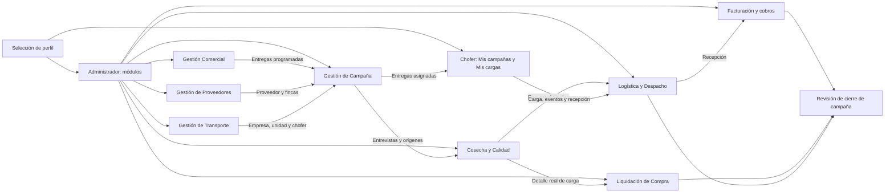

## Bienvenido (Acceso > Selección de perfil)

**Referencia:** V01. **Navegación:** Seleccionar Administrador → Entrar como administrador → Módulos; seleccionar Chofer → elegir usuario → Mis campañas.

**Tablas propuestas para revisar:** `usuario`, `rol`, `persona`.

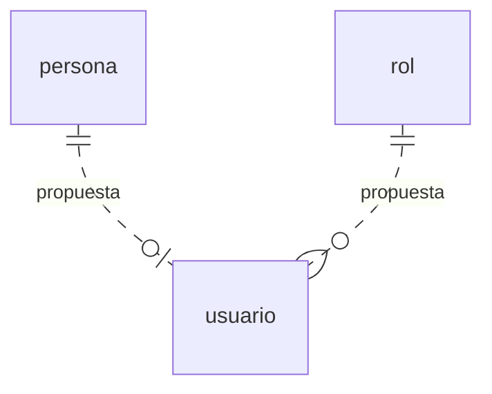

**D11 — Persona de la liquidación (Incorporado al SQL):** La liquidación referencia persona directamente y admite proveedor principal o persona vinculada activa. Conserva snapshot de identidad; no exige un vínculo ficticio del proveedor consigo mismo. La autenticación operativa está implementada en el backend con JWT; no requiere una tabla de sesión.

**Función de las tablas:** consultar la ficha V01 del [reporte específico](01_reporte_especifico.md); este documento conserva nombres, relaciones y decisiones, sin repetir atributos.

## Módulos del sistema (Administrador > Inicio)

**Referencia:** V02. **Navegación:** Cada una de las ocho tarjetas abre su módulo; Volver a módulos permite cambiar de flujo.

Es navegación de módulos; no requiere una tabla de negocio propia.

## Gestión Comercial — Clientes (Administrador > Gestión Comercial > Clientes)

**Referencia:** V03. **Navegación:** Gestión Comercial → Clientes → Ver cliente, Editar o Vincular a campaña; Contratos cambia al listado de participaciones.

**Tablas actuales que se conservan:** `cliente_negocio`.

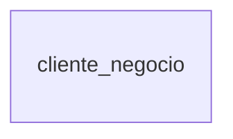

**D08 — Destino como texto (Confirmado e incorporado al SQL):** Decisión del 29/10/2026: no existe CRUD independiente de destinos en el prototipo. Se retira el catálogo propuesto; entrega_programada.destino guarda texto obligatorio. La guía conserva direccion_llegada_snapshot, ubigeo_llegada_snapshot y establecimiento_llegada_snapshot propios, sin FK de destino.

**Función de las tablas:** consultar la ficha V03 del [reporte específico](01_reporte_especifico.md); este documento conserva nombres, relaciones y decisiones, sin repetir atributos.

## Detalle de cliente (Administrador > Gestión Comercial > Clientes > Detalle)

**Referencia:** V04. **Navegación:** Clientes → Ver cliente SUTRIMEX → Participaciones por campaña → Abrir participación.

**Tablas actuales que se conservan:** `cliente_negocio`, `cliente_negocio_campana`, `campana`.

**Tablas propuestas para revisar:** `contrato_venta`.

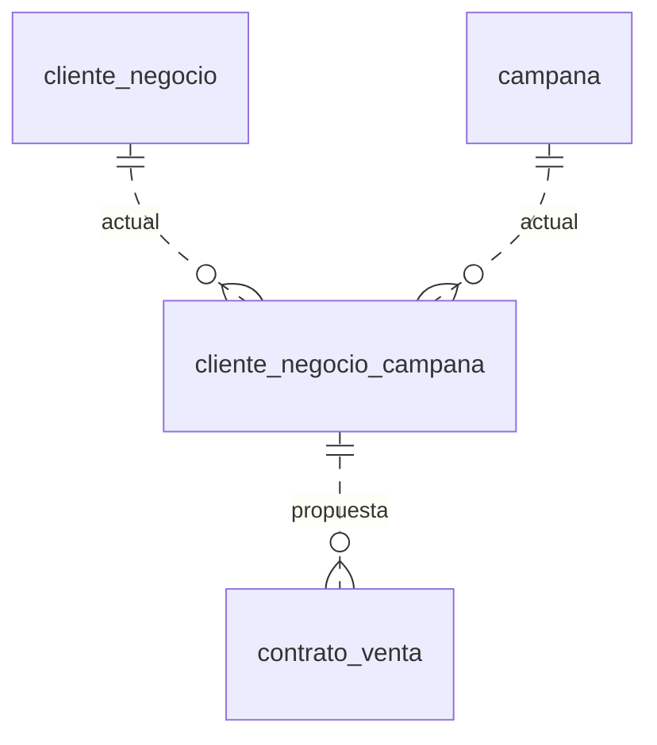

**Función de las tablas:** consultar la ficha V04 del [reporte específico](01_reporte_especifico.md); este documento conserva nombres, relaciones y decisiones, sin repetir atributos.

## Contratos — Participaciones comerciales (Administrador > Gestión Comercial > Contratos)

**Referencia:** V05. **Navegación:** Gestión Comercial → Contratos → Ver/Editar participación; Más opciones → Contratos o Entregas.

**Tablas actuales que se conservan:** `cliente_negocio_campana`, `cliente_negocio`, `campana`, `fruta_derivada`.

**Tablas propuestas para revisar:** `cliente_negocio_campana_x_fruta_derivada`, `contrato_venta`.

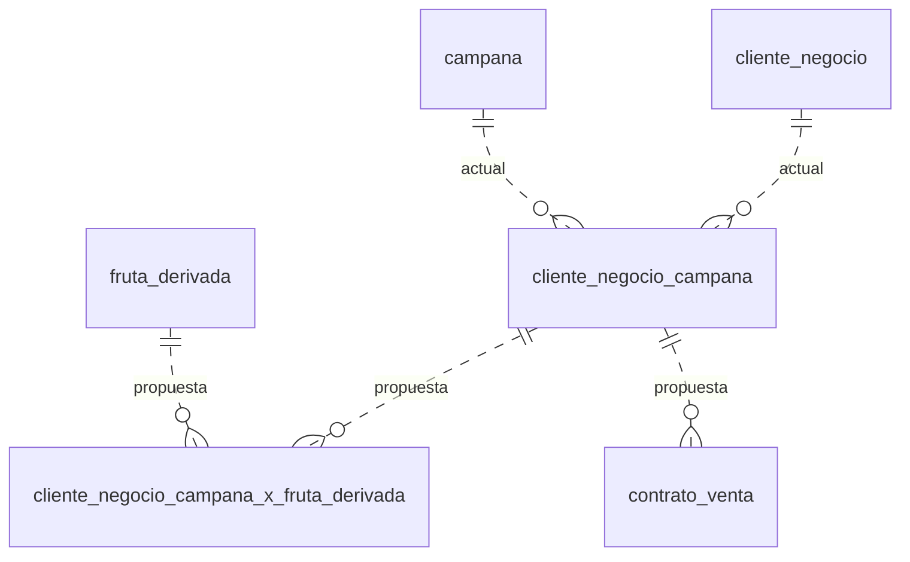

**D08 — Destino como texto (Confirmado e incorporado al SQL):** Decisión del 29/10/2026: no existe CRUD independiente de destinos en el prototipo. Se retira el catálogo propuesto; entrega_programada.destino guarda texto obligatorio. La guía conserva direccion_llegada_snapshot, ubigeo_llegada_snapshot y establecimiento_llegada_snapshot propios, sin FK de destino.

**D15 — Varios requerimientos cliente/campaña (Incorporado según respuesta del usuario):** Se retira la unicidad cliente/campaña para permitir requerimientos independientes. Cada fila conserva sus contratos y entregas. El editor del prototipo aún debe alinearse con esta decisión.

**Función de las tablas:** consultar la ficha V05 del [reporte específico](01_reporte_especifico.md); este documento conserva nombres, relaciones y decisiones, sin repetir atributos.

## Consulta cliente–campaña (Administrador > Gestión Comercial > Contratos > Participación)

**Referencia:** V06. **Navegación:** Ver participación o Abrir participación → consulta cliente–campaña → Volver al origen.

**Tablas actuales que se conservan:** `cliente_negocio_campana`, `cliente_negocio`, `campana`, `fruta_derivada`.

**Tablas propuestas para revisar:** `cliente_negocio_campana_x_fruta_derivada`, `contrato_venta`, `entrega_programada`, `coordinacion_entrega`.

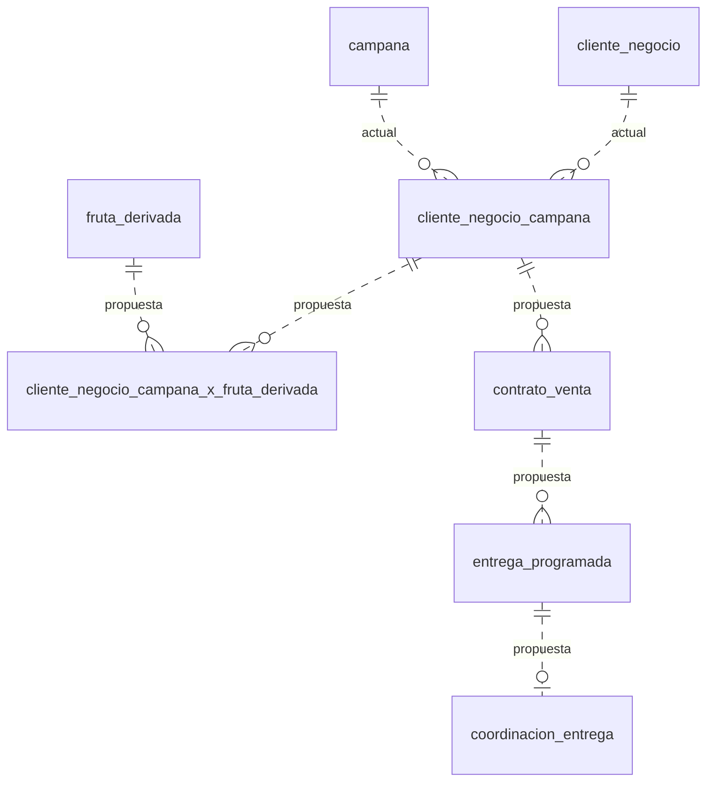

**D15 — Varios requerimientos cliente/campaña (Incorporado según respuesta del usuario):** Se retira la unicidad cliente/campaña para permitir requerimientos independientes. Cada fila conserva sus contratos y entregas. El editor del prototipo aún debe alinearse con esta decisión.

**Función de las tablas:** consultar la ficha V06 del [reporte específico](01_reporte_especifico.md); este documento conserva nombres, relaciones y decisiones, sin repetir atributos.

## Contratos del cliente en campaña (Administrador > Gestión Comercial > Contratos > Participación > Contratos)

**Referencia:** V07. **Navegación:** Contratos → Más opciones de SUTRIMEX → Contratos → Registrar/Editar contrato o Entregas.

**Tablas actuales que se conservan:** `cliente_negocio_campana`, `cliente_negocio`, `campana`.

**Tablas propuestas para revisar:** `contrato_venta`, `entrega_programada`.

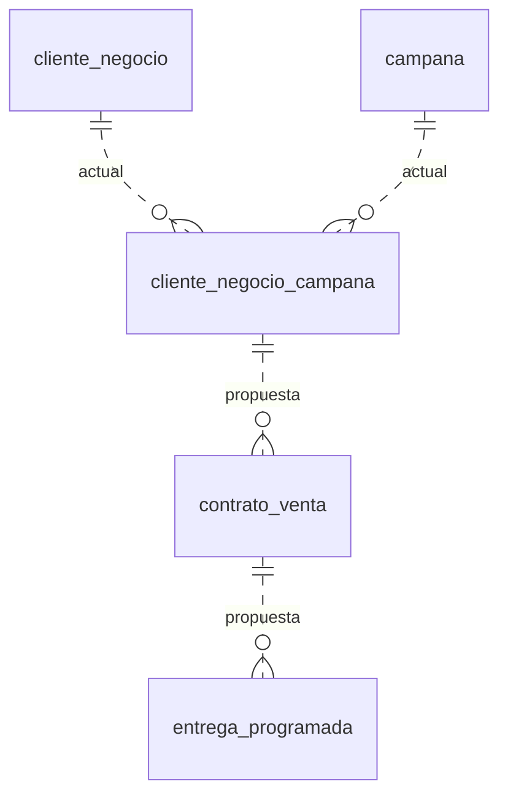

**D15 — Varios requerimientos cliente/campaña (Incorporado según respuesta del usuario):** Se retira la unicidad cliente/campaña para permitir requerimientos independientes. Cada fila conserva sus contratos y entregas. El editor del prototipo aún debe alinearse con esta decisión.

**Función de las tablas:** consultar la ficha V07 del [reporte específico](01_reporte_especifico.md); este documento conserva nombres, relaciones y decisiones, sin repetir atributos.

## Entregas programadas (Administrador > Gestión Comercial > Contratos > Contrato > Entregas)

**Referencia:** V08. **Navegación:** Contrato → Entregas → Registrar/Ver entrega; completar transporte corresponde a Campaña en proceso.

**Tablas actuales que se conservan:** `cliente_negocio_campana`, `cliente_negocio`, `fruta_derivada`.

**Tablas propuestas para revisar:** `entrega_programada`, `entrega_x_fruta_derivada`, `contrato_venta`, `coordinacion_entrega`, `carga`.

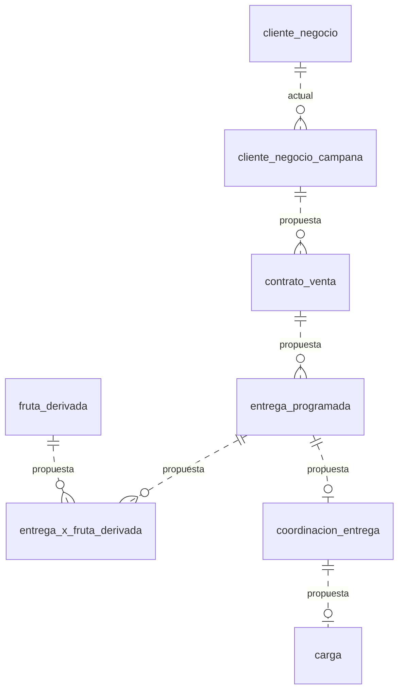

**D08 — Destino como texto (Confirmado e incorporado al SQL):** Decisión del 29/10/2026: no existe CRUD independiente de destinos en el prototipo. Se retira el catálogo propuesto; entrega_programada.destino guarda texto obligatorio. La guía conserva direccion_llegada_snapshot, ubigeo_llegada_snapshot y establecimiento_llegada_snapshot propios, sin FK de destino.

**D14 — Una carga por entrega (Confirmado por el usuario):** Se conserva un viaje/carga por entrega. Cosecha también es única por entrega. El SQL permite varias facturas de esa carga, con suma de kilos no superior a la recepción, según respuesta explícita del usuario.

**Función de las tablas:** consultar la ficha V08 del [reporte específico](01_reporte_especifico.md); este documento conserva nombres, relaciones y decisiones, sin repetir atributos.

## Gestión de Campaña (Administrador > Gestión de Campaña > Listado)

**Referencia:** V09. **Navegación:** Módulos → Gestión de Campaña → Planificado / En Proceso / Finalizado → Detalle o Más opciones.

**Tablas actuales que se conservan:** `campana`, `fruta`, `fruta_derivada`.

**Tablas propuestas para revisar:** `usuario`.

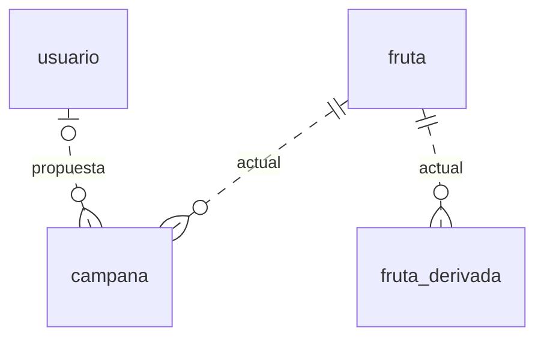

**Función de las tablas:** consultar la ficha V09 del [reporte específico](01_reporte_especifico.md); este documento conserva nombres, relaciones y decisiones, sin repetir atributos.

## Datos generales y resumen de campaña (Administrador > Gestión de Campaña > Campaña > Detalle)

**Referencia:** V10. **Navegación:** En Proceso → Ver detalle de Mango 2026 → Datos generales; Revisar cierre abre su control separado.

**Tablas actuales que se conservan:** `campana`, `fruta`, `fruta_derivada`, `campania_x_proveedores`, `examen_proveedor`, `certificado_campana`, `cliente_negocio_campana`.

**Tablas propuestas para revisar:** `usuario`, `certificado_campana_x_proveedor`, `ampliacion_certificado_campana`, `contrato_venta`, `entrega_programada`, `coordinacion_entrega`, `cosecha`, `carga`, `recepcion_planta`.

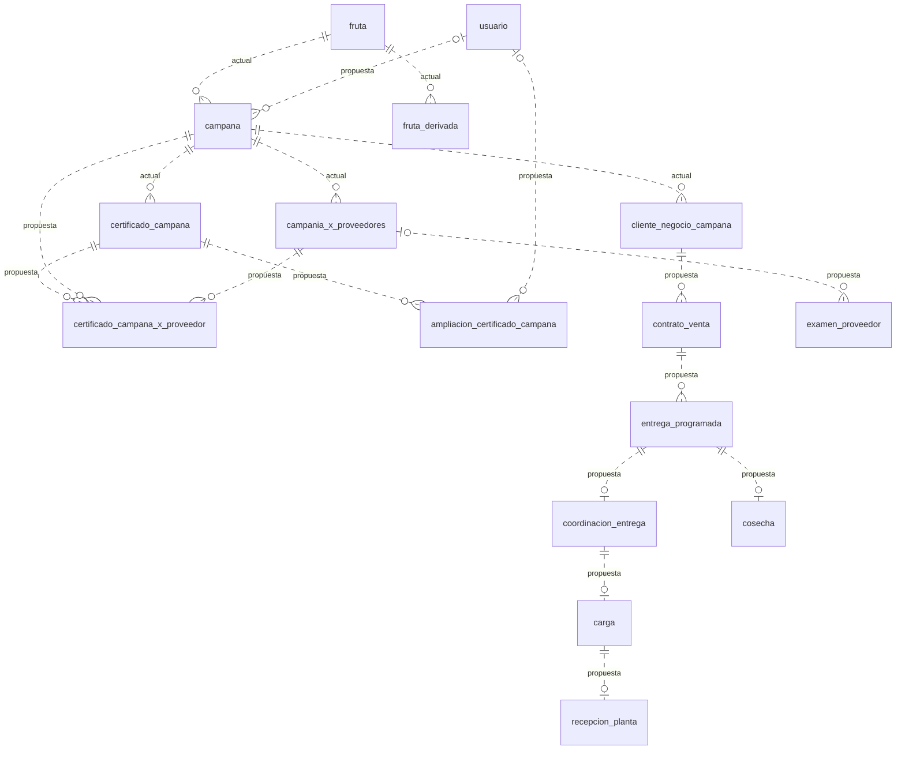

**D01 — Participación única (Confirmado e incorporado al SQL):** Decisión del 29/10/2026: se retira la cabecera participacion_proveedor_campana. campania_x_proveedores conserva cxp_id, proveedor/campaña, cantidad, tipo, evaluación, precio y disponibilidad. Cobertura de certificados y proveedor_carga referencian cxp_id; no se mantiene una segunda participación.

**D09 — Cantidad de certificados (Por discutir):** El editor dice uno por campaña; el backend y el resumen admiten varios. Se mantiene la capacidad actual hasta decidir si las normas requieren certificados distintos.

**Función de las tablas:** consultar la ficha V10 del [reporte específico](01_reporte_especifico.md); este documento conserva nombres, relaciones y decisiones, sin repetir atributos.

## Proveedores de campaña (Administrador > Gestión de Campaña > Planificado > Campaña > Proveedores)

**Referencia:** V11. **Navegación:** Planificado → Más opciones de Palta 2027 → Proveedores → Ver participación; Más opciones del proveedor → Entrevista / Exámenes.

**Tablas actuales que se conservan:** `campania_x_proveedores`, `proveedor`, `campana`, `proveedor_x_fruta`, `fruta`, `fruta_derivada`, `entrevista_extencion`, `finca`, `examen_proveedor`.

**Tablas propuestas para revisar:** `proveedor_x_fruta_derivada`.

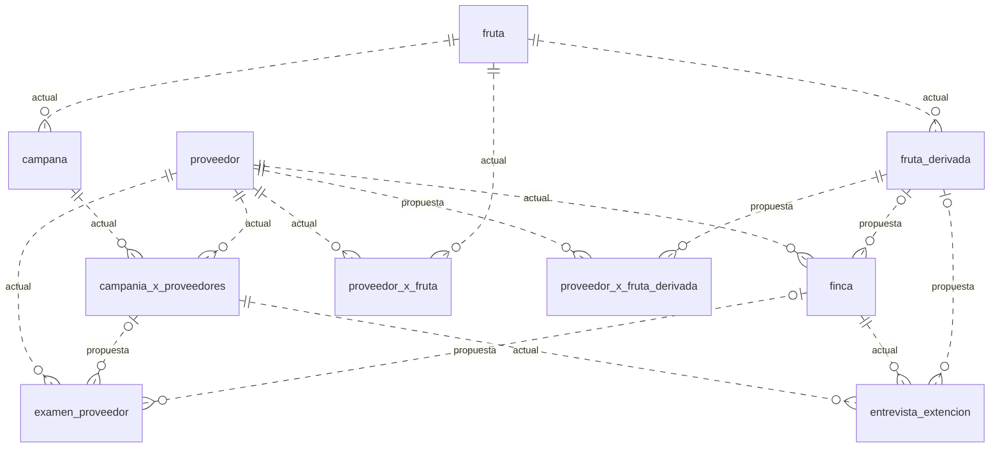

**D01 — Participación única (Confirmado e incorporado al SQL):** Decisión del 29/10/2026: se retira la cabecera participacion_proveedor_campana. campania_x_proveedores conserva cxp_id, proveedor/campaña, cantidad, tipo, evaluación, precio y disponibilidad. Cobertura de certificados y proveedor_carga referencian cxp_id; no se mantiene una segunda participación.

**D02 — Fincas entrevistadas (Aprobado por el usuario):** El listado de fincas de una participación se obtiene desde entrevista_extencion. No se vuelve a agregar finca_id a campania_x_proveedores; los orígenes de entrega/carga seleccionan las fincas físicas de recojo.

**Función de las tablas:** consultar la ficha V11 del [reporte específico](01_reporte_especifico.md); este documento conserva nombres, relaciones y decisiones, sin repetir atributos.

## Entrevista (Administrador > Gestión de Campaña > Planificado > Proveedores > Participación > Entrevista)

**Referencia:** V12. **Navegación:** Proveedores de campaña → Más opciones de Roberto Palacios → Entrevista → Fincas entrevistadas → Ver finca o Registrar entrevista.

**Tablas actuales que se conservan:** `entrevista_extencion`, `finca`, `campania_x_proveedores`, `proveedor`, `campana`, `fruta_derivada`, `fruta`.

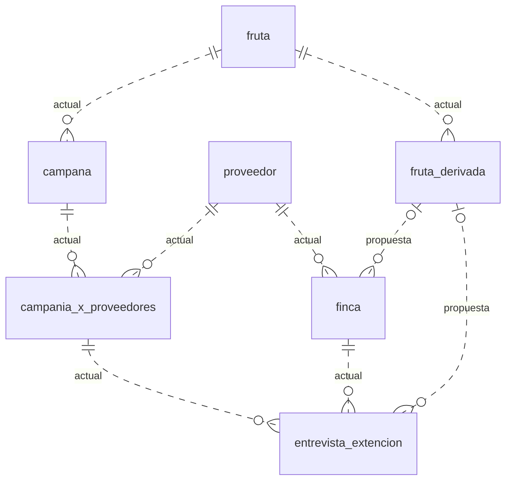

**D02 — Fincas entrevistadas (Aprobado por el usuario):** El listado de fincas de una participación se obtiene desde entrevista_extencion. No se vuelve a agregar finca_id a campania_x_proveedores; los orígenes de entrega/carga seleccionan las fincas físicas de recojo.

**D04 — Una variedad por finca (Aprobado por el usuario):** Se conserva finca.fruta_derivada_id y se obtiene fruta por fruta_derivada.fruta_id. No se agrega una tabla de varios cultivos por finca. El vínculo permanece opcional para datos históricos; completar variedad antes de operar cuando la vista la requiere.

**D10 — Condiciones de compra (Incorporado al SQL):** El precio simple vive en campania_x_proveedores.precio_compra_kg y moneda PEN. Se retira acuerdo_compra: no existe un flujo independiente de acuerdos/versiones en el prototipo. La liquidación conserva kilos reconocidos y precio aplicados.

**Función de las tablas:** consultar la ficha V12 del [reporte específico](01_reporte_especifico.md); este documento conserva nombres, relaciones y decisiones, sin repetir atributos.

## Exámenes (Administrador > Gestión de Campaña > Planificado > Proveedores > Participación > Exámenes)

**Referencia:** V13. **Navegación:** Proveedores de campaña → Más opciones del proveedor → Exámenes → Registrar examen.

**Tablas actuales que se conservan:** `examen_proveedor`, `campania_x_proveedores`, `proveedor`, `finca`, `campana`, `fruta`.

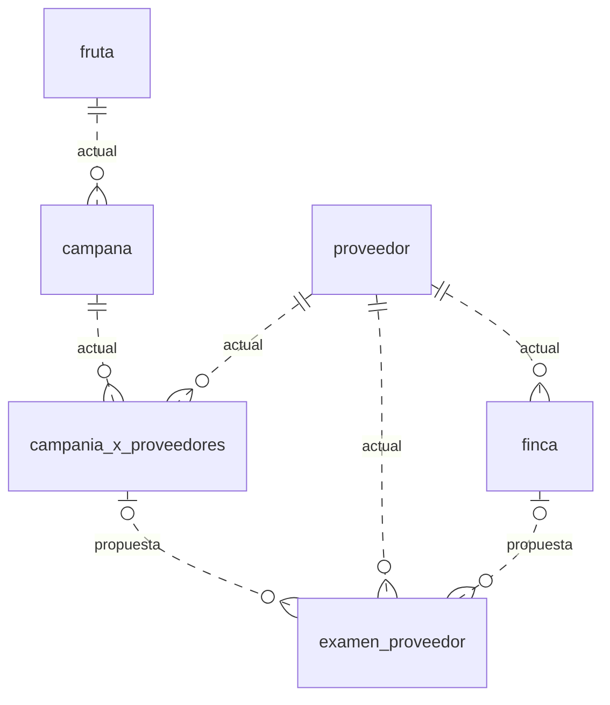

**D12 — Examen por etapas (Incorporado al SQL):** Pendiente y Enviado admiten resultado/documento ausentes. Con resultado requiere resultado explícito. Se mantienen tipos positivo/negativo del backend para el dato final.

**D13 — Gestión documental diferida (Decisión previa conservada):** archivo no está en el SQL ni en diagramas. Los campos de documentos, comprobantes y evidencias son opcionales y sin FK. El mockup puede exigir archivos, pero esa exigencia no está implementada en el esquema de esta etapa.

**Función de las tablas:** consultar la ficha V13 del [reporte específico](01_reporte_especifico.md); este documento conserva nombres, relaciones y decisiones, sin repetir atributos.

## Certificaciones (Administrador > Gestión de Campaña > Planificado > Campaña > Certificaciones)

**Referencia:** V14. **Navegación:** Planificado → Más opciones de campaña → Certificaciones → Editar certificado / Ampliación / Registrar pago.

**Tablas actuales que se conservan:** `certificado_campana`, `campana`, `campania_x_proveedores`, `proveedor`.

**Tablas propuestas para revisar:** `certificado_campana_x_proveedor`, `norma`, `ampliacion_certificado_campana`, `pago_certificado_campana`.

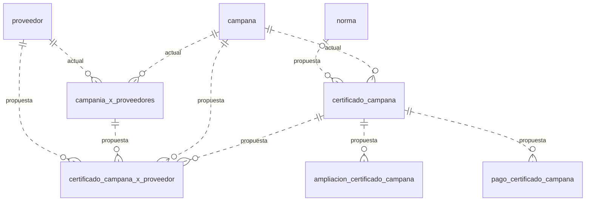

**D01 — Participación única (Confirmado e incorporado al SQL):** Decisión del 29/10/2026: se retira la cabecera participacion_proveedor_campana. campania_x_proveedores conserva cxp_id, proveedor/campaña, cantidad, tipo, evaluación, precio y disponibilidad. Cobertura de certificados y proveedor_carga referencian cxp_id; no se mantiene una segunda participación.

**D09 — Cantidad de certificados (Por discutir):** El editor dice uno por campaña; el backend y el resumen admiten varios. Se mantiene la capacidad actual hasta decidir si las normas requieren certificados distintos.

**D13 — Gestión documental diferida (Decisión previa conservada):** archivo no está en el SQL ni en diagramas. Los campos de documentos, comprobantes y evidencias son opcionales y sin FK. El mockup puede exigir archivos, pero esa exigencia no está implementada en el esquema de esta etapa.

**Función de las tablas:** consultar la ficha V14 del [reporte específico](01_reporte_especifico.md); este documento conserva nombres, relaciones y decisiones, sin repetir atributos.

## Ampliación de certificación (Administrador > Gestión de Campaña > Certificaciones > Ampliación)

**Referencia:** V15. **Navegación:** Certificaciones → + Ampliación → modal; Cancelar vuelve sin registrar evento.

**Tablas actuales que se conservan:** `certificado_campana`.

**Tablas propuestas para revisar:** `ampliacion_certificado_campana`.

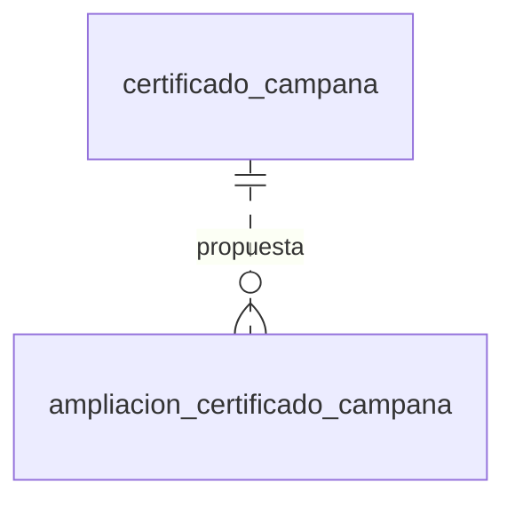

**D09 — Cantidad de certificados (Por discutir):** El editor dice uno por campaña; el backend y el resumen admiten varios. Se mantiene la capacidad actual hasta decidir si las normas requieren certificados distintos.

**Función de las tablas:** consultar la ficha V15 del [reporte específico](01_reporte_especifico.md); este documento conserva nombres, relaciones y decisiones, sin repetir atributos.

## Pago de certificación (Administrador > Gestión de Campaña > Certificaciones > Pagos)

**Referencia:** V16. **Navegación:** Certificaciones → Registrar pago → modal; Cancelar vuelve sin registrar desembolso.

**Tablas actuales que se conservan:** `certificado_campana`.

**Tablas propuestas para revisar:** `pago_certificado_campana`.

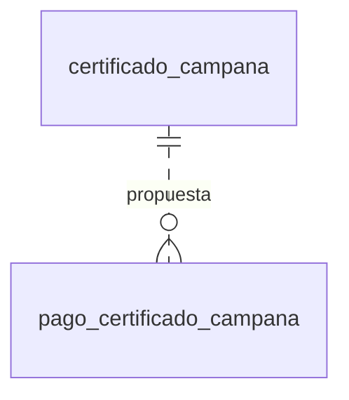

**D13 — Gestión documental diferida (Decisión previa conservada):** archivo no está en el SQL ni en diagramas. Los campos de documentos, comprobantes y evidencias son opcionales y sin FK. El mockup puede exigir archivos, pero esa exigencia no está implementada en el esquema de esta etapa.

**Función de las tablas:** consultar la ficha V16 del [reporte específico](01_reporte_especifico.md); este documento conserva nombres, relaciones y decisiones, sin repetir atributos.

## Transportistas por campaña (Administrador > Gestión de Campaña > En Proceso > Campaña > Transportistas)

**Referencia:** V17. **Navegación:** En Proceso → Más opciones de Mango 2026 → Transportistas → Vincular; Más opciones de empresa → Acuerdo de pago.

**Tablas actuales que se conservan:** `empresa_transporte_externo`, `campana`.

**Tablas propuestas para revisar:** `acuerdo_transporte`, `adelanto_transporte`.

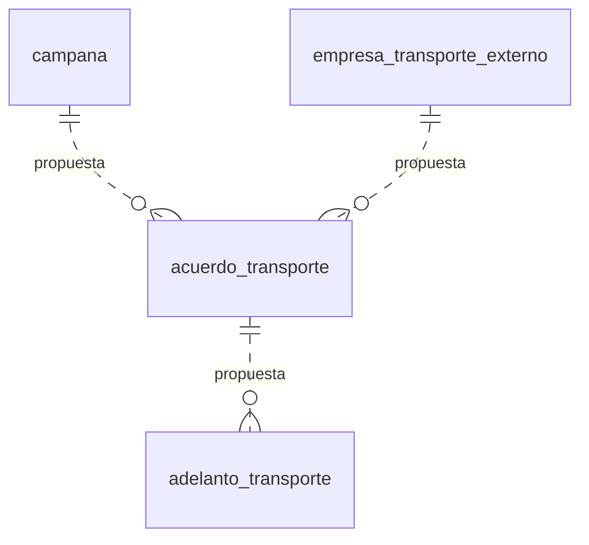

**D06 — Vincular antes del acuerdo (Incorporado al SQL):** acuerdo_transporte admite BORRADOR sin condiciones completas; CONFIRMADO exige monto, tipo y fechas. No hace falta inventar un segundo vínculo.

**Función de las tablas:** consultar la ficha V17 del [reporte específico](01_reporte_especifico.md); este documento conserva nombres, relaciones y decisiones, sin repetir atributos.

## Entregas de la campaña (Administrador > Gestión de Campaña > En Proceso > Campaña > Entregas)

**Referencia:** V18. **Navegación:** En Proceso → Más opciones → Entregas → Completar entrega, Editar coordinación o Ver entrega según preparación.

**Tablas actuales que se conservan:** `campana`, `cliente_negocio_campana`, `cliente_negocio`.

**Tablas propuestas para revisar:** `entrega_programada`, `contrato_venta`, `coordinacion_entrega`, `carga`.

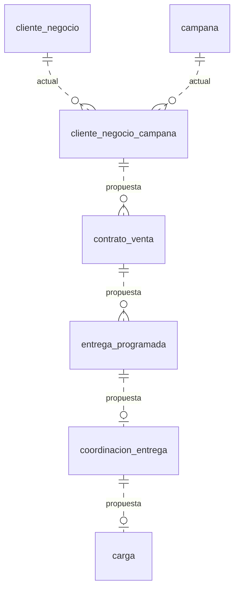

**Función de las tablas:** consultar la ficha V18 del [reporte específico](01_reporte_especifico.md); este documento conserva nombres, relaciones y decisiones, sin repetir atributos.

## Completar coordinación de entrega (Administrador > Gestión de Campaña > En Proceso > Entregas > Coordinación)

**Referencia:** V19. **Navegación:** Entregas → Completar entrega → Completar coordinación → elegir transportista, chofer, unidad y orígenes.

**Tablas actuales que se conservan:** `cliente_negocio_campana`, `cliente_negocio`, `campana`, `empresa_transporte_externo`, `vehiculo_externo`, `chofer_transporte_externo`, `campania_x_proveedores`, `proveedor`, `entrevista_extencion`, `finca`, `fruta_derivada`.

**Tablas propuestas para revisar:** `coordinacion_entrega`, `origen_entrega`, `entrega_programada`, `contrato_venta`, `acuerdo_transporte`.

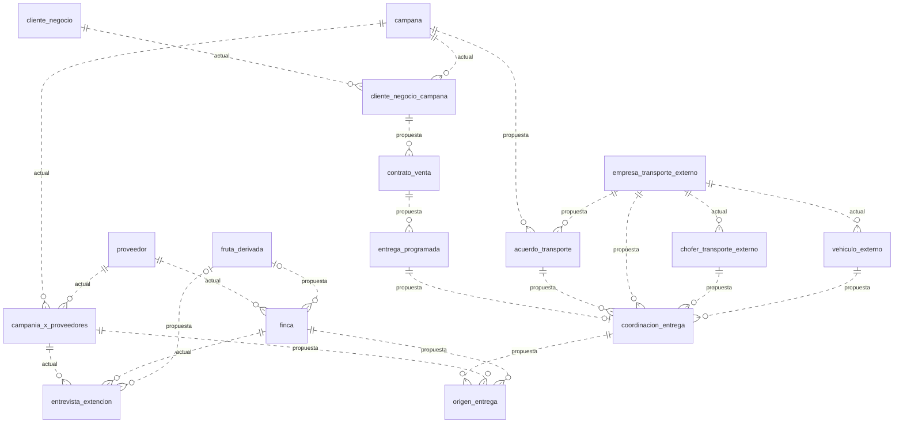

**D02 — Fincas entrevistadas (Aprobado por el usuario):** El listado de fincas de una participación se obtiene desde entrevista_extencion. No se vuelve a agregar finca_id a campania_x_proveedores; los orígenes de entrega/carga seleccionan las fincas físicas de recojo.

**D05 — Autoridad de transporte (Confirmado por el usuario):** coordinacion_entrega es la fuente del viaje. Se conservan las tablas actuales por compatibilidad; ambas asignaciones usan instantes y exclusión [inicio,fin), permitiendo viajes sucesivos en el día.

**D06 — Vincular antes del acuerdo (Incorporado al SQL):** acuerdo_transporte admite BORRADOR sin condiciones completas; CONFIRMADO exige monto, tipo y fechas. No hace falta inventar un segundo vínculo.

**Función de las tablas:** consultar la ficha V19 del [reporte específico](01_reporte_especifico.md); este documento conserva nombres, relaciones y decisiones, sin repetir atributos.

## Programa semanal de entregas (Administrador > Gestión de Campaña > Campaña > Programa semanal de entregas)

**Referencia:** V20. **Navegación:** Campaña → Más opciones → Programa semanal de entregas → semana/variedad → cantidad diaria abre su composición.

**Tablas actuales que se conservan:** `campana`, `cliente_negocio`, `cliente_negocio_campana`, `fruta_derivada`, `vehiculo_externo`.

**Tablas propuestas para revisar:** `contrato_venta`, `entrega_programada`, `entrega_x_fruta_derivada`, `coordinacion_entrega`.

```mermaid
erDiagram
    cliente_negocio ||..o{ cliente_negocio_campana : actual
    campana ||..o{ cliente_negocio_campana : actual
    cliente_negocio_campana ||..o{ contrato_venta : propuesta
    contrato_venta ||..o{ entrega_programada : propuesta
    entrega_programada ||..o{ entrega_x_fruta_derivada : propuesta
    fruta_derivada ||..o{ entrega_x_fruta_derivada : propuesta
    entrega_programada ||..o| coordinacion_entrega : propuesta
    vehiculo_externo ||..o{ coordinacion_entrega : propuesta
```

**Función de las tablas:** consultar la ficha V20 del [reporte específico](01_reporte_especifico.md); este documento conserva nombres, relaciones y decisiones, sin repetir atributos.

## Gestión de proveedores (Administrador > Gestión de Proveedores > Listado)

**Referencia:** V21. **Navegación:** Módulos → Gestión de Proveedores → Ver/Editar proveedor; Más opciones → Fincas o Certificados.

**Tablas actuales que se conservan:** `proveedor`, `proveedor_x_fruta`, `fruta`, `fruta_derivada`.

**Tablas propuestas para revisar:** `proveedor_x_fruta_derivada`, `persona`, `proveedor_x_persona`.

```mermaid
erDiagram
    fruta ||..o{ fruta_derivada : actual
    proveedor ||..o{ proveedor_x_fruta : actual
    fruta ||..o{ proveedor_x_fruta : actual
    proveedor ||..o{ proveedor_x_persona : propuesta
    persona ||..o{ proveedor_x_persona : propuesta
    proveedor ||..o{ proveedor_x_fruta_derivada : propuesta
    fruta_derivada ||..o{ proveedor_x_fruta_derivada : propuesta
    persona o|..o{ proveedor : propuesta
```

**D11 — Persona de la liquidación (Incorporado al SQL):** La liquidación referencia persona directamente y admite proveedor principal o persona vinculada activa. Conserva snapshot de identidad; no exige un vínculo ficticio del proveedor consigo mismo. La autenticación operativa está implementada en el backend con JWT; no requiere una tabla de sesión.

**Función de las tablas:** consultar la ficha V21 del [reporte específico](01_reporte_especifico.md); este documento conserva nombres, relaciones y decisiones, sin repetir atributos.

## Detalle de proveedor (Administrador > Gestión de Proveedores > Proveedor > Detalle)

**Referencia:** V22. **Navegación:** Gestión de Proveedores → Ver proveedor → Datos generales, frutas y variedades → Volver a proveedores.

**Tablas actuales que se conservan:** `proveedor`, `proveedor_x_fruta`, `fruta`, `fruta_derivada`.

**Tablas propuestas para revisar:** `proveedor_x_fruta_derivada`, `persona`.

```mermaid
erDiagram
    fruta ||..o{ fruta_derivada : actual
    proveedor ||..o{ proveedor_x_fruta : actual
    fruta ||..o{ proveedor_x_fruta : actual
    proveedor ||..o{ proveedor_x_fruta_derivada : propuesta
    fruta_derivada ||..o{ proveedor_x_fruta_derivada : propuesta
    persona o|..o{ proveedor : propuesta
```

**D11 — Persona de la liquidación (Incorporado al SQL):** La liquidación referencia persona directamente y admite proveedor principal o persona vinculada activa. Conserva snapshot de identidad; no exige un vínculo ficticio del proveedor consigo mismo. La autenticación operativa está implementada en el backend con JWT; no requiere una tabla de sesión.

**Función de las tablas:** consultar la ficha V22 del [reporte específico](01_reporte_especifico.md); este documento conserva nombres, relaciones y decisiones, sin repetir atributos.

## Fincas (Administrador > Gestión de Proveedores > Proveedor > Fincas)

**Referencia:** V23. **Navegación:** Proveedor → Más opciones → Fincas → Registrar / Ver / Editar finca.

**Tablas actuales que se conservan:** `finca`, `proveedor`, `fruta`, `fruta_derivada`.

```mermaid
erDiagram
    proveedor ||..o{ finca : actual
    fruta ||..o{ fruta_derivada : actual
    fruta_derivada o|..o{ finca : propuesta
```

**D04 — Una variedad por finca (Aprobado por el usuario):** Se conserva finca.fruta_derivada_id y se obtiene fruta por fruta_derivada.fruta_id. No se agrega una tabla de varios cultivos por finca. El vínculo permanece opcional para datos históricos; completar variedad antes de operar cuando la vista la requiere.

**Función de las tablas:** consultar la ficha V23 del [reporte específico](01_reporte_especifico.md); este documento conserva nombres, relaciones y decisiones, sin repetir atributos.

## Certificados del proveedor (Administrador > Gestión de Proveedores > Proveedor > Certificados)

**Referencia:** V24. **Navegación:** Proveedor → Más opciones → Certificados → Registrar / Ver / Editar certificado propio.

**Tablas actuales que se conservan:** `certificado_proveedor`, `proveedor`.

```mermaid
erDiagram
    proveedor ||..o{ certificado_proveedor : actual
```

**D13 — Gestión documental diferida (Decisión previa conservada):** archivo no está en el SQL ni en diagramas. Los campos de documentos, comprobantes y evidencias son opcionales y sin FK. El mockup puede exigir archivos, pero esa exigencia no está implementada en el esquema de esta etapa.

**Función de las tablas:** consultar la ficha V24 del [reporte específico](01_reporte_especifico.md); este documento conserva nombres, relaciones y decisiones, sin repetir atributos.

## Gestión de transporte (Administrador > Gestión de Transporte > Transportistas)

**Referencia:** V25. **Navegación:** Módulos → Gestión de Transporte → Ver empresa; selección de empresas → Solicitar cotización.

**Tablas actuales que se conservan:** `empresa_transporte_externo`, `vehiculo_externo`, `chofer_transporte_externo`, `trazabilidad_transporte`, `chofer_vehiculo_externo`, `detalle_trazabilidad`.

**Tablas propuestas para revisar:** `persona`.

```mermaid
erDiagram
    empresa_transporte_externo ||..o{ chofer_transporte_externo : actual
    vehiculo_externo ||..o{ chofer_vehiculo_externo : actual
    chofer_transporte_externo ||..o{ chofer_vehiculo_externo : actual
    trazabilidad_transporte ||..o{ chofer_vehiculo_externo : actual
    trazabilidad_transporte ||..o{ detalle_trazabilidad : actual
    empresa_transporte_externo ||..o{ vehiculo_externo : actual
    persona o|..o{ chofer_transporte_externo : propuesta
    persona o|..o{ empresa_transporte_externo : propuesta
```

**D05 — Autoridad de transporte (Confirmado por el usuario):** coordinacion_entrega es la fuente del viaje. Se conservan las tablas actuales por compatibilidad; ambas asignaciones usan instantes y exclusión [inicio,fin), permitiendo viajes sucesivos en el día.

**Función de las tablas:** consultar la ficha V25 del [reporte específico](01_reporte_especifico.md); este documento conserva nombres, relaciones y decisiones, sin repetir atributos.

## Ficha del transportista (Administrador > Gestión de Transporte > Transportista > Detalle)

**Referencia:** V26. **Navegación:** Ver empresa SUTRIMEX → Ver vehículos / Ver choferes / Nuevo vehículo / Nuevo chofer / Editar transportista.

**Tablas actuales que se conservan:** `empresa_transporte_externo`, `vehiculo_externo`, `chofer_transporte_externo`.

```mermaid
erDiagram
    empresa_transporte_externo ||..o{ chofer_transporte_externo : actual
    empresa_transporte_externo ||..o{ vehiculo_externo : actual
```

**D05 — Autoridad de transporte (Confirmado por el usuario):** coordinacion_entrega es la fuente del viaje. Se conservan las tablas actuales por compatibilidad; ambas asignaciones usan instantes y exclusión [inicio,fin), permitiendo viajes sucesivos en el día.

**Función de las tablas:** consultar la ficha V26 del [reporte específico](01_reporte_especifico.md); este documento conserva nombres, relaciones y decisiones, sin repetir atributos.

## Vehículos (Administrador > Gestión de Transporte > Transportista > Vehículos)

**Referencia:** V27. **Navegación:** Ficha del transportista → Ver vehículos → listado filtrado por empresa → Ver/Editar unidad.

**Tablas actuales que se conservan:** `vehiculo_externo`, `empresa_transporte_externo`.

```mermaid
erDiagram
    empresa_transporte_externo ||..o{ vehiculo_externo : actual
```

**D05 — Autoridad de transporte (Confirmado por el usuario):** coordinacion_entrega es la fuente del viaje. Se conservan las tablas actuales por compatibilidad; ambas asignaciones usan instantes y exclusión [inicio,fin), permitiendo viajes sucesivos en el día.

**Función de las tablas:** consultar la ficha V27 del [reporte específico](01_reporte_especifico.md); este documento conserva nombres, relaciones y decisiones, sin repetir atributos.

## Choferes (Administrador > Gestión de Transporte > Transportista > Choferes)

**Referencia:** V28. **Navegación:** Ficha del transportista → Ver choferes → listado filtrado por empresa → Ver/Editar conductor.

**Tablas actuales que se conservan:** `chofer_transporte_externo`, `empresa_transporte_externo`.

**Tablas propuestas para revisar:** `persona`, `usuario`.

```mermaid
erDiagram
    empresa_transporte_externo ||..o{ chofer_transporte_externo : actual
    persona ||..o| usuario : propuesta
    persona o|..o{ chofer_transporte_externo : propuesta
    usuario o|..o{ chofer_transporte_externo : propuesta
    persona o|..o{ empresa_transporte_externo : propuesta
```

**D05 — Autoridad de transporte (Confirmado por el usuario):** coordinacion_entrega es la fuente del viaje. Se conservan las tablas actuales por compatibilidad; ambas asignaciones usan instantes y exclusión [inicio,fin), permitiendo viajes sucesivos en el día.

**D11 — Persona de la liquidación (Incorporado al SQL):** La liquidación referencia persona directamente y admite proveedor principal o persona vinculada activa. Conserva snapshot de identidad; no exige un vínculo ficticio del proveedor consigo mismo. La autenticación operativa está implementada en el backend con JWT; no requiere una tabla de sesión.

**Función de las tablas:** consultar la ficha V28 del [reporte específico](01_reporte_especifico.md); este documento conserva nombres, relaciones y decisiones, sin repetir atributos.

## Requerimientos y cotizaciones (Administrador > Gestión de Transporte > Requerimientos y cotizaciones)

**Referencia:** V29. **Navegación:** Gestión de Transporte → Requerimientos y cotizaciones → Nueva solicitud. El listado estaba vacío.

**Tablas actuales que se conservan:** `campana`, `empresa_transporte_externo`.

**Tablas propuestas para revisar:** `solicitud_transporte`, `invitacion_transporte`, `cotizacion_transporte`.

```mermaid
erDiagram
    campana ||..o{ solicitud_transporte : propuesta
    solicitud_transporte ||..o{ invitacion_transporte : propuesta
    empresa_transporte_externo ||..o{ invitacion_transporte : propuesta
    invitacion_transporte ||..o{ cotizacion_transporte : propuesta
```

**D13 — Gestión documental diferida (Decisión previa conservada):** archivo no está en el SQL ni en diagramas. Los campos de documentos, comprobantes y evidencias son opcionales y sin FK. El mockup puede exigir archivos, pero esa exigencia no está implementada en el esquema de esta etapa.

**Función de las tablas:** consultar la ficha V29 del [reporte específico](01_reporte_especifico.md); este documento conserva nombres, relaciones y decisiones, sin repetir atributos.

## Solicitar cotización (Administrador > Gestión de Transporte > Requerimientos y cotizaciones > Solicitud)

**Referencia:** V30. **Navegación:** Padrón → seleccionar transportistas → Solicitar cotización → formulario → Revisar solicitud. No se ejecutó envío.

**Tablas actuales que se conservan:** `campana`, `empresa_transporte_externo`.

**Tablas propuestas para revisar:** `solicitud_transporte`, `invitacion_transporte`, `cotizacion_transporte`.

```mermaid
erDiagram
    campana ||..o{ solicitud_transporte : propuesta
    solicitud_transporte ||..o{ invitacion_transporte : propuesta
    empresa_transporte_externo ||..o{ invitacion_transporte : propuesta
    invitacion_transporte ||..o{ cotizacion_transporte : propuesta
```

**D13 — Gestión documental diferida (Decisión previa conservada):** archivo no está en el SQL ni en diagramas. Los campos de documentos, comprobantes y evidencias son opcionales y sin FK. El mockup puede exigir archivos, pero esa exigencia no está implementada en el esquema de esta etapa.

**Función de las tablas:** consultar la ficha V30 del [reporte específico](01_reporte_especifico.md); este documento conserva nombres, relaciones y decisiones, sin repetir atributos.

## Cosecha y control de calidad (Administrador > Cosecha y Control de Calidad > Campañas)

**Referencia:** V31. **Navegación:** Módulos → Cosecha y Control de Calidad → Exportador/Industria → Ver campaña o menú de opciones.

**Tablas actuales que se conservan:** `campana`, `cliente_negocio`, `cliente_negocio_campana`.

**Tablas propuestas para revisar:** `contrato_venta`, `entrega_programada`, `cosecha`, `carga`.

```mermaid
erDiagram
    cliente_negocio ||..o{ cliente_negocio_campana : actual
    campana ||..o{ cliente_negocio_campana : actual
    cliente_negocio_campana ||..o{ contrato_venta : propuesta
    contrato_venta ||..o{ entrega_programada : propuesta
    entrega_programada ||..o| cosecha : propuesta
    carga
```

**D07 — Incorporación de campaña a Calidad (Incorporado al SQL):** campana.calidad conserva un objeto por canal con su habilitación/estado, antes de crear cargas o elegir entregas.

**Función de las tablas:** consultar la ficha V31 del [reporte específico](01_reporte_especifico.md); este documento conserva nombres, relaciones y decisiones, sin repetir atributos.

## Resumen de cosecha y calidad (Administrador > Cosecha y Control de Calidad > Campaña > Resumen)

**Referencia:** V32. **Navegación:** Calidad → Ver campaña Mango 2026 → resumen de estado y fechas → Volver a campañas.

**Tablas actuales que se conservan:** `campana`, `fruta`.

**Tablas propuestas para revisar:** `cosecha`, `carga`.

```mermaid
erDiagram
    fruta ||..o{ campana : actual
    cosecha
    carga
```

**Función de las tablas:** consultar la ficha V32 del [reporte específico](01_reporte_especifico.md); este documento conserva nombres, relaciones y decisiones, sin repetir atributos.

## Análisis y revisión (Administrador > Cosecha y Control de Calidad > Exportador > Campaña > Análisis y revisión)

**Referencia:** V33. **Navegación:** Calidad → Opciones de campaña → Análisis y revisión → Registrar análisis o Completar/editar.

**Tablas actuales que se conservan:** `campana`, `campania_x_proveedores`, `proveedor`, `entrevista_extencion`, `finca`, `fruta_derivada`.

**Tablas propuestas para revisar:** `analisis_calidad`, `medicion_mtd`, `cosecha`.

```mermaid
erDiagram
    campana ||..o{ campania_x_proveedores : actual
    proveedor ||..o{ campania_x_proveedores : actual
    campania_x_proveedores ||..o{ entrevista_extencion : actual
    finca ||..o{ entrevista_extencion : actual
    proveedor ||..o{ finca : actual
    cosecha o|..o{ analisis_calidad : propuesta
    campania_x_proveedores ||..o{ analisis_calidad : propuesta
    campania_x_proveedores ||..o{ medicion_mtd : propuesta
    fruta_derivada o|..o{ entrevista_extencion : propuesta
    fruta_derivada o|..o{ finca : propuesta
    finca ||..o{ analisis_calidad : propuesta
    finca ||..o{ medicion_mtd : propuesta
```

**D03 — Análisis antes de cosecha (Aprobado por el usuario):** analisis_calidad identifica cxp_id y finca_id; cosecha_id queda opcional. La campaña se obtiene por la participación, sin otra FK redundante a campaña. El servicio validará coincidencia de campaña y origen si se vincula posteriormente una cosecha.

**D04 — Una variedad por finca (Aprobado por el usuario):** Se conserva finca.fruta_derivada_id y se obtiene fruta por fruta_derivada.fruta_id. No se agrega una tabla de varios cultivos por finca. El vínculo permanece opcional para datos históricos; completar variedad antes de operar cuando la vista la requiere.

**D13 — Gestión documental diferida (Decisión previa conservada):** archivo no está en el SQL ni en diagramas. Los campos de documentos, comprobantes y evidencias son opcionales y sin FK. El mockup puede exigir archivos, pero esa exigencia no está implementada en el esquema de esta etapa.

**Función de las tablas:** consultar la ficha V33 del [reporte específico](01_reporte_especifico.md); este documento conserva nombres, relaciones y decisiones, sin repetir atributos.

## Cargas por entrega (Administrador > Cosecha y Control de Calidad > Campaña > Cargas por entrega)

**Referencia:** V34. **Navegación:** Calidad → Opciones → Carga / Cargas por entrega → Registrar carga, Ver carga o Editar datos.

**Tablas actuales que se conservan:** `campana`, `cliente_negocio_campana`, `cliente_negocio`, `empresa_transporte_externo`, `vehiculo_externo`, `chofer_transporte_externo`, `proveedor`, `finca`, `fruta_derivada`.

**Tablas propuestas para revisar:** `carga`, `proveedor_carga`, `origen_carga`, `gasto_carga`, `coordinacion_entrega`, `entrega_programada`, `contrato_venta`, `cosecha`, `analisis_calidad`.

```mermaid
erDiagram
    empresa_transporte_externo ||..o{ chofer_transporte_externo : actual
    cliente_negocio ||..o{ cliente_negocio_campana : actual
    campana ||..o{ cliente_negocio_campana : actual
    proveedor ||..o{ finca : actual
    empresa_transporte_externo ||..o{ vehiculo_externo : actual
    cliente_negocio_campana ||..o{ contrato_venta : propuesta
    contrato_venta ||..o{ entrega_programada : propuesta
    entrega_programada ||..o| coordinacion_entrega : propuesta
    empresa_transporte_externo ||..o{ coordinacion_entrega : propuesta
    chofer_transporte_externo ||..o{ coordinacion_entrega : propuesta
    entrega_programada ||..o| cosecha : propuesta
    cosecha o|..o{ analisis_calidad : propuesta
    coordinacion_entrega ||..o| carga : propuesta
    carga ||..o{ proveedor_carga : propuesta
    fruta_derivada ||..o{ proveedor_carga : propuesta
    proveedor_carga ||..o{ origen_carga : propuesta
    carga ||..o{ gasto_carga : propuesta
    vehiculo_externo ||..o{ coordinacion_entrega : propuesta
    fruta_derivada o|..o{ finca : propuesta
    finca ||..o{ origen_carga : propuesta
    finca ||..o{ analisis_calidad : propuesta
```

**D14 — Una carga por entrega (Confirmado por el usuario):** Se conserva un viaje/carga por entrega. Cosecha también es única por entrega. El SQL permite varias facturas de esa carga, con suma de kilos no superior a la recepción, según respuesta explícita del usuario.

**D05 — Autoridad de transporte (Confirmado por el usuario):** coordinacion_entrega es la fuente del viaje. Se conservan las tablas actuales por compatibilidad; ambas asignaciones usan instantes y exclusión [inicio,fin), permitiendo viajes sucesivos en el día.

**Función de las tablas:** consultar la ficha V34 del [reporte específico](01_reporte_especifico.md); este documento conserva nombres, relaciones y decisiones, sin repetir atributos.

## Detalle de operación y carga (Administrador > Cosecha y Control de Calidad > Cargas por entrega > Detalle)

**Referencia:** V35. **Navegación:** Cargas por entrega → Ver carga 2 → operación EXP-MAN-002 → entrega, controles, MTD y documentos.

**Tablas actuales que se conservan:** `campania_x_proveedores`, `proveedor`, `finca`, `fruta_derivada`, `cliente_negocio_campana`, `empresa_transporte_externo`, `vehiculo_externo`, `chofer_transporte_externo`.

**Tablas propuestas para revisar:** `cosecha`, `carga`, `coordinacion_entrega`, `origen_entrega`, `entrega_programada`, `contrato_venta`, `analisis_calidad`, `medicion_mtd`, `proveedor_carga`, `origen_carga`.

```mermaid
erDiagram
    proveedor ||..o{ campania_x_proveedores : actual
    empresa_transporte_externo ||..o{ chofer_transporte_externo : actual
    proveedor ||..o{ finca : actual
    empresa_transporte_externo ||..o{ vehiculo_externo : actual
    cliente_negocio_campana ||..o{ contrato_venta : propuesta
    contrato_venta ||..o{ entrega_programada : propuesta
    entrega_programada ||..o| coordinacion_entrega : propuesta
    empresa_transporte_externo ||..o{ coordinacion_entrega : propuesta
    chofer_transporte_externo ||..o{ coordinacion_entrega : propuesta
    coordinacion_entrega ||..o{ origen_entrega : propuesta
    campania_x_proveedores ||..o{ origen_entrega : propuesta
    entrega_programada ||..o| cosecha : propuesta
    cosecha o|..o{ analisis_calidad : propuesta
    campania_x_proveedores ||..o{ analisis_calidad : propuesta
    campania_x_proveedores ||..o{ medicion_mtd : propuesta
    coordinacion_entrega ||..o| carga : propuesta
    carga ||..o{ proveedor_carga : propuesta
    campania_x_proveedores ||..o{ proveedor_carga : propuesta
    fruta_derivada ||..o{ proveedor_carga : propuesta
    proveedor_carga ||..o{ origen_carga : propuesta
    campania_x_proveedores ||..o{ origen_carga : propuesta
    vehiculo_externo ||..o{ coordinacion_entrega : propuesta
    fruta_derivada o|..o{ finca : propuesta
    finca ||..o{ origen_entrega : propuesta
    finca ||..o{ origen_carga : propuesta
    finca ||..o{ analisis_calidad : propuesta
    finca ||..o{ medicion_mtd : propuesta
```

**D03 — Análisis antes de cosecha (Aprobado por el usuario):** analisis_calidad identifica cxp_id y finca_id; cosecha_id queda opcional. La campaña se obtiene por la participación, sin otra FK redundante a campaña. El servicio validará coincidencia de campaña y origen si se vincula posteriormente una cosecha.

**D14 — Una carga por entrega (Confirmado por el usuario):** Se conserva un viaje/carga por entrega. Cosecha también es única por entrega. El SQL permite varias facturas de esa carga, con suma de kilos no superior a la recepción, según respuesta explícita del usuario.

**Función de las tablas:** consultar la ficha V35 del [reporte específico](01_reporte_especifico.md); este documento conserva nombres, relaciones y decisiones, sin repetir atributos.

## Guías de remisión (Administrador > Cosecha y Control de Calidad > Campaña > Guías de remisión)

**Referencia:** V36. **Navegación:** Calidad → Opciones → Guías de remisión → fila de carga → Preparar guía o Ver detalle.

**Tablas actuales que se conservan:** `cliente_negocio_campana`, `cliente_negocio`, `empresa_transporte_externo`, `vehiculo_externo`, `chofer_transporte_externo`.

**Tablas propuestas para revisar:** `carga`, `proveedor_carga`, `coordinacion_entrega`, `entrega_programada`, `contrato_venta`, `guia_remision`, `proveedor_guia`, `guia_x_norma`, `norma`.

```mermaid
erDiagram
    empresa_transporte_externo ||..o{ chofer_transporte_externo : actual
    cliente_negocio ||..o{ cliente_negocio_campana : actual
    empresa_transporte_externo ||..o{ vehiculo_externo : actual
    cliente_negocio_campana ||..o{ contrato_venta : propuesta
    contrato_venta ||..o{ entrega_programada : propuesta
    entrega_programada ||..o| coordinacion_entrega : propuesta
    empresa_transporte_externo ||..o{ coordinacion_entrega : propuesta
    chofer_transporte_externo ||..o{ coordinacion_entrega : propuesta
    coordinacion_entrega ||..o| carga : propuesta
    carga ||..o{ proveedor_carga : propuesta
    carga ||..o{ guia_remision : propuesta
    guia_remision ||..o{ proveedor_guia : propuesta
    carga ||..o{ proveedor_guia : propuesta
    proveedor_carga ||..o{ proveedor_guia : propuesta
    guia_remision ||..o{ guia_x_norma : propuesta
    norma ||..o{ guia_x_norma : propuesta
    vehiculo_externo ||..o{ coordinacion_entrega : propuesta
```

**D14 — Una carga por entrega (Confirmado por el usuario):** Se conserva un viaje/carga por entrega. Cosecha también es única por entrega. El SQL permite varias facturas de esa carga, con suma de kilos no superior a la recepción, según respuesta explícita del usuario.

**D13 — Gestión documental diferida (Decisión previa conservada):** archivo no está en el SQL ni en diagramas. Los campos de documentos, comprobantes y evidencias son opcionales y sin FK. El mockup puede exigir archivos, pero esa exigencia no está implementada en el esquema de esta etapa.

**Función de las tablas:** consultar la ficha V36 del [reporte específico](01_reporte_especifico.md); este documento conserva nombres, relaciones y decisiones, sin repetir atributos.

## Preparar guía de remisión (Administrador > Cosecha y Control de Calidad > Guías de remisión > Carga > Preparar guía)

**Referencia:** V37. **Navegación:** Preparar guía → Guías de la carga → Completar datos → formulario de traslado, proveedores, conductor, partida, llegada y normas.

**Tablas actuales que se conservan:** `finca`, `proveedor`, `fruta_derivada`, `empresa_transporte_externo`, `vehiculo_externo`, `chofer_transporte_externo`, `cliente_negocio_campana`, `cliente_negocio`.

**Tablas propuestas para revisar:** `guia_remision`, `proveedor_guia`, `guia_x_norma`, `carga`, `proveedor_carga`, `origen_carga`, `origen_entrega`, `coordinacion_entrega`, `entrega_programada`, `contrato_venta`, `norma`.

```mermaid
erDiagram
    empresa_transporte_externo ||..o{ chofer_transporte_externo : actual
    cliente_negocio ||..o{ cliente_negocio_campana : actual
    proveedor ||..o{ finca : actual
    empresa_transporte_externo ||..o{ vehiculo_externo : actual
    cliente_negocio_campana ||..o{ contrato_venta : propuesta
    contrato_venta ||..o{ entrega_programada : propuesta
    entrega_programada ||..o| coordinacion_entrega : propuesta
    empresa_transporte_externo ||..o{ coordinacion_entrega : propuesta
    chofer_transporte_externo ||..o{ coordinacion_entrega : propuesta
    coordinacion_entrega ||..o{ origen_entrega : propuesta
    coordinacion_entrega ||..o| carga : propuesta
    carga ||..o{ proveedor_carga : propuesta
    fruta_derivada ||..o{ proveedor_carga : propuesta
    proveedor_carga ||..o{ origen_carga : propuesta
    carga ||..o{ guia_remision : propuesta
    finca ||..o{ guia_remision : propuesta
    guia_remision ||..o{ proveedor_guia : propuesta
    carga ||..o{ proveedor_guia : propuesta
    proveedor_carga ||..o{ proveedor_guia : propuesta
    guia_remision ||..o{ guia_x_norma : propuesta
    norma ||..o{ guia_x_norma : propuesta
    vehiculo_externo ||..o{ coordinacion_entrega : propuesta
    fruta_derivada o|..o{ finca : propuesta
    finca ||..o{ origen_entrega : propuesta
    finca ||..o{ origen_carga : propuesta
```

**D13 — Gestión documental diferida (Decisión previa conservada):** archivo no está en el SQL ni en diagramas. Los campos de documentos, comprobantes y evidencias son opcionales y sin FK. El mockup puede exigir archivos, pero esa exigencia no está implementada en el esquema de esta etapa.

**D14 — Una carga por entrega (Confirmado por el usuario):** Se conserva un viaje/carga por entrega. Cosecha también es única por entrega. El SQL permite varias facturas de esa carga, con suma de kilos no superior a la recepción, según respuesta explícita del usuario.

**Función de las tablas:** consultar la ficha V37 del [reporte específico](01_reporte_especifico.md); este documento conserva nombres, relaciones y decisiones, sin repetir atributos.

## Logística y despacho (Administrador > Logística y Despacho > Campañas)

**Referencia:** V38. **Navegación:** Módulos → Logística y Despacho → Ingresar a cargas de una campaña.

**Tablas actuales que se conservan:** `campana`, `cliente_negocio_campana`.

**Tablas propuestas para revisar:** `contrato_venta`, `entrega_programada`, `coordinacion_entrega`, `carga`, `historial_chofer`.

```mermaid
erDiagram
    campana ||..o{ cliente_negocio_campana : actual
    cliente_negocio_campana ||..o{ contrato_venta : propuesta
    contrato_venta ||..o{ entrega_programada : propuesta
    entrega_programada ||..o| coordinacion_entrega : propuesta
    coordinacion_entrega ||..o| carga : propuesta
    coordinacion_entrega ||..o{ historial_chofer : propuesta
    carga o|..o{ historial_chofer : propuesta
```

**D05 — Autoridad de transporte (Confirmado por el usuario):** coordinacion_entrega es la fuente del viaje. Se conservan las tablas actuales por compatibilidad; ambas asignaciones usan instantes y exclusión [inicio,fin), permitiendo viajes sucesivos en el día.

**Función de las tablas:** consultar la ficha V38 del [reporte específico](01_reporte_especifico.md); este documento conserva nombres, relaciones y decisiones, sin repetir atributos.

## Cargas de campaña (Administrador > Logística y Despacho > Campaña > Cargas)

**Referencia:** V39. **Navegación:** Campaña de Logística → filtrar estado → Ver entrega por código.

**Tablas actuales que se conservan:** `campana`, `cliente_negocio_campana`, `cliente_negocio`, `vehiculo_externo`, `chofer_transporte_externo`.

**Tablas propuestas para revisar:** `carga`, `coordinacion_entrega`, `historial_chofer`, `entrega_programada`, `contrato_venta`.

```mermaid
erDiagram
    cliente_negocio ||..o{ cliente_negocio_campana : actual
    campana ||..o{ cliente_negocio_campana : actual
    cliente_negocio_campana ||..o{ contrato_venta : propuesta
    contrato_venta ||..o{ entrega_programada : propuesta
    entrega_programada ||..o| coordinacion_entrega : propuesta
    chofer_transporte_externo ||..o{ coordinacion_entrega : propuesta
    coordinacion_entrega ||..o| carga : propuesta
    coordinacion_entrega ||..o{ historial_chofer : propuesta
    carga o|..o{ historial_chofer : propuesta
    chofer_transporte_externo ||..o{ historial_chofer : propuesta
    vehiculo_externo ||..o{ coordinacion_entrega : propuesta
```

**D05 — Autoridad de transporte (Confirmado por el usuario):** coordinacion_entrega es la fuente del viaje. Se conservan las tablas actuales por compatibilidad; ambas asignaciones usan instantes y exclusión [inicio,fin), permitiendo viajes sucesivos en el día.

**Función de las tablas:** consultar la ficha V39 del [reporte específico](01_reporte_especifico.md); este documento conserva nombres, relaciones y decisiones, sin repetir atributos.

## Consulta de entrega (Administrador > Logística y Despacho > Campaña > Cargas > Entrega)

**Referencia:** V40. **Navegación:** Cargas de Logística → Ver entrega DEMO-FACTURAR-001 → historial, viaje, carga, checklist y recepción en consulta.

**Tablas actuales que se conservan:** `campana`, `finca`, `cliente_negocio_campana`, `cliente_negocio`, `empresa_transporte_externo`, `vehiculo_externo`, `chofer_transporte_externo`, `proveedor`, `fruta_derivada`.

**Tablas propuestas para revisar:** `coordinacion_entrega`, `origen_entrega`, `entrega_programada`, `contrato_venta`, `carga`, `proveedor_carga`, `gasto_carga`, `historial_chofer`, `recepcion_planta`, `guia_remision`.

```mermaid
erDiagram
    empresa_transporte_externo ||..o{ chofer_transporte_externo : actual
    cliente_negocio ||..o{ cliente_negocio_campana : actual
    campana ||..o{ cliente_negocio_campana : actual
    proveedor ||..o{ finca : actual
    empresa_transporte_externo ||..o{ vehiculo_externo : actual
    cliente_negocio_campana ||..o{ contrato_venta : propuesta
    contrato_venta ||..o{ entrega_programada : propuesta
    entrega_programada ||..o| coordinacion_entrega : propuesta
    empresa_transporte_externo ||..o{ coordinacion_entrega : propuesta
    chofer_transporte_externo ||..o{ coordinacion_entrega : propuesta
    coordinacion_entrega ||..o{ origen_entrega : propuesta
    coordinacion_entrega ||..o| carga : propuesta
    carga ||..o{ proveedor_carga : propuesta
    fruta_derivada ||..o{ proveedor_carga : propuesta
    carga ||..o{ gasto_carga : propuesta
    carga ||..o{ guia_remision : propuesta
    finca ||..o{ guia_remision : propuesta
    coordinacion_entrega ||..o{ historial_chofer : propuesta
    carga o|..o{ historial_chofer : propuesta
    chofer_transporte_externo ||..o{ historial_chofer : propuesta
    carga ||..o| recepcion_planta : propuesta
    chofer_transporte_externo ||..o{ recepcion_planta : propuesta
    vehiculo_externo ||..o{ coordinacion_entrega : propuesta
    fruta_derivada o|..o{ finca : propuesta
    finca ||..o{ origen_entrega : propuesta
```

**D05 — Autoridad de transporte (Confirmado por el usuario):** coordinacion_entrega es la fuente del viaje. Se conservan las tablas actuales por compatibilidad; ambas asignaciones usan instantes y exclusión [inicio,fin), permitiendo viajes sucesivos en el día.

**D13 — Gestión documental diferida (Decisión previa conservada):** archivo no está en el SQL ni en diagramas. Los campos de documentos, comprobantes y evidencias son opcionales y sin FK. El mockup puede exigir archivos, pero esa exigencia no está implementada en el esquema de esta etapa.

**Función de las tablas:** consultar la ficha V40 del [reporte específico](01_reporte_especifico.md); este documento conserva nombres, relaciones y decisiones, sin repetir atributos.

## Facturación y cobros — Campañas (Administrador > Facturación y cobros > Campañas)

**Referencia:** V41. **Navegación:** Módulos → Facturación y cobros → campaña → Ver clientes.

**Tablas actuales que se conservan:** `campana`, `cliente_negocio_campana`.

**Tablas propuestas para revisar:** `carga`, `coordinacion_entrega`, `entrega_programada`, `contrato_venta`.

```mermaid
erDiagram
    campana ||..o{ cliente_negocio_campana : actual
    cliente_negocio_campana ||..o{ contrato_venta : propuesta
    contrato_venta ||..o{ entrega_programada : propuesta
    entrega_programada ||..o| coordinacion_entrega : propuesta
    coordinacion_entrega ||..o| carga : propuesta
```

**Función de las tablas:** consultar la ficha V41 del [reporte específico](01_reporte_especifico.md); este documento conserva nombres, relaciones y decisiones, sin repetir atributos.

## Clientes de campaña (Administrador > Facturación y cobros > Campaña > Clientes)

**Referencia:** V42. **Navegación:** Campaña → clientes con cargas → Facturar → cargas registradas del cliente.

**Tablas actuales que se conservan:** `campana`, `cliente_negocio`, `cliente_negocio_campana`.

**Tablas propuestas para revisar:** `contrato_venta`, `entrega_programada`, `coordinacion_entrega`, `carga`, `factura_venta`, `cobro_venta`.

```mermaid
erDiagram
    cliente_negocio ||..o{ cliente_negocio_campana : actual
    campana ||..o{ cliente_negocio_campana : actual
    factura_venta ||..o{ cobro_venta : propuesta
    cliente_negocio_campana ||..o{ contrato_venta : propuesta
    contrato_venta ||..o{ entrega_programada : propuesta
    entrega_programada ||..o| coordinacion_entrega : propuesta
    coordinacion_entrega ||..o| carga : propuesta
    carga ||..o{ factura_venta : propuesta
```

**Función de las tablas:** consultar la ficha V42 del [reporte específico](01_reporte_especifico.md); este documento conserva nombres, relaciones y decisiones, sin repetir atributos.

## Cargas registradas del cliente (Administrador > Facturación y cobros > Campaña > Cliente > Cargas)

**Referencia:** V43. **Navegación:** Cliente → desplegar Carga 5 DEMO-FACTURAR-001 → Ver factura, Registrar cobro o Historial de cobros.

**Tablas actuales que se conservan:** `cliente_negocio`, `cliente_negocio_campana`.

**Tablas propuestas para revisar:** `factura_venta`, `contrato_venta`, `entrega_programada`, `coordinacion_entrega`, `carga`, `proveedor_carga`, `recepcion_planta`, `cobro_venta`.

```mermaid
erDiagram
    cliente_negocio ||..o{ cliente_negocio_campana : actual
    factura_venta ||..o{ cobro_venta : propuesta
    cliente_negocio_campana ||..o{ contrato_venta : propuesta
    contrato_venta ||..o{ entrega_programada : propuesta
    entrega_programada ||..o| coordinacion_entrega : propuesta
    coordinacion_entrega ||..o| carga : propuesta
    carga ||..o{ proveedor_carga : propuesta
    carga ||..o| recepcion_planta : propuesta
    carga ||..o{ factura_venta : propuesta
```

**D13 — Gestión documental diferida (Decisión previa conservada):** archivo no está en el SQL ni en diagramas. Los campos de documentos, comprobantes y evidencias son opcionales y sin FK. El mockup puede exigir archivos, pero esa exigencia no está implementada en el esquema de esta etapa.

**Función de las tablas:** consultar la ficha V43 del [reporte específico](01_reporte_especifico.md); este documento conserva nombres, relaciones y decisiones, sin repetir atributos.

## Historial de cobros (Administrador > Facturación y cobros > Cliente > Factura > Cobros)

**Referencia:** V44. **Navegación:** Carga facturada → Historial de cobros → movimientos y saldos → Registrar cobro.

**Tablas actuales que se conservan:** `cliente_negocio_campana`, `cliente_negocio`.

**Tablas propuestas para revisar:** `cobro_venta`, `factura_venta`, `carga`.

```mermaid
erDiagram
    cliente_negocio ||..o{ cliente_negocio_campana : actual
    factura_venta ||..o{ cobro_venta : propuesta
    carga ||..o{ factura_venta : propuesta
```

**D13 — Gestión documental diferida (Decisión previa conservada):** archivo no está en el SQL ni en diagramas. Los campos de documentos, comprobantes y evidencias son opcionales y sin FK. El mockup puede exigir archivos, pero esa exigencia no está implementada en el esquema de esta etapa.

**Función de las tablas:** consultar la ficha V44 del [reporte específico](01_reporte_especifico.md); este documento conserva nombres, relaciones y decisiones, sin repetir atributos.

## Liquidación de compra — Campañas (Administrador > Liquidación de Compra > Campañas)

**Referencia:** V45. **Navegación:** Módulos → Liquidación de Compra → campaña → Ver cargas; acceso global a proveedores y límites UIT.

**Tablas actuales que se conservan:** `campana`, `cliente_negocio_campana`.

**Tablas propuestas para revisar:** `carga`, `coordinacion_entrega`, `entrega_programada`, `contrato_venta`, `liquidacion_proveedor`, `pago_proveedor`, `liquidacion_transporte`, `pago_transporte`.

```mermaid
erDiagram
    campana ||..o{ cliente_negocio_campana : actual
    liquidacion_proveedor ||..o{ pago_proveedor : propuesta
    liquidacion_transporte ||..o{ pago_transporte : propuesta
    cliente_negocio_campana ||..o{ contrato_venta : propuesta
    contrato_venta ||..o{ entrega_programada : propuesta
    entrega_programada ||..o| coordinacion_entrega : propuesta
    coordinacion_entrega ||..o| carga : propuesta
    carga ||..o{ liquidacion_proveedor : propuesta
    carga ||..o| liquidacion_transporte : propuesta
```

**Función de las tablas:** consultar la ficha V45 del [reporte específico](01_reporte_especifico.md); este documento conserva nombres, relaciones y decisiones, sin repetir atributos.

## Liquidaciones por carga (Administrador > Liquidación de Compra > Campaña > Cargas)

**Referencia:** V46. **Navegación:** Campaña → Ver cargas → Proveedor o Transportista por cada carga; Control UIT por proveedor.

**Tablas actuales que se conservan:** `campana`, `proveedor`, `empresa_transporte_externo`, `vehiculo_externo`, `chofer_transporte_externo`, `cliente_negocio_campana`, `cliente_negocio`.

**Tablas propuestas para revisar:** `carga`, `proveedor_carga`, `liquidacion_proveedor`, `liquidacion_transporte`, `coordinacion_entrega`, `entrega_programada`, `contrato_venta`.

```mermaid
erDiagram
    empresa_transporte_externo ||..o{ chofer_transporte_externo : actual
    cliente_negocio ||..o{ cliente_negocio_campana : actual
    campana ||..o{ cliente_negocio_campana : actual
    empresa_transporte_externo ||..o{ vehiculo_externo : actual
    cliente_negocio_campana ||..o{ contrato_venta : propuesta
    contrato_venta ||..o{ entrega_programada : propuesta
    entrega_programada ||..o| coordinacion_entrega : propuesta
    empresa_transporte_externo ||..o{ coordinacion_entrega : propuesta
    chofer_transporte_externo ||..o{ coordinacion_entrega : propuesta
    coordinacion_entrega ||..o| carga : propuesta
    carga ||..o{ proveedor_carga : propuesta
    carga ||..o{ liquidacion_proveedor : propuesta
    proveedor ||..o{ liquidacion_proveedor : propuesta
    carga ||..o| liquidacion_transporte : propuesta
    vehiculo_externo ||..o{ coordinacion_entrega : propuesta
```

**Función de las tablas:** consultar la ficha V46 del [reporte específico](01_reporte_especifico.md); este documento conserva nombres, relaciones y decisiones, sin repetir atributos.

## Proveedor — Por liquidar, Por pagar y Pagados (Administrador > Liquidación de Compra > Campaña > Carga > Proveedor)

**Referencia:** V47. **Navegación:** Carga → Proveedor → Por liquidar / Por pagar / Pagados → documento e historial de pagos.

**Tablas actuales que se conservan:** `proveedor`, `fruta_derivada`.

**Tablas propuestas para revisar:** `liquidacion_proveedor`, `pago_proveedor`, `carga`, `proveedor_carga`, `persona`, `proveedor_x_persona`.

```mermaid
erDiagram
    liquidacion_proveedor ||..o{ pago_proveedor : propuesta
    proveedor ||..o{ proveedor_x_persona : propuesta
    persona ||..o{ proveedor_x_persona : propuesta
    carga ||..o{ proveedor_carga : propuesta
    fruta_derivada ||..o{ proveedor_carga : propuesta
    carga ||..o{ liquidacion_proveedor : propuesta
    proveedor ||..o{ liquidacion_proveedor : propuesta
    persona o|..o{ proveedor : propuesta
    persona ||..o{ liquidacion_proveedor : propuesta
```

**D10 — Condiciones de compra (Incorporado al SQL):** El precio simple vive en campania_x_proveedores.precio_compra_kg y moneda PEN. Se retira acuerdo_compra: no existe un flujo independiente de acuerdos/versiones en el prototipo. La liquidación conserva kilos reconocidos y precio aplicados.

**D11 — Persona de la liquidación (Incorporado al SQL):** La liquidación referencia persona directamente y admite proveedor principal o persona vinculada activa. Conserva snapshot de identidad; no exige un vínculo ficticio del proveedor consigo mismo. La autenticación operativa está implementada en el backend con JWT; no requiere una tabla de sesión.

**Función de las tablas:** consultar la ficha V47 del [reporte específico](01_reporte_especifico.md); este documento conserva nombres, relaciones y decisiones, sin repetir atributos.

## Liquidación de compra — Documento (Administrador > Liquidación de Compra > Campaña > Carga > Proveedor > Liquidación)

**Referencia:** V48. **Navegación:** Proveedor → Pagados → Ver LC-000004 → modal de liquidación de compra.

**Tablas actuales que se conservan:** `proveedor`.

**Tablas propuestas para revisar:** `liquidacion_proveedor`, `pago_proveedor`, `carga`, `proveedor_carga`, `persona`, `proveedor_x_persona`.

```mermaid
erDiagram
    liquidacion_proveedor ||..o{ pago_proveedor : propuesta
    proveedor ||..o{ proveedor_x_persona : propuesta
    persona ||..o{ proveedor_x_persona : propuesta
    carga ||..o{ proveedor_carga : propuesta
    carga ||..o{ liquidacion_proveedor : propuesta
    proveedor ||..o{ liquidacion_proveedor : propuesta
    persona o|..o{ proveedor : propuesta
    persona ||..o{ liquidacion_proveedor : propuesta
```

**D13 — Gestión documental diferida (Decisión previa conservada):** archivo no está en el SQL ni en diagramas. Los campos de documentos, comprobantes y evidencias son opcionales y sin FK. El mockup puede exigir archivos, pero esa exigencia no está implementada en el esquema de esta etapa.

**Función de las tablas:** consultar la ficha V48 del [reporte específico](01_reporte_especifico.md); este documento conserva nombres, relaciones y decisiones, sin repetir atributos.

## Control UIT por proveedor (Administrador > Liquidación de Compra > Campaña > Control UIT por proveedor)

**Referencia:** V49. **Navegación:** Liquidación → Control UIT por proveedor → año → personas vinculadas / detalle anual.

**Tablas actuales que se conservan:** `proveedor`.

**Tablas propuestas para revisar:** `parametro_uit`, `proveedor_x_persona`, `persona`, `liquidacion_proveedor`, `carga`.

```mermaid
erDiagram
    proveedor ||..o{ proveedor_x_persona : propuesta
    persona ||..o{ proveedor_x_persona : propuesta
    carga ||..o{ liquidacion_proveedor : propuesta
    proveedor ||..o{ liquidacion_proveedor : propuesta
    persona o|..o{ proveedor : propuesta
    persona ||..o{ liquidacion_proveedor : propuesta
    parametro_uit
```

**D11 — Persona de la liquidación (Incorporado al SQL):** La liquidación referencia persona directamente y admite proveedor principal o persona vinculada activa. Conserva snapshot de identidad; no exige un vínculo ficticio del proveedor consigo mismo. La autenticación operativa está implementada en el backend con JWT; no requiere una tabla de sesión.

**Función de las tablas:** consultar la ficha V49 del [reporte específico](01_reporte_especifico.md); este documento conserva nombres, relaciones y decisiones, sin repetir atributos.

## Transportista — Liquidación y pagos (Administrador > Liquidación de Compra > Campaña > Carga > Transportista)

**Referencia:** V50. **Navegación:** Carga → Transportista → documento LT, Historial de pagos y paneles de acuerdo/saldo.

**Tablas actuales que se conservan:** `empresa_transporte_externo`, `vehiculo_externo`, `chofer_transporte_externo`.

**Tablas propuestas para revisar:** `liquidacion_transporte`, `gasto_transporte`, `pago_transporte`, `carga`, `coordinacion_entrega`, `acuerdo_transporte`, `adelanto_transporte`, `aplicacion_adelanto`.

```mermaid
erDiagram
    empresa_transporte_externo ||..o{ chofer_transporte_externo : actual
    empresa_transporte_externo ||..o{ vehiculo_externo : actual
    liquidacion_transporte ||..o{ pago_transporte : propuesta
    empresa_transporte_externo ||..o{ acuerdo_transporte : propuesta
    acuerdo_transporte ||..o{ coordinacion_entrega : propuesta
    empresa_transporte_externo ||..o{ coordinacion_entrega : propuesta
    chofer_transporte_externo ||..o{ coordinacion_entrega : propuesta
    coordinacion_entrega ||..o| carga : propuesta
    carga ||..o| liquidacion_transporte : propuesta
    carga ||..o{ gasto_transporte : propuesta
    acuerdo_transporte ||..o{ adelanto_transporte : propuesta
    adelanto_transporte ||..o{ aplicacion_adelanto : propuesta
    vehiculo_externo ||..o{ coordinacion_entrega : propuesta
    liquidacion_transporte ||..o{ aplicacion_adelanto : propuesta
```

**D05 — Autoridad de transporte (Confirmado por el usuario):** coordinacion_entrega es la fuente del viaje. Se conservan las tablas actuales por compatibilidad; ambas asignaciones usan instantes y exclusión [inicio,fin), permitiendo viajes sucesivos en el día.

**D06 — Vincular antes del acuerdo (Incorporado al SQL):** acuerdo_transporte admite BORRADOR sin condiciones completas; CONFIRMADO exige monto, tipo y fechas. No hace falta inventar un segundo vínculo.

**D13 — Gestión documental diferida (Decisión previa conservada):** archivo no está en el SQL ni en diagramas. Los campos de documentos, comprobantes y evidencias son opcionales y sin FK. El mockup puede exigir archivos, pero esa exigencia no está implementada en el esquema de esta etapa.

**Función de las tablas:** consultar la ficha V50 del [reporte específico](01_reporte_especifico.md); este documento conserva nombres, relaciones y decisiones, sin repetir atributos.

## Acuerdo de la empresa y saldo de campaña (Administrador > Liquidación de Compra > Transportista > Acuerdo y adelantos)

**Referencia:** V51. **Navegación:** Transportista → desplegar Acuerdo de la empresa y saldo de campaña → adelanto, flete liquidado y saldo.

**Tablas actuales que se conservan:** `empresa_transporte_externo`, `campana`.

**Tablas propuestas para revisar:** `acuerdo_transporte`, `adelanto_transporte`, `aplicacion_adelanto`, `liquidacion_transporte`, `pago_transporte`, `gasto_transporte`.

```mermaid
erDiagram
    liquidacion_transporte ||..o{ pago_transporte : propuesta
    campana ||..o{ acuerdo_transporte : propuesta
    empresa_transporte_externo ||..o{ acuerdo_transporte : propuesta
    acuerdo_transporte ||..o{ adelanto_transporte : propuesta
    adelanto_transporte ||..o{ aplicacion_adelanto : propuesta
    liquidacion_transporte ||..o{ aplicacion_adelanto : propuesta
    gasto_transporte
```

**D06 — Vincular antes del acuerdo (Incorporado al SQL):** acuerdo_transporte admite BORRADOR sin condiciones completas; CONFIRMADO exige monto, tipo y fechas. No hace falta inventar un segundo vínculo.

**Función de las tablas:** consultar la ficha V51 del [reporte específico](01_reporte_especifico.md); este documento conserva nombres, relaciones y decisiones, sin repetir atributos.

## Revisar cierre de campaña (Administrador > Gestión de Campaña > Campaña > Cierre)

**Referencia:** V52. **Navegación:** Detalle de campaña → Revisar cierre → grupos de pendientes y motivo; Confirmar permanecía bloqueado.

**Tablas actuales que se conservan:** `campana`, `cliente_negocio_campana`, `certificado_campana`.

**Tablas propuestas para revisar:** `contrato_venta`, `entrega_programada`, `coordinacion_entrega`, `historial_chofer`, `cosecha`, `carga`, `recepcion_planta`, `factura_venta`, `cobro_venta`, `liquidacion_proveedor`, `pago_proveedor`, `liquidacion_transporte`, `pago_transporte`, `acuerdo_transporte`, `adelanto_transporte`, `aplicacion_adelanto`, `pago_certificado_campana`.

```mermaid
erDiagram
    campana ||..o{ certificado_campana : actual
    campana ||..o{ cliente_negocio_campana : actual
    liquidacion_proveedor ||..o{ pago_proveedor : propuesta
    liquidacion_transporte ||..o{ pago_transporte : propuesta
    factura_venta ||..o{ cobro_venta : propuesta
    certificado_campana ||..o{ pago_certificado_campana : propuesta
    cliente_negocio_campana ||..o{ contrato_venta : propuesta
    contrato_venta ||..o{ entrega_programada : propuesta
    campana ||..o{ acuerdo_transporte : propuesta
    entrega_programada ||..o| coordinacion_entrega : propuesta
    acuerdo_transporte ||..o{ coordinacion_entrega : propuesta
    entrega_programada ||..o| cosecha : propuesta
    coordinacion_entrega ||..o| carga : propuesta
    coordinacion_entrega ||..o{ historial_chofer : propuesta
    carga o|..o{ historial_chofer : propuesta
    carga ||..o| recepcion_planta : propuesta
    carga ||..o{ liquidacion_proveedor : propuesta
    carga ||..o| liquidacion_transporte : propuesta
    acuerdo_transporte ||..o{ adelanto_transporte : propuesta
    adelanto_transporte ||..o{ aplicacion_adelanto : propuesta
    carga ||..o{ factura_venta : propuesta
    liquidacion_transporte ||..o{ aplicacion_adelanto : propuesta
```

**D13 — Gestión documental diferida (Decisión previa conservada):** archivo no está en el SQL ni en diagramas. Los campos de documentos, comprobantes y evidencias son opcionales y sin FK. El mockup puede exigir archivos, pero esa exigencia no está implementada en el esquema de esta etapa.

**D14 — Una carga por entrega (Confirmado por el usuario):** Se conserva un viaje/carga por entrega. Cosecha también es única por entrega. El SQL permite varias facturas de esa carga, con suma de kilos no superior a la recepción, según respuesta explícita del usuario.

**Función de las tablas:** consultar la ficha V52 del [reporte específico](01_reporte_especifico.md); este documento conserva nombres, relaciones y decisiones, sin repetir atributos.

## Mis campañas (Chofer > Mis campañas)

**Referencia:** V53. **Navegación:** Bienvenido → Chofer Miguel Torres o Elena Ruiz → Mis campañas filtradas por asignación.

**Tablas actuales que se conservan:** `chofer_transporte_externo`, `empresa_transporte_externo`, `cliente_negocio_campana`, `campana`.

**Tablas propuestas para revisar:** `usuario`, `coordinacion_entrega`, `entrega_programada`, `contrato_venta`.

```mermaid
erDiagram
    empresa_transporte_externo ||..o{ chofer_transporte_externo : actual
    campana ||..o{ cliente_negocio_campana : actual
    cliente_negocio_campana ||..o{ contrato_venta : propuesta
    contrato_venta ||..o{ entrega_programada : propuesta
    entrega_programada ||..o| coordinacion_entrega : propuesta
    empresa_transporte_externo ||..o{ coordinacion_entrega : propuesta
    chofer_transporte_externo ||..o{ coordinacion_entrega : propuesta
    usuario o|..o{ campana : propuesta
    usuario o|..o{ chofer_transporte_externo : propuesta
```

**D05 — Autoridad de transporte (Confirmado por el usuario):** coordinacion_entrega es la fuente del viaje. Se conservan las tablas actuales por compatibilidad; ambas asignaciones usan instantes y exclusión [inicio,fin), permitiendo viajes sucesivos en el día.

**D11 — Persona de la liquidación (Incorporado al SQL):** La liquidación referencia persona directamente y admite proveedor principal o persona vinculada activa. Conserva snapshot de identidad; no exige un vínculo ficticio del proveedor consigo mismo. La autenticación operativa está implementada en el backend con JWT; no requiere una tabla de sesión.

**Función de las tablas:** consultar la ficha V53 del [reporte específico](01_reporte_especifico.md); este documento conserva nombres, relaciones y decisiones, sin repetir atributos.

## Mis cargas (Chofer > Mis campañas > Campaña > Mis cargas)

**Referencia:** V54. **Navegación:** Mis campañas → campaña → tarjetas de Mis cargas, con datos programados y estado del despacho.

**Tablas actuales que se conservan:** `chofer_transporte_externo`, `finca`, `proveedor`, `cliente_negocio_campana`, `cliente_negocio`, `vehiculo_externo`.

**Tablas propuestas para revisar:** `coordinacion_entrega`, `origen_entrega`, `entrega_programada`, `contrato_venta`, `carga`, `historial_chofer`.

```mermaid
erDiagram
    cliente_negocio ||..o{ cliente_negocio_campana : actual
    proveedor ||..o{ finca : actual
    cliente_negocio_campana ||..o{ contrato_venta : propuesta
    contrato_venta ||..o{ entrega_programada : propuesta
    entrega_programada ||..o| coordinacion_entrega : propuesta
    chofer_transporte_externo ||..o{ coordinacion_entrega : propuesta
    coordinacion_entrega ||..o{ origen_entrega : propuesta
    coordinacion_entrega ||..o| carga : propuesta
    coordinacion_entrega ||..o{ historial_chofer : propuesta
    carga o|..o{ historial_chofer : propuesta
    chofer_transporte_externo ||..o{ historial_chofer : propuesta
    vehiculo_externo ||..o{ coordinacion_entrega : propuesta
    finca ||..o{ origen_entrega : propuesta
```

**D02 — Fincas entrevistadas (Aprobado por el usuario):** El listado de fincas de una participación se obtiene desde entrevista_extencion. No se vuelve a agregar finca_id a campania_x_proveedores; los orígenes de entrega/carga seleccionan las fincas físicas de recojo.

**D05 — Autoridad de transporte (Confirmado por el usuario):** coordinacion_entrega es la fuente del viaje. Se conservan las tablas actuales por compatibilidad; ambas asignaciones usan instantes y exclusión [inicio,fin), permitiendo viajes sucesivos en el día.

**Función de las tablas:** consultar la ficha V54 del [reporte específico](01_reporte_especifico.md); este documento conserva nombres, relaciones y decisiones, sin repetir atributos.

## Ubicación y ruta de recojo (Chofer > Mis cargas > Carga > Ubicación y ruta de recojo)

**Referencia:** V55. **Navegación:** Mis cargas → Ver ubicación y ruta → selector de finca → mapa. No se activó Usar mi ubicación.

**Tablas actuales que se conservan:** `finca`, `proveedor`.

**Tablas propuestas para revisar:** `origen_entrega`, `coordinacion_entrega`.

```mermaid
erDiagram
    proveedor ||..o{ finca : actual
    coordinacion_entrega ||..o{ origen_entrega : propuesta
    finca ||..o{ origen_entrega : propuesta
```

**D02 — Fincas entrevistadas (Aprobado por el usuario):** El listado de fincas de una participación se obtiene desde entrevista_extencion. No se vuelve a agregar finca_id a campania_x_proveedores; los orígenes de entrega/carga seleccionan las fincas físicas de recojo.

**D04 — Una variedad por finca (Aprobado por el usuario):** Se conserva finca.fruta_derivada_id y se obtiene fruta por fruta_derivada.fruta_id. No se agrega una tabla de varios cultivos por finca. El vínculo permanece opcional para datos históricos; completar variedad antes de operar cuando la vista la requiere.

**Función de las tablas:** consultar la ficha V55 del [reporte específico](01_reporte_especifico.md); este documento conserva nombres, relaciones y decisiones, sin repetir atributos.

## Completar carga (Chofer > Mis cargas > Carga > Completar carga)

**Referencia:** V56. **Navegación:** Mis cargas → tarjeta Exportación Por completar → Completar carga → Llenar datos de carga.

**Tablas actuales que se conservan:** `chofer_transporte_externo`, `cliente_negocio_campana`, `cliente_negocio`.

**Tablas propuestas para revisar:** `coordinacion_entrega`, `carga`, `entrega_programada`, `contrato_venta`.

```mermaid
erDiagram
    cliente_negocio ||..o{ cliente_negocio_campana : actual
    cliente_negocio_campana ||..o{ contrato_venta : propuesta
    contrato_venta ||..o{ entrega_programada : propuesta
    entrega_programada ||..o| coordinacion_entrega : propuesta
    chofer_transporte_externo ||..o{ coordinacion_entrega : propuesta
    coordinacion_entrega ||..o| carga : propuesta
```

**D14 — Una carga por entrega (Confirmado por el usuario):** Se conserva un viaje/carga por entrega. Cosecha también es única por entrega. El SQL permite varias facturas de esa carga, con suma de kilos no superior a la recepción, según respuesta explícita del usuario.

**Función de las tablas:** consultar la ficha V56 del [reporte específico](01_reporte_especifico.md); este documento conserva nombres, relaciones y decisiones, sin repetir atributos.

## Registrar datos de carga (Chofer > Mis cargas > Carga > Datos de carga)

**Referencia:** V57. **Navegación:** Completar carga → Llenar datos → formulario de peso, variedad, bultos, responsable y gastos por proveedor.

**Tablas actuales que se conservan:** `finca`, `campania_x_proveedores`, `proveedor`, `fruta_derivada`.

**Tablas propuestas para revisar:** `carga`, `proveedor_carga`, `origen_carga`, `gasto_carga`, `coordinacion_entrega`, `origen_entrega`, `entrega_programada`.

```mermaid
erDiagram
    proveedor ||..o{ campania_x_proveedores : actual
    proveedor ||..o{ finca : actual
    entrega_programada ||..o| coordinacion_entrega : propuesta
    coordinacion_entrega ||..o{ origen_entrega : propuesta
    campania_x_proveedores ||..o{ origen_entrega : propuesta
    coordinacion_entrega ||..o| carga : propuesta
    carga ||..o{ proveedor_carga : propuesta
    campania_x_proveedores ||..o{ proveedor_carga : propuesta
    fruta_derivada ||..o{ proveedor_carga : propuesta
    proveedor_carga ||..o{ origen_carga : propuesta
    campania_x_proveedores ||..o{ origen_carga : propuesta
    carga ||..o{ gasto_carga : propuesta
    fruta_derivada o|..o{ finca : propuesta
    finca ||..o{ origen_entrega : propuesta
    finca ||..o{ origen_carga : propuesta
```

**D02 — Fincas entrevistadas (Aprobado por el usuario):** El listado de fincas de una participación se obtiene desde entrevista_extencion. No se vuelve a agregar finca_id a campania_x_proveedores; los orígenes de entrega/carga seleccionan las fincas físicas de recojo.

**D04 — Una variedad por finca (Aprobado por el usuario):** Se conserva finca.fruta_derivada_id y se obtiene fruta por fruta_derivada.fruta_id. No se agrega una tabla de varios cultivos por finca. El vínculo permanece opcional para datos históricos; completar variedad antes de operar cuando la vista la requiere.

**D10 — Condiciones de compra (Incorporado al SQL):** El precio simple vive en campania_x_proveedores.precio_compra_kg y moneda PEN. Se retira acuerdo_compra: no existe un flujo independiente de acuerdos/versiones en el prototipo. La liquidación conserva kilos reconocidos y precio aplicados.

**D14 — Una carga por entrega (Confirmado por el usuario):** Se conserva un viaje/carga por entrega. Cosecha también es única por entrega. El SQL permite varias facturas de esa carga, con suma de kilos no superior a la recepción, según respuesta explícita del usuario.

**Función de las tablas:** consultar la ficha V57 del [reporte específico](01_reporte_especifico.md); este documento conserva nombres, relaciones y decisiones, sin repetir atributos.

## Mi despacho (Chofer > Mis cargas > Carga > Mi despacho)

**Referencia:** V58. **Navegación:** Mis cargas → tarjeta de Industria con carga real → Mi despacho → pasos, checklist e historial.

**Tablas actuales que se conservan:** `proveedor`, `fruta_derivada`, `chofer_transporte_externo`.

**Tablas propuestas para revisar:** `historial_chofer`, `carga`, `proveedor_carga`, `coordinacion_entrega`, `recepcion_planta`.

```mermaid
erDiagram
    chofer_transporte_externo ||..o{ coordinacion_entrega : propuesta
    coordinacion_entrega ||..o| carga : propuesta
    carga ||..o{ proveedor_carga : propuesta
    fruta_derivada ||..o{ proveedor_carga : propuesta
    coordinacion_entrega ||..o{ historial_chofer : propuesta
    carga o|..o{ historial_chofer : propuesta
    chofer_transporte_externo ||..o{ historial_chofer : propuesta
    carga ||..o| recepcion_planta : propuesta
    chofer_transporte_externo ||..o{ recepcion_planta : propuesta
    proveedor
```

**D05 — Autoridad de transporte (Confirmado por el usuario):** coordinacion_entrega es la fuente del viaje. Se conservan las tablas actuales por compatibilidad; ambas asignaciones usan instantes y exclusión [inicio,fin), permitiendo viajes sucesivos en el día.

**D13 — Gestión documental diferida (Decisión previa conservada):** archivo no está en el SQL ni en diagramas. Los campos de documentos, comprobantes y evidencias son opcionales y sin FK. El mockup puede exigir archivos, pero esa exigencia no está implementada en el esquema de esta etapa.

**Función de las tablas:** consultar la ficha V58 del [reporte específico](01_reporte_especifico.md); este documento conserva nombres, relaciones y decisiones, sin repetir atributos.

## Registrar recepción (Chofer > Mi despacho > Checklist de entrega > Recepción en planta)

**Referencia:** V59. **Navegación:** Mi despacho en Llegada → Recepción en planta → modal de peso recibido → Cancelar o Guardar paso.

**Tablas propuestas para revisar:** `recepcion_planta`, `carga`, `coordinacion_entrega`, `historial_chofer`.

```mermaid
erDiagram
    coordinacion_entrega ||..o| carga : propuesta
    coordinacion_entrega ||..o{ historial_chofer : propuesta
    carga o|..o{ historial_chofer : propuesta
    carga ||..o| recepcion_planta : propuesta
```

**D13 — Gestión documental diferida (Decisión previa conservada):** archivo no está en el SQL ni en diagramas. Los campos de documentos, comprobantes y evidencias son opcionales y sin FK. El mockup puede exigir archivos, pero esa exigencia no está implementada en el esquema de esta etapa.

**Función de las tablas:** consultar la ficha V59 del [reporte específico](01_reporte_especifico.md); este documento conserva nombres, relaciones y decisiones, sin repetir atributos.

## Registrar descarte (Chofer > Mi despacho > Checklist de entrega > Descarte informado)

**Referencia:** V60. **Navegación:** Mi despacho → Descarte informado → Sí/No; Sí muestra kilos, porcentaje calculado y evidencia.

**Tablas propuestas para revisar:** `recepcion_planta`, `carga`, `coordinacion_entrega`, `historial_chofer`.

```mermaid
erDiagram
    coordinacion_entrega ||..o| carga : propuesta
    coordinacion_entrega ||..o{ historial_chofer : propuesta
    carga o|..o{ historial_chofer : propuesta
    carga ||..o| recepcion_planta : propuesta
```

**D13 — Gestión documental diferida (Decisión previa conservada):** archivo no está en el SQL ni en diagramas. Los campos de documentos, comprobantes y evidencias son opcionales y sin FK. El mockup puede exigir archivos, pero esa exigencia no está implementada en el esquema de esta etapa.

**Función de las tablas:** consultar la ficha V60 del [reporte específico](01_reporte_especifico.md); este documento conserva nombres, relaciones y decisiones, sin repetir atributos.

## Guía de salida del vehículo (Chofer > Mi despacho > Guía de salida del vehículo)

**Referencia:** V61. **Navegación:** Mi despacho → Guía de salida del vehículo → adjunto y Guardar documento. En el objetivo se difiere archivo.

**Tablas propuestas para revisar:** `carga`, `coordinacion_entrega`, `historial_chofer`.

```mermaid
erDiagram
    coordinacion_entrega ||..o| carga : propuesta
    coordinacion_entrega ||..o{ historial_chofer : propuesta
    carga o|..o{ historial_chofer : propuesta
```

**D13 — Gestión documental diferida (Decisión previa conservada):** archivo no está en el SQL ni en diagramas. Los campos de documentos, comprobantes y evidencias son opcionales y sin FK. El mockup puede exigir archivos, pero esa exigencia no está implementada en el esquema de esta etapa.

**Función de las tablas:** consultar la ficha V61 del [reporte específico](01_reporte_especifico.md); este documento conserva nombres, relaciones y decisiones, sin repetir atributos.

## Cerrar despacho (Chofer > Mi despacho > Cierre)

**Referencia:** V62. **Navegación:** Mi despacho → Cerrar despacho, habilitado solo tras requisitos. No se ejecutó una transición de cierre.

**Tablas actuales que se conservan:** `chofer_transporte_externo`.

**Tablas propuestas para revisar:** `historial_chofer`, `recepcion_planta`, `carga`, `coordinacion_entrega`.

```mermaid
erDiagram
    chofer_transporte_externo ||..o{ coordinacion_entrega : propuesta
    coordinacion_entrega ||..o| carga : propuesta
    coordinacion_entrega ||..o{ historial_chofer : propuesta
    carga o|..o{ historial_chofer : propuesta
    chofer_transporte_externo ||..o{ historial_chofer : propuesta
    carga ||..o| recepcion_planta : propuesta
    chofer_transporte_externo ||..o{ recepcion_planta : propuesta
```

**D13 — Gestión documental diferida (Decisión previa conservada):** archivo no está en el SQL ni en diagramas. Los campos de documentos, comprobantes y evidencias son opcionales y sin FK. El mockup puede exigir archivos, pero esa exigencia no está implementada en el esquema de esta etapa.

**Función de las tablas:** consultar la ficha V62 del [reporte específico](01_reporte_especifico.md); este documento conserva nombres, relaciones y decisiones, sin repetir atributos.
